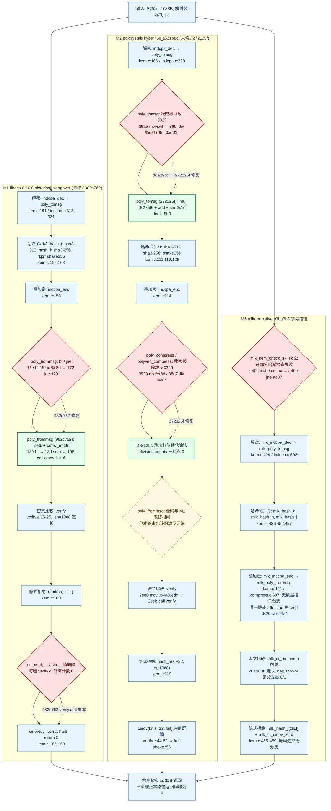

# 多泄漏模块检测平台补充报告

统一检测、定位、修复与复测的证据分层

日期：2026-10-16

摘要：真实历史案例与人工构造校准分列；检测、定位、修复、复测四段链逐模块给出实际状态，未运行不写成未检出。M2–M5 的锁频家族统计、Mona 对 M2 对照、RTLF 族外交叉（42/42）与 M2 除法热点微基准层均已回填，报告内已无 «待主控数据»；结构性未做的检查写“未执行”。本轮新增两块：R03 格式破损 / 截断族的族外对照（3 臂 × 3 种子、18/18 restore_match=yes；破损类对 9/9 CI 含 0，截断路径 23.1–23.4 ns 属公开长度检查的接口语义；族外 dudect 在 M1 未修臂越过上游阈值），以及 R05 全流程六类来源排查表（3 实现 × 5 步骤 × 6 类 = 90 格：存在 5、不存在 74、不适用 10、未检查 1）。M4 只引用分臂数值（vulnerable Δ −4.089 ns、ct Δ +0.055 ns），不引用混臂的家族合并 Δ。

## 1 研究对象与证据口径

平台把编译器引入分支、秘密操作数除法、秘密访存地址和提前退出比较分开处理，并以固定参考实现作为阴性对照候选。统一接口的目的，是让不同机制接受相同的来源记录、调用窗口、数据格式与结果审查，而不是用模块数量代替安全结论。

M1 与 M2 是固定提交的真实历史路径；M3 与 M4 是人工构造校准（前者为秘密下标查表，后者为提前退出比较），其阳性只能检验检测器能否识别目标机制，不计为新的真实 CVE；M5 是固定 mlkem-native 的阴性对照候选。四条证据链分列，不互相冒充。

本报告把四种状态写全并区分：(1) 已执行且检出（含人工校准的目标机制）；(2) 已执行且未检出，必须带工具、输入范围与调用边界；(3) 未执行，一律写“未执行”或 not_run，不写成阴性或未检出；(4) 结构性未做的检查写“未执行”（如题面第 5 条中的“数据相关循环”），它不是占位符、也不是阴性。本轮 M2–M5 的锁频家族统计、Mona 对 M2 对照、RTLF 族外交叉（42/42）与 M2 除法热点微基准层都已实际执行并回填，**报告内已无 «待主控数据» 占位符**。软件资格、源与产物机制、工具定位、原始时间观察、正式统计与竞赛验收互相独立。

完整完成条件与命令合同以 [E01](../../../docs/platform/COMPLETION_REQUIREMENTS.md) 为准；M1 的旧范围保持封存身份，本报告不重做、不改写。 [E01,E02,E10]

## 2 平台架构与机制矩阵

共享层记录公开输入、源与二进制身份、全调用测量窗口、类别乱序、逐次原值、环境和恢复；统计层输出均值差与区间、参数检验族、RTLF 与在线 dudect 的独立结果；动态层使用秘密标记、可变时指令检查和反汇编；有界验证层单独记录秘密模型、入口、边界与探索完成性。

各层证据不可互相替代：静态存在除法不说明处理器已出现可测时差，工具报警次数不是采样量，功能测试通过也不表示统计阴性。下图按「真实历史案例 / 人工构造校准 / 阴性对照候选」分组并逐层显示状态，橙色格是结构性未运行（如“数据相关循环”未做专门检查）。本图是结果图，不是计划图：没有执行过的格子不预填数值。 [E03-E08,E10]

## 3 统一测量与统计方法

普通计时应覆盖声明的完整调用；输入生成、分配、日志、结果消费与 I/O 位于窗口外。热点微基准和独立夹具必须另标调用边界，不与完整解封装混合。普通长尾保留；动态检查产物与正式采集产物分开。源、未提交改动摘要、编译器、选项、ISA、时钟单位、种子、CPU 与二进制摘要共同限定结果。

正式采数前须冻结并本地提交 PLAN，写明主类对、样本预算、停止条件、复测与参数假设族。锁频任务由主控在 CPU2/CPU6 串行调度：boost 关闭、performance、约 4.30 GHz、taskset，并保存进入、采中、退出记录；退出必须实际核对 restore_match。请求频率、可见回读与真实物理恒频是不同声明。本轮 M2–M5 的 54 次控制器运行全部 restore_match=yes，放行探针 20/20 落在 4300000 ±2% 且跨度 ≤50000 kHz；这是工程控制观测，不主张逐调用物理恒频或物理误差界。 [E19]

现有 C 电池使用两组样本均值、样本方差、Welch t 与自由度；95% 区间与 p 值采用大样本正态近似（z=1.9599639845），不能称有限样本精确 Student-t。零方差、数据不足、缺工具或失败均单列状态。参数 p 按事前家族做 Holm；RTLF 固定 α=.01；dudect 最大 t、RTLF 二值结果与 Mona 结果不伪造为 p 纳入 Holm。

本轮冻结的家族口径：M2 与 M5 的家族成员为主类对 × 3 次运行 × 2 版；M3 与 M4 的家族成员为臂内主类对 × 3 次运行 × 2 臂 = m=6，跨臂 on/off 对比只作受控对照（含二进制级常数偏移），不进 Holm 家族；RTLF（α=.01、seed 2026101605、bootstrap 10000，只给二值结论）与 online dudect 一律族外、不进 Holm；RTLF 检验的是分布差异（含尾部与分位），Welch/CI 检验的是均值差，两者分列、互不替代。本轮 RTLF 42/42 完成、无 blocked/failed：no_difference_detected 30 项、difference_detected 12 项。M4 与其 Welch/Holm 方向一致（vulnerable 主类对与截断对照各 3/3 检出、ct 各 3/3 未检出），是两种方法在同一批数据上的独立印证；M2 主类对 6/6 检出，但**未修与已修两个臂都检出**，因此不可归因于除法变体，与 Welch/Holm 拒绝 0 的差异最一致的读法是类构造（message-zero 与 message-ones 各自是同一份确定性密文的 10000 次重复，而 bit-flipped 与 random 逐样本变化）加上未受控漂移，**不据此作任一方向的泄漏结论**；M3 12/12、M5 6/6 未检出。家族实际运行结果：M2 m=6 拒绝 0（合并 Δ +4.58 ns，CI [−3.08, +12.25]，I²=58.3%）；M3 m=6 拒绝 0（−0.73 ns，[−5.56, +4.10]，I²=12.5%）；M4 m=6 拒绝 3 且全在 vulnerable 臂；M5 m=3 拒绝 0（−5.30 ns，[−11.77, +1.16]，I²=0%）。**M4 的家族窗口把泄漏臂与不泄漏臂混在一起（I²=98.6%），因此本报告只引用分臂数值：vulnerable 臂 Δ −4.089 ns、95% CI [−4.215, −3.963]；ct 臂 Δ +0.055 ns、95% CI [−0.363, +0.473]；家族窗口的合并 Δ 不在正文、表或图中出现。** [E01,E08,E19,E20]

## 4 检测—定位—修复—复测：四段链状态

检测段回答“不同类别的执行时间是否可区分”，必须给样本预算、描述统计、区间与检验族；定位段回答“差异对应源码或产物中的哪个机制”，必须给工具、命中位置与实际调用边界；修复段优先使用上游官方修复，人工校准使用明确标注的目标机制开关，并先核对功能等价与拒绝语义；复测段在同规程下独立再运行，比较修复或关闭前后的同向性与稳定性。

四段不能互相顶替：定位阳性不能填统计格，统计未运行不能写阴性，官方修复存在也不等于本机统计已复现。下表逐模块给出四段链的实际状态；M1 为已封存原件的引用，本轮不重做。

**表 T1　检测—定位—修复—复测：五模块四段链状态**

| 模块 / 案例类别 | (1) 检测（输入与统计） | (2) 定位（工具与产物） | (3) 修复 / 关闭 | (4) 复测 | 证据 |
|---|---|---|---|---|---|
| M1 编译器消息位分支 / 真实历史案例 | 已执行：10000 值/类 × 3 次独立运行；Welch 95% 正态近似 CI、Holm 家族 m=6、RTLF α=.01、dudect t&gt;10 | 已执行：Valgrind 标记 indcpa 私钥前 1152 B，未修在 poly_frommsg（poly.c:179）报 1 个秘密条件跳转；反汇编 bt+jae；已修 0 个 | 官方修复 982c762：重链为 setb + cmov_int16；旧封存结论不改写 | 已执行：基准 31337@CPU2、换种子 424242@CPU2、换物理核 31337@CPU6 各一次，方向一致 | [E02] [E17] [E18] |
| M2 秘密操作数除法 / 真实历史案例 | 已执行：3 次运行（31337@CPU2、424242@CPU2、31337@CPU6）× 2 臂 × 每类 10000 次、预热 100 在窗口外；家族 m2_end_to_end_full_decaps_v1 m=6，Holm 拒绝 0；合并 Δ +4.58 ns，95% CI [−3.08, +12.25]（含 0），I²=58.3% | 已执行（阳性）：未修 poly_tomsg、polyvec_compress、poly_compress 各 1 个目标 div、已修各 0；热点探针 varlat=yes 1280 errors/3 contexts 对已修 0/0，varlat=no 两版 0/0 | 完整已修 272125f（非中间 dda29cc）：目标 div 与对应报警消失；历史 Kyber768 不冒称 FIPS 203 | 已执行：r1/r2/r3 三次独立运行，18 次控制器运行 restore_match=yes；分层结论：定位层阳性 / 除法热点微基准层未检出（家族 m=6，Holm 拒绝 0，Δ +0.044 ns、CI 含 0）/ 完整解封装层未检出；按臂描述性未修 +12.35、已修 −11.20 方向相反＝臂间漂移 | [E03] [E04] [E13] [E19] [E20] |
| M3 秘密下标访存 / 人工构造校准 | 已执行：3 次运行 × 2 臂 × 每类 10000 次；家族 m3_lut_arm_end_to_end_v1（臂内主类对）m=6，Holm 拒绝 0；合并 Δ −0.73 ns，95% CI [−5.56, +4.10]（含 0），I²=12.5% | 已执行：挂载后 Memcheck 开臂 1280 errors/2 contexts（compress.c:714 / poly_frommsg）对关臂 0/0；Microwalk 开臂 poly_frommsg+30/+59 的 MI 1.922 bits（全场最高）对关臂 0.722 | 人工 off 关闭目标机制：秘密索引 load 报警消失；跨臂 on/off 含二进制级常数偏移，只作受控对照、不进 Holm | 已执行：r1/r2/r3 三次独立运行，12 次控制器运行 restore_match=yes；端到端未检出；按臂描述性开臂 −0.62、关臂 −0.83 | [E05] [E14] [E19] [E20] [E21] |
| M4 提前退出比较 / 人工构造校准 | 已执行：3 次运行 × 2 臂 × 每类 10000 次；家族 m4_compare_arm_session_v1（臂内主类对）m=6，Holm 拒绝 3 项且全部来自 vulnerable 臂（原始 p = 0 / 9.23e−25 / 3.14e−22），ct 臂 p = 0.386 / 0.438 / 0.399 | 已执行：Memcheck vulnerable 32 errors/1 context（compare_early.c:9）对 ct 0/0；Binsec 0.11.3 + Z3 4.15.3 给 insecure（反例 0x8049047）对 bounded secure，pending/cut/unknown 全 0，另有 -sse-depth 5 得到 unknown 的截断对照 | 人工 ct 归约关闭目标机制（定位层与有界层）；两版只返回相等性 | 已执行：r1/r2/r3 三次运行，18 次控制器运行 restore_match=yes；按臂描述性 vulnerable −4.089 [−4.215, −3.963]、ct +0.055 [−0.363, +0.473]；族外截断对照（--compare-bytes 16）p = 6.25e−202 / 0.00563 / 4.44e−177，边界不同、不进 Holm | [E06] [E16] [E19] [E20] [E22] [E23] |
| M5 mlkem-native 参考 / 阴性对照候选 | 已执行：3 次运行 × 1 臂 × 每类 10000 次；家族 m5_reference_end_to_end_v1 m=3，Holm 拒绝 0；合并 Δ −5.30 ns，95% CI [−11.77, +1.16]（含 0），I²=0% | 已执行且未检出：PKE 秘密 1152 B 与拒绝种子 z 32 B 明确标记，发行版 Memcheck、varlat=no、varlat=yes 三模式各 10 次完整调用 0 errors/0 contexts | 不适用：参考实现没有可关闭的目标机制；不写成“已防护” | 已执行：r1/r2/r3 三次运行，6 次控制器运行 restore_match=yes；族外 dudect max|t| = 2.10 / 1.98 / 2.82，state=1（预算内无证据）；阴性只限本预算，不证明恒时 | [E07] [E15] [E19] [E20] |

注：四段链的顺序是检测 → 定位 → 修复/关闭 → 复测；复测一律指同规程的独立再运行。M1 的四段均为已封存原件的引用，本轮不重做也不改写。M2 的端到端未检出与定位层阳性分层记录，不互相冒充。 [E01]

## 5 题面第 3 条对照：输入分类与测试

题面第 3 条要求至少两类具有明确区别的解封装输入、足够次数的重复实验并记录解封装时间，且不应只比较长度明显不同、路径完全不同的数据。平台的做法是：合法密文之间只改解密消息位（message-zero 与 message-ones，同为等长合法密文），异常输入使用同长度的位翻转、随机与验证失败密文；长度类拒绝在封装层先检查，不计入内核类别样本。

重复次数与时间记录按模块分列：M1 已完成每类 10000 值 × 3 次独立运行；M2–M5 本轮同样完成每类 10000 次、预热 100（窗口外）与 r1/r2/r3 三次独立运行（换种子、换物理核），共 54 次控制器运行全部 restore_match=yes。定位层的 10 次完整标记调用（M3/M5）是有限动态检查，不作为统计样本。此外，R03 另做了一组**族外**的异常输入对照（长度正确的破损密文与长度不足的截断密文对合法密文，3 臂 × 3 种子、每类 10000 次、18/18 restore_match=yes），用来回答「异常输入会不会引出额外的可区分路径」；它不进 Holm、不改任何既有判定，详见第 8 节。 [E19,E28]

**表 T2　题面第 3 条（输入分类与测试）逐项对照**

| 题面要求要点 | 平台实际做法 | 状态 | 证据 |
|---|---|---|---|
| 至少两类具有明确区别的解封装输入 | M1/M2 主类对为 message-zero 与 message-ones：同为合法、同长度密文，只在解密消息位上不同；M2 另有 malformed-zero-tail 与 malformed-ff-tail 对照类对（族外）。M3 同主类对并分 on/off 两臂；M4 为等长 32 字节的 mismatch-first 与 mismatch-last（输出同为不相等），另有 --compare-bytes 16 截断对照；M5 为 message-zero 与 message-ones，另有 bit-flipped 与 random 对照 | M1–M5 均已执行 | [E02] [E13] [E14] [E16] [E15] [E19] |
| 不比较明显长度不同、路径完全不同的数据 | 长度与空指针在封装层先检查，错误长度不进内核类别样本；M3 指出 measure 的密文长度在 API 层固定为 1088 字节、接口层无法表达“截断”，因此对照条件取内容被破坏或随机的密文且一律族外；M4 两类输入的公开长度都为 32 字节并复制到同一工作数组 | 已执行（功能与设计层） | [E13] [E14] [E16] |
| 各类输入足够次数的重复实验 | 五个模块统一为每类 10000 次、预热 100（窗口外），并各做 r1（31337@CPU2）、r2（424242@CPU2）、r3（31337@CPU6）三次独立运行；家族成员数分别为 M2 m=6、M3 m=6、M4 m=6、M5 m=3；定位层的 10 次完整标记调用（M3/M5）是有限动态检查，不作统计样本 | 已执行：54 次控制器运行全部 restore_match=yes | [E19] [E20] |
| 记录解封装执行时间 | 统一 measure 长表 run_id、implementation、input_category、sample_index、elapsed_nanoseconds、time_unit；单位 ns，时钟 CLOCK_MONOTONIC，窗口外生成输入、预热与结果消费；原始 CSV 全量保留（含普通长尾），以 .csv.gz 原字节存放并记录 SHA-256 | 已执行（M1 为封存原件、M2–M5 本轮实际采集） | [E17] [E19] [E20] |
| 异常与失败输入的覆盖 | M2：64 例真实隐式拒绝、跨版 160 类例等价、空指针/0/短/长/SIZE_MAX 长度、系统随机源失败清零；另有 malformed 尾部对（族外对照）；M5：5 接受与 5 隐式拒绝；M4：空指针/真实短数组/零长度在调用内核前拒绝 | 已执行（功能与拒绝语义层），族外对照见 T4 末段 | [E13] [E15] [E16] |

注：“输入类别”是统计单位；定位层的有限调用不是样本量，两者在本报告中始终分列。 [E01]

## 6 题面第 4 条对照：侧信道统计检测

题面第 4 条要求用统计方法判断不同输入类别是否存在显著可区分性，可使用均值、方差、分位数、置信区间与适当的统计检验，且不能仅凭少量样本或单次测试结论。平台实现分三层：描述统计（均值、标准差、分位数）、参数推断（Welch 均值差与 95% 正态近似区间、Holm 逐步校正）与族外交叉（RTLF α=.01、在线 dudect、Mona 统计对照）。

M1 三层均已执行，并在换种子、换物理核两次独立复测上复现；M2–M5 本轮完成参数层（Welch 95% 正态近似区间与 Holm）与族外 dudect：M2/M3/M5 未拒绝、M4 在 vulnerable 臂拒绝 3 项。工具自身的合成正负校准只证明软件接口，不填充密码实现的结果。 [E20]

**表 T3　题面第 4 条（侧信道统计检测）逐项对照**

| 题面要求要点 | 平台实际做法 | 状态 | 证据 |
|---|---|---|---|
| 均值、方差、分位数等描述统计 | 每个数据集输出各类均值、样本方差/标准差与分位数；家族另给合并效应 Δ、I² 与按臂描述性合并；M1：各类均值、中位数、标准差与十分位全部输出 | 已执行（M1 与 M2–M5） | [E02] [E17] [E08] [E20] |
| 置信区间 | 两组样本均值差 Δ、Welch 标准误与 95% 区间；实现为大样本正态近似（z=1.9599639845），不称有限样本精确 Student-t。M2 +4.58 [−3.08, +12.25]；M3 −0.73 [−5.56, +4.10]；M4 按臂分列：vulnerable −4.089 [−4.215, −3.963]、ct +0.055 [−0.363, +0.473]（家族窗口把两臂混在一起、I²=98.6%，故不引用合并 Δ）；M5 −5.30 [−11.77, +1.16] | 已执行 | [E08] [E20] |
| 适当的统计检验与多重比较校正 | Welch t 与自由度，参数族按事前清单做 Holm–Bonferroni 逐步校正（全族 α=0.05）：M2 m=6 拒绝 0；M3 m=6 拒绝 0；M4 m=6 拒绝 3（全在 vulnerable 臂：p = 0 / 9.23e−25 / 3.14e−22）；M5 m=3 拒绝 0 | 已执行；成员表与阈值见 members.csv 与 holm.csv | [E20] |
| 多方法交叉印证（族外） | online dudect：M2 未修 max|t| 4.68/3.05/3.66（无证据）、已修 36.27/30.94/61.91（leakage_found，不可归因于除法变体）；M3 on/off 1.93/2.24、3.41/3.37、2.81/3.03 均 state=1；M4 vulnerable 356.6/396.9/395.6（leakage_found）、ct 2.06/1.90/2.27（无证据）；M5 2.10/1.98/2.82（state=1）。dudect 最大 t 不转伪 p、不进 Holm | 已执行（族外交叉）：RTLF α=.01、seed 2026101605、42/42 完成——no_difference_detected 30 项、difference_detected 12 项；M4 与 Welch/Holm 方向一致（vulnerable 含截断 6/6 检出、ct 6/6 未检出）；M2 主类对 6/6 检出但两个臂都检出、对照 6/6 未检出；M3 12/12、M5 6/6 未检出 | [E19] [E20] |
| 不能仅凭少量样本或单次测试结论 | 每个模块三次独立运行（换种子、换物理核），家族判定基于全部成员；普通长尾不删、不追加样本直到显著；M4 的 98.6% I² 与 M2 的臂间漂移都原样报告，不挑一致结果 | 已执行：54 次控制器运行 restore_match=yes | [E19] [E20] |
| 多重比较的家族口径（主控冻结） | M2/M5：家族成员 = 主类对 × 3 次运行 × 2 版（M5 单臂，故 m=3）；M3/M4：家族成员 = 臂内主类对 × 3 次运行 × 2 臂 = m=6，跨臂 on/off 与 --compare-bytes 截断对照只作受控对照（含二进制级常数偏移或不同调用边界），不进 Holm；RTLF（α=.01）与在线 dudect 一律族外 | 口径已冻结并按此执行 | [E01] [E08] [E19] [E20] |
| 不用工具安装、软件资格或定位结果替代统计，也不把未检出读成恒时 | M2 定位阳性但端到端未检出；M5 工具与 dudect 均无证据但只限本预算；M3/M4 的定位与统计分层记录；“CI 含 0 且 Holm 不拒绝”一律写未检出，不写恒时或等价 | 已执行（口径与文档层） | [E01] [E13] [E20] |

注：四个家族各自独立判定；M4 的三项拒绝只针对人工提前退出夹具，不外推到真实密码库。M4 的效应量只按臂引用（vulnerable −4.089 ns / ct +0.055 ns）。RTLF、Mona、R03 族外对照均已回填并单列。 [E01]

## 7 题面第 5 条对照：六类泄漏来源 × 解封装步骤

题面第 5 条列举六类泄漏来源——敏感条件分支、提前返回、可变时间比较函数、数据相关循环、数据相关内存访问、失败路径及异常处理——并要求说明其与 ML-KEM 解封装流程的对应关系。下表按四个步骤逐格给出“查了什么工具或方法、结果如何”：解密（indcpa_dec 与 poly_tomsg 消息解码）、重加密（indcpa_enc）、比较（verify ct 与 ct'）、隐式拒绝（J(z‖ct) 与统一错误路径）。

表格只写已有证据：M1 为真实历史案例，已有 Valgrind、反汇编与三次独立统计；M2 为真实历史案例，静态除法差异与热点探针 varlat 已执行且为阳性，完整调用端到端统计已执行但未检出（Holm 拒绝 0，CI 含 0）；M3 与 M4 的阳性全部为人工构造校准；M5 的 0 errors/0 contexts 只覆盖固定源码、编译器与有限输入。没有证据的格子写“未执行”。KyberSlash 的秘密操作数除法不属于题面六类，单独列在末行以免与“可变时间比较函数”混淆。本表按四个步骤展开；R05 的 90 格排查表（3 实现 × 5 步骤 × 6 类）是同一批证据的逐格版本，见第 9 节。 [E30]

**表 T4　题面第 5 条（泄露定位）：六类泄漏来源 × ML-KEM 解封装四个步骤**

| 泄漏来源 | 解密（indcpa_dec / poly_tomsg） | 重加密（indcpa_enc） | 比较（verify ct == ct'） | 隐式拒绝（J(z‖ct) 与统一错误路径） |
|---|---|---|---|---|
| 敏感条件分支 | M5 秘密标记 Memcheck 与 varlat=no/yes 覆盖完整 mlkem_decapsulate（PKE 秘密 1152 B），10 次调用 0 errors/0 contexts → 有限输入内未检出；M1/M2/M3/M4 未对该步单独执行 | M1 真实案例已执行：未修在 poly_frommsg（poly.c:179）报 1 个秘密条件跳转，官方 982c762 后 0 个；反汇编 bt+jae → setb+cmov_int16。M5 同段有限输入 0/0 | M4 人工校准已执行两层：Memcheck 提前退出 32 errors/1 context（compare_early.c:9）对 ct 0/0；锁频家族 vulnerable 臂 Holm 拒绝 3 项（p = 0/9.23e−25/3.14e−22）、ct 臂不拒绝，dudect vulnerable 356.6/396.9/395.6 对 ct 2.06/1.90/2.27；M5 同段有限输入 0/0 | 功能与产物层已执行：M2/M5 保留原拒绝 KDF 与统一返回路径，M5 对 z 标记后 10 次调用 0/0；M2 的 malformed 尾部对照类对为族外统计 |
| 提前返回 | 未执行：没有针对该步的专门检查。相邻证据是 M5 全链秘密标记 0/0（工具不区分提前返回与普通分支） | 未执行：没有针对该步的专门检查。相邻证据是 M1 定位结论（未修只在消息编码处出现目标分支）与 M5 全链 0/0 | M4 人工校准已执行：Binsec 对抽取内核给 insecure（反例 0x8049047 即 compare_early.c:9 的提前返回分支）对 bounded secure，-sse-depth 5 截断得 unknown；锁频 vulnerable 臂 Holm 拒绝 3 项、ct 臂 0 项 | 未执行（时间层专门检查）：M2 在正确长度无效密文上返回 0 并生成原版拒绝秘密（功能层已验），malformed 尾部对为族外对照 |
| 可变时间比较函数 | 未执行：该步不含比较函数；M2 在该步定位到的是秘密操作数除法（见末行补充） | 未执行：该步不含比较函数；M2 在该步定位到的是压缩函数中的秘密操作数除法（见末行补充） | M4 已执行三层：Memcheck 32/1 对 0/0；Binsec insecure 对 bounded secure（i386 -O1、公开长度 1–16，halt 32/32 对 16/16，pending/cut/unknown 全 0）；锁频家族 vulnerable 臂原始 p = 0/9.23e−25/3.14e−22 对 ct 0.386/0.438/0.399。两版只返回相等性，不宣称标准 memcmp 排序语义 | 未执行：拒绝路径不做比较；相邻证据为 M5 对 z 的标记与 0/0（有限输入） |
| 数据相关循环 | 未执行：没有把循环次数作为对象的检查；M5 的秘密标记 0/0 不区分循环边界与条件分支 | 未执行：没有针对重加密循环次数的检查或轨迹差分结果 | 未执行：M4 的 Binsec 有界模型记录总路径 32/32 与 16/16 全部到达 halt，但长度固定 1–16，未把循环次数列为泄漏对象 | 未执行：拒绝 KDF 的循环次数没有单独检查 |
| 数据相关内存访问 | M5 已执行（有限输入）：秘密标记 Memcheck 与 varlat=no/yes 在 10 次完整调用上 0 errors/0 contexts，未检出秘密相关访存；M3 的人工 LUT 不落在该步 | M3 人工校准已执行：挂载到真实完整解封装重加密路径后 Memcheck 开臂 1280 errors/2 contexts（均落在 compress.c:714 的秘密下标 load），关臂与两个 defined 对照 0/0；Microwalk 源码自建在开臂把 poly_frommsg+30/+59 的 MI 报到 1.922 bits（全场最高），关臂同函数 0.722 bits；锁频端到端家族 Holm 拒绝 0（Δ −0.73 ns，CI 含 0） | 未执行：该步按公开长度顺序读取，没有秘密索引对象；M4 Memcheck 命中是条件跳转而非访存 | M5 已执行（有限输入）：拒绝种子 z 32 B 明确标记，SHAKE 拒绝 KDF 10 次完整调用 0 errors/0 contexts |
| 失败路径与异常处理 | 功能层已执行：M2 封装层先检查长度/空指针，正确长度无效密文继续走原解密与隐式拒绝；M5 全链有限输入 0/0。族外统计：M2 malformed 尾部对照类对六项 p = 0.785/0.604/0.605/0.710/0.615/0.230，无一致方向 | 功能层已执行：M2 重加密/验证/拒绝路径保留原实现，跨版 160 类例等价；M5 同链 0/0（有限输入）。族外统计同左：malformed 尾部对照未显示一致方向 | 功能层已执行：比较失败进入统一隐式拒绝，不返回内部验证结果；M4 在调用内核前拒绝空指针、真实短数组与零长度，错误不改输出。族外统计：M3 对照类对六项 p = 0.462/0.687/0.587/0.735/0.684/0.162，M5 对照 p = 0.020/0.475/0.240，均无一致方向 | 功能层已执行：M2 的 64 例真实隐式拒绝逐字段校验、拒绝秘密 J(z‖ct) 未改；M5 为 5 接受与 5 隐式拒绝。族外统计：M2 malformed 尾部对六项 p 0.230–0.785，Holm 家族不含该对照 |
| 补充（题面六类未单列）：秘密操作数可变时指令（整数除法，KyberSlash） | M2 真实历史案例已执行：poly_tomsg（indcpa.c:328，解密段）在 Clang18 -Oz 未修含 1 个目标 div、已修 0 个；热点探针 varlat=yes 1280/3 对 0/0，varlat=no 两版 0/0。端到端家族（m=6）Holm 拒绝 0，Δ +4.58 ns、CI 含 0＝未检出；触发后另跑只包该热点的微基准家族（m=6）同样拒绝 0，Δ +0.044 ns、CI 含 0 | M2 真实历史案例已执行：polyvec_compress 与 poly_compress（indcpa.c:91–92）未修各 1 个目标 div、已修各 0；归因由同 ELF 源码、反汇编、数据流与 varlat 开关对照共同支持，不表示本机已出现可测物理时差。端到端 dudect 阳性反而出现在已修臂，不可归因于除法变体 | 不适用：比较路径没有除法热点；M5 参考实现（含比较段）在 varlat=yes/no 下 0/0 | 未执行：拒绝 KDF 没有单独的 varlat 探针；相邻证据为 M5 全链 varlat=yes/no 0/0（有限输入）与 M2 malformed 尾部族外对照 |

注：六类是题面第 5 条原文列举的来源；末行为本项目实际定位到、但题面未单列的机制，单独成行以免与“可变时间比较函数”混淆。M3/M4 全部为人工构造校准，不是真实 CVE；M1/M2 为固定历史真实路径。M2 按三层记录：定位层阳性、除法热点微基准层未检出、完整解封装层未检出。族外 RTLF 的二值结论与 Welch/Holm 分列，不改变家族判定。 [E01]

## 8 题面第 3 条补充：R03 格式破损 / 截断族的族外对照

本节的对照对象是「长度正确但内容破损」与「长度不足」两类异常输入，与主检验的 message-zero / message-ones 不同：三臂（M1 未修 liboqs 0.10.0、M1 加官方修复 982c762、M5 mlkem-native b3ba7b3）× 三个种子（31337、424242、7），每类 10000 次、预热 100 在窗口外；三个输入类是 valid（一份固定合法 ML-KEM-768 密文 1088 B）、malformed（同一份密文 u 字段前 960 B 置 0xFF、v 字段后 128 B 置 0x00，长度仍为 1088）与 truncated（同一份密文只喂 1087 B）。采集由唯一锁频控制器串行调度（boost=0、governor/EPP=performance、min=max=4300000 kHz、taskset -c 2|6）：3 臂 × 3 种子 = 9 次 measure + 9 次族外 online dudect = 18 次控制器运行，**18/18 restore_match=yes**、worker_exit_code=0、放行探针全部在 ±2% 带内。证据路径：docs/evidence/r03-malformed-20261016/ 下的 PLAN.md、RESULT.md、R03/<run>/ 与 logs/status.log。 [E28,E29,E31]

**对照 A（valid − malformed）**：9 个 Δ 全部落在 +9.8 ～ −3.2 ns 之间，**9/9 的 95% 正态近似 CI 含 0，9/9 的原始 p ≥ 0.28（最大 0.9552）**，方向在两臂之间来回摆动（未修臂 +7.9/+1.6/−3.2，已修臂 +4.7/+9.8/+0.5）。这与「隐式拒绝路径按设计就走完整重加密，破损密文与合法密文耗时一致」的预期相符：**未检出额外的可区分路径**。这**不是恒时证明**，只覆盖本机、本编译产物、本样本预算。 [E28]

**对照 B（valid − truncated）**：截断路径在三臂上的实测均值是 **23.1–23.4 ns**，比完整解封装低约 3 个数量级；Δ ≈ 29.3 µs（M5）/ ≈ 55.1 µs（M1）。这里的原始 p 是双精度下溢后原样打印的 `0`，**是下溢，不得当作精确零**；差异本身已由 CI 说明（例如 M5 的 [29335.1, 29347.7] ns）。该耗时**与臂无关**，说明它在进入 KEM 之前就命中了封装层的**公开长度检查**——长度是公开输入，按固定路径常数时间拒绝本来就是正确行为，**这是接口语义，不是秘密相关泄漏**。 [E28]

**族外 online dudect**（该入口自带的 message-zero vs message-ones 类对，因为 dudect 需要两个都能跑完的类）：M1 未修臂三次末批 max|t| = **10.78 / 11.43 / 12.02**（越过上游 >10 阈值），M1 已修臂 = 1.12 / 2.05 / 2.01，M5 = 1.35 / 1.52 / 2.00（均未越过）。它与 M1 既有定位结论（未修产物上 `poly_frommsg` 的消息位分支存在、982c762 后消失）**同向**，只作族外印证；**最大 t 不转伪 p、不进 Holm**。 [E28]

**为什么不进主检验**（设计性理由，不是数据性理由）：(1) FIPS 203 §7.3 的隐式拒绝本来就不论密文是否合法都走完整 `Dec → Re-Enc → 常数时间比较 → J(z‖c)` 路径，所以「破损密文是否引出额外的可区分路径」本该由主类对回答，不需要一个长度维度去触发；(2) 该对照能回答的问题更小、更弱——它只需要证明「同样的调用序列、同样的路径集合被走到」，这是定性结论，不需要 p 值，写进主家族反而会被误读成时序恒时的证据；(3) 破损输入会改变输入生成本身的代价分布，与本仓库「输入生成在窗口外」的可加性模型不兼容；(4) 即使破损类对出现可区分，也无法区分「破损处理逻辑本身有时间差」与机器漂移，要定位仍须回到题面第 5 条的逐格排查。**因此本节只给原始 p、Δ 与 95% CI，不做 Holm、不做任何多重比较校正，不改变 efca8a1 冻结的家族口径，也不改变 M1/M5 的任何既有判定。** [E28,E30]

**边界**：输入是人工构造的，这不是上游 CVE；「未检出」只说明在该机、该编译产物、该类对、该样本预算下没有额外的可区分路径，**不构成恒时证明**，也不给出总体误报率。本项目不做密钥恢复，不运行 exploit demo。 [E28]

**表 T7　R03 对照 A：valid − malformed（族外，不做 Holm）**

| 臂 | 种子 | Δ（ns） | 95% 正态近似 CI（ns） | 原始 p | n0/n1 |
|---|---|---|---|---|---|
| M1 未修 liboqs 0.10.0 | 31337 | +7.9 | [−6.6, +22.3] | 0.2849 | 10000/10000 |
| M1 未修 liboqs 0.10.0 | 424242 | +1.6 | [−8.5, +11.6] | 0.7591 | 10000/10000 |
| M1 未修 liboqs 0.10.0 | 7 | −3.2 | [−17.6, +11.1] | 0.6581 | 10000/10000 |
| M1 + 982c762 | 31337 | +4.7 | [−12.9, +22.2] | 0.6043 | 10000/10000 |
| M1 + 982c762 | 424242 | +9.8 | [−8.5, +28.1] | 0.2934 | 10000/10000 |
| M1 + 982c762 | 7 | +0.5 | [−15.9, +16.9] | 0.9552 | 10000/10000 |
| M5 mlkem-native b3ba7b3 | 31337 | −2.2 | [−11.0, +6.5] | 0.6153 | 10000/10000 |
| M5 mlkem-native b3ba7b3 | 424242 | −1.2 | [−12.1, +9.7] | 0.8280 | 10000/10000 |
| M5 mlkem-native b3ba7b3 | 7 | −2.6 | [−9.5, +4.3] | 0.4648 | 10000/10000 |

注：malformed 是长度正确（1088 B）但 u 字段前 960 B 置 0xFF、v 字段后 128 B 置 0x00 的密文，按设计走完整重加密与隐式拒绝。9/9 的 CI 含 0、9/9 原始 p ≥ 0.28（最大 0.9552），方向在两臂间摆动＝未检出额外的可区分路径。族外描述性对照：不做 Holm、不做任何多重比较校正、不进任何家族，也不改变 efca8a1 与 M1/M5 既有判定。原始值、逐类输入摘要与零值行数见 docs/evidence/r03-malformed-20261016/R03/&lt;run&gt;/ 与 logs/status.log。 [E01]

**表 T8　R03 对照 B：valid − truncated（族外，不做 Holm）**

| 臂 | 种子 | Δ（ns） | 95% CI（ns） | 原始 p | truncated 均值（ns） |
|---|---|---|---|---|---|
| M1 未修 liboqs 0.10.0 | 31337 | +55437.8 | [55427.9, 55447.8] | 下溢为 0 | 23.2 |
| M1 未修 liboqs 0.10.0 | 424242 | +55232.5 | [55225.3, 55239.6] | 下溢为 0 | 23.2 |
| M1 未修 liboqs 0.10.0 | 7 | +55100.7 | [55089.8, 55111.7] | 下溢为 0 | 23.2 |
| M1 + 982c762 | 31337 | +54767.8 | [54754.4, 54781.2] | 下溢为 0 | 23.2 |
| M1 + 982c762 | 424242 | +55117.1 | [55102.5, 55131.7] | 下溢为 0 | 23.4 |
| M1 + 982c762 | 7 | +54947.7 | [54936.3, 54959.1] | 下溢为 0 | 23.1 |
| M5 mlkem-native b3ba7b3 | 31337 | +29341.4 | [29335.1, 29347.7] | 下溢为 0 | 23.2 |
| M5 mlkem-native b3ba7b3 | 424242 | +29294.1 | [29286.0, 29302.1] | 下溢为 0 | 23.3 |
| M5 mlkem-native b3ba7b3 | 7 | +29321.8 | [29317.0, 29326.7] | 下溢为 0 | 23.2 |

注：truncated 只喂 1087 字节，耗时与臂无关（23.1–23.4 ns），说明它在进入 KEM 之前就命中封装层的公开长度检查——这是接口语义，不是秘密相关泄漏。原始 p 是双精度下溢后原样打印的 0，不得解释为“精确零”；差异本身由 CI 说明（例如 M5 的 [29335.1, 29347.7] ns）。Δ ≈ 29.3 µs（M5）/ ≈ 55.1 µs（M1）。同样不进 Holm。 [E01]

**表 T9　R03 族外 online dudect（入口自带的 message-zero vs message-ones 类对）**

| 臂 | 种子 | 末批 max |t| | 状态 | 解释 |
|---|---|---|---|---|
| M1 未修 liboqs 0.10.0 | 31337 | 10.78 | 0 | 越过上游 t&gt;10 阈值 |
| M1 未修 liboqs 0.10.0 | 424242 | 11.43 | 0 | 同上 |
| M1 未修 liboqs 0.10.0 | 7 | 12.02 | 0 | 同上 |
| M1 + 982c762 | 31337 | 1.12 | 1 | 预算内无证据 |
| M1 + 982c762 | 424242 | 2.05 | 1 | 预算内无证据 |
| M1 + 982c762 | 7 | 2.01 | 1 | 预算内无证据 |
| M5 mlkem-native b3ba7b3 | 31337 | 1.35 | 1 | 预算内无证据 |
| M5 mlkem-native b3ba7b3 | 424242 | 1.52 | 1 | 预算内无证据 |
| M5 mlkem-native b3ba7b3 | 7 | 2.00 | 1 | 预算内无证据 |

注：dudect 需要两个都能跑完的类，因此它测的不是 malformed/truncated 类对，而是该入口自带的 message-zero vs message-ones；valid vs truncated 的三个数量级差已由 Welch 给出，不需要也不适合用 dudect 复核。M1 未修臂三次都越过阈值、已修臂三次都在 2.05 以下，与既有定位结论同向，只作族外印证：最大 t 不转伪 p、不进 Holm。 [E01]

## 9 题面第 5 条补充：R05 全流程六类来源排查表（90 格）

题面第 5 条除要求说明六类来源与解封装流程的对应关系外，还要逐格给出「查了什么、结果如何」。R05 排查表把对象定为 3 个实现（M1 liboqs 0.10.0 未修 / 982c762 已修、M2 pq-crystals kyber768 a621b8d / 272125f、M5 mlkem-native b3ba7b3 参考）× 5 个步骤（解密、哈希 G/H/J、重加密、密文比较、隐式拒绝 / cmov）× 6 类来源（提前返回、可变时间比较、数据相关循环、数据相关访存、失败路径、异常处理）＝ **90 格**；每格只写三件事：结论（存在 / 不存在 / 不适用 / 未检查）、证据（函数名 + 反汇编地址或行号，或工具输出路径）、修复点（上游提交或本项目补丁，没有就写“无”）。**阴性的含义被收窄为**：在下列固定源码、固定编译器与选项、固定产物上，已查工具没有报出该类来源；它不覆盖任意输入、任意编译器或微架构，**不是物理恒时、不是总体误报率、不是密钥恢复**。人工构造的夹具一律标注“人工构造校准”，不当作真实历史实现。 [E30]

**90 格汇总：存在 5、不存在 74、不适用 10、未检查 1**（每格只计一次，计数由该文件正文 15 张表逐行程序化统计得到）。5 个「存在」格的归属是 M1 两个、M2 两个、M5 一个；10 个「不适用」全部是异常处理 × 该函数不可能失败；**唯一的「未检查」格是 M2 重加密 × 提前返回**——该实现的 `poly_frommsg` 与 M1 未修源码逐字相同，但本轮没有对它出反汇编，**不把“源码相同”当“产物相同”**，补做方式是对同一 ELF 运行 `objdump -d --disassemble=pqcrystals_kyber768_ref_poly_frommsg`。M5 的那个「存在」格是 `mlk_kem_check_sk` 在 sk 完整性检查失败时的提前返回，**只携带公开信息、不可利用**，属上游有意的 FIPS 203 §7.3 检查而非缺陷，已如实登记。 [E30]

**修复点**：M1 的两处（重加密 / 提前返回、隐式拒绝 / 可变时间比较）由同一份官方补丁 **982c762** 覆盖（`setb` + `cmov_int16`，以及 `verify.c` 的值屏障）；M2 的两处由 **272125f** 覆盖（解密侧经中间提交 dda29cc 只修 KyberSlash1，完整修复才是 272125f）。 [E30]

**必须一并记住的边界**：(1) 本轮 M4 的 Binsec 参数 -checkct-features **只开了 control-flow 与 memory-access 两项，未开乘法 / 除法检查**（工具帮助原文为 “Multiplication and division checks are experimental”），因此**现有 Binsec 结果不能用来判定 M2 的 `div` 类来源**，M2 第 2 类的判定全部来自反汇编与 varlat；(2) M1 隐式拒绝 × 可变时间比较是「机制存在、未在本产物上观测到分支」，证据是钉版 `cmov` 缺值屏障且 982c762 恰好补了它，不是在 M1 产物上看到了跳转；(3) M1 隐式拒绝 × 失败路径的强度弱于 M2 / M5，本轮没有出 `cmov` 调用点的反汇编；(4) M2 的除法机制只在 `-Oz` 产物成立，换优化级别会让它静默消失。这些边界都已写进该表本体。 [E30]

下图是 R05 排查表 §5 mermaid 流程图的等价静态渲染（同一份节点文字、三条主链、同一套颜色语义；虚线箭头是修复映射，边标签原样写在图注里）。**mermaid 源码原样保留在 docs/R05-全流程排查表.md §5 与本报告的离线 HTML 中**；PDF 只能承载静态图，故此处用等价渲染，不改变任何一格结论。 [E30]

**表 T10　R05 全流程排查表：90 格四类结论汇总**

| 实现 | 存在 | 不存在 | 不适用 | 未检查 | 小计 |
|---|---|---|---|---|---|
| M1 liboqs 0.10.0 未修 / 982c762 已修 | 2 | 25 | 3 | 0 | 30 |
| M2 kyber768 a621b8d / 272125f | 2 | 24 | 3 | 1 | 30 |
| M5 mlkem-native b3ba7b3 参考 | 1 | 25 | 4 | 0 | 30 |
| 合计 | 5 | 74 | 10 | 1 | 90 |

注：计数口径：总格数 = 3 实现 × 5 步骤（解密、哈希 G/H/J、重加密、密文比较、隐式拒绝 / cmov）× 6 类来源 = 90，每格只计一次，由该文件正文 15 张表逐行程序化统计得到。“不适用”10 格全部是异常处理（第 6 类）× 该函数不可能失败；“未检查”1 格是 M2 重加密 × 提前返回。 [E01]

**表 T11　R05 非「不存在」格清单：5 个「存在」+ 1 个「未检查」**

| # | 实现 / 步骤 / 类别 | 结论 | 证据（函数名 + 反汇编地址或行号） | 修复点 |
|---|---|---|---|---|
| 1 | M1 未修 / 重加密 / 1 提前返回 | 存在 | pqcrystals_ml_kem_768_ipd_ref_poly_frommsg：16e: bt %ecx,%r8d → 172: jae 179（locked-poly-frommsg-vulnerable.s 第 8–9 行）；Memcheck 报 poly_frommsg (…/poly.c:179)「Conditional jump or move depends on uninitialised value(s)」，调用栈含 indcpa_enc (indcpa.c:271)（valgrind-ct/vulnerable.log） | 官方 982c762（setb + cmov_int16）；patch-apply.txt 证明补丁覆盖 …ml-kem-768-ipd_ref/poly.c |
| 2 | M1 未修 / 隐式拒绝 / 2 可变时间比较 | 存在（机制存在、未在本产物上观测到分支） | 钉版 vendor/liboqs-0.10.0/…/verify.c 的 cmov 无 __asm__ 值屏障（计数 0），对比 vendor/kyber-kyberslash-unfixed/ref/verify.c:44-52 已带屏障；982c762 恰好一并改了该文件 | 官方 982c762（同一补丁的 verify.c 值屏障）；本轮未单独出 cmov 调用点反汇编，故不升级为“已检出泄漏” |
| 3 | M2 未修 / 解密 / 2 可变时间比较 | 存在 | poly_tomsg：3689: mov $0xd01,%r9d（= 3329）+ 36a5: movswl (%rsi,%rcx,2),%eax（秘密被除数）+ 36bf: div %r9d；varlat 报 poly_tomsg (ref/poly.c:188)，1280 errors / 3 contexts、exit 99 | dda29cc（KyberSlash1，只修此处）→ 完整已修 272125f |
| 4 | M2 未修 / 重加密 / 2 可变时间比较 | 存在 | poly_compress：34f2: mov $0xd01,%r8d + 3507: movswl (%rsi,%r9,2),%eax + 3523: div %r8d；polyvec_compress：38c7: div %r8d；varlat 另两条上下文 poly_compress (ref/poly.c:28)、polyvec_compress (ref/polyvec.c:48)；机器可读计数见 ordinary-unfixed-qualification.division-counts.txt | 官方 272125f（KyberSlash2）；已修三热点 div 计数全 0 |
| 5 | M5 参考 / 隐式拒绝 / 1 提前返回（公开信息，非可利用） | 存在（有界例外，如实登记） | 归档内 logs-v2/poison.disasm 第 9033–9036 行：a404: call 8a80 &lt;baseline_native_check_sk&gt; → a40c: test %eax,%eax → a40e: jne ad87（检查失败提前跳到清零与 ret 入口）；公开性声明见 vendor/mlkem-native/mlkem/src/kem.c:92-99 | 无：上游有意的 FIPS 203 §7.3 sk 哈希检查，不是缺陷；该差异只携带公开信息，但“sk 不可信”不在本轮 CCA 模型内 |
| 6 | M2 未修 / 已修 / 重加密 / 1 提前返回 | 未检查 | 该实现确实有对应结构：poly_frommsg 源码与 M1 未修逐字相同（vendor/kyber-kyberslash-unfixed/ref/poly.c:155-170，indcpa.c:269 调用），但本轮 native-qualification/ 与 microbench-…/disasm/ 的 .asm 清单都不含 poly_frommsg（只有 mlkem_decapsulate、dec、poly_tomsg、poly_compress、polyvec_compress）。不把“源码相同”当“产物相同”，故记未检查 | 无（272125f 的 diff 不碰 poly_frommsg）。补做方式：对同一 ELF 运行 objdump -d --disassemble=pqcrystals_kyber768_ref_poly_frommsg |

注：逐格证据与修复点原文见 docs/R05-全流程排查表.md §4.2/§4.3。边界：本轮 M4 的 Binsec -checkct-features 只开了 control-flow,memory-access，未开 multiplication/dividend/divisor（工具帮助原文 “Multiplication and division checks are experimental”），因此现有 Binsec 结果不能用来判定 M2 的 div 类来源。所有“不存在/阴性”都不是恒时证明；人工夹具不计为上游 CVE。 [E01]

## 10 M1 既有真实案例与 Mona 对照

既有 M1 针对固定 liboqs 0.10.0、Clang 18 与便携 C 路径，保留原源码、产物分支、工具、逐次数据与官方修复复测证据。本报告只引用 [E02](../../../docs/evidence/r02-r04-close-20261016/RESULT.md) 的限定结论，不修改旧 CSV、旧家族或原报告。

原 E02 表中主类对三次未修均值差为 +39.337、+31.117、+22.337 ns；对应已修为 −13.209、+8.354、−4.885 ns。Holm 家族 m=6 只拒绝未修主检验（p=1.30×10⁻⁵ 对阈值 0.00833）。这些数字是封存引用，不是本报告生成时的新采集；区间、预算、环境与原族以 [E17](../../../docs/evidence/liboqs010-locked-20261015/README.md) 与 [E02](../../../docs/evidence/r02-r04-close-20261016/RESULT.md) 为准。

工具交叉印证见 [E18](../../../docs/evidence/tooling-strengthen-20261015/RESULT.md)：Valgrind 只标记 indcpa 私钥前 1152 B 时，未修在 poly_frommsg（poly.c:179）报 1 个秘密条件跳转、已修 0 个；反汇编为 bt+jae 变为 setb 加 cmov_int16；同规程 RTLF 与在线 dudect 与 CI 方向一致。这不是端到端恒时证明。

新增 Mona 对既有六份类对的真实离线回放并未与既有检测方向一致：三份 vulnerable 均无通过验证的箱体分离；primary 与 seed-424242 的 fixed 各有一个成功记录，CPU6 fixed 未找到最优箱体。两项成功都出现在扩展后只剩一个验证子集的末轮，不能解释为受控总体误报率或上游修复失效。Mona 是族外独立观察，不替换 CI/Welch、Holm、RTLF 或 dudect。本轮新增 Mona 对 M2 六份主类对的真实执行（工具身份 mona-timing-report@4c74fb7e，离线上游内核，六份原始 CSV 跑完后 sha256 6/6 未变）：**三个未修臂在 Mona 箱体规则下都没有通过验证的箱体分离（0/9 ×3），s1/s2 的已修臂同样无分离（0/9、0/7）；只有 s3 已修臂出现一次 validated_box_separation（1/8，X<Y 箱 0.27–0.34、5120 值、子集数 1），属该自适应实现「末轮只剩 1 个子集」的已知假阳性模式**（与 M1 两项 fixed 同型）。六批最高批次成功百分比依次为 74%、18%、34%、29%、34%、100%。这**不说明两臂等价或恒时，也不推翻 Welch CI + Holm、RTLF 或 dudect 的结论**；Mona 的 `holm_member=false`，`Confidence Interval` 字段是批次成功百分比而非 p 值或覆盖区间。 [E09,E24,E25]

## 11 M2 KyberSlash：真实历史案例

历史 Kyber768 完整 keygen/encap/decap 已接通：两版普通与 ASan/UBSan 各 7/7、各 100 例官方 round3 KAT。锁频端到端家族 m2_end_to_end_full_decaps_v1（m=6）Holm 拒绝 0，合并 Δ +4.58 ns、95% CI [−3.08, +12.25]（含 0）、I²=58.3%；按臂描述性方向相反（未修 +12.35、已修 −11.20）＝臂间漂移。触发条件满足后另跑只包除法热点的微基准家族 m2_div_hotspot_microbench_v1（m=6）同样拒绝 0，合并 Δ +0.044 ns、95% CI [−0.430, +0.517]（含 0）、I²=68.7%，最显著单项 r01 未修 p=0.042 校正后 0.249。分层结论：定位层阳性（三热点各 1 个 div、varlat 1280/3 对 0/0）／除法热点微基准层未检出／完整解封装层未检出。族外 RTLF 与 dudect 都出现与家族判定不同的二值或 t 值，均按族外如实登记，不改变家族判定。

未修固定为 a621b8dde405cc507cbcfc5f794570a4f98d69cc，完整已修固定为 272125f6acc8e8b6850fd68ceb901a660ff48196；均以完整提交而非 exact tag 钉版。中间 dda29cc 只修 KyberSlash1，不能当作完整修复。对象是历史 Kyber768，不能冒称 FIPS 203 ML-KEM-768。

定位实际在 x86_64 Linux、Clang 18.1.3、-Oz 且关闭向量化的固定产物中执行：poly_tomsg（解密段）与 polyvec_compress、poly_compress（重加密段）的秘密相关操作数数据流与各自一条 div 对应。varlat 默认上下文 PC 落在系数 load，不能直接把该 PC 当成静态 div 地址；归因来自同 ELF 数据流、源码、反汇编及 varlat 开关对照。

完整 KEM 的适用独立 KAT、边界与原生产物资格见 [E13](../../../docs/evidence/m2-kem-20261016/RESULT.md)；完整调用软件合同 [E12](../../../docs/evidence/m2-kem-20261016/SOFTWARE_CONTRACT.md) 与实际结果分开。新生产 ELF 未重跑旧 varlat 探针，旧定位不倒写成新产物动态结果。完整调用的端到端统计已执行：家族 m2_end_to_end_full_decaps_v1（m=6）Holm 拒绝 0，合并 Δ +4.58 ns、95% CI [−3.08, +12.25]（含 0）、I²=58.3%，即未检出；按臂描述性方向相反（未修 +12.35、已修 −11.20）＝臂间漂移，不据此新增声明。族外 dudect 的阳性出现在已修臂，不可归因于除法变体。按冻结 PLAN，端到端未拒绝后启动了只包除法热点的微基准层：家族 m2_div_hotspot_microbench_v1（m = 3 次运行 × 2 臂 = 6）同样 Holm 拒绝 0，固定效应合并 Δ = +0.044 ns、95% CI [−0.430, +0.517]（含 0）、I²=68.7%，最显著单项 r01 未修 p=0.042 经校正后为 0.249；六个 run 全部 controller_exit=0、worker_exit_code=0、restore_match=yes。微基准窗口只包 pqcrystals_kyber768_ref_poly_tomsg，与完整解封装不可比，两族 p 值不合并。因此本模块按三层记录：**定位层阳性 / 除法热点微基准层未检出 / 完整解封装层未检出**，不改变端到端家族的 Holm 判定，也不用定位层阳性替代统计阳性。 [E03,E04,E12,E13,E19,E20]

## 12 M3 与 M4：人工机制校准

人工 LUT 挂载到真实完整 ML-KEM 解封装重加密路径：on/off 普通与 ASan/UBSan 各 6/6、64 公开种子 × 5 类字节等价。定位层开臂 Memcheck 1280 errors/2 contexts（poly_frommsg）对关臂 0/0，Microwalk 开臂 poly_frommsg+30/+59 的 MI 1.922 bits（全场最高）对关臂 0.722。锁频端到端家族 m3_lut_arm_end_to_end_v1（臂内主类对 × 3 次运行 × 2 臂 = m=6）Holm 拒绝 0，合并 Δ −0.73 ns、CI [−5.56, +4.10]、I²=12.5%；跨臂 on/off 含二进制级常数偏移，只作受控对照、不进 Holm。人工构造校准，不计为新 CVE。

M3 初始独立夹具的 32/1 对 0/0 只按原产物引用。新增完整解封装挂载以同一消息位生成真实重加密系数，on 的秘密索引 load 与 off 的公开等价读取保留同样密码输出及隐式拒绝。每代产物分别绑定资格与定位，不能把新 1280/2 与旧 32/1 混作一次运行；人工构造校准的性质不变，未构成新 CVE。 [E05,E14]

独立 32 字节 checked compare 夹具。定位层 vulnerable 报 32 errors/1 context（compare_early.c:9）对 ct 0/0；Binsec 0.11.3 + Z3 4.15.3 给 insecure（反例 0x8049047）对 bounded secure，-sse-depth 5 截断对照得 unknown。锁频端到端家族 m4_compare_arm_session_v1（臂内主类对 × 3 次运行 × 2 臂 = m=6）Holm 拒绝 3 项，全部来自 vulnerable 臂（原始 p = 0/9.23e−25/3.14e−22），ct 臂 p = 0.386/0.438/0.399；按臂描述性 vulnerable −4.089 [−4.215, −3.963]、ct +0.055 [−0.363, +0.473]。人工构造校准，不是新增 CVE。

M4 两版本只返回相等性，不提供标准 memcmp 的正负排序语义。封装先检查长度与空指针，真实短数组不传给内核；每变体以标准库 memcmp(...) 等于 0 为 oracle，枚举长度、差异位置及替换字节。poison 只包住秘密输入到目标调用，结果消费前取消标记。

新增 Binsec 只验证固定 i386 -O1 抽取内核：入口 m4_entry、终点 m4_halt，秘密数组 16 字节、候选数组与长度公开、长度 1–16；在消费允许公开的比较结果之前停止，两版所有路径均到达 halt，pending、cut、discontinued 与 solver unknown 均为零。反例 PC 0x8049047 对应 compare_early.c:9。有界 secure 不外推到 32 字节普通采集 ELF、任意长度、完整 KEM、其他编译条件或物理恒时。 [E06,E16]

## 13 M5：参考实现阴性对照候选

固定 mlkem-native 参考（提交 b3ba7b32…）原生功能资格通过：普通与 ASan/UBSan 各 7/7、独立 NIST 向量 25+25+10 与 5 隐式拒绝。定位层对 PKE 秘密与拒绝种子 z 明确标记，Memcheck、varlat=no/yes 各 10 次完整调用 0 errors/0 contexts。锁频端到端家族 m5_reference_end_to_end_v1（m=3）Holm 拒绝 0，合并 Δ −5.30 ns、CI [−11.77, +1.16]、I²=0%；族外 dudect max|t| 2.10/1.98/2.82（state=1）。族外 RTLF 对 M5 六项（主类对与对照各 3）全部 no_difference_detected；阴性只限本预算，不证明恒时。

固定 mlkem-native 提交为 b3ba7b32773e657dd37f6f87bce82528459ad8a4；完整库及许可证共 126 文件复核一致。实际调用链为 reference_measure 到 mlkem_decapsulate，再到 baseline_native_dec；普通测量链接 reference/libmlkem.a，未混入历史 liboqs 或人工补丁变体。

原生定位把 ML-KEM-768 解封装密钥的 PKE 秘密部分与拒绝秘密 z 标记为 undefined，内嵌公开 key、公开 hash 与密文保持 defined；发行版 Memcheck、固定补丁 varlat=no 与 varlat=yes 三模式下各 10 次完整调用均为 0 errors/0 contexts。这是已执行且未检出，只覆盖该源码、编译器、后端与有限输入，不构成恒时证明或总体误报率为零。

在线 dudect 入口已构建并通过不读钟 callback 与合成 raw 写出自检，本轮完成正式采集：家族 m5_reference_end_to_end_v1（m=3）Holm 拒绝 0，合并 Δ −5.30 ns、95% CI [−11.77, +1.16]（含 0）、I²=0%；族外 dudect max|t| = 2.10/1.98/2.82、state=1。这是本预算内的未检出，不是恒时证明，也不给出总体误报率为零；族外 RTLF 对 M5 六项（主类对 3 + 对照 3）全部 no_difference_detected（α=.01）；这仍只覆盖本机、本类对、本预算与该工具设置，未检出不等于恒时证明。 [E07,E15,E19,E20]

## 14 实测数值、证据对照与复算入口

下表把本报告出现的每个实测数字指向具体证据文件；M1 各行是封存引用，其余为本轮新增产物的原文数字。任何数字不能回到文件字段的，一律不写。

复算入口分两层：(1) 统计与图形由仓库内显式数据文件重建（report-data.json、report-tables.json、EVIDENCE_MATRIX.csv、r05_flowchart.py）；(2) 匿名 ZIP 解出后在独立目录重新构建并执行包内 CTest，命令与通过数记录在 docs/evidence/platform-report-20261016/refresh-20261016/zip-recompute-final4.log（本轮终版包）与 docs/evidence/platform-report-20261016/final4-20261016/offline-reproduction.json，不复用仓库本体充当复算。离线复算只重算已有数据，不算新硬件实验；外部 RTLF、Mona、dudect 与 Binsec 不在该入口重执行。

**表 T5　实测数字与证据对照（每个数字指向证据文件）**

| 数字 / 结论 | 值 | 证据（仓库相对路径） | 口径 |
|---|---|---|---|
| 采数条件（M2–M5 共用） | 控制器 sha256 4a0cf57a…（提交 a3c9ca1）；r1 31337@CPU2、r2 424242@CPU2、r3 31337@CPU6；每类 10000、预热 100；boost=0、performance、min=max=4300000 kHz、taskset | [E19](../../../docs/evidence/platform-collection-20261016/README.md) | 54 次控制器运行全部 restore_match=yes，放行探针 20/20 在 ±2% 带内 |
| M1 未修主类对均值差（三次独立运行） | +39.337 / +31.117 / +22.337 ns | [E02](../../../docs/evidence/r02-r04-close-20261016/RESULT.md) | 已封存原件引用；CI 分别不含 0 |
| M1 已修主类对均值差（三次独立运行） | −13.209 / +8.354 / −4.885 ns | [E02](../../../docs/evidence/r02-r04-close-20261016/RESULT.md) | 同上；三次 CI 均含 0 |
| M1 Holm 家族（m=6） | 未修主检验 p=1.30×10⁻⁵ 对阈值 0.00833，拒绝；其余不拒绝 | [E02](../../../docs/evidence/r02-r04-close-20261016/RESULT.md) | FWER α=.05；dudect 与 RTLF 不进家族 |
| M1 dudect 最大 t（三次） | +26.41 / +40.64 / +14.92；已修 +1.15 / +1.12 / +1.31 | [E18](../../../docs/evidence/tooling-strengthen-20261015/RESULT.md) | 上游门限 t&gt;10，rdtsc，族外 |
| M1 RTLF（α=.01） | 未修两次 significant（exit 11）；已修两次 no significant difference（exit 10） | [E18](../../../docs/evidence/tooling-strengthen-20261015/RESULT.md) | 族外交叉；bootstrap 种子事前固定 |
| M1 定位命中 | 未修 poly_frommsg 1 个秘密条件跳转对已修 0 个 | [E18](../../../docs/evidence/tooling-strengthen-20261015/RESULT.md) | Valgrind 只标记 indcpa 私钥前 1152 B |
| M2 家族 m2_end_to_end_full_decaps_v1（m=6） | 主类对原始 p = 0.223 / 0.050 / 0.159（未修）、0.261 / 0.247 / 0.064（已修）；Holm 拒绝 0；合并 Δ +4.58 ns，CI [−3.08, +12.25]，I²=58.3% | [E13](../../../docs/evidence/m2-kem-20261016/RESULT.md)、[E20](../../../docs/evidence/platform-collection-20261016/stats/holm/RESULT.md) | CI 含 0 且不拒绝＝未检出，不是恒时证明 |
| M2 按臂描述性（非独立家族） | 未修 +12.35 [2.98, 21.71]；已修 −11.20 [−24.56, 2.15] | [E19](../../../docs/evidence/platform-collection-20261016/README.md) | 方向相反＝臂间漂移，不据此新增声明 |
| M2 对照类对（族外） | malformed-zero-tail vs malformed-ff-tail：p = 0.785 / 0.604 / 0.605 / 0.710 / 0.615 / 0.230 | [E13](../../../docs/evidence/m2-kem-20261016/RESULT.md) | 无一致方向；不进 Holm |
| M2 族外 online dudect | 未修 max|t| = 4.68 / 3.05 / 3.66（无证据）；已修 36.27 / 30.94 / 61.91（leakage_found） | [E13](../../../docs/evidence/m2-kem-20261016/RESULT.md) | 阳性在已修臂，不可归因于除法变体；最大 t 不转伪 p |
| M2 定位层 | 未修 poly_tomsg / polyvec_compress / poly_compress 各 1 个 div、已修各 0；varlat 1280 errors/3 contexts 对 0/0 | [E03](../../../docs/evidence/m2-kyberslash-20261016/RESULT.md)、[E04](../../../docs/evidence/m2-kyberslash-20261016/VERSION_AUDIT.md) | 定位阳性 ≠ 端到端阳性；三层分层记录 |
| M2 除法热点微基准层（触发后实测） | 家族 m2_div_hotspot_microbench_v1，m = 3 次运行 × 2 臂 = 6；Holm 拒绝 0；固定效应合并 Δ = +0.044 ns，95% CI [−0.430, +0.517]（含 0），I²=68.7%；最显著单项 r01 未修 p=0.042 经校正后 0.249；六个 run 全部 controller_exit=0、worker_exit_code=0、restore_match=yes、放行探针 20/20 | [E27](../../../docs/evidence/m2-kem-20261016/microbench-0551254c9579/RESULT.md) | 窗口只包 pqcrystals_kyber768_ref_poly_tomsg，与完整解封装不可比、两族 p 值不合并；未检出≠恒时 |
| M3 家族 m3_lut_arm_end_to_end_v1（m=6） | 臂内主类对原始 p：开臂 0.189 / 0.268 / 0.315，关臂 0.375 / 0.458 / 0.480；Holm 拒绝 0；合并 Δ −0.73 ns，CI [−5.56, +4.10]，I²=12.5% | [E14](../../../docs/evidence/m3-completion-20261016/RESULT.md)、[E20](../../../docs/evidence/platform-collection-20261016/stats/holm/RESULT.md) | 跨臂 on/off 含二进制级常数偏移，不进 Holm |
| M3 定位层 | Memcheck 开臂 1280 errors/2 contexts 对关臂 0/0；Microwalk poly_frommsg+30/+59 MI 1.922 bits（全场最高）对关臂 0.722 | [E21](../../../docs/evidence/m3-completion-20261016/LOCATE_RESULT.md) | 人工构造校准；不是上游 CVE |
| M3 族外 online dudect | on/off max|t| = 1.93/2.24、3.41/3.37、2.81/3.03，均 state=1 | [E14](../../../docs/evidence/m3-completion-20261016/RESULT.md) | 预算内无证据；不进 Holm |
| M4 家族 m4_compare_arm_session_v1（m=6） | vulnerable 原始 p = 0 / 9.23e−25 / 3.14e−22；ct = 0.386 / 0.438 / 0.399；Holm 拒绝 3（全在 vulnerable 臂）；家族窗口 I²=98.6%（两臂异质，故不引用混臂合并 Δ） | [E16](../../../docs/evidence/m4-completion-20261016/RESULT.md)、[E20](../../../docs/evidence/platform-collection-20261016/stats/holm/RESULT.md) | 家族判定只用 Holm 拒绝数；效应量按臂读，不引用混臂合并值 |
| M4 分臂效应量（正文、表与图唯一引用的 Δ） | vulnerable Δ −4.089 ns，95% CI [−4.215, −3.963]；ct Δ +0.055 ns，95% CI [−0.363, +0.473] | [E19](../../../docs/evidence/platform-collection-20261016/README.md) | 两臂分列；人工夹具，不外推到真实密码库 |
| M4 族外截断对照与 dudect | --compare-bytes 16：p = 6.25e−202 / 0.00563 / 4.44e−177；dudect vulnerable 356.6 / 396.9 / 395.6（leakage_found）、ct 2.06 / 1.90 / 2.27（无证据） | [E16](../../../docs/evidence/m4-completion-20261016/RESULT.md)、[E23](../../../docs/evidence/m4-completion-20261016/MEASURE_V2.md) | 截断对照边界不同（内核 vs 完整封装），不进 Holm |
| M4 Binsec（有界） | insecure（反例 0x8049047，compare_early.c:9）对 bounded secure；halt 32/32 对 16/16；pending/cut/discontinued/unknown 全 0；-sse-depth 5 得 unknown | [E22](../../../docs/evidence/m4-completion-20261016/FORMAL_RESULT.md) | i386 -O1、公开长度 1–16；secure 是有限模型结论 |
| M5 家族 m5_reference_end_to_end_v1（m=3） | 原始 p = 0.249 / 0.410 / 0.427；Holm 拒绝 0；合并 Δ −5.30 ns，CI [−11.77, +1.16]，I²=0% | [E15](../../../docs/evidence/m5-completion-20261016/RESULT.md)、[E20](../../../docs/evidence/platform-collection-20261016/stats/holm/RESULT.md) | 未检出只限本机、本产物、本类对与本预算 |
| M5 族外对照与 dudect | bit-flipped vs random：p = 0.020 / 0.475 / 0.240；dudect max|t| = 2.10 / 1.98 / 2.82，state=1 | [E15](../../../docs/evidence/m5-completion-20261016/RESULT.md) | 无一致方向；不进 Holm |
| M5 定位层 | Memcheck、varlat=no、varlat=yes 三模式各 10 次完整调用 0 errors/0 contexts | [E15](../../../docs/evidence/m5-completion-20261016/RESULT.md) | 有限输入；无报警不等于恒时 |
| 控制器与恢复 | 54 次正式运行 controller_exit=0、worker_exit_code=0、restore_match=yes；放行探针 20/20 在 4300000 ±2% 且跨度 ≤50000 kHz | [E19](../../../docs/evidence/platform-collection-20261016/README.md) | 频率锁定为工程控制观测，不是物理恒频或误差界 |
| Mona 对 M1 六份类对 | 成功/失败记录：0/9、1/8、0/9、1/1、0/9、0/0 | [E09](../../../docs/evidence/mona-wire-20261016/RESULT.md) | 上游自适应箱体；与既有检测方向不一致，完整保留 |
| RTLF（M2–M5，族外 α=.01） | 42/42 完成、无 blocked/failed：no_difference_detected 30 项、difference_detected 12 项。M4：vulnerable 主类对 3/3 检出（显著上分位 40–70）、ct 3/3 未检出；截断对照 vulnerable 3/3 检出（60–70）、ct 3/3 未检出。M2：主类对 6/6 检出（10–70 段，未修与已修两臂都检出）、对照类对 6/6 未检出。M3 12/12、M5 6/6 未检出。42/42 数据集 zero_X=zero_Y=0 | [E26](../../../docs/evidence/platform-rtlf-20261016/RTLF_RESULT.md) | α=0.01、seed 2026101605、bootstrap 10000、二值结论、族外、不进 Holm；与 Welch/Holm 均值判定分列互不替代；未检出≠恒时证明 |
| Mona 对 M2 六份主类对（族外） | 六份各一行：三个未修臂与 s1/s2 已修臂均 no_validated_box_separation（0/9、0/9、0/9、0/7、0/9）；s3 已修臂 validated_box_separation（1/8，X&lt;Y 箱 0.27–0.34、5120 值、子集数 1＝末轮单子集 100%）；最高批次成功% 依次 74/18/34/29/34/100；holm_member=false | [E24](../../../docs/evidence/mona-wire-20261016/native-v2/run/m2/m2-mona.csv)、[E25](../../../docs/evidence/mona-wire-20261016/native-v2/run/m2/m2-details.csv)、[E09](../../../docs/evidence/mona-wire-20261016/RESULT.md) | 上游自适应箱体；批次成功百分比不是 p 值或覆盖区间；无分离不证明恒时、不推翻 Welch/Holm/RTLF/dudect |
| R03 族外对照（valid vs malformed） | 9 组「臂 × 种子」Δ 全部落在 +9.8 ～ −3.2 ns；9/9 的 95% CI 含 0；9/9 原始 p ≥ 0.28（最大 0.9552）；方向在两臂间摆动 | [E28](../../../docs/evidence/r03-malformed-20261016/RESULT.md) | 族外、不做 Holm、不改 efca8a1 与 M1/M5 既有判定；未检出≠恒时证明 |
| R03 族外对照（valid vs truncated） | truncated 三臂实测 23.1–23.4 ns；Δ ≈ 29.3 µs（M5）/ ≈ 55.1 µs（M1）；原始 p 双精度下溢打印为 0（下溢，不得当精确零） | [E28](../../../docs/evidence/r03-malformed-20261016/RESULT.md) | 公开长度检查的接口语义，不是秘密相关泄漏；不进 Holm |
| R03 族外 online dudect | M1 未修末批 max|t| = 10.78 / 11.43 / 12.02（越过上游 &gt;10 阈值）；M1 已修 1.12 / 2.05 / 2.01；M5 1.35 / 1.52 / 2.00 | [E28](../../../docs/evidence/r03-malformed-20261016/RESULT.md) | 类对为该入口自带 message-zero vs message-ones；最大 t 不转伪 p、不进 Holm |
| R03 采集条件与有效性 | 3 臂 × 3 种子，每类 10000、预热 100 在窗口外；boost=0、governor/EPP=performance、min=max=4300000 kHz、taskset -c 2|6；9 次 measure + 9 次族外 dudect = 18 次控制器运行 | [E29](../../../docs/evidence/r03-malformed-20261016/PLAN.md)、[E31](../../../docs/evidence/r03-malformed-20261016/logs/status.log) | 18/18 restore_match=yes、worker_exit_code=0、放行探针全在 ±2% 带内 |
| R05 全流程排查表（90 格） | 3 实现 × 5 步骤 × 6 类 = 90：存在 5、不存在 74、不适用 10、未检查 1；5 个「存在」＝M1 2（982c762 覆盖）、M2 2（272125f 覆盖）、M5 1（公开信息、不可利用） | [E30](../../../docs/R05-全流程排查表.md) | 判定以反汇编地址与 Memcheck/varlat 输出为准；「不存在」不是恒时证明；人工夹具不计为上游 CVE |
| 实包解出后的独立复算 | 命令与通过数见 docs/evidence/platform-report-20261016/refresh-20261016/zip-recompute-final4.log 与 docs/evidence/platform-report-20261016/final4-20261016/offline-reproduction.json（两份都是成包后生成的日志，不进本包） | 见上两处仓库相对路径 | 只从实际 ZIP 解出后构建；不复用仓库本体 |

注：表中所有非占位数字均可在所引文件中逐字核对；M1 行为封存引用，其余为本轮锁频采数产物的原文数字。 [E01]

## 15 当前局限、占位符与后续验收

M2–M5 的锁频端到端家族统计、Mona 对 M2 对照、RTLF 族外交叉（42/42）与 M2 除法热点微基准层均已回填；本轮另并入 R03 格式破损 / 截断族的族外对照（3 臂 × 3 种子，18/18 restore_match=yes，不进 Holm）与 R05 全流程六类来源排查表（3 实现 × 5 步骤 × 6 类 = 90 格：存在 5、不存在 74、不适用 10、未检查 1）。报告内已无 «待主控数据» 占位符；仍未执行的是题面第 5 条中「数据相关循环」等结构性单元格，按「未执行」如实标注，不是阴性。

正式统计完成并不要求每个历史实现都在当前 x86_64 上出现阳性。若完整调用不可区分，应报告预算、区间与工具状态，并保留定位与微基准的分层结果；若阴性候选出现阳性，应调查噪声、样本结构与产物机制，不能为了满足预期删除普通长尾或改类。任何工具失败都不能自动归入安全阴性。

本项目不做密钥恢复、不交付 exploit，不把历史 Kyber 等同于最终标准 ML-KEM，也不把人工夹具算作新漏洞。物理精度、逐调用恒频、所有输入下恒时与总体误报率均须单独证据；本报告没有增加这些主张。

下表记录本轮已清空的两处占位项（RTLF 族外交叉、M2 除法热点微基准层）；报告内不再有 «待主控数据»，仍标“未执行”的只有题面第 5 条中结构性未做的单元格。最终验收以 [E01](../../../docs/platform/COMPLETION_REQUIREMENTS.md) 的逐项条件为准，而不是以文稿、图表或模块数量替代实验完成。 [E01]

**表 T6　回填状态：已无 «待主控数据»（剩余仅为“未执行”单元格）**

| 占位位置 | 需要的字段 | 回填来源 |
|---|---|---|
| RTLF 族外交叉（原占位） | 42/42 完成、30 项 no_difference_detected、12 项 difference_detected；工具身份、环境、逐数据集 json/log/exit_code 与原日志 | [E26](../../../docs/evidence/platform-rtlf-20261016/RTLF_RESULT.md) |
| M2 除法热点微基准层（原 not_run） | 家族 m2_div_hotspot_microbench_v1 m=6，Holm 拒绝 0，Δ +0.044 ns、CI [−0.430, +0.517]、I²=68.7%；六 run 全部 restore_match=yes | [E27](../../../docs/evidence/m2-kem-20261016/microbench-0551254c9579/RESULT.md) |

注：本轮已清空全部 «待主控数据»：RTLF 族外交叉（42/42）与 M2 除法热点微基准层均已落盘并回填。报告中仍标“未执行”的只有题面第 5 条中结构性未做的单元格（如数据相关循环），它们不是占位符、也不是阴性。 [E01]

## 证据来源索引

- [E01] 完整完成条件；requirements_only；docs/platform/COMPLETION_REQUIREMENTS.md

- [E02] M1 既有封存结论；frozen_reference；docs/evidence/r02-r04-close-20261016/RESULT.md

- [E03] M2 定位结果；localization_only；docs/evidence/m2-kyberslash-20261016/RESULT.md

- [E04] M2 版本审计；pinned_history；docs/evidence/m2-kyberslash-20261016/VERSION_AUDIT.md

- [E05] M3 独立校准夹具；localization_only；docs/evidence/m3-memaccess-20261016/RESULT.md

- [E06] M4 独立校准夹具；localization_only；docs/evidence/m4-compare-20261016/RESULT.md

- [E07] M5 前置接线；software_only；docs/evidence/m5-mlkem-native-20261016/RESULT.md

- [E08] 统计电池协议；software_contract；scripts/platform_stats/README.md

- [E09] Mona 实际对照；offline_replay_only；docs/evidence/mona-wire-20261016/RESULT.md

- [E10] 架构与证据边界；architecture；docs/platform/ARCHITECTURE.md

- [E11] 工具固定来源与许可；source_inventory；third_party/REPOS.md

- [E12] M2 完整调用软件合同；software_contract_only；docs/evidence/m2-kem-20261016/SOFTWARE_CONTRACT.md

- [E13] M2 完整历史 KEM 原生资格；native_functional_qualified_statistics_not_run；docs/evidence/m2-kem-20261016/RESULT.md

- [E14] M3 完整解封装人工 LUT；native_functional_and_localization_statistics_not_run；docs/evidence/m3-completion-20261016/RESULT.md

- [E15] M5 原生秘密标记与 varlat；native_limited_dynamic_negative_statistics_not_run；docs/evidence/m5-completion-20261016/RESULT.md

- [E16] M4 Binsec 实际有界验证；bounded_formal_complete_statistics_not_run；docs/evidence/m4-completion-20261016/RESULT.md

- [E17] M1 锁频原始证据；locked_reference；docs/evidence/liboqs010-locked-20261015/README.md

- [E18] M1 开源检测器对照；tool_cross_check；docs/evidence/tooling-strengthen-20261015/RESULT.md

- [E19] 平台锁频采数原件（M2/M3/M4/M5）；locked_collection；docs/evidence/platform-collection-20261016/README.md

- [E20] Holm 家族与合并结果；family_statistics；docs/evidence/platform-collection-20261016/stats/holm/RESULT.md

- [E21] M3 定位复验（Memcheck 与 Microwalk）；localization_only；docs/evidence/m3-completion-20261016/LOCATE_RESULT.md

- [E22] M4 Binsec 形式化结果；bounded_formal；docs/evidence/m4-completion-20261016/FORMAL_RESULT.md

- [E23] M4 v2 采集件与口径；software_contract；docs/evidence/m4-completion-20261016/MEASURE_V2.md

- [E24] Mona 对 M2 六份主类对结果；tool_cross_check；docs/evidence/mona-wire-20261016/native-v2/run/m2/m2-mona.csv

- [E25] Mona 对 M2 明细（最高成功百分比与箱体）；tool_cross_check；docs/evidence/mona-wire-20261016/native-v2/run/m2/m2-details.csv

- [E26] RTLF 族外交叉结果（42/42）；tool_cross_check；docs/evidence/platform-rtlf-20261016/RTLF_RESULT.md

- [E27] M2 除法热点微基准层；family_statistics；docs/evidence/m2-kem-20261016/microbench-0551254c9579/RESULT.md

- [E28] R03 格式破损 / 截断族外对照结果；extra_family_descriptive；docs/evidence/r03-malformed-20261016/RESULT.md

- [E29] R03 族外对照采集计划（控制器校验 sha256）；extra_family_plan；docs/evidence/r03-malformed-20261016/PLAN.md

- [E30] R05 全流程六类来源排查表（90 格）；flow_matrix_review；docs/R05-全流程排查表.md

- [E31] R03 十八次控制器运行逐条状态；extra_family_controller_log；docs/evidence/r03-malformed-20261016/logs/status.log
