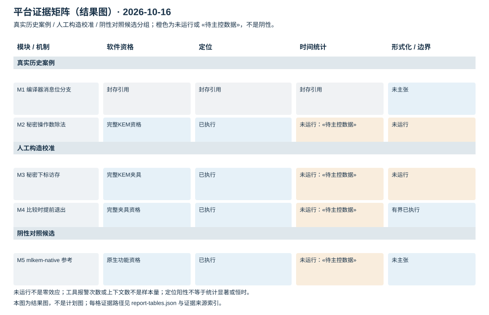
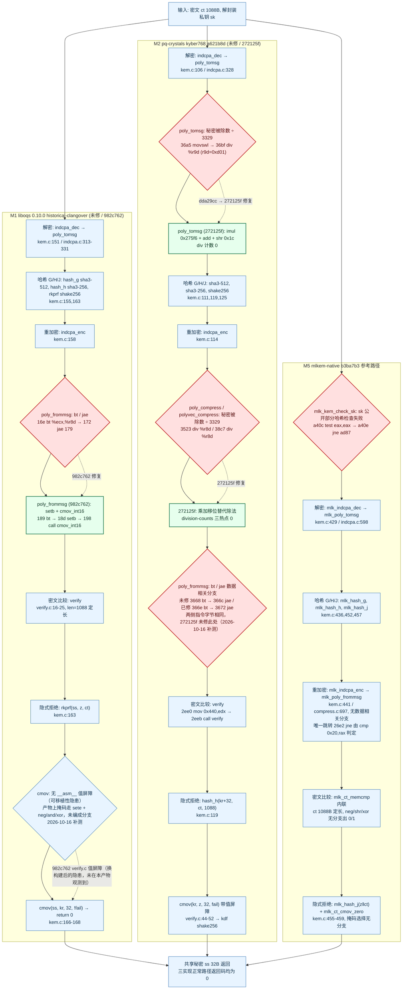

# 多泄漏模块检测平台补充报告

统一检测、定位、修复与复测的证据分层

日期：2026-10-16

摘要：真实历史案例与人工构造校准分列；检测、定位、修复、复测四段链逐模块给出实际状态，未运行不写成未检出。M2–M5 的锁频家族统计、Mona 对 M2 对照、RTLF 族外交叉（42/42）与 M2 除法热点微基准层均已回填，报告内已无 «待主控数据»；结构性未做的检查写“未执行”。**本轮（final5）把 T31 的全部收尾证据并入正文：**R01 向量来源与修复语义等价、R02 环境总表与异常样本规则与稳健性（64 类对 × 4 方法，翻转 12/64，没有任何翻转改变 Holm 判定）、R04 功效与 MDE（M2 约 25–67 ns、M3 约 18–34 ns、M5 约 14–28 ns；未检出 = 观测效应 < MDE）与分位数差（有效计时量化尺度约 10 ns）、R05 补缺格与计数更新（3 实现 × 5 步骤 × 6 类 = 90 格：存在 5、不存在 75、不适用 10、未检查 0）、R06 修复手段映射与泄露渠道审计（秘密内容泄露 0 条，另有低危发现 F1）、R08 性能开销（25 行汇总 + 11 行成对开销）、R09 优化级别（12 格）、R11 威胁模型（以独立 LaTeX 片段直接并入）、R12 创新对照（锁频 vs 不锁频的 CV 比 0.96–1.09；多工具矩阵 9 × 5 = 45 格，30 格有产物）与 T30 一键复现（干净 clone CTest 194/194）。新增**附录 A 题面 12 条对照矩阵**：11 条满足、第 6 条部分（唯一缺口是 R06 的 F1）。M4 只引用分臂数值（vulnerable Δ −4.089 ns、ct Δ +0.055 ns），不引用混臂的家族合并 Δ。

## 1 研究对象与证据口径

平台把编译器引入分支、秘密操作数除法、秘密访存地址和提前退出比较分开处理，并以固定参考实现作为阴性对照候选。统一接口的目的，是让不同机制接受相同的来源记录、调用窗口、数据格式与结果审查，而不是用模块数量代替安全结论。

M1 与 M2 是固定提交的真实历史路径；M3 与 M4 是人工构造校准（前者为秘密下标查表，后者为提前退出比较），其阳性只能检验检测器能否识别目标机制，不计为新的真实 CVE；M5 是固定 mlkem-native 的阴性对照候选。四条证据链分列，不互相冒充。

本报告把四种状态写全并区分：(1) 已执行且检出（含人工校准的目标机制）；(2) 已执行且未检出，必须带工具、输入范围与调用边界；(3) 未执行，一律写“未执行”或 not_run，不写成阴性或未检出；(4) 结构性未做的检查写“未执行”（如题面第 5 条中的“数据相关循环”），它不是占位符、也不是阴性。本轮 M2–M5 的锁频家族统计、Mona 对 M2 对照、RTLF 族外交叉（42/42）与 M2 除法热点微基准层都已实际执行并回填，**报告内已无 «待主控数据» 占位符**。软件资格、源与产物机制、工具定位、原始时间观察、正式统计与竞赛验收互相独立。

完整完成条件与命令合同以 [E01](../../../docs/platform/COMPLETION_REQUIREMENTS.md) 为准；M1 的旧范围保持封存身份，本报告不重做、不改写。 [E01,E02,E10]

## 2 平台架构与机制矩阵

共享层记录公开输入、源与二进制身份、全调用测量窗口、类别乱序、逐次原值、环境和恢复；统计层输出均值差与区间、参数检验族、RTLF 与在线 dudect 的独立结果；动态层使用秘密标记、可变时指令检查和反汇编；有界验证层单独记录秘密模型、入口、边界与探索完成性。

各层证据不可互相替代：静态存在除法不说明处理器已出现可测时差，工具报警次数不是采样量，功能测试通过也不表示统计阴性。下图按「真实历史案例 / 人工构造校准 / 阴性对照候选」分组并逐层显示状态，橙色格是结构性未运行（如“数据相关循环”未做专门检查）。本图是结果图，不是计划图：没有执行过的格子不预填数值。 [E03-E08,E10]

## 3 统一测量与统计方法

普通计时应覆盖声明的完整调用；输入生成、分配、日志、结果消费与 I/O 位于窗口外。热点微基准和独立夹具必须另标调用边界，不与完整解封装混合。普通长尾保留；动态检查产物与正式采集产物分开。源、未提交改动摘要、编译器、选项、ISA、时钟单位、种子、CPU 与二进制摘要共同限定结果。

正式采数前须冻结并本地提交 PLAN，写明主类对、样本预算、停止条件、复测与参数假设族。锁频任务由主控在 CPU2/CPU6 串行调度：boost 关闭、performance、约 4.30 GHz、taskset，并保存进入、采中、退出记录；退出必须实际核对 restore_match。请求频率、可见回读与真实物理恒频是不同声明。本轮 M2–M5 的 54 次控制器运行全部 restore_match=yes，放行探针 20/20 落在 4300000 ±2% 且跨度 ≤50000 kHz；这是工程控制观测，不主张逐调用物理恒频或物理误差界。 [E19]

现有 C 电池使用两组样本均值、样本方差、Welch t 与自由度；95% 区间与 p 值采用大样本正态近似（z=1.9599639845），不能称有限样本精确 Student-t。零方差、数据不足、缺工具或失败均单列状态。参数 p 按事前家族做 Holm；RTLF 固定 α=.01；dudect 最大 t、RTLF 二值结果与 Mona 结果不伪造为 p 纳入 Holm。

本轮冻结的家族口径：M2 与 M5 的家族成员为主类对 × 3 次运行 × 2 版；M3 与 M4 的家族成员为臂内主类对 × 3 次运行 × 2 臂 = m=6，跨臂 on/off 对比只作受控对照（含二进制级常数偏移），不进 Holm 家族；RTLF（α=.01、seed 2026101605、bootstrap 10000，只给二值结论）与 online dudect 一律族外、不进 Holm；RTLF 检验的是分布差异（含尾部与分位），Welch/CI 检验的是均值差，两者分列、互不替代。本轮 RTLF 42/42 完成、无 blocked/failed：no_difference_detected 30 项、difference_detected 12 项。M4 与其 Welch/Holm 方向一致（vulnerable 主类对与截断对照各 3/3 检出、ct 各 3/3 未检出），是两种方法在同一批数据上的独立印证；M2 主类对 6/6 检出，但**未修与已修两个臂都检出**，因此不可归因于除法变体，与 Welch/Holm 拒绝 0 的差异最一致的读法是类构造（message-zero 与 message-ones 各自是同一份确定性密文的 10000 次重复，而 bit-flipped 与 random 逐样本变化）加上未受控漂移，**不据此作任一方向的泄漏结论**；M3 12/12、M5 6/6 未检出。家族实际运行结果：M2 m=6 拒绝 0（合并 Δ +4.58 ns，CI [−3.08, +12.25]，I²=58.3%）；M3 m=6 拒绝 0（−0.73 ns，[−5.56, +4.10]，I²=12.5%）；M4 m=6 拒绝 3 且全在 vulnerable 臂；M5 m=3 拒绝 0（−5.30 ns，[−11.77, +1.16]，I²=0%）。**M4 的家族窗口把泄漏臂与不泄漏臂混在一起（I²=98.6%），因此本报告只引用分臂数值：vulnerable 臂 Δ −4.089 ns、95% CI [−4.215, −3.963]；ct 臂 Δ +0.055 ns、95% CI [−0.363, +0.473]；家族窗口的合并 Δ 不在正文、表或图中出现。** [E01,E08,E19,E20]

## 4 题面第 1 条：向量来源与修复语义等价

题面第 1 条要求实现或接入符合规范的 ML-KEM 密钥生成、封装与解封装，并用公开或主办方提供的测试向量验证算法正确性，且不得通过修改密码算法安全语义的方式换取常数时间效果。本节把「跑过哪些向量」与「修复前后的密码语义是否等价」分列：前者只说明功能一致性，后者回答「常数时间改造有没有改变可观测输出」。

下表逐行给出「模块 × 版本」实际跑过的公开向量例数、通过数、日志与来源标识。**不把文件里的例数当成通过数**：M1 两版各有 20 例密钥校验记「不适用」（该历史 liboqs 封装层没有输入校验入口），因此「例数 80 / 通过 35」必须连备注一起读。**M1 keygen 0/25 是 ipd 与最终稿的真实差异，不是本驱动或远端环境的问题，更不是向量装错**：liboqs 0.10.0 接入的是 FIPS 203 初始公开草案实现，其 K-PKE.KeyGen 的 `hash_g` 没有参数集域分隔字节，与最终稿参考的 `MLKEM_SYMBOLS + 1` 字节输入不同，keygen 期望值必然不同；而 encap（用向量给定的 ek 与 m）与 decap（用向量给定的 dk 与 ct）与最终稿一致，这正是 25/25 与 10/10 通过的原因。**M3 与 M4 是人工构造校准夹具**，其阳性只用于检验检测器能否识别目标机制，不计为新的真实 CVE。 [E32]

等价性一节对每一对「未修 / 已修」实现，用同一份驱动、同一份公开输入在两版上分别运行并比较**逐例输出摘要文件**：三对摘要 diff 全空，另有 1000 例由公开确定性测试种子派生的额外输入（一半随机密文、一半逐字节篡改密文），以及按 FIPS 203 §7.3（M1、M3）或 Kyber round3 §1.4（M2）判定的隐式拒绝检查。**摘要文件按 32 字节/公开例 + 64 字节/额外例计，实际文件大小与例数一致**，说明每版都跑满了公开例与 1000 例额外输入，不是「少跑一部分所以看起来相同」。 [E33]

**表 T12　题面第 1 条之向量来源总表（模块 × 版本 × 来源 × 例数 × 通过数）**

| 模块 / 版本 | 向量来源 + commit / SHA-256 | 例数 | 通过数 | 日志路径 | 备注 |
|---|---|---|---|---|---|
| M1 liboqs 0.10.0 未修（historical-clangover，Clang -Os -fno-vectorize） | tests/vectors/mlkem768.txt，SHA-256 c94dda2717eb370dddfe5b7ca7a7f58d789e0f63238a486e464ce40c673817f4（NIST ACVP 转换件） | 80 | 35 | logs/t05_m1_clangover_kat.log | 已执行 60 例中通过 35：keygen 0/25、encap 25/25、decap 10/10（含 5 例隐式拒绝）；keycheck 20 例记“不适用”（历史封装层无输入校验入口）；退出码 1，原因见本表注 |
| M1 liboqs 0.10.0 已修 982c762c242ef549c914891b47bf6e0ed6321f91 | 同一向量文件与同一 SHA-256 | 80 | 35 | logs/t05_m1_fixed982c762_kat.log | 与未修臂逐项相同（keygen 0/25、encap 25/25、decap 10/10） |
| M1 树内自带目标（historical/test_selftest） | 树内 tests/test_historical_selftest.c（系统随机往返，不含向量期望值） | 1 | 1 | logs/t05_m1_clangover_selftest.log、logs/t05_m1_fixed982c762_selftest.log | 该树为 historical 变体提供的唯一自带目标；只做往返，不计入上表 80 例；本轮未运行计时入口 measure |
| M2 pq-crystals kyber768 未修 a621b8dde405cc507cbcfc5f794570a4f98d69cc | tests/vectors/kyber768_round3/PQCkemKAT_2400.rsp，SHA-256 a1e122cad3c24bc51622e4c242d8b8acbcd3f618fee4220400605ca8f9ea02c2（官方第 3 轮提交包成员原字节） | 100 | 100 | logs/t05_m2_unfixed_kat.log | 逐例 keygen + encap + decap；100 例独立官方 round3 KAT 全通过 |
| M2 pq-crystals kyber768 已修 272125f6acc8e8b6850fd68ceb901a660ff48196 | 同上 .rsp（同一 SHA-256） | 100 | 100 | logs/t05_m2_fixed_kat.log | 与未修臂逐项相同 |
| M3 LUT-on（人工构造校准） | mlkem768.txt（同一 ACVP 转换件），SHA-256 c94dda27…817f4 | 80 | 80 | logs/t05_m3_on_kat.log | 25 keygen + 25 encap + 10 decap + 10 ekcheck + 10 dkcheck 全通过；日志含 5 implicit rejections、5 accepted ciphertexts |
| M3 LUT-off（人工构造校准） | 同上 | 80 | 80 | logs/t05_m3_off_kat.log | 与 on 版逐项相同 |
| M4 vulnerable（人工构造校准） | 无公开密码向量；人工夹具自检输入（mismatch-first / mismatch-last 各 1 例） | 2 | 2 | logs/t05_m4_vulnerable_inputs.log | 输出 m4_inputs=pass timing_collection=not_run；人工构造校准，不对应真实密码算法 |
| M4 ct（人工构造校准） | 同上 | 2 | 2 | logs/t05_m4_ct_inputs.log | 两版 --describe 输出逐字节相同；人工构造校准 |
| M5 mlkem-native 参考 b3ba7b32773e657dd37f6f87bce82528459ad8a4 | mlkem768.txt（同一 ACVP 转换件） | 80 | 80 | logs/t05_m5_reference_kat.log | 25 + 25 + 10 密码例与 20 例密钥校验全通过；含 5 implicit rejections |

注：机器可读版本见 docs/evidence/r01-kat-20261016/logs/T05_T06_summary.tsv。mlkem768.txt 由本仓库 tests/convert_vectors.sh 从 NIST ACVP-Server 975de31eb83d87039ec88934fdc47d8c312b892d 的 gen-val/json-files 原件按 tcId 关联生成，只提取 ML-KEM-768 的 25 keygen / 25 encaps / 10 decaps，不改预期字节。**未跑过的例数一律显式写“不适用”，不把文件里的例数当成通过数。** **M1 keygen 0/25 是 ipd 与最终稿的真实差异**：liboqs 0.10.0 接入的是 FIPS 203 初始公开草案实现，其 indcpa.c:217 的 hash_g 无参数集域分隔字节，而同仓库同步的最终稿参考 vendor/mlkem-native/mlkem/src/indcpa.c:464 用 MLKEM_SYMBOLS + 1 字节输入，故 keygen 期望值必然不同；encap 用向量给定的 ek 与 m、decap 用向量给定的 dk 与 ct，与最终稿一致，这正是 25/25 与 10/10 通过的原因。该树的 docs/historical-liboqs-0.10.0.md:18 本身就写明它不做与 tests/vectors/mlkem768.txt 的 KAT 绑定。此处如实记录 0/25，不把 IPD 冒充最终 FIPS 203，也不用它给 M1 的时序结论加分。**M3 与 M4 是人工构造校准夹具**（M3 为秘密下标查表，M4 为提前退出比较），不对应真实密码算法，不计为新的真实 CVE。这些数字只说明各版本在各自公开向量上的功能一致性，不构成常数时间、频率锁定或统计显著性的结论。 [E01]

**表 T13　题面第 1 条之修复语义等价（三对 diff + 1000 例额外输入 + 隐式拒绝）**

| 模块（两版） | 公开例 | 额外 1000 例 | diff 结果 | 隐式拒绝检查结果 |
|---|---|---|---|---|
| M1 clangover vs fixed-982c762 | 公开 10 例（mlkem768.txt 的 decap，含 5 例拒绝例） | 1000（500 随机 + 500 逐字节篡改） | 空：cmp 退出 0、差异字节 0；两版摘要文件 SHA-256 均为 f4dbc5f4777247ef8930cd78dcafaa3e327e9d3d92aa2056aa465b55f4310b9d | 通过：public_rejection_agree=10/10；额外 1000 例 extra_rejected=1000/1000、extra_unexpected_accept=0；按 FIPS 203 §7.3 的 J(z‖c) 判定 |
| M2 a621b8d vs 272125f | 公开 100 例（官方 round3 KAT 全例，全部是接受例） | 1000（500 随机 + 500 逐字节篡改） | 空：cmp 退出 0、差异字节 0；两版摘要文件 SHA-256 均为 3af51d3605554f53461a288e1663aa5db50b176ed1df5feecf83c95c0f4ed0a2 | 通过：public_expected_match=100/100、分类一致 100/100；额外 1000 例 extra_rejected=1000/1000；按 Kyber round3 §1.4 的 KDF(z‖H(c)) 判定（该历史算法不是 FIPS 203，不冒称附录口径） |
| M3 LUT-on vs LUT-off（人工构造校准） | 公开 10 例（含 5 例拒绝例） | 1000（500 随机 + 500 逐字节篡改） | 空：cmp 退出 0、差异字节 0；两版摘要文件 SHA-256 均为 43c1fb206230284b98d89719894c2cc64867b043b508e200dcb7967626c528e3 | 通过：public_rejection_agree=10/10；额外 1000 例 extra_rejected=1000/1000；按 FIPS 203 §7.3 的 J(z‖c) 判定 |
| M4 vulnerable vs ct（人工构造校准，仅接口等价） | 不适用（无共享密钥的无密码夹具） | 不适用 | 接口等价：两版 --describe 输出逐字节相同（describe_cmp_exit_status=0），输入自检输出逐字节相同（inputs_cmp_exit_status=0） | 不适用：夹具不做解封装，没有隐式拒绝语义 |

注：摘要文件按 32 B/公开例 + 64 B/额外例计：M1 与 M3 各 10 × 32 + 1000 × 64 = 64320 字节，M2 为 100 × 32 + 1000 × 64 = 67200 字节；out/ 中实际文件大小与之一致，说明每版都跑满了公开例与 1000 例额外输入，不是“少跑一部分所以看起来相同”。每例摘要输入为 tag ‖ index ‖ 密文 ‖ 共享密钥 与 tag ‖ index ‖ ek ‖ dk ‖ 合法 ct，经 SHAKE256-256bit 压缩后落盘，既能逐字节比较也不把共享密钥写进证据。两版隐式拒绝值在 1000 例上是精确等于规范拒绝值，而不是固定拒绝密钥：若某一版返回固定值或常量，extra_rejected 不可能同时满足 1000/1000（随机密文各不相同）。**M2 的公开 100 例全部是接受例**（round3 KAT 的 ss 就是接受路径的共享密钥），round3 的拒绝路径只由额外 1000 例覆盖，不假装公开向量覆盖了拒绝分支。M4 只有 32 字节比较与两类错位位置，没有密码算法和共享密钥，因此这里只能做接口等价说明，其时序差异是故意保留的实验缺陷。 [E01]

## 5 题面第 2 条：测量环境、异常样本规则与稳健性

题面第 2 条要求建立可重复的高精度时间测量框架，说明处理器、操作系统、编译器、优化级别、CPU 频率管理、测试次数及异常样本处理方法，并尽可能降低系统调度、缓存和后台进程造成的随机干扰。本节按「登记了什么」「样本怎么处理」「结论对方法有多敏感」三段回答，并把限制一并写出来，不单独列成就。

环境登记共 **28 项**，每一项都有原始命令与原始输出（长输出给摘录并指向 `raw/` 下的完整原文），含 5 组实际编译行与 ELF 摘要核验、计时源与 `clock_resolution_ns`、读钟开销实测、SMT 状态、`isolcpus`、IRQ 亲和、后台服务快照与频率节点回读。**必须一起读的两条限制**：(1) 本机 `isolcpus` 为空、SMT 未关闭、系统仍有 39 个 running service，`taskset` 亲和性加写频不是内核级 CPU 隔离；(2) 读钟开销均值 17.4–17.5 ns、最小步进 10 ns，而 M4 的比较步窗口只有 20–30 ns，**读钟开销与被测窗口同量级**，本批数据的**有效计时量化尺度约 10 ns**，与 M2/M3/M4/M5 关心的 4–30 ns 效应同量级。 [E34,E39]

异常样本处理与主分析口径一致：**主分析保留全部样本，不删离群值、不裁尾、不插值、不平滑、不扣读钟开销**（与 `docs/timing.md:34` 逐字一致），冻结家族成员一律用全样本 `n0 = n1 = 10000` 原值。主分析之外只允许三种族外敏感性方法：p99.9 截尾均值差、中位数差与 Hodges–Lehmann 位置差；规则在写文件时已经执行完毕，不存在「看结果再定规则」。 [E35]

稳健性分析在 **64 个类对**（含 21 个已冻结 Holm 家族成员与 43 个族外对照）上用四种方法重算，得到 **12 个「CI 含 0 / 不含 0」翻转**：其中 7 个属于已冻结家族成员、5 个属于族外对照。**如实写：没有任何翻转改变 Holm 判定**——家族与其 p 值在 `efca8a1` 已冻结，三种稳健方法一律族外，本页不重算 Holm、不改任何 p 值。翻转的性质是「均值型检验与位置型检验的功效差」或「约 10 ns 量化下秩方法失效」，**不是新的泄漏证据**；也不能用「12 个翻转」反推总体误报率（未校正、且各方法高度相关）。 [E36,E37]

**表 T14　题面第 2 条之环境总表（28 项覆盖与关键读数）**

| 分组 | 覆盖项 | 关键读数 | 出处 |
|---|---|---|---|
| 主机与内核 | uname -a、/etc/os-release、/proc/cmdline、nproc、内存 | nss-m；Linux 6.17.0-35-generic；Ubuntu 24.04.4 LTS；x86_64 | §1.1–1.4 |
| CPU | lscpu | AMD Ryzen 9 9950X，32 线程 | §1.6 |
| 工具链 | clang、gcc、cmake、ninja、valgrind 版本 | clang 18.1.3、gcc 13.3.0、cmake 3.28.3、ninja 1.11.1、valgrind 3.22.0 | §2 |
| 工具缺失（如实登记） | binsec、z3 | binsec 未安装（历史仅 M4 运行时 opam root，现已无二进制）；z3 不在 PATH，M4 运行时目录内 4.15.3 | §2.2 |
| 实际编译行 | M1 两版、M2 两版、M3 on/off、M4 两臂、M5，共 5 组，逐条含 ELF 摘要核验 | M1 用 -Os -fno-vectorize；M2 用 -Oz -g -fno-vectorize -fno-slp-vectorize；均无 -march、无显式 -mavx* | §3.2–3.6 |
| 计时源 | 各采集件的 clock 与 time_unit | 完整解封装用 CLOCK_MONOTONIC；M4 比较步用 CLOCK_MONOTONIC_RAW（与其它臂不是同一个时钟，跨模块比较无意义）；dudect 用自带 rdtsc | §4.1 |
| clock_resolution_ns | 逐采集件回读 | M5 的 .meta 报 1；M4 的 .meta 未记，本轮实测补上 | §4.2 |
| 读钟开销（新探针，n=100000 × 2） | 均值 / 中位数 / p99 / 最小步进 | CLOCK_MONOTONIC 17.423 / 20 / 21 ns；CLOCK_MONOTONIC_RAW 16.195 / 20 / 21 ns；min_ns = 10 | §4.3 |
| 读钟开销（既有归档 n=300000，CPU2 绑定） | 同口径复算 | 均值 17.50 ns、中位数 20 ns、p99 21 ns、p99.9 21 ns、最小 10 ns | §4.4 |
| 有效计时量化尺度（限制条） | 相邻不同取值间隔的中位数 | 全批 41 个主类对合起来 9 ns（逐类对 9–10 ns）⇒ 有效计时量化尺度约 10 ns；均值可靠 n=10000 平均出 1 ns 以下差异，分位数只能落在约 10 ns 格点 | §4.3；QUANTILE_CI §4.4 |
| 干扰控制 | SMT 状态、isolcpus、IRQ 亲和、后台服务快照 | **无 isolcpus**；采集期由控制器写 boost=0、performance、min=max=4300000 kHz 并 taskset 绑核；系统仍有 39 个 running service | §5、§6、§7 |
| 频率管理回读 | /sys 的 boost、CPU2 / CPU6 的 policy、amd_pstate 状态 | 逐项原文；采集件自身不写 sysfs | §7 |
| 采集方式 | 只读；唯一远端写入是读钟探针自身的新根 | 无 sudo、无安装、命令一律不绑 CPU2/CPU6（留给锁频采集） | 头部说明 |

注：28 项逐项都有原始命令与原始输出；完整原文在 docs/evidence/r02-env-20261016/raw/ 下的 5 份文件（remote-env.txt、compile-lines.txt、clock-probe.txt、clock-overhead-archive.txt、irq-and-isolation.txt）。本页只登记本次实际用过的读数，不外推到其它机器。读钟开销与被测窗口的关系必须一起读：单次取值 20 ns 上下、最小步进 10 ns，而 M4 的比较步窗口只有 20–30 ns，因此 M4 的结论只在均值层成立。 [E01]

**表 T15　题面第 2 条之异常样本规则与稳健性敏感性分析（64 类对 × 4 方法）**

| 项 | 规则 / 结果 | 数字 | 出处 |
|---|---|---|---|
| 主分析样本规则 | 保留全部样本：不删离群值、不裁尾、不插值、不平滑、不扣读钟开销 | 冻结家族成员一律用全样本 n0 = n1 = 10000 原值 | OUTLIER_RULES §1；与 docs/timing.md:34、docs/statistics.md:31、docs/acceptance.md:331-333 一致 |
| S1 p99.9 截尾均值差（族外） | 每侧截 0.1%，k = floor(0.001 × n) = 10，升序取下标 [k, n−k)，bootstrap 百分位 95% | n = 10000 ⇒ 保留 9980 / 9980；64/64 个类对满足“截尾后每组 ≥ 1000”的下限 | OUTLIER_RULES §2 |
| S2 中位数差（族外） | median(class0) − median(class1)，bootstrap 百分位 95% | B = 2000，每个类对固定种子 20261016 + 序号 | OUTLIER_RULES §2 |
| S3 Hodges–Lehmann 位置差（族外） | 全部 n0·n1 个成对差的中位数，整数格点二分精确求解 | 同上 | OUTLIER_RULES §2 |
| 与冻结家族的对齐 | 全样本 Welch 与 stats/members/members.csv.gz、stats/holm/holm.csv.gz 逐项比对 | Δ 最大绝对偏差 0 ns；CI 端点 2.49e-14 ns；双侧 p 9.44e-16（双精度舍入噪声） | ROBUSTNESS §4 |
| 翻转计数 | 64 个类对（21 个已冻结 Holm 家族成员 + 43 个族外对照）× 4 种方法 | **翻转 12 / 64**：其中已冻结家族成员 7 个、族外对照 5 个 | ROBUSTNESS §0、§6 |
| 翻转对 Holm 的影响 | 家族与其 p 值在 efca8a1 已冻结；本页三种稳健方法一律族外 | **没有任何翻转改变 Holm 判定**；不重算 Holm、不改任何 p 值 | ROBUSTNESS §0、§2 |
| 种子稳定性自检 | 同一脚本、只换 bootstrap 种子基数 777 | 12 / 64 → 13 / 64；唯一差异是族外 R03 类对 r03-m1unfixed-s2:valid-malformed（全样本 Δ 仅 1.575 ns、CI 含 0，属边界项），如实登记为对种子敏感，不当稳定翻转 | ROBUSTNESS §6.1 |
| 翻转的性质 | 两类翻转不能合并叙述 | 是“均值型检验与位置型检验的功效差”或“约 10 ns 量化下秩方法失效”，不是新的泄漏证据 | ROBUSTNESS §6.1 |

注：规则在写文件时已经执行完毕，不存在“看结果再定规则”。主分析口径与 docs/timing.md:34 逐字一致（普通长尾全部保留，采集阶段不做离群值删除）。三种稳健方法一律族外；bootstrap 为分组内独立重采样（各组按原样本量有放回），B = 2000，每个类对固定种子。**不能**用“12 个翻转”反推总体误报率：本页未做多重比较校正，且各方法高度相关。两次独立运行的两次改写块也已逐值核对（m1_wide_long_check.py，CONCLUSION same_sample_set=yes），避免重复计数。 [E01]

## 6 检测—定位—修复—复测：四段链状态

检测段回答“不同类别的执行时间是否可区分”，必须给样本预算、描述统计、区间与检验族；定位段回答“差异对应源码或产物中的哪个机制”，必须给工具、命中位置与实际调用边界；修复段优先使用上游官方修复，人工校准使用明确标注的目标机制开关，并先核对功能等价与拒绝语义；复测段在同规程下独立再运行，比较修复或关闭前后的同向性与稳定性。

四段不能互相顶替：定位阳性不能填统计格，统计未运行不能写阴性，官方修复存在也不等于本机统计已复现。下表逐模块给出四段链的实际状态；M1 为已封存原件的引用，本轮不重做。

**表 T1　检测—定位—修复—复测：五模块四段链状态**

| 模块 / 案例类别 | (1) 检测（输入与统计） | (2) 定位（工具与产物） | (3) 修复 / 关闭 | (4) 复测 | 证据 |
|---|---|---|---|---|---|
| M1 编译器消息位分支 / 真实历史案例 | 已执行：10000 值/类 × 3 次独立运行；Welch 95% 正态近似 CI、Holm 家族 m=6、RTLF α=.01、dudect t&gt;10 | 已执行：Valgrind 标记 indcpa 私钥前 1152 B，未修在 poly_frommsg（poly.c:179）报 1 个秘密条件跳转；反汇编 bt+jae；已修 0 个 | 官方修复 982c762：重链为 setb + cmov_int16；旧封存结论不改写 | 已执行：基准 31337@CPU2、换种子 424242@CPU2、换物理核 31337@CPU6 各一次，方向一致 | [E02] [E17] [E18] |
| M2 秘密操作数除法 / 真实历史案例 | 已执行：3 次运行（31337@CPU2、424242@CPU2、31337@CPU6）× 2 臂 × 每类 10000 次、预热 100 在窗口外；家族 m2_end_to_end_full_decaps_v1 m=6，Holm 拒绝 0；合并 Δ +4.58 ns，95% CI [−3.08, +12.25]（含 0），I²=58.3% | 已执行（阳性）：未修 poly_tomsg、polyvec_compress、poly_compress 各 1 个目标 div、已修各 0；热点探针 varlat=yes 1280 errors/3 contexts 对已修 0/0，varlat=no 两版 0/0 | 完整已修 272125f（非中间 dda29cc）：目标 div 与对应报警消失；历史 Kyber768 不冒称 FIPS 203 | 已执行：r1/r2/r3 三次独立运行，18 次控制器运行 restore_match=yes；分层结论：定位层阳性 / 除法热点微基准层未检出（家族 m=6，Holm 拒绝 0，Δ +0.044 ns、CI 含 0）/ 完整解封装层未检出；按臂描述性未修 +12.35、已修 −11.20 方向相反＝臂间漂移 | [E03] [E04] [E13] [E19] [E20] |
| M3 秘密下标访存 / 人工构造校准 | 已执行：3 次运行 × 2 臂 × 每类 10000 次；家族 m3_lut_arm_end_to_end_v1（臂内主类对）m=6，Holm 拒绝 0；合并 Δ −0.73 ns，95% CI [−5.56, +4.10]（含 0），I²=12.5% | 已执行：挂载后 Memcheck 开臂 1280 errors/2 contexts（compress.c:714 / poly_frommsg）对关臂 0/0；Microwalk 开臂 poly_frommsg+30/+59 的 MI 1.922 bits（全场最高）对关臂 0.722 | 人工 off 关闭目标机制：秘密索引 load 报警消失；跨臂 on/off 含二进制级常数偏移，只作受控对照、不进 Holm | 已执行：r1/r2/r3 三次独立运行，12 次控制器运行 restore_match=yes；端到端未检出；按臂描述性开臂 −0.62、关臂 −0.83 | [E05] [E14] [E19] [E20] [E21] |
| M4 提前退出比较 / 人工构造校准 | 已执行：3 次运行 × 2 臂 × 每类 10000 次；家族 m4_compare_arm_session_v1（臂内主类对）m=6，Holm 拒绝 3 项且全部来自 vulnerable 臂（原始 p = 0 / 9.23e−25 / 3.14e−22），ct 臂 p = 0.386 / 0.438 / 0.399 | 已执行：Memcheck vulnerable 32 errors/1 context（compare_early.c:9）对 ct 0/0；Binsec 0.11.3 + Z3 4.15.3 给 insecure（反例 0x8049047）对 bounded secure，pending/cut/unknown 全 0，另有 -sse-depth 5 得到 unknown 的截断对照 | 人工 ct 归约关闭目标机制（定位层与有界层）；两版只返回相等性 | 已执行：r1/r2/r3 三次运行，18 次控制器运行 restore_match=yes；按臂描述性 vulnerable −4.089 [−4.215, −3.963]、ct +0.055 [−0.363, +0.473]；族外截断对照（--compare-bytes 16）p = 6.25e−202 / 0.00563 / 4.44e−177，边界不同、不进 Holm | [E06] [E16] [E19] [E20] [E22] [E23] |
| M5 mlkem-native 参考 / 阴性对照候选 | 已执行：3 次运行 × 1 臂 × 每类 10000 次；家族 m5_reference_end_to_end_v1 m=3，Holm 拒绝 0；合并 Δ −5.30 ns，95% CI [−11.77, +1.16]（含 0），I²=0% | 已执行且未检出：PKE 秘密 1152 B 与拒绝种子 z 32 B 明确标记，发行版 Memcheck、varlat=no、varlat=yes 三模式各 10 次完整调用 0 errors/0 contexts | 不适用：参考实现没有可关闭的目标机制；不写成“已防护” | 已执行：r1/r2/r3 三次运行，6 次控制器运行 restore_match=yes；族外 dudect max|t| = 2.10 / 1.98 / 2.82，state=1（预算内无证据）；阴性只限本预算，不证明恒时 | [E07] [E15] [E19] [E20] |

注：四段链的顺序是检测 → 定位 → 修复/关闭 → 复测；复测一律指同规程的独立再运行。M1 的四段均为已封存原件的引用，本轮不重做也不改写。M2 的端到端未检出与定位层阳性分层记录，不互相冒充。 [E01]

## 7 题面第 3 条对照：输入分类与测试

题面第 3 条要求至少两类具有明确区别的解封装输入、足够次数的重复实验并记录解封装时间，且不应只比较长度明显不同、路径完全不同的数据。平台的做法是：合法密文之间只改解密消息位（message-zero 与 message-ones，同为等长合法密文），异常输入使用同长度的位翻转、随机与验证失败密文；长度类拒绝在封装层先检查，不计入内核类别样本。

重复次数与时间记录按模块分列：M1 已完成每类 10000 值 × 3 次独立运行；M2–M5 本轮同样完成每类 10000 次、预热 100（窗口外）与 r1/r2/r3 三次独立运行（换种子、换物理核），共 54 次控制器运行全部 restore_match=yes。定位层的 10 次完整标记调用（M3/M5）是有限动态检查，不作为统计样本。此外，R03 另做了一组**族外**的异常输入对照（长度正确的破损密文与长度不足的截断密文对合法密文，3 臂 × 3 种子、每类 10000 次、18/18 restore_match=yes），用来回答「异常输入会不会引出额外的可区分路径」；它不进 Holm、不改任何既有判定，详见第 13 节。 [E19,E28]

**表 T2　题面第 3 条（输入分类与测试）逐项对照**

| 题面要求要点 | 平台实际做法 | 状态 | 证据 |
|---|---|---|---|
| 至少两类具有明确区别的解封装输入 | M1/M2 主类对为 message-zero 与 message-ones：同为合法、同长度密文，只在解密消息位上不同；M2 另有 malformed-zero-tail 与 malformed-ff-tail 对照类对（族外）。M3 同主类对并分 on/off 两臂；M4 为等长 32 字节的 mismatch-first 与 mismatch-last（输出同为不相等），另有 --compare-bytes 16 截断对照；M5 为 message-zero 与 message-ones，另有 bit-flipped 与 random 对照 | M1–M5 均已执行 | [E02] [E13] [E14] [E16] [E15] [E19] |
| 不比较明显长度不同、路径完全不同的数据 | 长度与空指针在封装层先检查，错误长度不进内核类别样本；M3 指出 measure 的密文长度在 API 层固定为 1088 字节、接口层无法表达“截断”，因此对照条件取内容被破坏或随机的密文且一律族外；M4 两类输入的公开长度都为 32 字节并复制到同一工作数组 | 已执行（功能与设计层） | [E13] [E14] [E16] |
| 各类输入足够次数的重复实验 | 五个模块统一为每类 10000 次、预热 100（窗口外），并各做 r1（31337@CPU2）、r2（424242@CPU2）、r3（31337@CPU6）三次独立运行；家族成员数分别为 M2 m=6、M3 m=6、M4 m=6、M5 m=3；定位层的 10 次完整标记调用（M3/M5）是有限动态检查，不作统计样本 | 已执行：54 次控制器运行全部 restore_match=yes | [E19] [E20] |
| 记录解封装执行时间 | 统一 measure 长表 run_id、implementation、input_category、sample_index、elapsed_nanoseconds、time_unit；单位 ns，时钟 CLOCK_MONOTONIC，窗口外生成输入、预热与结果消费；原始 CSV 全量保留（含普通长尾），以 .csv.gz 原字节存放并记录 SHA-256 | 已执行（M1 为封存原件、M2–M5 本轮实际采集） | [E17] [E19] [E20] |
| 异常与失败输入的覆盖 | M2：64 例真实隐式拒绝、跨版 160 类例等价、空指针/0/短/长/SIZE_MAX 长度、系统随机源失败清零；另有 malformed 尾部对（族外对照）；M5：5 接受与 5 隐式拒绝；M4：空指针/真实短数组/零长度在调用内核前拒绝 | 已执行（功能与拒绝语义层），族外对照见 T4 末段 | [E13] [E15] [E16] |

注：“输入类别”是统计单位；定位层的有限调用不是样本量，两者在本报告中始终分列。 [E01]

## 8 题面第 4 条对照：侧信道统计检测

题面第 4 条要求用统计方法判断不同输入类别是否存在显著可区分性，可使用均值、方差、分位数、置信区间与适当的统计检验，且不能仅凭少量样本或单次测试结论。平台实现分三层：描述统计（均值、标准差、分位数）、参数推断（Welch 均值差与 95% 正态近似区间、Holm 逐步校正）与族外交叉（RTLF α=.01、在线 dudect、Mona 统计对照）。

M1 三层均已执行，并在换种子、换物理核两次独立复测上复现；M2–M5 本轮完成参数层（Welch 95% 正态近似区间与 Holm）与族外 dudect：M2/M3/M5 未拒绝、M4 在 vulnerable 臂拒绝 3 项。工具自身的合成正负校准只证明软件接口，不填充密码实现的结果。 [E20]

**表 T3　题面第 4 条（侧信道统计检测）逐项对照**

| 题面要求要点 | 平台实际做法 | 状态 | 证据 |
|---|---|---|---|
| 均值、方差、分位数等描述统计 | 每个数据集输出各类均值、样本方差/标准差与分位数；家族另给合并效应 Δ、I² 与按臂描述性合并；M1：各类均值、中位数、标准差与十分位全部输出 | 已执行（M1 与 M2–M5） | [E02] [E17] [E08] [E20] |
| 置信区间 | 两组样本均值差 Δ、Welch 标准误与 95% 区间；实现为大样本正态近似（z=1.9599639845），不称有限样本精确 Student-t。M2 +4.58 [−3.08, +12.25]；M3 −0.73 [−5.56, +4.10]；M4 按臂分列：vulnerable −4.089 [−4.215, −3.963]、ct +0.055 [−0.363, +0.473]（家族窗口把两臂混在一起、I²=98.6%，故不引用合并 Δ）；M5 −5.30 [−11.77, +1.16] | 已执行 | [E08] [E20] |
| 适当的统计检验与多重比较校正 | Welch t 与自由度，参数族按事前清单做 Holm–Bonferroni 逐步校正（全族 α=0.05）：M2 m=6 拒绝 0；M3 m=6 拒绝 0；M4 m=6 拒绝 3（全在 vulnerable 臂：p = 0 / 9.23e−25 / 3.14e−22）；M5 m=3 拒绝 0 | 已执行；成员表与阈值见 members.csv 与 holm.csv | [E20] |
| 多方法交叉印证（族外） | online dudect：M2 未修 max|t| 4.68/3.05/3.66（无证据）、已修 36.27/30.94/61.91（leakage_found，不可归因于除法变体）；M3 on/off 1.93/2.24、3.41/3.37、2.81/3.03 均 state=1；M4 vulnerable 356.6/396.9/395.6（leakage_found）、ct 2.06/1.90/2.27（无证据）；M5 2.10/1.98/2.82（state=1）。dudect 最大 t 不转伪 p、不进 Holm | 已执行（族外交叉）：RTLF α=.01、seed 2026101605、42/42 完成——no_difference_detected 30 项、difference_detected 12 项；M4 与 Welch/Holm 方向一致（vulnerable 含截断 6/6 检出、ct 6/6 未检出）；M2 主类对 6/6 检出但两个臂都检出、对照 6/6 未检出；M3 12/12、M5 6/6 未检出 | [E19] [E20] |
| 不能仅凭少量样本或单次测试结论 | 每个模块三次独立运行（换种子、换物理核），家族判定基于全部成员；普通长尾不删、不追加样本直到显著；M4 的 98.6% I² 与 M2 的臂间漂移都原样报告，不挑一致结果 | 已执行：54 次控制器运行 restore_match=yes | [E19] [E20] |
| 多重比较的家族口径（主控冻结） | M2/M5：家族成员 = 主类对 × 3 次运行 × 2 版（M5 单臂，故 m=3）；M3/M4：家族成员 = 臂内主类对 × 3 次运行 × 2 臂 = m=6，跨臂 on/off 与 --compare-bytes 截断对照只作受控对照（含二进制级常数偏移或不同调用边界），不进 Holm；RTLF（α=.01）与在线 dudect 一律族外 | 口径已冻结并按此执行 | [E01] [E08] [E19] [E20] |
| 不用工具安装、软件资格或定位结果替代统计，也不把未检出读成恒时 | M2 定位阳性但端到端未检出；M5 工具与 dudect 均无证据但只限本预算；M3/M4 的定位与统计分层记录；“CI 含 0 且 Holm 不拒绝”一律写未检出，不写恒时或等价 | 已执行（口径与文档层） | [E01] [E13] [E20] |

注：四个家族各自独立判定；M4 的三项拒绝只针对人工提前退出夹具，不外推到真实密码库。M4 的效应量只按臂引用（vulnerable −4.089 ns / ct +0.055 ns）。RTLF、Mona、R03 族外对照均已回填并单列。 [E01]

## 9 题面第 4 条补充：功效 / MDE、分位数差与分布图

本节把题面第 4 条的统计方法再往前推两步：一是回答「这套预算能分辨多大的效应」（事后功效与最小可检测效应 MDE），二是回答「换一种位置型统计量，结论是否还站得住」（分位数差 bootstrap 区间、ECDF 与箱线图）。两项都是**只读复算**：输入全部是已提交的锁频采集 CSV，不重新采集、不改动任何已有证据文件、不做密钥恢复。

MDE 按两样本双侧 α、功效 80%、等 n 的最小可检测效应公式计算，Holm 校正后的有效 α 取 α/m。**一句话结论**：M2/M3/M5「端到端未检出」的确切含义是，在本机、本编译产物、本类对与本次样本预算下，观测到的类间均值差小于本设计的最小可检测效应（**M2 约 25–67 ns、M3 约 18–34 ns、M5 约 14–28 ns**），所以这套预算**分辨不出**任何小于该量级的效应；**「未检出」= 观测效应 < MDE，不等于零效应**，也不构成恒时证明或物理泄漏界。MDE 用本次实测 SD，属事后（post hoc）功效描述，不改变任何已提交的 Holm 判定；M4 vulnerable 臂的 |Δ| 远大于其 MDE（最坏 1.47 ns 对 |Δ| ≈ 3.5–4.4 ns），这正是「该臂的效应大到这套预算足以分辨」与「该臂分辨不了」的分界。 [E38]

分位数差用 p10/p50/p90/p99 的差（class0 − class1）与 bootstrap 百分位 95% 区间（B = 10000，两类各自独立有放回重抽样，固定种子）。41 个主类对 × 4 个分位数共 164 条判定：88 条同向、13 条方向反向、24 条判定翻转，全部逐条列出、不做选择性汇报。**两条必须一起读的限制**：(1) 本批数据的**有效计时量化尺度约 10 ns**（相邻不同取值间隔的中位数 9 ns、逐类对 9–10 ns），均值可以靠 n = 10000 平均出 1 ns 以下的差异，**分位数只能落在约 10 ns 的格点上**；(2) 因此 M4 vulnerable 出现「均值差 3/3 显著、分位差 p10/p90/p99 恰为 0」的分歧——**不能用 M4 的分位数差去复核 M4 的均值结论**，两边都只能用各自的口径表述。分位数差的翻折不改变 M2 家族 Holm 不拒绝的结论，也不构成泄漏声明。 [E39,E40]

**表 T16　题面第 4 条之补充：功效 / MDE 与「未检出」的确切含义**

| 家族 / 臂 | m | n / 类 | MDE(α=0.05) 范围 (ns) | MDE(Holm α_eff) 范围 (ns) | 观测 Δ 与判定 | 出处 |
|---|---|---|---|---|---|---|
| M1 未修（真实历史案例） | 6（r02-r04-close-20261016/holm.csv） | 10000 | 25.2709 | 31.3901 | Δ = +39.3372 ns，**超过** MDE(m=6) 31.3901 ns ⇒ 可检出 | POWER §1.1 |
| M1 已修 | 6 | 10000 | 28.6289 | 35.5613 | Δ = −13.2093 ns，小于 MDE ⇒ 未检出 | POWER §1.1 |
| M2 端到端 | 6 | 10000 | 19.9–54.0 | 24.7–67.1 | 主类对 6 项 |Δ| 全部小于 MDE ⇒ 未检出（引用值取 Holm 口径 25–67 ns） | POWER §5.1 |
| M3 端到端（人工构造校准） | 6 | 10000 | 14.2–27.1 | 17.7–33.7 | on / off 两臂 |Δ| 都小于 MDE ⇒ 未检出（引用值取 Holm 口径 18–34 ns） | POWER §5.1 |
| M4 端到端（人工构造校准） | 6 | 10000 | 0.1853–1.1864（vulnerable） | 最坏 1.4736（vulnerable） | vulnerable 臂 3/3 run |Δ| 远大于 MDE ⇒ 可检出；ct 臂 0/3 超过 ⇒ 未检出 | POWER §5.1 |
| M5 参考（阴性对照候选） | 3 | 10000 | 11.7–24.5 | 13.5–28.3 | |Δ| 小于 MDE ⇒ 未检出（引用值取 Holm 口径 14–28 ns） | POWER §5.1 |
| R03 两个族外对照 | 无预注册家族（α_eff = 0.05） | 10000 | 14.4–20.6（对照 A） | 同左（不校正） | 对照 A 9/9 的 CI 含 0；对照 B 的截断路径差 +29.3 µs（M5）/ +55.1 µs（M1）由 CI 说明 ⇒ 可区分但属公开长度检查的接口语义 | POWER §1.4、§5.1 |

注：MDE 公式：MDE = (z_{1−α/2} + z_{1−β}) × sqrt(sd0²/n0 + sd1²/n1)，取 α = 0.05、功效 1−β = 0.80，两分位之和 2.801585218；Holm 校正后的有效 α = 0.05/m。SD 一律取样本标准差（numpy ddof=1），口径由 stats/members/members.csv.gz 的 sd0_ns / sd1_ns 与 ci_welch.json 的 standard_error_ns 逐位复现锁定。**一句话结论（原文）**：M2/M3/M5「端到端未检出」的确切含义是，在本机、本编译产物、本类对与本次样本预算下，观测到的类间均值差小于本设计的最小可检测效应（**M2 约 25–67 ns、M3 约 18–34 ns、M5 约 14–28 ns**），所以这套预算分辨不出任何小于该量级的效应；**「未检出」= 观测效应 &lt; MDE，不等于零效应**，也不构成恒时证明或物理泄漏界。MDE 用本次实测 SD，属事后（post hoc）功效描述，不改变任何已提交的 Holm 判定。**口径更正**：POWER.md §1 已更正 M1 主类对属于 r02-r04-close-20261016 预注册的 Holm 家族（m = 6、α_eff = 0.008333，主检验原始 p = 1.30117e-05、阈值 0.00833、拒绝），本表采用更正后的 MDE(25.2709 / 31.3901 ns)；该文件 §5 表中 M1 一行的家族列仍标“族外”，属同文件内的陈旧表述，本报告不引用该处、已登记待澄清。 [E01]

**表 T17　题面第 4 条之补充：分位数差 bootstrap CI、ECDF 与箱线图**

| 项 | 结果 | 口径 / 边界 | 出处 |
|---|---|---|---|
| 统计量与重抽样 | 分位数 p10 / p50 / p90 / p99 的差（class0 − class1），bootstrap 百分位 95% | B = 10000，两类各自独立有放回重抽样 n = 10000，固定种子 [20261016, 数据集序号]；不做截尾、不去长尾、不重排 | QUANTILE_CI §1 |
| 总体一致性 | 41 个主类对 × 4 个分位数 = 164 条判定 | 88 条同向、13 条方向反向、24 条判定翻转（与均值差 CI 是否含 0 不一致），全部逐条列出 | QUANTILE_CI §4 结论句 |
| M4 vulnerable（最需要注意的一条） | 均值差 −4.102 / −4.351 / −3.515 ns（3/3 的 CI 不含 0、Holm 拒绝），而 Δp10 / Δp90 / Δp99 恰为 0（含 0） | 该臂取值几乎只有 {20, 21, 30, 31, …} 几个格点（m4-s1-vuln 的 20 出现 6922/10000、30 出现 2659/10000）；**不能用 M4 的分位数差去复核 M4 的均值结论**，两边各按自己的口径表述 | QUANTILE_CI §4 |
| M2 | 分位数差与均值同向，但伴随多处约 ±10 ns 的翻转 | 不改变 M2 家族 Holm 不拒绝的结论，也不构成泄漏声明 | QUANTILE_CI §4 |
| M3 on / off（人工构造校准） | 15 / 24 条分位差恰为 0，其余 |分位差| ≤ 10 ns | 与均值差（|Δ| ≤ 10.7 ns）同为不可区分；仍有 1 条方向反向、0 条判定翻转 | QUANTILE_CI §4 |
| M1 | 未修长尾段不足以复现均值层结论；已修 4 个分位数与均值同为不可区分 | 族外描述，不改写既有封存结论 | QUANTILE_CI §4 |
| 有效计时量化尺度（限制条） | 相邻不同取值间隔的中位数 9 ns（各主类对 9–10 ns） | **有效计时量化尺度约 10 ns**：均值可靠 n = 10000 平均出 1 ns 以下差异，分位数只能落在约 10 ns 格点；与该批关心的 4–30 ns 效应同量级 | QUANTILE_CI §4.4 |
| 图 | ECDF（逐主类对）与修复前后箱线图（M1、M3 on/off、M4 两臂），矢量 PDF | 41 张 ECDF + 3 张箱线图（两臂分面板、各自纵轴）+ 1 张 M2 分层注记图；输出目录 docs/evidence/r04-stats-20261016/figures/ | QUANTILE_CI §6、POWER §5.1 |

注：分位数差与均值差在本批数据上多数同向，但两者并不等价：在有效计时粒度约 10 ns 的条件下，分位数差的分辨能力远低于 n = 10000 的均值差，因此 M4 vulnerable 出现“均值差 3/3 显著、分位差 p10/p90/p99 恰为 0”的分歧——**不能用 M4 的分位数差去复核 M4 的均值结论**，两边都只能用各自的口径表述。M2 的分位差翻折不改变其家族 Holm 不拒绝的结论，也不构成泄漏声明；M3/M4 是人工构造校准。所有翻转、反向与零差条目都在该文件 §4 逐条列出，不做任何隐藏或选择性汇报。 [E01]

## 10 题面第 5 条对照：六类泄漏来源 × 解封装步骤

题面第 5 条列举六类泄漏来源——敏感条件分支、提前返回、可变时间比较函数、数据相关循环、数据相关内存访问、失败路径及异常处理——并要求说明其与 ML-KEM 解封装流程的对应关系。下表按四个步骤逐格给出“查了什么工具或方法、结果如何”：解密（indcpa_dec 与 poly_tomsg 消息解码）、重加密（indcpa_enc）、比较（verify ct 与 ct'）、隐式拒绝（J(z‖ct) 与统一错误路径）。

表格只写已有证据：M1 为真实历史案例，已有 Valgrind、反汇编与三次独立统计；M2 为真实历史案例，静态除法差异与热点探针 varlat 已执行且为阳性，完整调用端到端统计已执行但未检出（Holm 拒绝 0，CI 含 0）；M3 与 M4 的阳性全部为人工构造校准；M5 的 0 errors/0 contexts 只覆盖固定源码、编译器与有限输入。没有证据的格子写“未执行”。KyberSlash 的秘密操作数除法不属于题面六类，单独列在末行以免与“可变时间比较函数”混淆。本表按四个步骤展开；R05 的 90 格排查表（3 实现 × 5 步骤 × 6 类）是同一批证据的逐格版本，见第 11 节，修复手段与审计见第 12 节。 [E30]

**表 T4　题面第 5 条（泄露定位）：六类泄漏来源 × ML-KEM 解封装四个步骤**

| 泄漏来源 | 解密（indcpa_dec / poly_tomsg） | 重加密（indcpa_enc） | 比较（verify ct == ct'） | 隐式拒绝（J(z‖ct) 与统一错误路径） |
|---|---|---|---|---|
| 敏感条件分支 | M5 秘密标记 Memcheck 与 varlat=no/yes 覆盖完整 mlkem_decapsulate（PKE 秘密 1152 B），10 次调用 0 errors/0 contexts → 有限输入内未检出；M1/M2/M3/M4 未对该步单独执行 | M1 真实案例已执行：未修在 poly_frommsg（poly.c:179）报 1 个秘密条件跳转，官方 982c762 后 0 个；反汇编 bt+jae → setb+cmov_int16。M5 同段有限输入 0/0 | M4 人工校准已执行两层：Memcheck 提前退出 32 errors/1 context（compare_early.c:9）对 ct 0/0；锁频家族 vulnerable 臂 Holm 拒绝 3 项（p = 0/9.23e−25/3.14e−22）、ct 臂不拒绝，dudect vulnerable 356.6/396.9/395.6 对 ct 2.06/1.90/2.27；M5 同段有限输入 0/0 | 功能与产物层已执行：M2/M5 保留原拒绝 KDF 与统一返回路径，M5 对 z 标记后 10 次调用 0/0；M2 的 malformed 尾部对照类对为族外统计 |
| 提前返回 | 未执行：没有针对该步的专门检查。相邻证据是 M5 全链秘密标记 0/0（工具不区分提前返回与普通分支） | 未执行：没有针对该步的专门检查。相邻证据是 M1 定位结论（未修只在消息编码处出现目标分支）与 M5 全链 0/0 | M4 人工校准已执行：Binsec 对抽取内核给 insecure（反例 0x8049047 即 compare_early.c:9 的提前返回分支）对 bounded secure，-sse-depth 5 截断得 unknown；锁频 vulnerable 臂 Holm 拒绝 3 项、ct 臂 0 项 | 未执行（时间层专门检查）：M2 在正确长度无效密文上返回 0 并生成原版拒绝秘密（功能层已验），malformed 尾部对为族外对照 |
| 可变时间比较函数 | 未执行：该步不含比较函数；M2 在该步定位到的是秘密操作数除法（见末行补充） | 未执行：该步不含比较函数；M2 在该步定位到的是压缩函数中的秘密操作数除法（见末行补充） | M4 已执行三层：Memcheck 32/1 对 0/0；Binsec insecure 对 bounded secure（i386 -O1、公开长度 1–16，halt 32/32 对 16/16，pending/cut/unknown 全 0）；锁频家族 vulnerable 臂原始 p = 0/9.23e−25/3.14e−22 对 ct 0.386/0.438/0.399。两版只返回相等性，不宣称标准 memcmp 排序语义 | 未执行：拒绝路径不做比较；相邻证据为 M5 对 z 的标记与 0/0（有限输入） |
| 数据相关循环 | 未执行：没有把循环次数作为对象的检查；M5 的秘密标记 0/0 不区分循环边界与条件分支 | 未执行：没有针对重加密循环次数的检查或轨迹差分结果 | 未执行：M4 的 Binsec 有界模型记录总路径 32/32 与 16/16 全部到达 halt，但长度固定 1–16，未把循环次数列为泄漏对象 | 未执行：拒绝 KDF 的循环次数没有单独检查 |
| 数据相关内存访问 | M5 已执行（有限输入）：秘密标记 Memcheck 与 varlat=no/yes 在 10 次完整调用上 0 errors/0 contexts，未检出秘密相关访存；M3 的人工 LUT 不落在该步 | M3 人工校准已执行：挂载到真实完整解封装重加密路径后 Memcheck 开臂 1280 errors/2 contexts（均落在 compress.c:714 的秘密下标 load），关臂与两个 defined 对照 0/0；Microwalk 源码自建在开臂把 poly_frommsg+30/+59 的 MI 报到 1.922 bits（全场最高），关臂同函数 0.722 bits；锁频端到端家族 Holm 拒绝 0（Δ −0.73 ns，CI 含 0） | 未执行：该步按公开长度顺序读取，没有秘密索引对象；M4 Memcheck 命中是条件跳转而非访存 | M5 已执行（有限输入）：拒绝种子 z 32 B 明确标记，SHAKE 拒绝 KDF 10 次完整调用 0 errors/0 contexts |
| 失败路径与异常处理 | 功能层已执行：M2 封装层先检查长度/空指针，正确长度无效密文继续走原解密与隐式拒绝；M5 全链有限输入 0/0。族外统计：M2 malformed 尾部对照类对六项 p = 0.785/0.604/0.605/0.710/0.615/0.230，无一致方向 | 功能层已执行：M2 重加密/验证/拒绝路径保留原实现，跨版 160 类例等价；M5 同链 0/0（有限输入）。族外统计同左：malformed 尾部对照未显示一致方向 | 功能层已执行：比较失败进入统一隐式拒绝，不返回内部验证结果；M4 在调用内核前拒绝空指针、真实短数组与零长度，错误不改输出。族外统计：M3 对照类对六项 p = 0.462/0.687/0.587/0.735/0.684/0.162，M5 对照 p = 0.020/0.475/0.240，均无一致方向 | 功能层已执行：M2 的 64 例真实隐式拒绝逐字段校验、拒绝秘密 J(z‖ct) 未改；M5 为 5 接受与 5 隐式拒绝。族外统计：M2 malformed 尾部对六项 p 0.230–0.785，Holm 家族不含该对照 |
| 补充（题面六类未单列）：秘密操作数可变时指令（整数除法，KyberSlash） | M2 真实历史案例已执行：poly_tomsg（indcpa.c:328，解密段）在 Clang18 -Oz 未修含 1 个目标 div、已修 0 个；热点探针 varlat=yes 1280/3 对 0/0，varlat=no 两版 0/0。端到端家族（m=6）Holm 拒绝 0，Δ +4.58 ns、CI 含 0＝未检出；触发后另跑只包该热点的微基准家族（m=6）同样拒绝 0，Δ +0.044 ns、CI 含 0 | M2 真实历史案例已执行：polyvec_compress 与 poly_compress（indcpa.c:91–92）未修各 1 个目标 div、已修各 0；归因由同 ELF 源码、反汇编、数据流与 varlat 开关对照共同支持，不表示本机已出现可测物理时差。端到端 dudect 阳性反而出现在已修臂，不可归因于除法变体 | 不适用：比较路径没有除法热点；M5 参考实现（含比较段）在 varlat=yes/no 下 0/0 | 未执行：拒绝 KDF 没有单独的 varlat 探针；相邻证据为 M5 全链 varlat=yes/no 0/0（有限输入）与 M2 malformed 尾部族外对照 |

注：六类是题面第 5 条原文列举的来源；末行为本项目实际定位到、但题面未单列的机制，单独成行以免与“可变时间比较函数”混淆。M3/M4 全部为人工构造校准，不是真实 CVE；M1/M2 为固定历史真实路径。M2 按三层记录：定位层阳性、除法热点微基准层未检出、完整解封装层未检出。族外 RTLF 的二值结论与 Welch/Holm 分列，不改变家族判定。 [E01]

## 11 题面第 5 条补充：R05 全流程六类来源排查表（90 格）

题面第 5 条除要求说明六类来源与解封装流程的对应关系外，还要逐格给出「查了什么、结果如何」。R05 排查表把对象定为 3 个实现（M1 liboqs 0.10.0 未修 / 982c762 已修、M2 pq-crystals kyber768 a621b8d / 272125f、M5 mlkem-native b3ba7b3 参考）× 5 个步骤（解密、哈希 G/H/J、重加密、密文比较、隐式拒绝 / cmov）× 6 类来源（提前返回、可变时间比较、数据相关循环、数据相关访存、失败路径、异常处理）＝ **90 格**；每格只写三件事：结论（存在 / 不存在 / 不适用 / 未检查）、证据（函数名 + 反汇编地址或行号，或工具输出路径）、修复点（上游提交或本项目补丁，没有就写“无”）。**阴性的含义被收窄为**：在下列固定源码、固定编译器与选项、固定产物上，已查工具没有报出该类来源；它不覆盖任意输入、任意编译器或微架构，**不是物理恒时、不是总体误报率、不是密钥恢复**。人工构造的夹具一律标注“人工构造校准”，不当作真实历史实现。 [E30]

**90 格汇总：存在 5、不存在 74、不适用 10、未检查 1**（每格只计一次，计数由该文件正文 15 张表逐行程序化统计得到）。5 个「存在」格的归属是 M1 两个、M2 两个、M5 一个；10 个「不适用」全部是异常处理 × 该函数不可能失败；**唯一的「未检查」格是 M2 重加密 × 提前返回**——该实现的 `poly_frommsg` 与 M1 未修源码逐字相同，但本轮没有对它出反汇编，**不把“源码相同”当“产物相同”**，补做方式是对同一 ELF 运行 `objdump -d --disassemble=pqcrystals_kyber768_ref_poly_frommsg`。M5 的那个「存在」格是 `mlk_kem_check_sk` 在 sk 完整性检查失败时的提前返回，**只携带公开信息、不可利用**，属上游有意的 FIPS 203 §7.3 检查而非缺陷，已如实登记。 [E30]

**修复点**：M1 的两处（重加密 / 提前返回、隐式拒绝 / 可变时间比较）由同一份官方补丁 **982c762** 覆盖（`setb` + `cmov_int16`，以及 `verify.c` 的值屏障）；M2 的两处由 **272125f** 覆盖（解密侧经中间提交 dda29cc 只修 KyberSlash1，完整修复才是 272125f）。 [E30]

**必须一并记住的边界**：(1) 本轮 M4 的 Binsec 参数 -checkct-features **只开了 control-flow 与 memory-access 两项，未开乘法 / 除法检查**（工具帮助原文为 “Multiplication and division checks are experimental”），因此**现有 Binsec 结果不能用来判定 M2 的 `div` 类来源**，M2 第 2 类的判定全部来自反汇编与 varlat；(2) M1 隐式拒绝 × 可变时间比较是「机制存在、未在本产物上观测到分支」，证据是钉版 `cmov` 缺值屏障且 982c762 恰好补了它，不是在 M1 产物上看到了跳转；(3) M1 隐式拒绝 × 失败路径的强度弱于 M2 / M5，本轮没有出 `cmov` 调用点的反汇编；(4) M2 的除法机制只在 `-Oz` 产物成立，换优化级别会让它静默消失。这些边界都已写进该表本体。 [E30]

下图是 R05 排查表 §5 mermaid 流程图的等价静态渲染（同一份节点文字、三条主链、同一套颜色语义；虚线箭头是修复映射，边标签原样写在图注里）。**mermaid 源码原样保留在 docs/R05-全流程排查表.md §5 与本报告的离线 HTML 中**；PDF 只能承载静态图，故此处用等价渲染，不改变任何一格结论。 [E30]

**表 T10　R05 全流程排查表：90 格四类结论汇总**

| 实现 | 存在 | 不存在 | 不适用 | 未检查 | 小计 |
|---|---|---|---|---|---|
| M1 liboqs 0.10.0 未修 / 982c762 已修 | 1 | 26 | 3 | 0 | 30 |
| M2 kyber768 a621b8d / 272125f | 3 | 24 | 3 | 0 | 30 |
| M5 mlkem-native b3ba7b3 参考 | 1 | 25 | 4 | 0 | 30 |
| 合计 | **5** | **75** | **10** | **0** | **90** |

注：计数口径：总格数 = 3 实现 × 5 步骤（解密、哈希 G/H/J、重加密、密文比较、隐式拒绝 / cmov）× 6 类来源 = 90，每格只计一次，由该文件正文 15 张表逐行程序化统计得到。“不适用”10 格全部是异常处理（第 6 类）× 该函数不可能失败（M1 解密/密文比较/隐式拒绝各 1；M2 同 3；M5 解密/重加密/密文比较/隐式拒绝 4）。“未检查”**已为 0 格**：原唯一的未检查格（M2 重加密 × 提前返回）已于 2026-10-16 补做并改判为“存在”。与 2026-10-16 之前的版本相比：总格数、不适用数不变；“存在”5→5（M1 −1、M2 +1）、“不存在”74→75、“未检查”1→0。人工构造校准（M3/M4）不计入上表 90 格。 [E01]

**表 T11　R05 全流程排查表的 5 个「存在」格清单（「未检查」已为 0）**

| # | 实现 / 步骤 / 类别 | 结论 | 证据（函数名 + 反汇编地址或行号） | 修复点 |
|---|---|---|---|---|
| 1 | M1 未修 / 重加密 / 1 提前返回 | 存在 | pqcrystals_ml_kem_768_ipd_ref_poly_frommsg：16e: bt %ecx,%r8d → 172: jae 179（locked-poly-frommsg-vulnerable.s 第 8–9 行）；Memcheck 报 poly_frommsg（poly.c:179）“Conditional jump or move depends on uninitialised value(s)”，调用栈含 indcpa_enc（indcpa.c:271）（valgrind-ct/vulnerable.log） | 官方 982c762（setb + cmov_int16）；patch-apply.txt 证明补丁覆盖 ml-kem-768-ipd_ref/poly.c |
| 2 | M2 未修 / 解密 / 2 可变时间比较 | 存在 | poly_tomsg：3689: mov $0xd01,%r9d（= 3329）+ 36a5: movswl (%rsi,%rcx,2),%eax（秘密被除数）+ 36bf: div %r9d；varlat 报 poly_tomsg（ref/poly.c:188），1280 errors / 3 contexts、exit 99 | dda29cc（KyberSlash1，只修此处）→ 完整已修 272125f |
| 3 | M2 未修 / 重加密 / 2 可变时间比较 | 存在 | poly_compress：34f2: mov $0xd01,%r8d + 3507: movswl (%rsi,%r9,2),%eax + 3523: div %r8d；polyvec_compress：38c7: div %r8d；varlat 另两条上下文 poly_compress（ref/poly.c:28）、polyvec_compress（ref/polyvec.c:48）；机器可读计数见 ordinary-unfixed-qualification.division-counts.txt | 官方 272125f（KyberSlash2）；已修三热点 div 计数全 0 |
| 4 | M2 未修与已修 / 重加密 / 1 提前返回（2026-10-16 补入） | 存在 | 未修 unfixed-poly_frommsg.asm：3668: bt %ecx,%r8d → 366c: jae 3673；已修 fixed-poly_frommsg.asm：366e: bt → 3672: jae 3679（指令字节两侧完全相同，SHA-256 6a6ee641a5e8a7de23052fbc7f5855dc01f3c08b6bb593fee43a2b41de26ed35），两者都在 docs/evidence/r05-locate-20261016/remote-tree/m2-disasm/；调用点 32d2 落在 indcpa_enc（indcpa.c:269），由 dec 的 2edb: call 3283 进入；动态命中 unfixed-z01of08.log（poly_frommsg（poly.c:167）← indcpa_enc ← dec） | 无：272125f 不碰 poly_frommsg（upstream-remediation.diff 只含 compress/tomsg 与 polyvec）；已修侧同为“存在” |
| 5 | M5 参考 / 隐式拒绝 / 1 提前返回（公开信息，非可利用） | 存在（有界例外，如实登记） | 归档内 logs-v2/poison.disasm 第 9033–9036 行：a404: call 8a80 &lt;baseline_native_check_sk&gt; → a40c: test %eax,%eax → a40e: jne ad87（检查失败提前跳到清零与 ret 入口）；公开性声明见 vendor/mlkem-native/mlkem/src/kem.c:92-99 | 无：上游有意的 FIPS 203 §7.3 sk 哈希检查，不是缺陷；该差异只携带公开信息，但“sk 不可信”不在本轮 CCA 模型内 |

注：逐格证据与修复点原文见 docs/R05-全流程排查表.md §4.2/§4.3。5 个「存在」格的分实现归属：M1 一个、M2 三个、M5 一个。2026-10-16 变更：原第 2 行“M1 隐式拒绝 / cmov × 可变时间比较”已移出本清单——补测显示该掩码走无分支的 sete %cl + cmov 内 neg/and/xor，两变体 dec 函数体内 0 条跳转，故 §1.5 第 2 类改判为“不存在（本产物）”；钉版缺 __asm__ 值屏障仍是未验证的可移植性隐患，作为边界保留、不再计入“存在”格。边界：本轮 M4 的 Binsec -checkct-features 只开了 control-flow, memory-access，未开乘法/除法检查（工具帮助原文 “Multiplication and division checks are experimental”），因此现有 Binsec 结果不能用来判定 M2 的 div 类来源；M5 重加密步骤的 Binsec checkct 为 unknown（带参数），不写“不存在”。所有“不存在 / 阴性”都不是恒时证明；人工夹具不计为上游 CVE。 [E01]

## 12 题面第 6 条：修复手段映射与泄露渠道审计

题面第 6 条有两条独立要求：一是针对已发现问题采用常数时间比较、掩码选择、固定循环次数、统一错误处理或消除敏感数据相关分支等方式修改；二是**防护过程中不得将私钥、中间敏感数据或验证结果通过日志、异常信息等其他渠道泄露**。本节把这两条分开回答，第一条用修复手段映射表，第二条用泄露渠道专项审计；**结论是前者满足、后者有一处低危缺口**。

映射表按七个题面分类逐行给出「修复点（上游提交或本仓库补丁路径）↔ 方法分类 ↔ 证据路径 ↔ 是否人工夹具」。**覆盖 5 个模块**：M1 的三处由同一份官方补丁 `982c762` 覆盖（消除数据相关分支、`cmov` 掩码选择、`verify.c` 值屏障），M2 的两处由 `272125f` 覆盖（消除数据相关除法；中间提交 `dda29cc` 只修 KyberSlash1，不能当作完整修复），M3 的四处与 M4 的两处是**人工构造校准**补丁（成对的正反面对照），**M5 的四行不是修复**，是上游参考实现既有做法，表中逐行声明。M2 另有一行登记「未修复的缺口」：`poly_frommsg` 的数据相关分支在两个被测版本上都在，`272125f` 不碰它，如实登记而不是伪装成修复。 [E43]

泄露渠道审计的对象是本工程自有实现与平台 harness（128 个 C 源/头文件、1048 个可能送出进程边界的调用点），其中 **122 条接触秘密相关标识符的调用点逐条人工判定**：**秘密内容泄露 0 条**——没有任何把共享密钥、私钥、拒绝种子或内部消息的字节写进 stdout、stderr、返回码或 errno 的语句。动态侧：7 种输入模式（1 合法 + 6 隐式拒绝）各 120 次，本机与远端两次独立运行，退出码唯一值均为 0、stdout/stderr 逐字节一致、`diff -u` 0 个差异块；Memcheck 的秘密标记下 **0 errors**（并给出能稳定报出 `Syscall param write(buf) points to uninitialised byte(s)` 的 canary 负对照，rc = 99，证明该通道有效）；**7/7 个计时 fence-to-fence 窗口通过白名单核对，窗口内无 I/O、无日志、无分配**。 [E42]

**如实写的缺口（发现项 F1，低危）**：`tools/platform_m2/collector.c` 的功能门在失败时把批级的接受/拒绝汇总写进 stderr、进程退出码与 meta 的 `run_status`；该计数由内层重加密比较的通过/失败信息累加而来，因此「同一批输入在不同实现或不同构建下退出码不同」本身是一个可观察信号。**边界**：该路径只在门失败时可见（正常采集路径 rc 恒 0、stderr 恒空），且是本批所有行的汇总、不逐行不逐类；本轮**未构造门失败场景**，该失败分支只做了源码判定。因此题面第 6 条在本报告中记为**部分满足**，而不是满足：需按 R06 §1.3 的建议（把门失败信息降级为不含计数的固定文本，并把计数只写进调用方指定的 meta 文件）修复后重跑 R06 §2 的动态 diff 与 §3 的 Memcheck。**这不影响任何既有统计判定，也不影响「秘密内容泄露 0 条」的结论。** [E42,E58]

审计明确列出的**未覆盖面**同样随结论一起读：未扫描上游 `vendor/`、`sources/`、`third_party/`；未执行网络路径的端到端差分；未检查进程名与命令行、打开的文件描述符、内存映射、core dump、`wait4` 资源用量、信号、`/proc/<pid>/stat`、子进程树、运行目录下的文件名与 mtime。这些都能成为侧信道，需要单独专项。**本审计不构成恒时证明，也不主张「零泄露」**，且所有实跑均为非锁频、仅功能性检查，不得引用为频率结论或统计结论。 [E42]

**表 T18　题面第 6 条之修复手段映射表（覆盖 5 个模块）**

| # | 模块 | 修复点（commit / 补丁路径） | 题面第 6 条方法分类 | 证据路径与身份 |
|---|---|---|---|---|
| M1-a | M1 liboqs 0.10.0 ipd | 官方 982c762c242ef549c914891b47bf6e0ed6321f91（改 …ml-kem-768-ipd_ref/poly.c） | **消除数据相关分支** | 修复前 16e: bt %ecx,%r8d → 172: jae 179：locked-poly-frommsg-vulnerable.s；修复后 189: bt %r13d,%eax → 18d: setb %dl → 198: call …cmov_int16，函数内无 jae：poly-frommsg-fixed-reloc.s；补丁覆盖范围 patch-apply.txt |
| M1-b | M1 同上（同一补丁的另一半） | 同上 982c762（新增 cmov_int16） | **掩码选择（cmov）** | cmov_int16 机器码：neg %edx / movzwl (%rdi),%eax / xor %eax,%esi / and %edx,%esi / xor %eax,%esi / mov %si,(%rdi)，地址 0x2c79：fixed-full.asm（本轮新增）；调用点 3f04: call 3ecb/cmov_int16 在 poly_frommsg 内 |
| M1-c | M1 隐式拒绝 / cmov 掩码生成 | 官方 982c762 同时给 verify.c 的 cmov 加 __asm__(&quot;&quot; : &quot;+r&quot;(b)) 值屏障 | **掩码选择（cmov）** | 掩码生成无分支：2b26: test %ebx,%ebx → 2b28: sete %cl → 2b37: call …cmov，dec 内 0 条跳转：fixed-full.asm；cmov 体 neg/and/xor 无条件传送：fixed-…cmov.bytes |
| M2-a | M2 pq-crystals kyber768 | 官方 dda29cc63af721981ee2c831cf00822e69be3220（KyberSlash1，只改 ref/poly.c 的 poly_tomsg） | **消除数据相关除法** | 修复前 3689: mov $0xd01,%r9d + 36a5: movswl (%rsi,%rcx,2),%eax + 36bf: div %r9d：unfixed-…poly_tomsg.asm；修复后 div 计数 0、改成 imul $0x275f6+add+shr $0x1c：fixed-…poly_tomsg.asm 与 ordinary-fixed-qualification.division-counts.txt |
| M2-b | M2 pq-crystals kyber768 | 官方 272125f6acc8e8b6850fd68ceb901a660ff48196（KyberSlash2；上游提交信息：Removed &quot;/KYBER_Q&quot; in poly_compress and polyvec_compress） | **消除数据相关除法** | 修复前 3523: div %r8d（poly_compress）、38c7: div %r8d（polyvec_compress）：unfixed-…poly_compress.asm、unfixed-…polyvec_compress.asm；修复后两侧 div 全 0：ordinary-fixed-qualification.division-counts.txt；源码差异 upstream-remediation.diff |
| M2-c | M2 上游两个被测版本都保留的同一处老写法（Kyber round3 起即有） | 无对应修复：该处**两个被测版本都仍是分支**（272125f 不碰 poly_frommsg） | **消除数据相关分支（未修复，登记为缺口）** | 本轮新增反汇编：未修 3668: bt → 366c: jae 3673；已修 366e: bt → 3672: jae 3679，指令字节两侧完全相同（SHA-256 6a6ee641a5e8a7de23052fbc7f5855dc01f3c08b6bb593fee43a2b41de26ed35）：unfixed-poly_frommsg.asm、fixed-poly_frommsg.asm；动态命中 unfixed-z08of08.log |
| M3-a | M3 人工夹具（mlkem-native 副本） | 补丁 m3-mem-lut-toggle.patch 的**开版**（-DPLATFORM_M3_LUT_LEAK=1） | **消除数据相关访存**（对照物：把无分支掩码选择换成跨缓存行秘密下标表，用于证明工具链能检出该类的**反面**） | Memcheck on --secret 1280 errors / 2 contexts，栈 baseline_native_poly_frommsg (compress.c:714) ← indcpa_enc (indcpa.c:544) ← dec (kem.c:443)；PC 静态偏移 0x5CED/0x5D15 = 两次 movzwl 秘密下标 load：LOCATE_RESULT.md；补丁 SHA-256 2ae5aed747344fb978b87530ac5016495991bc007f8a93fff872f1273ca3c925 |
| M3-b | M3 人工夹具 | 补丁 message-branch.patch（A 版：逐位 if/else，固定该函数优化条件 optnone/noinline） | **消除数据相关分支**（对照物：把无分支掩码选择换成消息位分支，用于证明工具链能检出该类的**反面**） | 补丁原文见路径；对应 R05 §4.4 行（人工构造校准，不计入 90 格）与 m3-memaccess-20261016/ |
| M3-c | M3 人工夹具 | 补丁 message-constant-time.patch（B 版：位掩码 + mlk_ct_sel_int16，固定该函数优化条件） | **掩码选择（cmov）** | 补丁原文见路径；与 A 版成对，用于“同结构、只换机制”的逐份反汇编对照 |
| M3-d | M3 人工夹具 | 补丁 message-value-barrier.patch（C 版：沿用上游 mlk_value_barrier_u8，不施加函数级优化控制） | **掩码选择（cmov）+ 固定循环上界** | 补丁原文见路径；mlk_value_barrier_u8 定义在 vendor/mlkem-native/mlkem/src/verify.h:108 |
| M4-a | M4 人工夹具（i386 抽取内核） | fixtures/early_reject_memcmp/compare_early.c（阳性臂：命中即 return 0） | **消除数据相关分支 / 统一错误处理（隐式拒绝）的对照物（反面）** | Binsec -sse -checkct：[checkct:result] Instruction 0x8049047 has control flow leak，状态 insecure，反例 m4_public_length=0x10、secret1[0]=0xff vs secret2 全 0：FORMAL_RESULT.md、vulnerable-1-16/checkct.toml |
| M4-b | M4 人工夹具 | fixtures/early_reject_memcmp/compare_ct.c（归约臂：difference_bits \ | = a[i]^b[i] 全量累积后一次比较） | **常量时间比较 + 消除提前返回（统一错误处理）** |
| M5-a | M5 mlkem-native b3ba7b3 参考路径 | **不是修复**：上游参考实现既有做法（无对应 CVE） | **掩码选择（cmov）** | mlk_poly_frommsg：mlk_value_barrier_u8 + mlk_ct_sel_int16 (MLKEM_Q_HALF, 0, msg[i] &amp; mask)（vendor/mlkem-native/mlkem/src/compress.c:697-724）；产物侧 8 个消息位全展开为 and/or/shr/neg/and 掩码路线、唯一跳转由 cmp $0x20,%rax 判定：poison.disasm 第 1532–1596 行（归档 software-dynamic-evidence.tar.gz 内 logs-v2/poison.disasm） |
| M5-b | M5 参考路径 | **不是修复**：上游既有做法 | **常量时间比较 + 统一错误处理（隐式拒绝）** | mlk_ct_memcmp（verify.h:338）内联：movdqu/pxor/por 累积 + movzbl/neg/shr/xor 无分支出 0/1（poison.disasm 第 9160–9211 行）；mlk_ct_cmov_zero（verify.h:388）内联：掩码选择、回边常数（第 9589–9600 行）；kem.c:449-458 的 fail = mlk_ct_memcmp (...) → mlk_hash_j(ss, z‖ct) → mlk_ct_cmov_zero (ss, kr, 32, fail) |
| M5-c | M5 参考路径 | **不是修复**：上游既有做法（对照 M2 的除法问题） | **消除数据相关除法** | 该实现从上游起就用乘加/移位而非 div：varlat=yes（KyberSlash 补丁 Valgrind，检测可变时延指令的秘密操作数）在三模式 10 次完整解封装上 **0 errors / 0 contexts**：varlat-yes.valgrind.log（归档内 logs-v2/） |
| M5-d | M5 参考路径 | **不是修复**：上游既有做法（mlk_kem_check_sk 的 FIPS 203 §7.3 哈希检查） | **消除数据相关分支的“例外登记”**：该早退分支的判据是**公开** sk 部分的哈希，不属秘密相关分支 | poison.disasm：a404: call 8a80 &lt;baseline_native_check_sk&gt; → a40c: test %eax,%eax → a40e: jne ad87（第 9033–9036 行）；公开性声明 vendor/mlkem-native/mlkem/src/kem.c:92-99 |

注：题面第 6 条的七个分类（常量时间比较 / 掩码选择(cmov) / 固定循环上界 / 统一错误处理(隐式拒绝) / 消除数据相关分支 / 消除数据相关除法 / 消除数据相关访存）在本表全部有落点。**M5 一栏不是修复**：那是参考实现既有做法（无对应 CVE），表中逐行声明为“否（上游既有做法，非针对某次 CVE 的修复）”。人工构造校准行标明“是（人工构造校准）”，不当作真实历史实现。**行数口径**：本表逐行取自 docs/evidence/r06-noleak-20261016/MAPPING.md §1 表格，实际为 16 个数据行（M1 三行、M2 三行、M3 四行、M4 两行、M5 四行）；该文件 §2 自述“表内行数 15”，与其自身表格的实际行数不一致，本报告按实际行数引用并把该差异登记为待澄清项（见 §24）。阴性不是恒时证明；本表只做“修复手段 ↔ 方法分类”的对应，不新增任何泄漏判定。 [E01]

**表 T19　题面第 6 条之日志 / 异常 / 返回码泄露专项审计**

| 项 | 结果 | 覆盖 / 边界 | 出处 |
|---|---|---|---|
| 静态扫描范围 | 自有实现 + harness 共 128 个 .c/.h（src 47、include 16、tools 20、tests 33、fixtures 10、scripts 2） | 命中 1048 个“可能送出进程边界”的调用点；不含 vendor/、sources/、third_party/、build/、deliverables/ 与旧封存副本 | AUDIT §1.1 |
| 接触秘密的调用点 | 122 条（src 31、tools 40、tests 45、fixtures 6）逐条人工判定 | 四类：A 类 = 秘密内容泄露；B 类 = 验证结果泄露；C 类 = 只打印路径/字节数/摘要；D 类 = 命名误报 | AUDIT §1.2 |
| 秘密内容泄露 | **0 条**：没有任何把 ss / sk / z / m&#x27; 的字节写进 stdout、stderr、返回码或 errno 的语句 | 多行输出语句按整句判定；输出语句参数里没有秘密标识符 | AUDIT §0、§1.4 |
| “验证是否通过”泄露 | **1 条（低危 F1）**：tools/platform_m2/collector.c 的功能门把批级接受/拒绝汇总写进 stderr、进程退出码与 meta 的 run_status | 正常路径不触发（三种密文类 rc 恒 0、stderr 恒空）；本轮**未构造门失败场景**，F1 的失败分支只做源码判定 | AUDIT §1.3 F1、§6 第 2 条 |
| 动态 diff | **为空**：7 种输入模式（1 合法 + 6 隐式拒绝）各 120 次，本机与远端两次独立运行，7 个模式的退出码唯一值均为 0、stdout/stderr 逐字节一致、diff -u 0 个差异块 | 功能重复，不构成任何时间侧信道或统计结论 | AUDIT §2 |
| Memcheck syscall 检查 | **0 errors**：M5 platform_m5_poison --poison 标记 1152 B PKE 秘密 + 32 B 拒绝种子，Valgrind 3.22.0 下 ERROR SUMMARY 0 errors；--track-origins=yes 复跑同为 0 | 负对照 canary 能稳定报出 Syscall param write(buf) points to uninitialised byte(s)（rc = 99），证明该通道有效 | AUDIT §3 |
| 计时窗口 I/O | **7 / 7 个 fence-to-fence 窗口全部通过白名单核对**：窗口内无 I/O、无日志、无分配 | 输入生成、内存分配、结果消费、日志与 I/O 全部位于窗口外 | AUDIT §4 |
| 其他信息项 | F2：M3 on 变体在秘密标记下 1280 errors / 2 contexts，但不流向 syscall 参数；F3：tools/platform_perf/perf_measure.c 未接入构建（仍在扫描范围内）；F4：人工夹具 fixtures/early_reject_memcmp/binsec_harness.c:13 把比较结果当退出码，是故意保留的实验缺陷 | 三项都如实列出，避免被误读为扫描遗漏 | AUDIT §1.3 |
| 未覆盖面（明确列出） | 未扫描 vendor/、sources/、third_party/；未执行 M5 原生 dudect 采数、M4 checkct 重跑、网络路径端到端差分、门失败动态演示；未检查进程名与命令行、打开的文件描述符、内存映射、core dump、wait4 资源用量、信号、/proc/&lt;pid&gt;/stat、子进程树、运行目录文件名与 mtime | Memcheck 只跟踪“未定义位”的传播；本审计不构成恒时证明，不主张零泄露 | AUDIT §6、§7 |

注：审计对象是本工程自有实现（src、include、tools、tests、fixtures、scripts）与本轮平台 harness，基线提交 e81c1aee541f5e9c2f93e061c8a5b5fa923c749d。**本审计不构成恒时证明，也不主张“零泄露”**；它只给出本轮固定代码快照、固定工具链与固定命令下的可观察面描述。所有实跑均为非锁频、仅功能性检查（frequency_control = not_configured，调速器 powersave），不代表计时结论，不得引用为频率结论或统计结论。**发现项按原文保留**：F1 低危、F2–F4 信息项。 [E01]

## 13 题面第 3 条补充：R03 格式破损 / 截断族的族外对照

本节的对照对象是「长度正确但内容破损」与「长度不足」两类异常输入，与主检验的 message-zero / message-ones 不同：三臂（M1 未修 liboqs 0.10.0、M1 加官方修复 982c762、M5 mlkem-native b3ba7b3）× 三个种子（31337、424242、7），每类 10000 次、预热 100 在窗口外；三个输入类是 valid（一份固定合法 ML-KEM-768 密文 1088 B）、malformed（同一份密文 u 字段前 960 B 置 0xFF、v 字段后 128 B 置 0x00，长度仍为 1088）与 truncated（同一份密文只喂 1087 B）。采集由唯一锁频控制器串行调度（boost=0、governor/EPP=performance、min=max=4300000 kHz、taskset -c 2|6）：3 臂 × 3 种子 = 9 次 measure + 9 次族外 online dudect = 18 次控制器运行，**18/18 restore_match=yes**、worker_exit_code=0、放行探针全部在 ±2% 带内。证据路径：docs/evidence/r03-malformed-20261016/ 下的 PLAN.md、RESULT.md、R03/<run>/ 与 logs/status.log。 [E28,E29,E31]

**对照 A（valid − malformed）**：9 个 Δ 全部落在 +9.8 ～ −3.2 ns 之间，**9/9 的 95% 正态近似 CI 含 0，9/9 的原始 p ≥ 0.28（最大 0.9552）**，方向在两臂之间来回摆动（未修臂 +7.9/+1.6/−3.2，已修臂 +4.7/+9.8/+0.5）。这与「隐式拒绝路径按设计就走完整重加密，破损密文与合法密文耗时一致」的预期相符：**未检出额外的可区分路径**。这**不是恒时证明**，只覆盖本机、本编译产物、本样本预算。 [E28]

**对照 B（valid − truncated）**：截断路径在三臂上的实测均值是 **23.1–23.4 ns**，比完整解封装低约 3 个数量级；Δ ≈ 29.3 µs（M5）/ ≈ 55.1 µs（M1）。这里的原始 p 是双精度下溢后原样打印的 `0`，**是下溢，不得当作精确零**；差异本身已由 CI 说明（例如 M5 的 [29335.1, 29347.7] ns）。该耗时**与臂无关**，说明它在进入 KEM 之前就命中了封装层的**公开长度检查**——长度是公开输入，按固定路径常数时间拒绝本来就是正确行为，**这是接口语义，不是秘密相关泄漏**。 [E28]

**族外 online dudect**（该入口自带的 message-zero vs message-ones 类对，因为 dudect 需要两个都能跑完的类）：M1 未修臂三次末批 max|t| = **10.78 / 11.43 / 12.02**（越过上游 >10 阈值），M1 已修臂 = 1.12 / 2.05 / 2.01，M5 = 1.35 / 1.52 / 2.00（均未越过）。它与 M1 既有定位结论（未修产物上 `poly_frommsg` 的消息位分支存在、982c762 后消失）**同向**，只作族外印证；**最大 t 不转伪 p、不进 Holm**。 [E28]

**为什么不进主检验**（设计性理由，不是数据性理由）：(1) FIPS 203 §7.3 的隐式拒绝本来就不论密文是否合法都走完整 `Dec → Re-Enc → 常数时间比较 → J(z‖c)` 路径，所以「破损密文是否引出额外的可区分路径」本该由主类对回答，不需要一个长度维度去触发；(2) 该对照能回答的问题更小、更弱——它只需要证明「同样的调用序列、同样的路径集合被走到」，这是定性结论，不需要 p 值，写进主家族反而会被误读成时序恒时的证据；(3) 破损输入会改变输入生成本身的代价分布，与本仓库「输入生成在窗口外」的可加性模型不兼容；(4) 即使破损类对出现可区分，也无法区分「破损处理逻辑本身有时间差」与机器漂移，要定位仍须回到题面第 5 条的逐格排查。**因此本节只给原始 p、Δ 与 95% CI，不做 Holm、不做任何多重比较校正，不改变 efca8a1 冻结的家族口径，也不改变 M1/M5 的任何既有判定。** [E28,E30]

**边界**：输入是人工构造的，这不是上游 CVE；「未检出」只说明在该机、该编译产物、该类对、该样本预算下没有额外的可区分路径，**不构成恒时证明**，也不给出总体误报率。本项目不做密钥恢复，不运行 exploit demo。 [E28]

**表 T7　R03 对照 A：valid − malformed（族外，不做 Holm）**

| 臂 | 种子 | Δ（ns） | 95% 正态近似 CI（ns） | 原始 p | n0/n1 |
|---|---|---|---|---|---|
| M1 未修 liboqs 0.10.0 | 31337 | +7.9 | [−6.6, +22.3] | 0.2849 | 10000/10000 |
| M1 未修 liboqs 0.10.0 | 424242 | +1.6 | [−8.5, +11.6] | 0.7591 | 10000/10000 |
| M1 未修 liboqs 0.10.0 | 7 | −3.2 | [−17.6, +11.1] | 0.6581 | 10000/10000 |
| M1 + 982c762 | 31337 | +4.7 | [−12.9, +22.2] | 0.6043 | 10000/10000 |
| M1 + 982c762 | 424242 | +9.8 | [−8.5, +28.1] | 0.2934 | 10000/10000 |
| M1 + 982c762 | 7 | +0.5 | [−15.9, +16.9] | 0.9552 | 10000/10000 |
| M5 mlkem-native b3ba7b3 | 31337 | −2.2 | [−11.0, +6.5] | 0.6153 | 10000/10000 |
| M5 mlkem-native b3ba7b3 | 424242 | −1.2 | [−12.1, +9.7] | 0.8280 | 10000/10000 |
| M5 mlkem-native b3ba7b3 | 7 | −2.6 | [−9.5, +4.3] | 0.4648 | 10000/10000 |

注：malformed 是长度正确（1088 B）但 u 字段前 960 B 置 0xFF、v 字段后 128 B 置 0x00 的密文，按设计走完整重加密与隐式拒绝。9/9 的 CI 含 0、9/9 原始 p ≥ 0.28（最大 0.9552），方向在两臂间摆动＝未检出额外的可区分路径。族外描述性对照：不做 Holm、不做任何多重比较校正、不进任何家族，也不改变 efca8a1 与 M1/M5 既有判定。原始值、逐类输入摘要与零值行数见 docs/evidence/r03-malformed-20261016/R03/&lt;run&gt;/ 与 logs/status.log。 [E01]

**表 T8　R03 对照 B：valid − truncated（族外，不做 Holm）**

| 臂 | 种子 | Δ（ns） | 95% CI（ns） | 原始 p | truncated 均值（ns） |
|---|---|---|---|---|---|
| M1 未修 liboqs 0.10.0 | 31337 | +55437.8 | [55427.9, 55447.8] | 下溢为 0 | 23.2 |
| M1 未修 liboqs 0.10.0 | 424242 | +55232.5 | [55225.3, 55239.6] | 下溢为 0 | 23.2 |
| M1 未修 liboqs 0.10.0 | 7 | +55100.7 | [55089.8, 55111.7] | 下溢为 0 | 23.2 |
| M1 + 982c762 | 31337 | +54767.8 | [54754.4, 54781.2] | 下溢为 0 | 23.2 |
| M1 + 982c762 | 424242 | +55117.1 | [55102.5, 55131.7] | 下溢为 0 | 23.4 |
| M1 + 982c762 | 7 | +54947.7 | [54936.3, 54959.1] | 下溢为 0 | 23.1 |
| M5 mlkem-native b3ba7b3 | 31337 | +29341.4 | [29335.1, 29347.7] | 下溢为 0 | 23.2 |
| M5 mlkem-native b3ba7b3 | 424242 | +29294.1 | [29286.0, 29302.1] | 下溢为 0 | 23.3 |
| M5 mlkem-native b3ba7b3 | 7 | +29321.8 | [29317.0, 29326.7] | 下溢为 0 | 23.2 |

注：truncated 只喂 1087 字节，耗时与臂无关（23.1–23.4 ns），说明它在进入 KEM 之前就命中封装层的公开长度检查——这是接口语义，不是秘密相关泄漏。原始 p 是双精度下溢后原样打印的 0，不得解释为“精确零”；差异本身由 CI 说明（例如 M5 的 [29335.1, 29347.7] ns）。Δ ≈ 29.3 µs（M5）/ ≈ 55.1 µs（M1）。同样不进 Holm。 [E01]

**表 T9　R03 族外 online dudect（入口自带的 message-zero vs message-ones 类对）**

| 臂 | 种子 | 末批 max |t| | 状态 | 解释 |
|---|---|---|---|---|
| M1 未修 liboqs 0.10.0 | 31337 | 10.78 | 0 | 越过上游 t&gt;10 阈值 |
| M1 未修 liboqs 0.10.0 | 424242 | 11.43 | 0 | 同上 |
| M1 未修 liboqs 0.10.0 | 7 | 12.02 | 0 | 同上 |
| M1 + 982c762 | 31337 | 1.12 | 1 | 预算内无证据 |
| M1 + 982c762 | 424242 | 2.05 | 1 | 预算内无证据 |
| M1 + 982c762 | 7 | 2.01 | 1 | 预算内无证据 |
| M5 mlkem-native b3ba7b3 | 31337 | 1.35 | 1 | 预算内无证据 |
| M5 mlkem-native b3ba7b3 | 424242 | 1.52 | 1 | 预算内无证据 |
| M5 mlkem-native b3ba7b3 | 7 | 2.00 | 1 | 预算内无证据 |

注：dudect 需要两个都能跑完的类，因此它测的不是 malformed/truncated 类对，而是该入口自带的 message-zero vs message-ones；valid vs truncated 的三个数量级差已由 Welch 给出，不需要也不适合用 dudect 复核。M1 未修臂三次都越过阈值、已修臂三次都在 2.05 以下，与既有定位结论同向，只作族外印证：最大 t 不转伪 p、不进 Holm。 [E01]

## 14 题面第 8 条：性能开销表

题面第 8 条要求分别给出防护前后 ML-KEM 解封装的平均运行时间、典型分位数及性能开销，并分析安全防护带来的效率代价。本节按「每个版本跑一次完整调用要多少时间」及其相对开销给出 25 行逐（模块, 臂, 操作）汇总与 11 行成对开销，**同时给纳秒与周期两种单位**。本组数据**族外**：不进任何 Holm 家族、不做多重比较校正，也不与 M1–M5 的秘密依赖性 p 值合并。

覆盖 M1 两版、M2 两版、M3 两臂、M5 单臂的 decaps / keygen / encaps 完整调用，以及 M4 两臂的比较步。n：decaps 25000/块 × 6 块 = 150000，keygen 与 encaps 各 30000，M4 每类 120000。**同一次运行内的调用不是独立重复**（共享同一段频率与温度状态），因此表内的合并 CI 是把 6 个块的调用合并后的 bootstrap 10000 次区间，是**下界性质、偏广口径偏窄**；含块间漂移的口径在该文件的块间一致性一节。成对开销按交错块（ABAB）两两配对后先算每对的相对开销再取中位数，CI 同样用 bootstrap 10000 次。 [E44,E45,E46]

**口径局限必须一起读**：(1) 周期按名义锁定基频换算（`cycles = ns × 4.3`，基频 4300000 kHz 来自控制器写死的目标 policy），**不是逐调用的实测频率**——本机实测会围绕它小幅波动（同类运行的历史快照见过 4282032–4336661 kHz）；现代 x86 的「周期」不是恒定工作量单位，换算值只用于跨机器粗对齐，**不得当成指令数或恒时性证据**。(2) 本轮 R08 拉回的副本里只有 CSV 与 meta，**没有 `during.json` / `entry-probes.json`**，所以「用该次运行 `cur_khz` 中位数换算的核对口径」本次无法给出——这不是「没差异」，而是「这次没有可核的逐运行频率记录」；同理这些 run 的副本没有 controller 目录，`restore_match` 等四条有效性判据本次无法从副本复核。(3) keygen 与 encaps 的窗口内包含公开 API 自身的随机源调用，decaps 不含，这两类的方差里含内核随机源开销。(4) M4 **不与完整解封装混比**，只在比较步内两臂互比（`comparison_scope = M4_compare_step_only`），且其计时源是 `CLOCK_MONOTONIC_RAW`，与其它臂不是同一个时钟。(5) 逐块重建时保留了两处异常运行如实登记、不剔除。**结论方向**：某一臂更快不等于它更安全，某一臂更慢不等于它泄漏——开销与恒时性是两个问题。 [E44]

**表 T20　题面第 8 条之性能开销：逐（模块, 臂, 操作）汇总（25 行）**

| 模块 | 臂 | 操作 | n（计时调用数） | 合并均值 ns | 合并均值 周期 | 中位数 ns | p90 ns | p99 ns |
|---|---|---|---|---|---|---|---|---|
| M1 | m1fixed | decaps | 150000 | 57873.3 | 248855 | 57798.0 | 57959.0 | 59522.0 |
| M1 | m1fixed | encaps | 30000 | 46253.2 | 198889 | 46187.0 | 46316.0 | 47970.0 |
| M1 | m1fixed | keygen | 30000 | 42328.5 | 182013 | 42240.0 | 42670.0 | 44132.0 |
| M1 | m1unfixed | decaps | 150000 | 57010.7 | 245146 | 56916.0 | 57157.0 | 58729.0 |
| M1 | m1unfixed | encaps | 30000 | 46328.9 | 199214 | 46256.0 | 46437.0 | 48110.0 |
| M1 | m1unfixed | keygen | 30000 | 41863.7 | 180014 | 41768.0 | 42209.0 | 43712.0 |
| M2 | m2fixed | decaps | 150000 | 56188.0 | 241608 | 55995.0 | 56656.0 | 58088.0 |
| M2 | m2fixed | encaps | 30000 | 49316.1 | 212059 | 49111.0 | 49733.0 | 51316.0 |
| M2 | m2fixed | keygen | 30000 | 40625.9 | 174691 | 40535.0 | 40988.8 | 42449.0 |
| M2 | m2unfixed | decaps | 150000 | 57878.5 | 248878 | 57809.0 | 58039.0 | 59762.0 |
| M2 | m2unfixed | encaps | 30000 | 50273.0 | 216174 | 50144.0 | 50614.0 | 52378.0 |
| M2 | m2unfixed | keygen | 30000 | 42009.4 | 180640 | 41928.0 | 42369.0 | 44002.0 |
| M3 | m3off | decaps | 150000 | 30178.2 | 129766 | 29195.0 | 30947.0 | 40216.0 |
| M3 | m3off | encaps | 30000 | 25067.7 | 107791 | 24275.0 | 25598.9 | 34124.0 |
| M3 | m3off | keygen | 30000 | 26857.1 | 115485 | 25979.0 | 28645.0 | 35296.0 |
| M3 | m3on | decaps | 150000 | 29128.0 | 125250 | 29074.0 | 29125.0 | 30718.0 |
| M3 | m3on | encaps | 30000 | 24223.2 | 104160 | 24155.0 | 24205.0 | 25939.0 |
| M3 | m3on | keygen | 30000 | 26150.0 | 112445 | 26039.0 | 26549.0 | 27832.0 |
| M4 | m4ct | mismatch-first | 120000 | 29.0 | 125 | 30.0 | 30.0 | 31.0 |
| M4 | m4ct | mismatch-last | 120000 | 29.0 | 125 | 30.0 | 30.0 | 31.0 |
| M4 | m4vul | mismatch-first | 120000 | 23.0 | 99 | 20.0 | 30.0 | 31.0 |
| M4 | m4vul | mismatch-last | 120000 | 27.1 | 117 | 30.0 | 30.0 | 31.0 |
| M5 | m5ref | decaps | 150000 | 29455.7 | 126659 | 29404.0 | 29455.0 | 31077.0 |
| M5 | m5ref | encaps | 30000 | 24644.2 | 105970 | 24446.0 | 25457.0 | 26178.0 |
| M5 | m5ref | keygen | 30000 | 26188.5 | 112610 | 26088.0 | 26559.0 | 27861.0 |

注：全部数字由 tools/platform_perf/analyze_r08_perf.py 从原始 CSV 计算并写入 docs/evidence/r08-perf-20261016/perf.csv，本表直接读取该 CSV、不手工转录。n：decaps 25000/块 × 6 块 = 150000，keygen / encaps 5000 × 6 = 30000，M4 每类 20000 × 6 = 120000。**同一次运行内的调用不是独立重复**（共享同一段频率/温度状态），故本表的合并 CI 是把 6 个块的调用合并后的 bootstrap 10000 次区间，是**下界性质、偏窄**；含块间漂移的口径在 PERF.md §5。计时原始单位是 ns，逐次调用一个原始值，不扣读钟开销、不截尾、全部落盘（meta time_unit = ns、clock_overhead_subtracted = no、long_tail_trimmed = no）。**周期换算限制**：cycles = ns × 4300000 kHz，基频是控制器写死的 TARGET_KHZ（目标 policy 的 scaling_min_freq = scaling_max_freq = 4300000 kHz），是**名义锁定频率、不是逐调用的实测频率**（同类运行的历史快照见过 4282032–4336661 kHz）；现代 x86 的“周期”不是恒定工作量单位，换算值只用于跨机器粗对齐，**不得当成指令数或恒时性证据**。keygen 与 encaps 的窗口内包含公开 API 自身的 system_random_bytes 调用，decaps 不含，这两类的方差里含内核随机源开销。 [E01]

**表 T21　题面第 8 条之性能开销：成对开销 %（11 行）**

| 模块 | 对照（baseline → treatment） | 操作 | 成对单位数 | Δ ns（成对） | 开销 %（成对） | 开销 % 95% CI（成对） |
|---|---|---|---|---|---|---|
| M1 | m1unfixed -&gt; m1fixed | decaps | 6 | 862.6 | 1.51 | [1.36, 1.65] |
| M1 | m1unfixed -&gt; m1fixed | encaps | 6 | -75.6 | -0.16 | [-0.40, 0.07] |
| M1 | m1unfixed -&gt; m1fixed | keygen | 6 | 464.9 | 1.11 | [0.91, 1.31] |
| M2 | m2unfixed -&gt; m2fixed | decaps | 6 | -1690.5 | -2.92 | [-3.06, -2.76] |
| M2 | m2unfixed -&gt; m2fixed | encaps | 6 | -957.0 | -1.90 | [-2.28, -1.53] |
| M2 | m2unfixed -&gt; m2fixed | keygen | 6 | -1383.4 | -3.29 | [-3.53, -3.01] |
| M3 | m3on -&gt; m3off | decaps | 6 | 1050.3 | 3.60 | [0.36, 9.98] |
| M3 | m3on -&gt; m3off | encaps | 6 | 844.4 | 3.49 | [0.11, 9.86] |
| M3 | m3on -&gt; m3off | keygen | 6 | 707.0 | 2.71 | [-0.45, 8.93] |
| M4 | m4vul -&gt; m4ct | mismatch-first | 6 | 6.0 | 26.21 | [25.68, 26.73] |
| M4 | m4vul -&gt; m4ct | mismatch-last | 6 | 1.9 | 6.85 | [6.29, 7.46] |

注：成对主口径：同一模块的 baseline 与 treatment 交错成块执行（ABAB 块），按 blocks 标签两两配对后先算每对的相对开销、再取中位数，CI 用 bootstrap 10000 次。**M4 只在比较步内两臂互比**（comparison_scope = M4_compare_step_only），计时源是 CLOCK_MONOTONIC_RAW，与其它臂的 CLOCK_MONOTONIC **不是同一个时钟**，跨模块比较无意义；M4 的 mismatch-first / mismatch-last 是人工构造的“第一个字节就不同 / 最后一个字节才不同”用例名，不是秘密类，其开销差**不外推到真实解封装**。**本次能核到与不能核到（口径随后续归档变化，如实登记）**：证据文件 PERF.md（本轮读取时的版本）第 1 节记载“R08 拉回的副本里只有 CSV 与 meta，没有 during.json / entry-probes.json”，因此 PLAN 里“用该次运行 cur_khz 中位数换算的核对口径”在**该文件写作时**无法给出——这不是“没差异”，而是“当时没有可核的逐运行频率记录”。**本轮写作时归档已补入控制器目录**（docs/evidence/r08-perf-20261016/remote/R08/&lt;run&gt;/controller/ 共 54 个；docs/evidence/r09-optlevel-20261016/remote/R09/&lt;run&gt;/controller/ 共 36 个，其中含 during.json、entry-probes.json 与 terminal.json）；直接读取这些原始文件计数得到：**R08 54/54、R09 36/36 的 terminal.json 四判据全部通过（restore_match=yes、worker_exit_code=0、worker_drained=true）**，且 entry-probes.json 已随控制器目录落盘。但 **PERF.md 与 R09 的 RESULT.md 尚未同步这一更新**（两份文件仍写着副本缺 controller 目录），故本报告只把上述原始计数作为**补充登记**，不改写两份证据文件的任何数值与结论；两文件同步后应回填并重新生成报告。**结论方向必须一起读**：某一臂更快不等于它更安全，某一臂更慢不等于它泄漏——开销与恒时性是两个问题。 [E01]

## 15 题面第 9 条：优化级别对照与跨环境范围

题面第 9 条的最低要求是「至少在一种软件运行环境完成完整实验」，高水平的加分项是不同编译优化级别、不同 CPU 架构或本地与网络场景下的对比。本节先把**必做部分**的结果给全，再逐项交代可选部分做与没做、为什么。

**必做的优化级别对照已完成**：M1 两版 + M5 × {-O0, -O2, -O3, -Os} = **12 格**，逐格给产物判定（反汇编的秘密相关分支、`div` 计数、Memcheck 命中位置数/动态次数）与锁频实测（主类对 message-zero vs message-ones、每种子每类 10000 次完整解封装、3 个种子的 Δ、Δ̄ 与 bootstrap 95% 区间），并附图。**结论按数据说话**：教科书式 `bt` + `jae` 只在 `-Os` 出现；`-O2`/`-O3` 同样有秘密相关分支（形态是每比特一条 `testb` 加条件跳转，Memcheck 唯一位置数 8 / 15，比 `-Os` 的 1 更多），但本次端到端计时**没把它们分辨出来**；`-O0` 该级别下没有秘密相关分支（源码级算术掩码被原样保留）。修复版 `982c762` 在四个级别上都成立（产物 `helper_bt_jae` 四格全 no、Memcheck 四格 0/0、计时没有任何一级出现未修 `-Os` 那种三种子同向且合并 CI 不含 0 的形态）。M5 在四个级别上均未检出。**必须写明的两点**：(1) `-O2`/`-O3` 的「未检出」不等于安全——产物有分支、Memcheck 有命中，只是端到端计时没分辨出来；(2) 本次方法的可观测下限约 25–30 ns（`-Os` 的 Δ̄ ≈ −28.9 ns，相对 5.55×10⁴ ns 的解封装均值约 0.05%），而判为安全的 M5 参考路径在 `-O3` 也给 −2.42 [−3.93, −1.33]、在 `-Os` 给 −4.95 [−18.89, +4.85]，即 ±5 ns 量级的「显著」在本次设置里同样出现在没有该机制的格子上，属本实验残余水平。 [E47,E48,E49]

**可选部分的逐项交代**：(1) **不同编译优化级别——已完成**（上面 12 格）。(2) **不同 CPU 架构——不做**。理由是本项目冻结范围为真实 x86_64 Linux 实测，本机 macOS/ARM、交叉编译或模拟器**不能冒充真实 x86_64 Linux 实测**，把两者混在一起会污染「跨环境稳定性」的读法；本轮时间预算优先给 DoD 必做路径。该决定与本仓库工作环境约定一致，属于**范围冻结**而不是数据缺失。(3) **本地与网络场景——未执行**。计划中的同机网络对照（T25：本地直调 / 回环 TCP / veth+netem 三档）是**可选**项，需要 netns/veth/netem 与 sudo，并要在 CPU2/CPU6 之外组织拓扑，本轮未开始，已登记为阻塞项。**影响**：威胁模型章的网络小节按「未执行」写、不写「未检出」；同机锁频结果**不能**外推网络可检出性；若后续执行，引用时必须标注「同机模拟、非真实远程」。 [E47,E58]

**边界与可核性缺口（如实登记）**：本组数据族外，不进任何 Holm 家族，不改变 M1/M5 既有判定，任何「未检出」都不等于该级别安全；gcc 对照未做、`-O1` / `-Oz` / `-Og` 未做、其它架构未做，这些是「未执行」而不是「已执行且未检出」；每格 s1/s2 在 CPU2、s3 在 CPU6，因此 Δ̄ 混了两个物理核，**不是同核重复**；12 格没有一格出现 `div`/`idiv`，也没有 x86 `cmov` 指令（修复版的「cmov」是函数名 `cmov_int16`）；判定产物记的是 sha256、计时 meta 自报的是 SHA3-256，**算法不同、只能并列记录**，不能断言「计时用的就是被判定那一个二进制」；R09 的 RESULT.md（本轮读取时的版本）记载 36 个有效 run 的副本没有 controller 目录、四条判据无法从副本复核；**本轮写作时归档已补入控制器目录**（R09 36 个、R08 54 个，含 `terminal.json`、`entry-probes.json` 与 `during.json`），直接读取这些原始文件计数为 **R08 54/54、R09 36/36 四判据全部通过**（`restore_match=yes`、`worker_exit_code=0`、`worker_drained=true`）；但两份证据文件尚未同步这一更新，故本报告只作补充登记、不改写它们的结论；另有 1 次运行因频率探针 20 次采样的 `cur_khz` 跨度 54629 kHz 超过合同允许的 50000 kHz 被拒（20 个值都在 ±2% 带内，是跨度判据触发），worker 未启动、无 CSV，换名重跑后计入，已如实列出。 [E47]

**与第 3 节锁频口径的关系**：第 3 节的「54 次控制器运行全部 restore_match 为 yes」指平台锁频采集（M2–M5 家族）那一批；本节 R08 与 R09 的额外运行不在该统计内，两者不可互相顶替。 [E19,E44,E47]

**表 T22　题面第 9 条之优化级别对照：12 格产物判定 + 锁频实测**

| 格 | 模块 / 版本 | 级别 | 秘密相关分支（产物） | div 计数 | Memcheck 命中（位置 / 动态） | 逐种子 Δ (ns) | Δ̄ [95% CI] (ns) | 可区分性判定 |
|---|---|---|---|---|---|---|---|---|
| m1unfixed-O0 | M1 未修 | -O0 | 无（movzbl; sar; and $1; xor; sub; and $0x681，源码级算术掩码被原样保留） | 0 | 0 / 0 | 3.035 / 86.471 / 23.265 | 37.59 [3.04, 86.47] | **不可区分**：3 个种子全部含 0，且方向与分支代价模型相反（该级别没有分支，符号散乱） |
| m1unfixed-O2 | M1 未修 | -O2 | **有**（testb $0x1, (%rsi,%rax) 后跟 je，每比特一条，8 处） | 0 | 8 / 512 | -22.409 / 0.198 / -11.850 | -11.35 [-22.41, 0.20] | **不可区分**：3 个种子全部含 0；均值方向为负但区间跨 0 |
| m1unfixed-O3 | M1 未修 | -O3 | **有**（同上形态，15 处） | 0 | 15 / 512 | 2.677 / -17.645 / -5.326 | -6.76 [-17.64, 2.68] | **不可区分（边缘）**：只有 1/3 种子 CI 不含 0，区间上界 +2.68 紧贴 0 |
| m1unfixed-Os | M1 未修 | -Os | **有**（bt %ecx,%r8d + jae，教科书 clangover 形态） | 0 | 1 / 512 | -20.704 / -12.512 / -53.469 | -28.90 [-53.47, -12.51] | **可区分**：3 个种子方向一致为负，2/3 种子自身 CI 不含 0，合并 CI 不含 0 |
| m1fixed-O0 | M1 已修 982c762 | -O0 | 无（掩码：call cmov_int16，体内 xor; sub; and; xor） | 0 | 0 / 0 | -39.361 / -19.097 / -16.164 | -24.87 [-39.36, -16.16] | 边缘：合并 CI 不含 0，但 3 个种子各自的 Welch CI 全部含 0（0/3 种子自身 CI 不含 0） |
| m1fixed-O2 | M1 已修 982c762 | -O2 | 无（掩码：call cmov_int16，体内 neg; xor; and; xor） | 0 | 0 / 0 | -4.552 / 18.000 / -15.941 | -0.83 [-15.94, 18.00] | 不可区分：合并 CI 含 0（0/3 种子自身 CI 不含 0） |
| m1fixed-O3 | M1 已修 982c762 | -O3 | 无（同上） | 0 | 0 / 0 | -0.253 / -10.558 / -13.123 | -7.98 [-13.12, -0.25] | 边缘：合并 CI 不含 0，但 3 个种子各自的 Welch CI 全部含 0（0/3 种子自身 CI 不含 0） |
| m1fixed-Os | M1 已修 982c762 | -Os | 无（同一个 bt 后接 setb %dl，不是 jae） | 0 | 0 / 0 | -6.894 / -10.876 / 3.563 | -4.74 [-10.88, 3.56] | 不可区分：合并 CI 含 0（0/3 种子自身 CI 不含 0） |
| m5ref-O0 | M5 参考 b3ba7b3 | -O0 | 无（掩码 + call mlk_value_barrier_u8 值屏障） | 0 | 0 / 0 | 2.555 / -24.085 / 14.638 | -2.30 [-24.09, 14.64] | 不可区分：合并 CI 含 0（0/3 种子自身 CI 不含 0） |
| m5ref-O2 | M5 参考 b3ba7b3 | -O2 | 无（掩码：and; movzbl; neg; shr $0x10; and $0x681） | 0 | 0 / 0 | -1.609 / 0.842 / 0.120 | -0.22 [-1.61, 0.84] | 不可区分：合并 CI 含 0（0/3 种子自身 CI 不含 0） |
| m5ref-O3 | M5 参考 b3ba7b3 | -O3 | 无（同上） | 0 | 0 / 0 | -1.996 / -1.332 / -3.932 | -2.42 [-3.93, -1.33] | 边缘：合并 CI 不含 0，但 3 个种子各自的 Welch CI 全部含 0（0/3 种子自身 CI 不含 0） |
| m5ref-Os | M5 参考 b3ba7b3 | -Os | 无（同上） | 0 | 0 / 0 | 4.853 / -18.888 / -0.828 | -4.95 [-18.89, 4.85] | 不可区分：合并 CI 含 0（1/3 种子自身 CI 不含 0） |

注：主类对为 message-zero vs message-ones，每种子每类 10000 次完整 mlkem_decapsulate；Δ = mean(zero) − mean(ones)，**Δ &lt; 0 表示 zero 更快**；Δ̄ = 3 个种子 Δ 的算术平均，CI 用 bootstrap 10000 次重采样这 3 个 Δ（3 个重复下区间会很窄，故并排给出“自身 CI 不含 0 的种子数”）。**CPU 分配**：每格 s1 / s2 在 CPU2、s3 在 CPU6，因此 Δ̄ 混了两个物理核，**不是同核重复**，把它读成“同一核上的重复测量精度”是错的。12 格没有一格出现 div / idiv，也没有 x86 cmov 指令（M1 修复版的“cmov”是**函数名** cmov_int16，不是 cmov 指令）。**产物溯源**：同格 3 个种子的 meta executable_digest（自报 SHA3-256）逐字相同，但 T22 判定产物记的是 sha256，**算法不同、只能并列记录**，不能断言“计时用的就是被判定那一个二进制”。**判为“安全”的对照水平**：M5 参考路径在 -O3 也给 −2.42 [−3.93, −1.33]、在 -Os 给 −4.95 [−18.89, +4.85]（1/3 种子 CI 不含 0），即 ±5 ns 量级的“显著”在本次设置里同样出现在没有该机制的格子上，属本实验残余水平，不能单独当作机制证据。gcc 对照未做，-O1 / -Oz / -Og 未做，其它架构未做——这些是“未执行”，不是“已执行且未检出”。**优化级别是族外探索**，不进任何 Holm 家族，不改变 M1/M5 既有判定；任何“未检出”都不等于该级别安全。 [E01]

## 16 题面第 12 条：创新对照（锁频 vs 不锁频、多工具矩阵）

题面第 12 条要求至少在自动化侧信道检测、敏感路径定位、常数时间实现方法、统计检测方法、低开销防护或跨平台验证之一取得改进，并用可复现实验说明效果。本节给出两项**族外**创新对照：锁频与不锁频的 A/B 对照（回答「固定工作点到底买到了什么」），以及九工具 × 五模块的交叉矩阵（回答「单工具会漏掉什么、会错在哪里」）。两项都不进 Holm、不改任何既有判定。

锁频 vs 不锁频：3 个臂（M1 未修、M1 已修、M5）× locked / unlocked 各 9 次运行、每类 10000 次。locked 臂由控制器写 boost=0、performance、min=max=4300000 kHz，有效性判据 `restore_match=yes`（9/9）；unlocked 臂**完全不写 sysfs**（默认 boost=1、powersave、min=2982259、max=5756452），有效性判据是运行前后全量频率快照逐字相同（9/9 `config_changed=no`）。**结果与直觉相反，如实报告**：在纳秒尺度上不锁频臂的标准差反而更低（SD 比 0.741 / 0.757 / 0.956），但把 SD 除以该臂均值得到变异系数 CV 后两者基本相等（**CV 比 0.964 / 1.006 / 1.089，跨臂方向不一致**）——ns 尺度上看到的不锁频「更稳」主要是频率更高、每次调用耗时更短造成的机械效应，不是噪声真的更小。**因此锁频控制器的价值应当表述为确定性、可核对与可恢复的固定工作点（boost=0、固定 min=max、进出快照加 restore_match），而不是「必然降低测量方差」。** 已知阴性对象 M5 在两种条件下都未被误报（0/3 与 0/3），真阳性对象 M1 未修在两种条件下都被检出（3/3 与 3/3）；样本量只有 3 vs 3，只作描述，不给「假阳性率 = x%」这类总体结论。 [E52]

多工具矩阵：**9 个工具 × 5 个模块 = 45 格**，其中 **30 格有真实运行产物、15 格为未运行**（每一格都在逐格证据 CSV 里写了原因，工具缺失一律写「未运行 + 原因」而不写「未检出」）。在指定的阴性基准 M5 上真正运行过的 6 个工具全部给出阴性，**误报合计 0**；其余 3 个工具在 M5 未运行，不填阴性也不计误报。**只有 Welch + Holm 是预注册家族成员**，其余一律族外。交叉之后多出来的东西：M1 由反汇编、Memcheck、Welch+Holm、RTLF、dudect 五路同向；**M2 的「定位阳性 + 端到端未检出」这个分层结论只有交叉才成立**——单看 RTLF 会把 M2 读成「两臂都可区分」，单看 dudect 会把阳性读成「修复引入了泄漏」（其阳性落在已修臂）；M3 的定位结论有三个独立来源而同层端到端阴性也被明确分层；**M4 是唯一一个定位层与端到端都阳性、且 `ct` 对照臂在所有工具下都不报的模块**，构成「工具确实能检出」的对照；M5 由 6 个工具 6 路全阴，其阴性不是单一工具的产物。Mona 是唯一与既有方向不一致的工具（未修臂无分离、已修臂有分离），其 `Confidence Interval` 字段是批次成功百分比而非 p 值、`holm_member=false`，本轮**没有**用它推翻任何既有结论，也**没有**把它的「无分离」写成 M1/M2 的阴性证据。 [E53,E54]

**表 T23　题面第 12 条之创新对照 (a)：锁频 vs 不锁频（族外）**

| 臂 | locked CV | unlocked CV | unlocked / locked（CV） | SD 比（unlocked / locked） | 达到检出所需样本量比 | p < 0.05 次数（locked / unlocked） |
|---|---|---|---|---|---|---|
| M1 未修（真实历史阳性对象） | 0.011725 | 0.011302 | **0.964** | 0.741 | 0.549 | locked 3/3；unlocked 3/3 |
| M1 已修 | 0.013044 | 0.013127 | **1.006** | 0.757 | 0.574 | locked 1/3；unlocked 0/3 |
| M5（阴性基准） | 0.014603 | 0.015897 | **1.089** | 0.956 | 0.914 | locked 0/3；unlocked 0/3 |

注：条件：locked 臂由控制器写 boost=0、governor/EPP=performance、min=max=4300000 kHz，有效性判据 restore_match=yes（9/9）；unlocked 臂**完全不写 sysfs**（默认 boost=1、powersave、min=2982259、max=5756452、EPP=balance_performance），有效性判据是进程返回 0 且运行前后全量频率快照逐字相同（9/9 config_changed=no）。绑核同为 taskset -c 2 / 2 / 6，每臂 9 次运行、每类 10000 次。**结论（如实报告，与直觉相反）**：在纳秒尺度上不锁频臂的标准差反而更低（SD 比 0.741 / 0.757 / 0.956），但把 SD 除以该臂均值得到变异系数 CV 后就基本相等（比值 0.964 / 1.006 / 1.089，跨臂方向不一致）——ns 尺度上看到的不锁频“更稳”主要是频率更高、每次调用耗时更短造成的机械效应，不是噪声真的更小。因此**锁频控制器的价值应当表述为确定性、可核对与可恢复的固定工作点**（boost=0、固定 min=max、进出快照 + restore_match=yes），**而不是“必然降低测量方差”**。已知阴性对象 M5 在两种条件下都未被误报（0/3 与 0/3），真阳性对象 M1 未修在两种条件下都被检出（3/3 与 3/3）；样本量只有 3 vs 3，这只作描述，不给“假阳性率 = x%”这类总体结论。边界：该结论限定本机、本体、本负载，不能外推到其它 CPU、其它 governor 或远程场景；unlocked 臂“未改动配置”只证明采集进程没有写 sysfs，不证明系统频率恒定——恰恰相反，它就是不恒定的那一臂；本对照族外、不进 Holm、不改变 M1/M5 的任何既有判定。 [E01]

**表 T24　题面第 12 条之创新对照 (b)：多工具矩阵 9 工具 × 5 模块 = 45 格**

| 工具（家族） | M1 阳性 | M2 定位阳性 / 端到端未检出 | M3 定位阳性 / 端到端未检出 | M4 vulnerable 阳性 | M5 阴性 | 运行 / 报阳 / M5 误报 | 方向不符或未归因 |
|---|---|---|---|---|---|---|---|
| dudect（族外，端到端在线统计） | 检出 | 未检出（已修臂反报阳性） | 未检出 | 检出 | 未检出 | 5 / 3 / 0 | M2 阳性落在已修臂（max|t| 36.27 / 30.94 / 61.91），未修臂反而阴性（4.68 / 3.05 / 3.66）；单工具解读会得出“修复引入泄漏”，本表按事实登记，不据此作泄漏结论 |
| RTLF α=0.01（族外，二值分布检验） | 检出 | 两个臂都检出（不可归因） | 未检出 | 检出 | 未检出 | 5 / 3 / 0 | M2 主类对 6/6 全检出、未修与已修各 3 项，与 Welch/Holm 家族“拒绝 0”相左；读作类构造与环境漂移，不改预注册判定 |
| Welch + Holm（家族内，唯一预注册家族成员） | 检出（1/6 拒绝） | 未检出（0 拒绝） | 未检出（0 拒绝） | 检出（3 拒绝，全在 vulnerable 臂） | 未检出（0 拒绝） | 5 / 2 / 0 | 无 |
| Memcheck-ctgrind（定位层） | 检出 | 未运行（完整解封装） | 检出（1280/2 对 0/0） | 检出（32/1 对 0/0） | 未检出（三模式 0/0） | 4 / 3 / 0 | 无（M2 按未运行登记） |
| KyberSlash varlat（定位层） | 未运行 | 检出（1280/3 对 0/0） | 未运行 | 未运行 | 未检出（两模式 0/0） | 2 / 1 / 0 | 无 |
| Binsec checkct（形式层） | 未运行 | 未运行 | 未运行 | 检出（insecure 对 bounded secure） | 未运行 | 1 / 1 / 不适用 | 无 |
| Microwalk（定位层） | 未运行（pin 缺失） | 未运行 | 检出（互信息 1.922 对 0.722 bits） | 未运行 | 未运行 | 1 / 1 / 不适用 | 无 |
| Mona（族外统计对照） | 未修臂无分离（已修臂 2/6 有分离） | 未修臂无分离（s3 已修臂 1/8 有分离） | 未运行 | 未运行 | 未运行 | 2 / 0 / 不适用 | M1/M2 的未修臂全部无分离，却在已修臂出现箱体分离；其 Confidence Interval 字段是批次成功百分比而非 p 值，holm_member 为 false |
| 反汇编（定位层） | 检出（bt/jae → bt/setb + cmov_int16） | 检出（三热点各 1 个 div → 0） | 检出（两处秘密下标 movzwl） | 检出（0x8049047 数据相关） | 未发现 | 5 / 4 / 0 | 无 |

注：45 格中 **30 格有真实运行产物**、**15 格为未运行**（每一格都在 docs/evidence/r12-innovation-20261016/TOOL_MATRIX.csv 里写了原因）。“运行过”指该工具在该模块上有真实产物原件（日志、JSON、CSV、反汇编）且逐条打开核对；“报阳性”指工具自己的判定为阳性。**误报只按指定的阴性基准 M5 统计**：在 M5 上真正运行过的 6 个工具（dudect、RTLF、Welch+Holm、Memcheck-ctgrind、varlat、反汇编）全部给出阴性，误报合计 0；其余 3 个工具（Binsec、Microwalk、Mona）在 M5 上未运行，不填阴性、也不计误报。**只有 Welch + Holm 是预注册家族成员**，其余一律族外，其最大 t、二值结论与箱体结论都不伪造为 p 纳入 Holm。两处“阳性但不该算检出”（dudect 与 RTLF 在 M2）正是多工具交叉的价值：单看其中一个会在 M2 上得到与预注册结论相反的读法。Mona 是唯一与既有方向不一致的工具，其 Confidence Interval 字段是批次成功百分比而不是 p 值，自适应箱体搜索可产生假阳性，holm_member 为 false，本轮没有用它推翻任何既有结论，也没有把它的“无分离”写成 M1/M2 的阴性证据。 [E01]

## 17 题面第 11 条：一键复现与复现参数总表

题面第 11 条要求提供测试程序、测试数据生成方法、实验参数、编译选项与统计分析过程，使评测人员能够复现实验结论。本节给出「一键入口 + 参数总表」两件交付物，并附一次**干净 clone 实测**；复现的边界（缺件、需 sudo 的部分、演练不是结论）一并写明。

一键入口 `scripts/reproduce_all.sh` 分两档：`quick` 档做配置、构建、CTest（platform / ordinary / sanitize 三选一或全跑）与每类小样本统计演练，**全程不需要 sudo、不写任何 sysfs 频率节点、不绑核**；`full` 档按四份冻结 PLAN 生成完整采集命令，**默认 dry-run 只打印**，加 `--execute` 才真跑且必须给 `--control-root`（校验位于云端唯一存放根之下并含控制器）。参数总表逐模块列出**实际用过的**编译选项、种子、样本数、核与频率管理、统计脚本或工具、计划文件与证据目录，每一行的链接都指向仓库内真实存在的文件，没有落盘依据的参数不写进来。 [E55,E56]

**干净 clone 实测**：在临时解出目录里跑 `quick` 档，退出码 0，三个配置的 CTest 分别为 platform 80/80、ordinary 57/57、sanitize 57/57，**合计 194 项通过、0 失败**。**同一处的三段边界**：(1) 演练产出的统计值（M3 m=6 拒绝 1、M4 m=6 拒绝 0、M5 m=3 拒绝 0）**不是任何模块的正式统计结论**——演练不锁频、不绑核、跑在 macOS/ARM、每类只 1000 次，只演示「没有锁频协议时同一台机器会给出什么」；(2) `vendor/liboqs-0.10.0`、`vendor/kyber-kyberslash-*` 与 `third_party` 都在 `.gitignore` 内，干净 clone 缺件时按「缺件即跳过并打印原因」处理，M2 演练因此跳过，要复现 M1 的历史阳性对照与 M2 两臂需先跑取件脚本；(3) 本轮 **final5 只重出报告**，匿名包与解出复算由主控另跑，报告内引用的解出复算产物仍是最后一次实际执行的 `final4-20261016`。 [E57,E58]

**表 T25　题面第 11 条之一键复现入口、quick 档实测与 full 档边界**

| 项 | 内容 | 实测 / 边界 | 出处 |
|---|---|---|---|
| 入口与两档 | scripts/reproduce_all.sh quick / full | quick 档全程不需要 sudo、不写任何 sysfs 频率节点、不绑核；full 档默认 dry-run 只打印，加 --execute 才真跑，且必须给 --control-root（校验位于 Cry 之下并含 controller.py） | RESULT §6.1；REPRODUCE-PARAMS §0 |
| quick 档链路 | 配置 + 构建 + CTest（platform / ordinary / sanitize，可三选一或全跑）+ 每类小样本统计演练 | measure / m4_measure → platform_stats（Welch CI）→ 汇总 members.csv → platform_holm（Holm + 固定效应合并）→ 逐行打印 holm.csv / pooled.csv | RESULT §6.1 |
| 干净 clone 实测 | HEAD 8a95f64；脚本 sha256 16562851a309ed40ee37b4b5deb3d1b54a4f44f70af01140cd235619c0117b97（与工作区一致）；退出码 0 | platform 80/80、ordinary 57/57、sanitize 57/57 ⇒ **合计 194 项 CTest 通过、0 失败** | REPRODUCE-QUICK-LOG §1、§2 |
| 演练统计值（不得当结论） | M3 m=6 拒绝 1（M3-on-r2，Δ = +22.12 ns）、M4 m=6 拒绝 0（Δ = +0.56 ns）、M5 m=3 拒绝 0（Δ = −43.38 ns） | **不是任何模块的正式统计结论**：演练不锁频、不绑核、跑在 macOS/ARM、每类只 1000 次 | RESULT §6.2 |
| 干净 clone 缺件（如实登记） | vendor/liboqs-0.10.0、vendor/kyber-kyberslash-*、third_party 均在 .gitignore 内 | M2 演练跳过并打印原因；M1 的 quick 档需先跑 tools/fetch_liboqs_0.10.0.sh；OpenSSL 3 自动探测，找不到就退回 -DBASELINE_ALLOW_NON_SHA3_OPENSSL=ON（native_digest 记 Skipped，不伪装通过） | RESULT §5、§6.1；BLOCKERS B05 |
| 复现参数总表 | docs/REPRODUCE-PARAMS.md 逐模块列出编译选项、种子、样本数、核与频率管理、统计脚本或工具、PLAN 与证据目录 | 每一行的链接都指向仓库内真实存在的文件；没有落盘依据的参数不写进来；四份模块 PLAN 在执行前由提交 efca8a1 冻结 | REPRODUCE-PARAMS 头部与 §0 |
| 离线复算入口（本轮未重跑） | 匿名包解出后在独立目录重新构建并执行包内 CTest | 最后一次**实际执行**的是 final4-20261016（CTest 5/5、0 失败、2.06 s）；**final5 的成包与解出复算由主控另跑，本轮未执行**，故本行仍指向 final4 的产物 | refresh-20261016/zip-recompute-final4.log、final4-20261016/offline-reproduction.json |

注：本表把题面第 11 条要求的三件事逐项落到路径：测试程序与测试数据生成方法（tests/convert_vectors.sh、tests/vectors/ 的来源链）、实验参数与编译选项（docs/REPRODUCE-PARAMS.md）、统计分析过程（scripts/platform_stats 与 tools/platform_stats 家族的 C 实现）。quick 档在干净 clone 里实测退出码 0、CTest 194/194 通过；full 档默认 dry-run，只打印命令与 PLAN 摘要，加 --execute 才真跑且必须给 --control-root。**本轮 final5 只重出报告，匿名包与解出复算由主控另跑**，final5 的复算入口尚未执行。 [E01]

## 18 威胁模型（题面第 10 条）

本章直接并入 T28 的威胁模型 LaTeX 片段（[E51](../../../docs/evidence/r11-threat-20261016/threat-model.tex)，已实测可独立编译：8 页、0 报错、0 缺字），本报告不改写其任何字节；独立中文稿见 [E50](../../../docs/evidence/r11-threat-20261016/THREAT_MODEL.md)。该章回答四件事：攻击者能控制什么、能看到什么、具备哪些能力；哪些内容明确不在本轮范围内以及为什么；本地高精度观测与远程网络之间的边界在哪里；以及本平台的结论如何分成「已执行且检出 / 已执行且未检出 / 未执行」三档。**网络路径未执行**：本轮没有任何网络采集产物，同机锁频结果不能外推远程可检出性。 [E50,E51,E58]

## 19 M1 既有真实案例与 Mona 对照

既有 M1 针对固定 liboqs 0.10.0、Clang 18 与便携 C 路径，保留原源码、产物分支、工具、逐次数据与官方修复复测证据。本报告只引用 [E02](../../../docs/evidence/r02-r04-close-20261016/RESULT.md) 的限定结论，不修改旧 CSV、旧家族或原报告。

原 E02 表中主类对三次未修均值差为 +39.337、+31.117、+22.337 ns；对应已修为 −13.209、+8.354、−4.885 ns。Holm 家族 m=6 只拒绝未修主检验（p=1.30×10⁻⁵ 对阈值 0.00833）。这些数字是封存引用，不是本报告生成时的新采集；区间、预算、环境与原族以 [E17](../../../docs/evidence/liboqs010-locked-20261015/README.md) 与 [E02](../../../docs/evidence/r02-r04-close-20261016/RESULT.md) 为准。

工具交叉印证见 [E18](../../../docs/evidence/tooling-strengthen-20261015/RESULT.md)：Valgrind 只标记 indcpa 私钥前 1152 B 时，未修在 poly_frommsg（poly.c:179）报 1 个秘密条件跳转、已修 0 个；反汇编为 bt+jae 变为 setb 加 cmov_int16；同规程 RTLF 与在线 dudect 与 CI 方向一致。这不是端到端恒时证明。

新增 Mona 对既有六份类对的真实离线回放并未与既有检测方向一致：三份 vulnerable 均无通过验证的箱体分离；primary 与 seed-424242 的 fixed 各有一个成功记录，CPU6 fixed 未找到最优箱体。两项成功都出现在扩展后只剩一个验证子集的末轮，不能解释为受控总体误报率或上游修复失效。Mona 是族外独立观察，不替换 CI/Welch、Holm、RTLF 或 dudect。本轮新增 Mona 对 M2 六份主类对的真实执行（工具身份 mona-timing-report@4c74fb7e，离线上游内核，六份原始 CSV 跑完后 sha256 6/6 未变）：**三个未修臂在 Mona 箱体规则下都没有通过验证的箱体分离（0/9 ×3），s1/s2 的已修臂同样无分离（0/9、0/7）；只有 s3 已修臂出现一次 validated_box_separation（1/8，X<Y 箱 0.27–0.34、5120 值、子集数 1），属该自适应实现「末轮只剩 1 个子集」的已知假阳性模式**（与 M1 两项 fixed 同型）。六批最高批次成功百分比依次为 74%、18%、34%、29%、34%、100%。这**不说明两臂等价或恒时，也不推翻 Welch CI + Holm、RTLF 或 dudect 的结论**；Mona 的 `holm_member=false`，`Confidence Interval` 字段是批次成功百分比而非 p 值或覆盖区间。 [E09,E24,E25]

## 20 M2 KyberSlash：真实历史案例

历史 Kyber768 完整 keygen/encap/decap 已接通：两版普通与 ASan/UBSan 各 7/7、各 100 例官方 round3 KAT。锁频端到端家族 m2_end_to_end_full_decaps_v1（m=6）Holm 拒绝 0，合并 Δ +4.58 ns、95% CI [−3.08, +12.25]（含 0）、I²=58.3%；按臂描述性方向相反（未修 +12.35、已修 −11.20）＝臂间漂移。触发条件满足后另跑只包除法热点的微基准家族 m2_div_hotspot_microbench_v1（m=6）同样拒绝 0，合并 Δ +0.044 ns、95% CI [−0.430, +0.517]（含 0）、I²=68.7%，最显著单项 r01 未修 p=0.042 校正后 0.249。分层结论：定位层阳性（三热点各 1 个 div、varlat 1280/3 对 0/0）／除法热点微基准层未检出／完整解封装层未检出。族外 RTLF 与 dudect 都出现与家族判定不同的二值或 t 值，均按族外如实登记，不改变家族判定。

未修固定为 a621b8dde405cc507cbcfc5f794570a4f98d69cc，完整已修固定为 272125f6acc8e8b6850fd68ceb901a660ff48196；均以完整提交而非 exact tag 钉版。中间 dda29cc 只修 KyberSlash1，不能当作完整修复。对象是历史 Kyber768，不能冒称 FIPS 203 ML-KEM-768。

定位实际在 x86_64 Linux、Clang 18.1.3、-Oz 且关闭向量化的固定产物中执行：poly_tomsg（解密段）与 polyvec_compress、poly_compress（重加密段）的秘密相关操作数数据流与各自一条 div 对应。varlat 默认上下文 PC 落在系数 load，不能直接把该 PC 当成静态 div 地址；归因来自同 ELF 数据流、源码、反汇编及 varlat 开关对照。

完整 KEM 的适用独立 KAT、边界与原生产物资格见 [E13](../../../docs/evidence/m2-kem-20261016/RESULT.md)；完整调用软件合同 [E12](../../../docs/evidence/m2-kem-20261016/SOFTWARE_CONTRACT.md) 与实际结果分开。新生产 ELF 未重跑旧 varlat 探针，旧定位不倒写成新产物动态结果。完整调用的端到端统计已执行：家族 m2_end_to_end_full_decaps_v1（m=6）Holm 拒绝 0，合并 Δ +4.58 ns、95% CI [−3.08, +12.25]（含 0）、I²=58.3%，即未检出；按臂描述性方向相反（未修 +12.35、已修 −11.20）＝臂间漂移，不据此新增声明。族外 dudect 的阳性出现在已修臂，不可归因于除法变体。按冻结 PLAN，端到端未拒绝后启动了只包除法热点的微基准层：家族 m2_div_hotspot_microbench_v1（m = 3 次运行 × 2 臂 = 6）同样 Holm 拒绝 0，固定效应合并 Δ = +0.044 ns、95% CI [−0.430, +0.517]（含 0）、I²=68.7%，最显著单项 r01 未修 p=0.042 经校正后为 0.249；六个 run 全部 controller_exit=0、worker_exit_code=0、restore_match=yes。微基准窗口只包 pqcrystals_kyber768_ref_poly_tomsg，与完整解封装不可比，两族 p 值不合并。因此本模块按三层记录：**定位层阳性 / 除法热点微基准层未检出 / 完整解封装层未检出**，不改变端到端家族的 Holm 判定，也不用定位层阳性替代统计阳性。 [E03,E04,E12,E13,E19,E20]

## 21 M3 与 M4：人工机制校准

人工 LUT 挂载到真实完整 ML-KEM 解封装重加密路径：on/off 普通与 ASan/UBSan 各 6/6、64 公开种子 × 5 类字节等价。定位层开臂 Memcheck 1280 errors/2 contexts（poly_frommsg）对关臂 0/0，Microwalk 开臂 poly_frommsg+30/+59 的 MI 1.922 bits（全场最高）对关臂 0.722。锁频端到端家族 m3_lut_arm_end_to_end_v1（臂内主类对 × 3 次运行 × 2 臂 = m=6）Holm 拒绝 0，合并 Δ −0.73 ns、CI [−5.56, +4.10]、I²=12.5%；跨臂 on/off 含二进制级常数偏移，只作受控对照、不进 Holm。人工构造校准，不计为新 CVE。

M3 初始独立夹具的 32/1 对 0/0 只按原产物引用。新增完整解封装挂载以同一消息位生成真实重加密系数，on 的秘密索引 load 与 off 的公开等价读取保留同样密码输出及隐式拒绝。每代产物分别绑定资格与定位，不能把新 1280/2 与旧 32/1 混作一次运行；人工构造校准的性质不变，未构成新 CVE。 [E05,E14]

独立 32 字节 checked compare 夹具。定位层 vulnerable 报 32 errors/1 context（compare_early.c:9）对 ct 0/0；Binsec 0.11.3 + Z3 4.15.3 给 insecure（反例 0x8049047）对 bounded secure，-sse-depth 5 截断对照得 unknown。锁频端到端家族 m4_compare_arm_session_v1（臂内主类对 × 3 次运行 × 2 臂 = m=6）Holm 拒绝 3 项，全部来自 vulnerable 臂（原始 p = 0/9.23e−25/3.14e−22），ct 臂 p = 0.386/0.438/0.399；按臂描述性 vulnerable −4.089 [−4.215, −3.963]、ct +0.055 [−0.363, +0.473]。人工构造校准，不是新增 CVE。

M4 两版本只返回相等性，不提供标准 memcmp 的正负排序语义。封装先检查长度与空指针，真实短数组不传给内核；每变体以标准库 memcmp(...) 等于 0 为 oracle，枚举长度、差异位置及替换字节。poison 只包住秘密输入到目标调用，结果消费前取消标记。

新增 Binsec 只验证固定 i386 -O1 抽取内核：入口 m4_entry、终点 m4_halt，秘密数组 16 字节、候选数组与长度公开、长度 1–16；在消费允许公开的比较结果之前停止，两版所有路径均到达 halt，pending、cut、discontinued 与 solver unknown 均为零。反例 PC 0x8049047 对应 compare_early.c:9。有界 secure 不外推到 32 字节普通采集 ELF、任意长度、完整 KEM、其他编译条件或物理恒时。 [E06,E16]

## 22 M5：参考实现阴性对照候选

固定 mlkem-native 参考（提交 b3ba7b32…）原生功能资格通过：普通与 ASan/UBSan 各 7/7、独立 NIST 向量 25+25+10 与 5 隐式拒绝。定位层对 PKE 秘密与拒绝种子 z 明确标记，Memcheck、varlat=no/yes 各 10 次完整调用 0 errors/0 contexts。锁频端到端家族 m5_reference_end_to_end_v1（m=3）Holm 拒绝 0，合并 Δ −5.30 ns、CI [−11.77, +1.16]、I²=0%；族外 dudect max|t| 2.10/1.98/2.82（state=1）。族外 RTLF 对 M5 六项（主类对与对照各 3）全部 no_difference_detected；阴性只限本预算，不证明恒时。

固定 mlkem-native 提交为 b3ba7b32773e657dd37f6f87bce82528459ad8a4；完整库及许可证共 126 文件复核一致。实际调用链为 reference_measure 到 mlkem_decapsulate，再到 baseline_native_dec；普通测量链接 reference/libmlkem.a，未混入历史 liboqs 或人工补丁变体。

原生定位把 ML-KEM-768 解封装密钥的 PKE 秘密部分与拒绝秘密 z 标记为 undefined，内嵌公开 key、公开 hash 与密文保持 defined；发行版 Memcheck、固定补丁 varlat=no 与 varlat=yes 三模式下各 10 次完整调用均为 0 errors/0 contexts。这是已执行且未检出，只覆盖该源码、编译器、后端与有限输入，不构成恒时证明或总体误报率为零。

在线 dudect 入口已构建并通过不读钟 callback 与合成 raw 写出自检，本轮完成正式采集：家族 m5_reference_end_to_end_v1（m=3）Holm 拒绝 0，合并 Δ −5.30 ns、95% CI [−11.77, +1.16]（含 0）、I²=0%；族外 dudect max|t| = 2.10/1.98/2.82、state=1。这是本预算内的未检出，不是恒时证明，也不给出总体误报率为零；族外 RTLF 对 M5 六项（主类对 3 + 对照 3）全部 no_difference_detected（α=.01）；这仍只覆盖本机、本类对、本预算与该工具设置，未检出不等于恒时证明。 [E07,E15,E19,E20]

## 23 实测数值、证据对照与复算入口

下表把本报告出现的每个实测数字指向具体证据文件；M1 各行是封存引用，其余为本轮新增产物的原文数字。任何数字不能回到文件字段的，一律不写。

复算入口分两层：(1) 统计与图形由仓库内显式数据文件重建（report-data.json、report-tables.json、EVIDENCE_MATRIX.csv、r05_flowchart.py）；(2) 匿名 ZIP 解出后在独立目录重新构建并执行包内 CTest，命令与通过数记录在 docs/evidence/platform-report-20261016/refresh-20261016/zip-recompute-final4.log（本轮终版包）与 docs/evidence/platform-report-20261016/final4-20261016/offline-reproduction.json，不复用仓库本体充当复算。离线复算只重算已有数据，不算新硬件实验；外部 RTLF、Mona、dudect 与 Binsec 不在该入口重执行。

**表 T5　实测数字与证据对照（每个数字指向证据文件）**

| 数字 / 结论 | 值 | 证据（仓库相对路径） | 口径 |
|---|---|---|---|
| 采数条件（M2–M5 共用） | 控制器 sha256 4a0cf57a…（提交 a3c9ca1）；r1 31337@CPU2、r2 424242@CPU2、r3 31337@CPU6；每类 10000、预热 100；boost=0、performance、min=max=4300000 kHz、taskset | [E19](../../../docs/evidence/platform-collection-20261016/README.md) | 54 次控制器运行全部 restore_match=yes，放行探针 20/20 在 ±2% 带内 |
| M1 未修主类对均值差（三次独立运行） | +39.337 / +31.117 / +22.337 ns | [E02](../../../docs/evidence/r02-r04-close-20261016/RESULT.md) | 已封存原件引用；CI 分别不含 0 |
| M1 已修主类对均值差（三次独立运行） | −13.209 / +8.354 / −4.885 ns | [E02](../../../docs/evidence/r02-r04-close-20261016/RESULT.md) | 同上；三次 CI 均含 0 |
| M1 Holm 家族（m=6） | 未修主检验 p=1.30×10⁻⁵ 对阈值 0.00833，拒绝；其余不拒绝 | [E02](../../../docs/evidence/r02-r04-close-20261016/RESULT.md) | FWER α=.05；dudect 与 RTLF 不进家族 |
| M1 dudect 最大 t（三次） | +26.41 / +40.64 / +14.92；已修 +1.15 / +1.12 / +1.31 | [E18](../../../docs/evidence/tooling-strengthen-20261015/RESULT.md) | 上游门限 t&gt;10，rdtsc，族外 |
| M1 RTLF（α=.01） | 未修两次 significant（exit 11）；已修两次 no significant difference（exit 10） | [E18](../../../docs/evidence/tooling-strengthen-20261015/RESULT.md) | 族外交叉；bootstrap 种子事前固定 |
| M1 定位命中 | 未修 poly_frommsg 1 个秘密条件跳转对已修 0 个 | [E18](../../../docs/evidence/tooling-strengthen-20261015/RESULT.md) | Valgrind 只标记 indcpa 私钥前 1152 B |
| M2 家族 m2_end_to_end_full_decaps_v1（m=6） | 主类对原始 p = 0.223 / 0.050 / 0.159（未修）、0.261 / 0.247 / 0.064（已修）；Holm 拒绝 0；合并 Δ +4.58 ns，CI [−3.08, +12.25]，I²=58.3% | [E13](../../../docs/evidence/m2-kem-20261016/RESULT.md)、[E20](../../../docs/evidence/platform-collection-20261016/stats/holm/RESULT.md) | CI 含 0 且不拒绝＝未检出，不是恒时证明 |
| M2 按臂描述性（非独立家族） | 未修 +12.35 [2.98, 21.71]；已修 −11.20 [−24.56, 2.15] | [E19](../../../docs/evidence/platform-collection-20261016/README.md) | 方向相反＝臂间漂移，不据此新增声明 |
| M2 对照类对（族外） | malformed-zero-tail vs malformed-ff-tail：p = 0.785 / 0.604 / 0.605 / 0.710 / 0.615 / 0.230 | [E13](../../../docs/evidence/m2-kem-20261016/RESULT.md) | 无一致方向；不进 Holm |
| M2 族外 online dudect | 未修 max|t| = 4.68 / 3.05 / 3.66（无证据）；已修 36.27 / 30.94 / 61.91（leakage_found） | [E13](../../../docs/evidence/m2-kem-20261016/RESULT.md) | 阳性在已修臂，不可归因于除法变体；最大 t 不转伪 p |
| M2 定位层 | 未修 poly_tomsg / polyvec_compress / poly_compress 各 1 个 div、已修各 0；varlat 1280 errors/3 contexts 对 0/0 | [E03](../../../docs/evidence/m2-kyberslash-20261016/RESULT.md)、[E04](../../../docs/evidence/m2-kyberslash-20261016/VERSION_AUDIT.md) | 定位阳性 ≠ 端到端阳性；三层分层记录 |
| M2 除法热点微基准层（触发后实测） | 家族 m2_div_hotspot_microbench_v1，m = 3 次运行 × 2 臂 = 6；Holm 拒绝 0；固定效应合并 Δ = +0.044 ns，95% CI [−0.430, +0.517]（含 0），I²=68.7%；最显著单项 r01 未修 p=0.042 经校正后 0.249；六个 run 全部 controller_exit=0、worker_exit_code=0、restore_match=yes、放行探针 20/20 | [E27](../../../docs/evidence/m2-kem-20261016/microbench-0551254c9579/RESULT.md) | 窗口只包 pqcrystals_kyber768_ref_poly_tomsg，与完整解封装不可比、两族 p 值不合并；未检出≠恒时 |
| M3 家族 m3_lut_arm_end_to_end_v1（m=6） | 臂内主类对原始 p：开臂 0.189 / 0.268 / 0.315，关臂 0.375 / 0.458 / 0.480；Holm 拒绝 0；合并 Δ −0.73 ns，CI [−5.56, +4.10]，I²=12.5% | [E14](../../../docs/evidence/m3-completion-20261016/RESULT.md)、[E20](../../../docs/evidence/platform-collection-20261016/stats/holm/RESULT.md) | 跨臂 on/off 含二进制级常数偏移，不进 Holm |
| M3 定位层 | Memcheck 开臂 1280 errors/2 contexts 对关臂 0/0；Microwalk poly_frommsg+30/+59 MI 1.922 bits（全场最高）对关臂 0.722 | [E21](../../../docs/evidence/m3-completion-20261016/LOCATE_RESULT.md) | 人工构造校准；不是上游 CVE |
| M3 族外 online dudect | on/off max|t| = 1.93/2.24、3.41/3.37、2.81/3.03，均 state=1 | [E14](../../../docs/evidence/m3-completion-20261016/RESULT.md) | 预算内无证据；不进 Holm |
| M4 家族 m4_compare_arm_session_v1（m=6） | vulnerable 原始 p = 0 / 9.23e−25 / 3.14e−22；ct = 0.386 / 0.438 / 0.399；Holm 拒绝 3（全在 vulnerable 臂）；家族窗口 I²=98.6%（两臂异质，故不引用混臂合并 Δ） | [E16](../../../docs/evidence/m4-completion-20261016/RESULT.md)、[E20](../../../docs/evidence/platform-collection-20261016/stats/holm/RESULT.md) | 家族判定只用 Holm 拒绝数；效应量按臂读，不引用混臂合并值 |
| M4 分臂效应量（正文、表与图唯一引用的 Δ） | vulnerable Δ −4.089 ns，95% CI [−4.215, −3.963]；ct Δ +0.055 ns，95% CI [−0.363, +0.473] | [E19](../../../docs/evidence/platform-collection-20261016/README.md) | 两臂分列；人工夹具，不外推到真实密码库 |
| M4 族外截断对照与 dudect | --compare-bytes 16：p = 6.25e−202 / 0.00563 / 4.44e−177；dudect vulnerable 356.6 / 396.9 / 395.6（leakage_found）、ct 2.06 / 1.90 / 2.27（无证据） | [E16](../../../docs/evidence/m4-completion-20261016/RESULT.md)、[E23](../../../docs/evidence/m4-completion-20261016/MEASURE_V2.md) | 截断对照边界不同（内核 vs 完整封装），不进 Holm |
| M4 Binsec（有界） | insecure（反例 0x8049047，compare_early.c:9）对 bounded secure；halt 32/32 对 16/16；pending/cut/discontinued/unknown 全 0；-sse-depth 5 得 unknown | [E22](../../../docs/evidence/m4-completion-20261016/FORMAL_RESULT.md) | i386 -O1、公开长度 1–16；secure 是有限模型结论 |
| M5 家族 m5_reference_end_to_end_v1（m=3） | 原始 p = 0.249 / 0.410 / 0.427；Holm 拒绝 0；合并 Δ −5.30 ns，CI [−11.77, +1.16]，I²=0% | [E15](../../../docs/evidence/m5-completion-20261016/RESULT.md)、[E20](../../../docs/evidence/platform-collection-20261016/stats/holm/RESULT.md) | 未检出只限本机、本产物、本类对与本预算 |
| M5 族外对照与 dudect | bit-flipped vs random：p = 0.020 / 0.475 / 0.240；dudect max|t| = 2.10 / 1.98 / 2.82，state=1 | [E15](../../../docs/evidence/m5-completion-20261016/RESULT.md) | 无一致方向；不进 Holm |
| M5 定位层 | Memcheck、varlat=no、varlat=yes 三模式各 10 次完整调用 0 errors/0 contexts | [E15](../../../docs/evidence/m5-completion-20261016/RESULT.md) | 有限输入；无报警不等于恒时 |
| 控制器与恢复 | 54 次正式运行 controller_exit=0、worker_exit_code=0、restore_match=yes；放行探针 20/20 在 4300000 ±2% 且跨度 ≤50000 kHz | [E19](../../../docs/evidence/platform-collection-20261016/README.md) | 频率锁定为工程控制观测，不是物理恒频或误差界 |
| Mona 对 M1 六份类对 | 成功/失败记录：0/9、1/8、0/9、1/1、0/9、0/0 | [E09](../../../docs/evidence/mona-wire-20261016/RESULT.md) | 上游自适应箱体；与既有检测方向不一致，完整保留 |
| RTLF（M2–M5，族外 α=.01） | 42/42 完成、无 blocked/failed：no_difference_detected 30 项、difference_detected 12 项。M4：vulnerable 主类对 3/3 检出（显著上分位 40–70）、ct 3/3 未检出；截断对照 vulnerable 3/3 检出（60–70）、ct 3/3 未检出。M2：主类对 6/6 检出（10–70 段，未修与已修两臂都检出）、对照类对 6/6 未检出。M3 12/12、M5 6/6 未检出。42/42 数据集 zero_X=zero_Y=0 | [E26](../../../docs/evidence/platform-rtlf-20261016/RTLF_RESULT.md) | α=0.01、seed 2026101605、bootstrap 10000、二值结论、族外、不进 Holm；与 Welch/Holm 均值判定分列互不替代；未检出≠恒时证明 |
| Mona 对 M2 六份主类对（族外） | 六份各一行：三个未修臂与 s1/s2 已修臂均 no_validated_box_separation（0/9、0/9、0/9、0/7、0/9）；s3 已修臂 validated_box_separation（1/8，X&lt;Y 箱 0.27–0.34、5120 值、子集数 1＝末轮单子集 100%）；最高批次成功% 依次 74/18/34/29/34/100；holm_member=false | [E24](../../../docs/evidence/mona-wire-20261016/native-v2/run/m2/m2-mona.csv)、[E25](../../../docs/evidence/mona-wire-20261016/native-v2/run/m2/m2-details.csv)、[E09](../../../docs/evidence/mona-wire-20261016/RESULT.md) | 上游自适应箱体；批次成功百分比不是 p 值或覆盖区间；无分离不证明恒时、不推翻 Welch/Holm/RTLF/dudect |
| R03 族外对照（valid vs malformed） | 9 组「臂 × 种子」Δ 全部落在 +9.8 ～ −3.2 ns；9/9 的 95% CI 含 0；9/9 原始 p ≥ 0.28（最大 0.9552）；方向在两臂间摆动 | [E28](../../../docs/evidence/r03-malformed-20261016/RESULT.md) | 族外、不做 Holm、不改 efca8a1 与 M1/M5 既有判定；未检出≠恒时证明 |
| R03 族外对照（valid vs truncated） | truncated 三臂实测 23.1–23.4 ns；Δ ≈ 29.3 µs（M5）/ ≈ 55.1 µs（M1）；原始 p 双精度下溢打印为 0（下溢，不得当精确零） | [E28](../../../docs/evidence/r03-malformed-20261016/RESULT.md) | 公开长度检查的接口语义，不是秘密相关泄漏；不进 Holm |
| R03 族外 online dudect | M1 未修末批 max|t| = 10.78 / 11.43 / 12.02（越过上游 &gt;10 阈值）；M1 已修 1.12 / 2.05 / 2.01；M5 1.35 / 1.52 / 2.00 | [E28](../../../docs/evidence/r03-malformed-20261016/RESULT.md) | 类对为该入口自带 message-zero vs message-ones；最大 t 不转伪 p、不进 Holm |
| R03 采集条件与有效性 | 3 臂 × 3 种子，每类 10000、预热 100 在窗口外；boost=0、governor/EPP=performance、min=max=4300000 kHz、taskset -c 2|6；9 次 measure + 9 次族外 dudect = 18 次控制器运行 | [E29](../../../docs/evidence/r03-malformed-20261016/PLAN.md)、[E31](../../../docs/evidence/r03-malformed-20261016/logs/status.log) | 18/18 restore_match=yes、worker_exit_code=0、放行探针全在 ±2% 带内 |
| R05 全流程排查表（90 格） | 3 实现 × 5 步骤 × 6 类 = 90：存在 5、不存在 74、不适用 10、未检查 1；5 个「存在」＝M1 2（982c762 覆盖）、M2 2（272125f 覆盖）、M5 1（公开信息、不可利用） | [E30](../../../docs/R05-全流程排查表.md) | 判定以反汇编地址与 Memcheck/varlat 输出为准；「不存在」不是恒时证明；人工夹具不计为上游 CVE |
| 实包解出后的独立复算 | 命令与通过数见 docs/evidence/platform-report-20261016/refresh-20261016/zip-recompute-final4.log 与 docs/evidence/platform-report-20261016/final4-20261016/offline-reproduction.json（两份都是成包后生成的日志，不进本包） | 见上两处仓库相对路径 | 只从实际 ZIP 解出后构建；不复用仓库本体 |

注：表中所有非占位数字均可在所引文件中逐字核对；M1 行为封存引用，其余为本轮锁频采数产物的原文数字。 [E01]

## 24 当前局限、占位符与后续验收

本轮把 R01 向量与等价、R02 环境与稳健性、R04 功效与分位数、R05 补缺格与 90 格计数更新、R06 泄露渠道审计与修复映射、R08 性能、R09 优化级别、R11 威胁模型、R12 创新对照与 T30 一键复现并入正式报告，并新增附录 A「题面 12 条对照矩阵」。R05 计数更新为 3 实现 × 5 步骤 × 6 类 = 90 格：**存在 5 / 不存在 75 / 不适用 10 / 未检查 0**（原唯一的未检查格已于 2026-10-16 补做并改判为“存在”）。12 条中 11 条为“满足”、第 6 条为“部分”（唯一缺口是 R06 低危发现 F1：M2 采集件功能门失败时把批级接受/拒绝汇总写进 stderr、退出码与 meta 的 run_status）；第 9 条必做的优化级别对照已完成，可选的三项中“不同编译优化级别”完成、“不同 CPU 架构”不做、“本地与网络场景”（T25）未执行。报告内仍无 «待主控数据» 占位符；标“未执行”的格是结构性未做，不等于阴性。本轮 final5 只重出报告，匿名包与解出复算由主控另跑。

正式统计完成并不要求每个历史实现都在当前 x86_64 上出现阳性。若完整调用不可区分，应报告预算、区间与工具状态，并保留定位与微基准的分层结果；若阴性候选出现阳性，应调查噪声、样本结构与产物机制，不能为了满足预期删除普通长尾或改类。任何工具失败都不能自动归入安全阴性。

本项目不做密钥恢复、不交付 exploit，不把历史 Kyber 等同于最终标准 ML-KEM，也不把人工夹具算作新漏洞。物理精度、逐调用恒频、所有输入下恒时与总体误报率均须单独证据；本报告没有增加这些主张。

**来源文件之间尚未对齐的三处，本报告不改判、按可核的一侧引用，并在这里如实登记**：(1) R06 修复手段映射表实际有 **16 个数据行**（M1 三、M2 三、M3 四、M4 两、M5 四），而该文件自述“表内行数 15”，两者不一致；(2) R04 功效文件 §1 已更正 M1 主类对属于预注册 Holm 家族（m = 6），但同文件 §5 的家族列仍把 M1 标为“族外”，本报告采用更正后的 M1 口径；(3) 「M5 × 可变时间比较」4 格在 R05 本体按产物与源码判“不存在”，而 `BLOCKERS.md` 把这一情形描述为“工具不适用型 unknown”，两处措辞不一致，本报告按 R05 本体的结论与计数（存在 5 / 不存在 75 / 不适用 10 / 未检查 0）引用，并保留该工具侧边界。三处都是文件表述层面的差异，不改变任何数字与判定。**第四处是归档与文稿的时间差**：R08 / R09 的控制器目录（含 `terminal.json`、`entry-probes.json`、`during.json`）在本报告写作时已补入归档，四判据原始计数为 R08 54/54、R09 36/36 全部通过，而 `PERF.md` 与 R09 的 `RESULT.md` 仍写着副本缺 controller 目录；本报告只作补充登记、不改写两份证据文件，并已在第 15 节与表 T21 的表注写明；两份文件同步更新后应回填并重新生成报告。

仍以“未执行”登记的项：题面第 9 条可选的同机网络场景（T25）与不做第二架构的决定；R05 第 5 条 M5 重加密步骤的 Binsec `checkct` 为 unknown（带具体参数与三重阻塞）；R09 未做的 gcc 对照、`-O1` / `-Oz` / `-Og` 与其它架构；R06 未覆盖的上游快照、网络路径与进程级可观察面；R02 的 `isolcpus` / SMT / 后台服务未隔离。它们都不是阴性。

下表记录本轮已清空的两处占位项（RTLF 族外交叉、M2 除法热点微基准层）；报告内不再有 «待主控数据»，仍标“未执行”的只有题面第 5 条中结构性未做的单元格与上面列出的可选项。本轮 final5 只重出报告：匿名包、包内解出复算与包审计由主控另跑，报告内引用的解出复算产物仍是最后一次实际执行的 final4-20261016。最终验收以 [E01](../../../docs/platform/COMPLETION_REQUIREMENTS.md) 的逐项条件为准，而不是以文稿、图表或模块数量替代实验完成。 [E01]

**表 T6　回填状态：已无 «待主控数据»（剩余仅为“未执行”单元格）**

| 占位位置 | 需要的字段 | 回填来源 |
|---|---|---|
| RTLF 族外交叉（原占位） | 42/42 完成、30 项 no_difference_detected、12 项 difference_detected；工具身份、环境、逐数据集 json/log/exit_code 与原日志 | [E26](../../../docs/evidence/platform-rtlf-20261016/RTLF_RESULT.md) |
| M2 除法热点微基准层（原 not_run） | 家族 m2_div_hotspot_microbench_v1 m=6，Holm 拒绝 0，Δ +0.044 ns、CI [−0.430, +0.517]、I²=68.7%；六 run 全部 restore_match=yes | [E27](../../../docs/evidence/m2-kem-20261016/microbench-0551254c9579/RESULT.md) |

注：本轮已清空全部 «待主控数据»：RTLF 族外交叉（42/42）与 M2 除法热点微基准层均已落盘并回填。报告中仍标“未执行”的只有题面第 5 条中结构性未做的单元格（如数据相关循环），它们不是占位符、也不是阴性。 [E01]

## 25 附录 A：题面 12 条对照矩阵

下表是题面 12 条的逐条对照：条款号、一句要求、状态、报告章节号、证据路径（相对仓库根）与「缺什么 / 为什么 / 影响什么」。状态只取三种值——**满足 / 部分 / 未执行**；判据是仓库内可打开的证据文件，不用文稿措辞或模块数量替代实验完成。**11 条为满足、第 6 条为部分**；第 9 条按项目冻结范围把「必做」与「可选」拆开写，可选三项中 1 项完成、1 项不做、1 项未执行，理由与影响写在同行说明列。

**表 T26　附录 A：题面 12 条对照矩阵**

| 条款 | 一句要求 | 状态 | 报告章节 | 证据路径（相对仓库根） | 说明（缺什么 / 为什么 / 影响什么） |
|---|---|---|---|---|---|
| 1 | 实现或接入符合规范的 ML-KEM 密钥生成、封装与解封装，并用公开或主办方向量验证；不得靠改安全语义换常数时间 | 满足 | §4；模块细节见 §19–§22 | docs/evidence/r01-kat-20261016/VECTORS.md、docs/evidence/r01-kat-20261016/EQUIV.md | 平台自有 ML-KEM-768 路径（M3 人工挂载 80/80、M5 mlkem-native 参考 80/80）与公开向量一致；修复语义等价三对 diff 全空且隐式拒绝逐例等于规范值。**必须一起读的边界**：M1 接的是 liboqs 0.10.0 的 FIPS 203 初始公开草案，keygen 0/25 是 ipd 与最终稿的真实差异（hash_g 无参数集域分隔字节），encap 25/25、decap 10/10 通过；M2 是历史 Kyber 第 3 轮，不冒称 FIPS 203。两者都不给规范符合性加分，也不影响 diff 结论 |
| 2 | 建立可重复的高精度时间测量框架，说明处理器、操作系统、编译器、优化级别、CPU 频率管理、测试次数与异常样本处理方法，并尽可能降低干扰 | 满足 | §5；统计口径见 §3 | docs/evidence/r02-env-20261016/ENV_TABLE.md、docs/evidence/r02-env-20261016/OUTLIER_RULES.md、docs/evidence/r02-env-20261016/ROBUSTNESS.md | 28 项环境项全部有原始命令与原始输出（含 5 组实际编译行与 ELF 摘要核验、读钟开销实测、SMT / isolcpus / IRQ / 后台服务快照、booster 与 policy 回读）。**限制（如实写在同处）**：无 isolcpus、SMT 未关闭、系统仍有 39 个 running service；读钟开销均值 17.4–17.5 ns、最小步进 10 ns，与 M4 夹具的 20–30 ns 窗口同量级；有效计时量化尺度约 10 ns，因此 M4 的**分位数**结论不使用，只使用其均值结论 |
| 3 | 设计至少两类有明确区别的解封装输入并对各类做足够次数的重复实验，记录执行时间；不得只比较长度明显不同、路径完全不同的数据 | 满足 | §7、§13 | docs/evidence/platform-collection-20261016/README.md、docs/evidence/r03-malformed-20261016/RESULT.md | 主类对为 message-zero 与 message-ones（同为等长合法密文，只改解密消息位）；异常输入用同长度的位翻转/随机/验证失败密文；长度类拒绝在封装层先检查、不计入内核类别样本。每类 10000 次 + 预热 100（窗口外）× 3 次独立运行，共 54 次控制器运行 restore_match=yes；R03 另做族外异常输入对照（3 臂 × 3 种子、18/18 restore_match=yes） |
| 4 | 用统计方法判断不同输入类别执行时间是否存在显著可区分性（均值、方差、分位数、置信区间与适当检验），不得只凭少量样本或单次测试 | 满足 | §8、§9 | docs/evidence/platform-collection-20261016/stats/holm/RESULT.md、docs/evidence/r04-stats-20261016/POWER.md、docs/evidence/r04-stats-20261016/QUANTILE_CI.md | 三层：描述统计（均值、标准差、p10/p50/p90/p99）、参数推断（Welch 95% 正态近似区间 + Holm 逐步校正，四家族各自独立判定）、族外交叉（RTLF α=.01、在线 dudect、Mona）。M2/M3/M5 端到端未检出、M4 vulnerable 臂拒绝 3 项；新增事后功效分析给出 MDE 与“未检出 = 观测效应 &lt; MDE”的确切口径，并给出分位数差 bootstrap CI 与 ECDF / 箱线图 |
| 5 | 对检测到的明显时间差异定位泄露来源（敏感条件分支、提前返回、可变时间比较、数据相关循环、数据相关访存、失败路径及异常处理），并说明其与解封装流程的对应关系 | 满足 | §10、§11 | docs/R05-全流程排查表.md、docs/evidence/r05-locate-20261016/RESULT.md | R05 排查表把 3 个实现 × 5 个步骤（解密、哈希 G/H/J、重加密、密文比较、隐式拒绝 / cmov）× 6 类来源 = **90 格**逐格给出结论、证据与修复点，计数为**存在 5 / 不存在 75 / 不适用 10 / 未检查 0**。**边界**：M5 重加密步骤的 Binsec checkct 仍为 unknown（架构不能解码 x86-64、缺显式 secret global 会假阴性、32 字节消息路径数 2^256），按“unknown + 参数”登记、不写“不存在”；该格结论由反汇编与三模式 Memcheck 支撑。另有一处**口径差异**：「M5 × 可变时间比较」4 格在 R05 本体按产物+源码判“不存在”，BLOCKERS.md 第 1 条把这情形描述为“工具不适用型 unknown”，两处措辞不一致，本报告按 R05 本体引用并登记待澄清（详见 §24） |
| 6 | 对已发现问题采用常数时间比较、掩码选择、固定循环次数、统一错误处理或消除数据相关分支等方式修改；防护过程不得把私钥、中间敏感数据或验证结果通过日志、异常信息等渠道泄露 | 部分 | §12 | docs/evidence/r06-noleak-20261016/MAPPING.md、docs/evidence/r06-noleak-20261016/AUDIT.md | **已满足的部分**：修复手段映射表覆盖 5 个模块（实际 16 行，见 §12 与待澄清项），七个方法分类全部有落点；官方修复 982c762（M1）与 272125f（M2）都经产物、动态与统计三类证据核对；静态 1048 个调用点中 122 条接触秘密标识符的调用点逐条判定，**秘密内容泄露 0 条**，动态 diff 为空，Memcheck syscall 0（含 canary 负对照），计时窗口 7/7 无 I/O。**缺什么**：仍有 1 条低危发现 F1——tools/platform_m2/collector.c 在功能门失败时把批级接受/拒绝汇总写进 stderr、进程退出码与 meta 的 run_status，它属于“把验证结果映射到进程可观察面”。**为什么没关**：该路径只在门失败时触发（正常采集 rc 恒 0、stderr 恒空），本轮未构造门失败场景做动态演示，按 R06 §6 第 2 条如实登记。**影响什么**：不影响任何既有统计判定与“秘密内容泄露 0 条”的结论；但“同一批输入在不同实现/构建下退出码不同”本身是一个可观察信号，需按 R06 §1.3 建议修复后重跑 R06 §2/§3。此外 R06 §6 已列出的未覆盖面（上游 vendor/sources、网络路径、进程名与命令行、fd、maps、core dump、wait4、信号、/proc stat、子进程树、文件名与 mtime）本轮未做 |
| 7 | 完成防护后在与防护前相同或等价的测试环境下重新采集数据，对比时间分布与统计检测结果，说明泄露是否明显降低；同时验证修改后的功能正确性 | 满足 | §6（表 T1 的复测列）、§4、§19–§22 | docs/evidence/r02-r04-close-20261016/RESULT.md、docs/evidence/r01-kat-20261016/EQUIV.md、docs/evidence/platform-rtlf-20261016/RTLF_RESULT.md | M1（真实历史案例）给出完整的“前后对比”：未修 Δ = +39.337 ns（95% CI 不含 0）、已修 Δ = −13.209 ns（CI 含 0），换种子与换物理核两次独立复测方向一致；族外 RTLF 未修 2/2 检出、已修 2/2 未检出，在线 dudect 未修跨过 t&gt;10、已修 ≤ 2.05；产物侧 bt+jae → setb+cmov_int16。功能正确性同批复核：两版公开向量 decap 10/10、修复语义等价 diff 全空、1000 例额外输入隐式拒绝 1000/1000。M2 的“降低”只在定位/产物层成立（三热点 div 各 1→0、varlat 1280/3→0/0），端到端均值差在修复前后都未检出，如实分层记录；M3/M4 为人工构造校准的 on/off 与两臂对照 |
| 8 | 分别给出防护前后 ML-KEM 解封装平均运行时间、典型分位数及性能开销，分析安全防护带来的效率代价 | 满足 | §14 | docs/evidence/r08-perf-20261016/PERF.md、docs/evidence/r08-perf-20261016/perf.csv、docs/evidence/r08-perf-20261016/perf.csv.comparison.csv、docs/evidence/r08-perf-20261016/remote/R08/r08-perf-m1fixed-b10/controller/terminal.json | 25 行逐（模块, 臂, 操作）汇总（n、均值 ± 95% CI、中位数、p90、p99）与 11 行成对开销（成对主口径 + bootstrap 10000 次 CI），同时给 ns 与周期两种单位。**口径局限**：周期按名义锁定基频 4300000 kHz 换算（cycles = ns × 4.3），不是逐调用实测频率；现代 x86 的“周期”不是恒定工作量单位；PERF.md 写作时其拉回副本只有 CSV 与 meta，因此“用该次运行 cur_khz 中位数换算的核对口径”在该文件里无法给出；本轮写作时控制器目录已补入归档（R08 54 个、R09 36 个，含 during.json / entry-probes.json / terminal.json），四判据原始计数为 R08 54/54、R09 36/36 全部通过，作为补充登记，不改写该文件结论。**结论方向**：某一臂更快不等于它更安全。M4 只在比较步内两臂互比（comparison_scope = M4_compare_step_only），且用 CLOCK_MONOTONIC_RAW，与其它臂不同时钟，跨模块比较无意义 |
| 9 | 至少在一种软件运行环境完成完整实验；高水平作品可增加不同编译优化级别、不同 CPU 架构或本地与网络场景的对比，分析侧信道现象的稳定性 | 满足 | §15 | docs/evidence/r09-optlevel-20261016/RESULT.md、docs/evidence/r09-optlevel-20261016/BUILD.md、BLOCKERS.md | **必做的优化级别对照已完成**：M1 两版 + M5 × {-O0, -O2, -O3, -Os} = 12 格，每格 3 个种子、每类 10000 次完整解封装，含产物判定（反汇编 + Memcheck）与锁频实测（Δ 与 CI）及图。**可选项 1/3 完成**：(a) 不同编译优化级别——已完成；(b) 不同 CPU 架构——**不做**，理由是本项目冻结范围为 x86_64 Linux 真机实测，macOS/ARM、交叉编译或模拟器不能冒充真实 x86_64 Linux 实测，且本轮时间预算优先给 DoD 必做路径；(c) 本地与网络场景——**未执行**（T25 可选，需 netns/veth/netem 与 sudo，且要在 CPU2/CPU6 之外组织拓扑），已登记 BLOCKERS B01，威胁模型 C.6 与 D3 按“未执行”写，不做远程可检出性外推。**边界**：R09 的 36 个有效 run 副本没有 controller 目录，restore_match 等四条判据本次无法从副本复核；另有 1 次运行因频率探针跨度 54629 kHz 超过合同允许的 50000 kHz 被拒、换名重跑，已如实列出 |
| 10 | 明确攻击者可控制的输入、可观测信息、是否具有本地执行权限以及攻击条件假设，区分本地高精度计时攻击与远程网络时间攻击的能力边界 | 满足 | §18 | docs/evidence/r11-threat-20261016/threat-model.tex、docs/evidence/r11-threat-20261016/THREAT_MODEL.md | 威胁模型章以独立 LaTeX 片段直接并入本报告（攻击者模型、不在范围内、本地高精度与远程网络边界、结论等级表、遗留与边界五节）。攻击者可控输入限于密文（含长度与内容），可观测量限于单次调用耗时，不持有私钥、无物理接触；采集件持有的测试密钥对是资格夹具的一部分、可公开复现，不是受害者私钥。结论按“已执行且检出 / 已执行且未检出 / 未执行”三档分列，且明确未执行网络路径 |
| 11 | 提供测试程序、测试数据生成方法、实验参数、编译选项与统计分析过程，使评测人员能够复现实验结论 | 满足 | §17 | docs/REPRODUCE-PARAMS.md、scripts/reproduce_all.sh、docs/evidence/r12-innovation-20261016/REPRODUCE-QUICK-LOG.md | 一键入口 scripts/reproduce_all.sh 分 quick（构建 + CTest + 每类小样本统计演练）与 full（按四份冻结 PLAN 生成完整采集命令，默认 dry-run）两档；参数总表逐模块列出编译选项、种子、样本数、核与频率管理、统计工具与证据目录，每行都指向仓库内真实文件。**干净 clone 实测**：HEAD 8a95f64，退出码 0，platform 80/80 + ordinary 57/57 + sanitize 57/57 = **194/194 通过、0 失败**。**前置条件（如实写在同处）**：vendor/liboqs-0.10.0、vendor/kyber-kyberslash-*、third_party 均在 .gitignore 内，干净 clone 需先跑取件脚本；quick 演练中的 M2 因缺件跳过并打印原因（BLOCKERS B05）。演练不锁频、不绑核、跑在 macOS/ARM、每类 1000 次，不是任何模块的正式统计结论 |
| 12 | 至少在自动化侧信道检测、敏感路径定位、常数时间实现方法、统计检测方法、低开销防护或跨平台验证之一取得改进，并用可复现实验说明效果 | 满足 | §16、§3、§12 | docs/evidence/r12-innovation-20261016/RESULT_LOCKED_VS_UNLOCKED.md、docs/evidence/r12-innovation-20261016/RESULT.md、docs/evidence/r12-innovation-20261016/TOOL_MATRIX.csv | 两项族外创新对照：(a) 锁频 vs 不锁频（3 臂 × locked/unlocked 各 9 次运行）——**如实报告锁频没有降低相对变异**（频率归一后的 CV 比 0.96 / 1.01 / 1.09，跨臂方向不一致），锁频的价值表述为确定性、可核对与可恢复的固定工作点，而不是“必然降低方差”；(b) 多工具矩阵 9 工具 × 5 模块 = 45 格，30 格有真实运行产物、15 格未运行并逐格写明原因，单工具路线会漏掉 M2/M3 的定位层阳性或在 M2 上给出方向错位的阳性，只有交叉才得到“定位阳性 + 端到端未检出”的分层结论。两项都族外、不进 Holm、不改既有判定 |

注：状态取值只有三种：**满足 / 部分 / 未执行**。判据是仓库内可打开的证据文件，不以文稿措辞或模块数量替代实验完成。**第 9 条**按项目冻结范围拆分：必做的优化级别对照已完成；可选的三项中“不同编译优化级别”完成、“不同 CPU 架构”不做、“本地与网络场景”未执行，理由与影响写在同行的说明列。**第 6 条**为“部分”，唯一缺口是 R06 的低危发现 F1（M2 采集件功能门失败时把批级接受/拒绝汇总写进 stderr、进程退出码与 meta 的 run_status），它只在门失败路径可见、未做动态演示，需按 R06 §1.3 建议修复后重跑 R06 §2/§3。其余条款的未执行项（如威胁模型记载的网络路径、R05 第 5 条里 M5 重加密步骤的 Binsec unknown、R09 未做的 gcc / -O1 / -Oz / -Og / 其它架构）都在对应章节与说明列里写明，不写成阴性、也不含糊成“满足”。 [E01]

## 证据来源索引

- [E01] 完整完成条件；requirements_only；docs/platform/COMPLETION_REQUIREMENTS.md

- [E02] M1 既有封存结论；frozen_reference；docs/evidence/r02-r04-close-20261016/RESULT.md

- [E03] M2 定位结果；localization_only；docs/evidence/m2-kyberslash-20261016/RESULT.md

- [E04] M2 版本审计；pinned_history；docs/evidence/m2-kyberslash-20261016/VERSION_AUDIT.md

- [E05] M3 独立校准夹具；localization_only；docs/evidence/m3-memaccess-20261016/RESULT.md

- [E06] M4 独立校准夹具；localization_only；docs/evidence/m4-compare-20261016/RESULT.md

- [E07] M5 前置接线；software_only；docs/evidence/m5-mlkem-native-20261016/RESULT.md

- [E08] 统计电池协议；software_contract；scripts/platform_stats/README.md

- [E09] Mona 实际对照；offline_replay_only；docs/evidence/mona-wire-20261016/RESULT.md

- [E10] 架构与证据边界；architecture；docs/platform/ARCHITECTURE.md

- [E11] 工具固定来源与许可；source_inventory；third_party/REPOS.md

- [E12] M2 完整调用软件合同；software_contract_only；docs/evidence/m2-kem-20261016/SOFTWARE_CONTRACT.md

- [E13] M2 完整历史 KEM 原生资格；native_functional_qualified_statistics_not_run；docs/evidence/m2-kem-20261016/RESULT.md

- [E14] M3 完整解封装人工 LUT；native_functional_and_localization_statistics_not_run；docs/evidence/m3-completion-20261016/RESULT.md

- [E15] M5 原生秘密标记与 varlat；native_limited_dynamic_negative_statistics_not_run；docs/evidence/m5-completion-20261016/RESULT.md

- [E16] M4 Binsec 实际有界验证；bounded_formal_complete_statistics_not_run；docs/evidence/m4-completion-20261016/RESULT.md

- [E17] M1 锁频原始证据；locked_reference；docs/evidence/liboqs010-locked-20261015/README.md

- [E18] M1 开源检测器对照；tool_cross_check；docs/evidence/tooling-strengthen-20261015/RESULT.md

- [E19] 平台锁频采数原件（M2/M3/M4/M5）；locked_collection；docs/evidence/platform-collection-20261016/README.md

- [E20] Holm 家族与合并结果；family_statistics；docs/evidence/platform-collection-20261016/stats/holm/RESULT.md

- [E21] M3 定位复验（Memcheck 与 Microwalk）；localization_only；docs/evidence/m3-completion-20261016/LOCATE_RESULT.md

- [E22] M4 Binsec 形式化结果；bounded_formal；docs/evidence/m4-completion-20261016/FORMAL_RESULT.md

- [E23] M4 v2 采集件与口径；software_contract；docs/evidence/m4-completion-20261016/MEASURE_V2.md

- [E24] Mona 对 M2 六份主类对结果；tool_cross_check；docs/evidence/mona-wire-20261016/native-v2/run/m2/m2-mona.csv

- [E25] Mona 对 M2 明细（最高成功百分比与箱体）；tool_cross_check；docs/evidence/mona-wire-20261016/native-v2/run/m2/m2-details.csv

- [E26] RTLF 族外交叉结果（42/42）；tool_cross_check；docs/evidence/platform-rtlf-20261016/RTLF_RESULT.md

- [E27] M2 除法热点微基准层；family_statistics；docs/evidence/m2-kem-20261016/microbench-0551254c9579/RESULT.md

- [E28] R03 格式破损 / 截断族外对照结果；extra_family_descriptive；docs/evidence/r03-malformed-20261016/RESULT.md

- [E29] R03 族外对照采集计划（控制器校验 sha256）；extra_family_plan；docs/evidence/r03-malformed-20261016/PLAN.md

- [E30] R05 全流程六类来源排查表（90 格）；flow_matrix_review；docs/R05-全流程排查表.md

- [E31] R03 十八次控制器运行逐条状态；extra_family_controller_log；docs/evidence/r03-malformed-20261016/logs/status.log

- [E32] R01 向量来源总表（T05）；vector_and_equivalence；docs/evidence/r01-kat-20261016/VECTORS.md

- [E33] R01 修复语义等价（T06）；vector_and_equivalence；docs/evidence/r01-kat-20261016/EQUIV.md

- [E34] R02 环境总表（T07，28 项）；environment_and_rules；docs/evidence/r02-env-20261016/ENV_TABLE.md

- [E35] R02 异常样本与稳健性规则（T08）；environment_and_rules；docs/evidence/r02-env-20261016/OUTLIER_RULES.md

- [E36] R02 稳健性敏感性分析（T09）；robustness_descriptive；docs/evidence/r02-env-20261016/ROBUSTNESS.md

- [E37] R02 稳健性机读结果（64 类对 × 4 方法）；robustness_descriptive；docs/evidence/r02-env-20261016/robustness.csv

- [E38] R04 功效 / MDE（T26）；power_analysis；docs/evidence/r04-stats-20261016/POWER.md

- [E39] R04 分位数差 bootstrap CI（T27）；quantile_descriptive；docs/evidence/r04-stats-20261016/QUANTILE_CI.md

- [E40] R04 修复前后箱线图（M4 两臂）；quantile_descriptive；docs/evidence/r04-stats-20261016/figures/boxplot-M4-vulnerable-vs-ct.pdf

- [E41] R05 补缺格定位结果；localization_completion；docs/evidence/r05-locate-20261016/RESULT.md

- [E42] R06 日志·异常·返回码泄露专项审计（T18）；leak_channel_audit；docs/evidence/r06-noleak-20261016/AUDIT.md

- [E43] R06 修复手段 → 题面第 6 条方法分类映射；remediation_mapping；docs/evidence/r06-noleak-20261016/MAPPING.md

- [E44] R08 性能开销表（T21）；performance_descriptive；docs/evidence/r08-perf-20261016/PERF.md

- [E45] R08 逐（臂 × 操作）汇总（25 行）；performance_descriptive；docs/evidence/r08-perf-20261016/perf.csv

- [E46] R08 成对开销（11 行）；performance_descriptive；docs/evidence/r08-perf-20261016/perf.csv.comparison.csv

- [E47] R09 优化级别对照结论（T24）；optlevel_descriptive；docs/evidence/r09-optlevel-20261016/RESULT.md

- [E48] R09 产物判定与构建（T22）；optlevel_descriptive；docs/evidence/r09-optlevel-20261016/BUILD.md

- [E49] R09 优化级别 Δ 与 CI 图；optlevel_descriptive；docs/evidence/r09-optlevel-20261016/figures/r09_delta_by_optlevel.pdf

- [E50] R11 威胁模型（独立稿）；threat_model；docs/evidence/r11-threat-20261016/THREAT_MODEL.md

- [E51] R11 威胁模型 LaTeX 片段（本报告直接 input）；threat_model；docs/evidence/r11-threat-20261016/threat-model.tex

- [E52] R12 创新对照 (a)：锁频 vs 不锁频；innovation_descriptive；docs/evidence/r12-innovation-20261016/RESULT_LOCKED_VS_UNLOCKED.md

- [E53] R12 创新对照 (b)：多工具矩阵与一键复现（T29b / T30）；innovation_descriptive；docs/evidence/r12-innovation-20261016/RESULT.md

- [E54] R12 多工具矩阵逐格证据（9 × 5 = 45 格）；innovation_descriptive；docs/evidence/r12-innovation-20261016/TOOL_MATRIX.csv

- [E55] 复现参数总表（T30）；reproduce_entry；docs/REPRODUCE-PARAMS.md

- [E56] 一键复现入口脚本；reproduce_entry；scripts/reproduce_all.sh

- [E57] 干净 clone quick 档实测记录；reproduce_entry；docs/evidence/r12-innovation-20261016/REPRODUCE-QUICK-LOG.md

- [E58] 本轮阻塞与降级登记；blockers；BLOCKERS.md

- [E59] R08 控制器终态判据（54 个同构文件之一，补充登记）；locked_collection；docs/evidence/r08-perf-20261016/remote/R08/r08-perf-m1fixed-b10/controller/terminal.json

- [E60] R09 控制器终态判据（36 个同构文件之一，补充登记）；locked_collection；docs/evidence/r09-optlevel-20261016/remote/R09/r09-o0-m1unfixed-s2/controller/terminal.json
