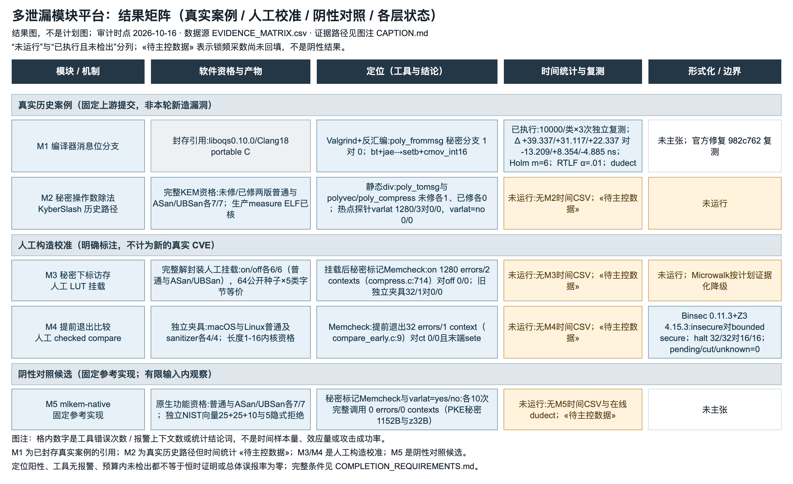

# 多泄漏平台报告准备件（2026-10-16 刷新）

审计基线：`main@ac46e62`，刷新时点 2026-10-16。
本目录提供**平台结果矩阵图**与逐章大纲；正式报告的当前载体在
[多泄漏平台新补充报告](../multi-leakage-platform-20261016/README.md)，旧正式 DOCX/PDF 与旧证据保持原件。

- [figures/platform-evidence-matrix.svg](figures/platform-evidence-matrix.svg)：可直接编辑的原生矢量结果图源（1492×912，纯 text 元素）。
- [figures/platform-evidence-matrix.png](figures/platform-evidence-matrix.png)：2984×1824 的 2 倍预览。
- [figures/CAPTION.md](figures/CAPTION.md)：图注、分类口径、各层状态含义与每格证据路径。
- [figures/REVIEW.md](figures/REVIEW.md)：实际生成命令、逐格内容与视觉核验。
- [figures/render_matrix.py](figures/render_matrix.py)：从 CSV 重建 SVG；[figures/render_preview.py](figures/render_preview.py)：渲染 PNG。
- [EVIDENCE_MATRIX.csv](EVIDENCE_MATRIX.csv)：机器可读状态（3 个分类带、`evidence_paths`、`filled_at`）。
- [REPORT_OUTLINE.md](REPORT_OUTLINE.md)：逐章研究问题、现有证据、待填表图与允许结论。

**本图是结果图，不是计划图**：只写已有证据的实际状态。分「真实历史案例（M1/M2）/
人工构造校准（M3/M4，不计为新的真实 CVE）/ 阴性对照候选（M5）」三组，逐格显示软件资格、
定位、时间统计与形式化边界；`未运行`与`«待主控数据»`都不写成阴性。

完整要求见 [COMPLETION_REQUIREMENTS](../../../docs/platform/COMPLETION_REQUIREMENTS.md)。
本准备件不新增时间样本，不运行密码算法，不改 M1 结论，也不主张 M2 已统计可区分或 M5 已阴性通过。
M2–M5 的锁频统计回填后需同步更新 CSV、图、图注与正文，再由主控汇总总索引。

图注：格内数字是工具错误次数/报警上下文数或统计结论词，不是样本量、效应量或攻击成功率；
`«待主控数据»` 表示锁频采数尚未回填，不是阴性。最初 Mermaid 矩阵语法可渲染，但三轮图中文字
仍被裁切，已停止该路线并采用原生 SVG；未交付裁切图，也未把该渲染器问题写成平台实验阻塞。
