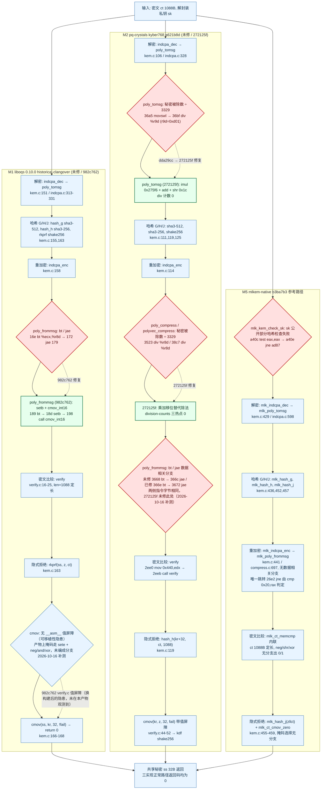

# R05 解封装全流程六类泄漏来源排查表

赛题第 5 条交付物。对象是 ML-KEM / 历史 Kyber 的**解封装全流程**，按五个步骤（列）× 六类泄漏来源（行）逐格给结论。
写法约定：每一格只写三件事——**结论**（存在 / 不存在 / 不适用 / 未检查）、**证据**（函数名 + 反汇编地址或工具输出路径，路径相对仓库根）、**修复点**（上游提交或本轮补丁，没有就写“无”）。

**阴性不是恒时证明。** 本表里出现“不存在”，含义统一收窄为：**在下列固定源码、固定编译器与选项、固定产物上，已查工具没有报出该类来源**。它不覆盖任意输入、任意编译器/微架构，也不是物理恒时、不是总体误报率、不是密钥恢复。
人工构造的夹具（M3/M4 等）一律标注**人工构造校准**，不当作真实历史实现。

**最近一次更新：2026-10-16（T15 补缺格）。** 本次只改三处格与相应汇总/遗留条目：
M2 §2.3 第 1 类（未检查 → **存在**）、M1 §1.5 第 2 类、M1 §1.5 第 5 类；并新增 M2/M5 哈希步骤的秘密标记结论。
新增原件、命令与原始输出在 [evidence/r05-locate-20261016/](evidence/r05-locate-20261016/)（[RESULT.md](evidence/r05-locate-20261016/RESULT.md)、[COMMANDS.md](evidence/r05-locate-20261016/COMMANDS.md)），
修复手段到题面第 6 条分类的映射在 [evidence/r06-noleak-20261016/MAPPING.md](evidence/r06-noleak-20261016/MAPPING.md)。既有证据目录一律未改动。

---

## 0. 对象与产物身份

| 实现 | 源码身份 | 实际被查产物 | 产物摘要 |
|---|---|---|---|
| **M1 未修** | liboqs 0.10.0（`vendor/liboqs-0.10.0/`，钉版快照） | `historical/measure`，Clang 18.1.3，`-Os -fno-vectorize`，AVX2 分发已关 | `measure` SHA-256 `bd84ee9c2a44993fb5c6b43c4fb37027a168d265b4ca027eba3c3026798a0f78` |
| **M1 已修** | 官方提交 `982c762c242ef549c914891b47bf6e0ed6321f91` 整份补丁打在副本 `liboqs-0.10.0-982c762/` | 同左，`-DLIBOQS010_SOURCE_DIR=` 重链 | `measure` SHA-256 `1849821eca3039872cf5f103e3928141978b8846792a8da4e7c790ce96c2b5e9` |
| **M2 未修** | pq-crystals kyber `a621b8dde405cc507cbcfc5f794570a4f98d69cc`（`vendor/kyber-kyberslash-unfixed/`） | 原生普通 `measure`，Clang 18.1.3，`-Oz -fno-vectorize` | `dd4073ba38d9ba6b465fca9b6f2e94ef11d8ebc8948901e41f0ba9926ee674e7` |
| **M2 已修** | pq-crystals kyber `272125f6acc8e8b6850fd68ceb901a660ff48196`（`vendor/kyber-kyberslash-fixed/`） | 同左 | `c48f89a5bc7f9bd8117a0319eacbc40bf9d061ecae2bad48812376d04745ada7` |
| **M5 参考** | mlkem-native `b3ba7b32773e657dd37f6f87bce82528459ad8a4`（`vendor/mlkem-native/`），portable C | 原生普通 `build-v2-ordinary/platform_m5_poison`，Clang 18.1.3，`-O2 -g -DNDEBUG` | `ELF` 摘要见 [elf-ordinary.sha256](evidence/m5-completion-20261016/software-dynamic-evidence.tar.gz)（归档内）与 M5 [ENV](evidence/m5-completion-20261016/ENV.md) |

M1 的“已修/未修”判定口径：两边的 `measure` 摘要与解封装统计见 [liboqs010-locked-20261015/README.md](evidence/liboqs010-locked-20261015/README.md)、[stage-d-decaps.txt](evidence/liboqs010-locked-20261015/logs/stage-d-decaps.txt)。
M2 的两份上游提交元数据见 [upstream-commits.txt](evidence/m2-kyberslash-20261016/version-audit/upstream-commits.txt)，源码级修复差异见 [upstream-remediation.diff](evidence/m2-kyberslash-20261016/version-audit/upstream-remediation.diff)。

### 0.1 六个步骤在三个实现里的实际函数（只列被查到的）

| 步骤 | M1（liboqs 0.10.0 ipd） | M2（历史 Kyber768 ref） | M5（mlkem-native） |
|---|---|---|---|
| 解密 | `pqcrystals_ml_kem_768_ipd_ref_indcpa_dec` → `poly_tomsg` | `pqcrystals_kyber768_ref_indcpa_dec` → `poly_tomsg` | `mlk_indcpa_dec` → `mlk_poly_tomsg` |
| 哈希 G/H/J | `hash_g`(sha3-512)、`hash_h`(sha3-256)、`rkprf`(shake256)，共享 FIPS202 | `pqcrystals_kyber_fips202_ref_sha3_512` / `_sha3_256` / `_shake256` | `mlk_hash_g` / `mlk_hash_h` / `mlk_hash_j`，内联 `keccakf1600_permute` |
| 重加密 | `indcpa_enc` → `poly_frommsg`、`polyvec_compress`、`poly_compress` | `pqcrystals_kyber768_ref_indcpa_enc` → 同上三件 | `mlk_indcpa_enc` → `mlk_poly_frommsg`、`mlk_poly_compress_du`、`mlk_polyvec_compress_du` |
| 密文比较 | `verify`（`verify.c`） | `pqcrystals_kyber768_ref_verify` | `mlk_ct_memcmp`（内联进 `mlk_kem_dec` / `baseline_native_dec`） |
| 隐式拒绝 / cmov | `rkprf(ss, z, ct)` + `cmov(ss, kr, 32, !fail)` | `hash_h(kr+32, ct, 1088)` + `cmov(kr, z, 32, fail)` + `kdf`(shake256) | `mlk_hash_j(ss, z‖ct)` + `mlk_ct_cmov_zero(ss, kr, 32, fail)` |

> 三家的隐式拒绝写法不同，这是**历史代际差异**，不是缺陷：M1 0.10.0-ipd 与 M5 是 `J(z‖c)` / `G` 后 `cmov` 覆盖；M2（2023 年 Kyber round3）是 `KDF(z_or_kr ‖ H(c))`，即 `cmov` 选 `z` 还是预密钥、再 `shake256` 出共享秘密。三者的拒绝秘密都只经 `cmov`/掩码选择，不经过分支。

### 0.2 步骤 × 类别的“判据”定义（本表按这一口径填）

1. **提前返回**：存在一条在秘密相关的判定上提前离开当前子路径的分支。
2. **可变时间比较**：比较/选择的返回到达时间取决于秘密（提前退出比较、`memcmp` 短路、或可变时延指令的**操作数**含秘密）。
3. **数据相关循环**：循环的**次数**或**是否继续**由秘密决定，而不只是由公开长度/固定常数决定。
4. **数据相关访存**：访存**地址**由秘密决定（秘密下标表、秘密驱动偏移）。
5. **失败路径**：验证失败时走一条与成功不同的**可区分路径**（不同的返回码、不同的后续计算、少做/多做一步）。
6. **异常处理**：`abort`/断言/`longjmp`/信号/未定义行为等会在特殊取值下改变控制流或终止进程的机制。

---

## 1. M1：liboqs 0.10.0 historical-clangover（未修）与 982c762（已修）

证据总览：反汇编原件 [locked-poly-frommsg-vulnerable.s](evidence/liboqs010-locked-20261015/logs/locked-poly-frommsg-vulnerable.s)、[locked-poly-frommsg-fixed.s](evidence/liboqs010-locked-20261015/logs/locked-poly-frommsg-fixed.s)、带重定位的 [poly-frommsg-fixed-reloc.s](evidence/tooling-strengthen-20261015/logs/poly-frommsg-fixed-reloc.s)；Memcheck/ctgrind 四条日志 [valgrind-ct/](evidence/tooling-strengthen-20261015/valgrind-ct/)；文本结论 [tooling-strengthen-20261015/RESULT.md](evidence/tooling-strengthen-20261015/RESULT.md)。
**统一警告：本节所有 M1 引用的地址只对上述两个固定 ELF 有效。** 行号指 `objdump -d` 输出的地址列（`<函数名+0x..>` 括号里的偏移同步给出）。

### 1.1 解密

| 类别 | 结论 | 证据 | 修复点 |
|---|---|---|---|
| 1 提前返回 | 不存在 | `indcpa_dec` 到 `poly_tomsg` 无数据相关分支。`poly_tomsg` 的循环回边由计数器与常数比较（`cmp $0x20,%rax` / `jne` 一类），源码 `vendor/liboqs-0.10.0/src/kem/ml_kem/pqcrystals-kyber-standard_ml-kem-768-ipd_ref/indcpa.c:313-331`。间接支持：未修整段私钥标记日志 [vulnerable-full-key.log](evidence/tooling-strengthen-20261015/valgrind-ct/vulnerable-full-key.log) 只有 `poly_frommsg` + `rej_uniform` 两个上下文（`ERROR SUMMARY: 6138 errors from 3 contexts`），没有 `poly_tomsg`/`indcpa_dec` | 无 |
| 2 可变时间比较 | 不存在 | 该步骤只有多项式减法/规约与位提取，没有数组比较；`poly_tomsg` 用 `t *= 80635; t >>= 28`（liboqs 0.10.0 版本已是乘加形式，`poly.c:192-207`），不含除法指令 | 无 |
| 3 数据相关循环 | 不存在 | 循环上界是 `KYBER_N/8 = 32` 与 `8`，编译期常数；无 `while(ctr<N)` 型重采样 | 无 |
| 4 数据相关访存 | 不存在 | 写入是 `mov %dx,(%rdi,%rcx,2)` 型固定顺序寻址；无秘密下标表 | 无 |
| 5 失败路径 | 不存在 | `crypto_kem_dec`（`kem.c:140-169`）在本步骤不判定失败；外层 `src/mlkem_liboqs010.c:59-75` 只在长度/空指针不合法时返回 `MLKEM_ERROR_ARGUMENT`（公开值），`OQS_KEM_..._decaps` 非 `OQS_SUCCESS` 时返回 `-1`，正常路径只要进入就一定返回 0 | 无 |
| 6 异常处理 | 不适用 | 该步骤及其被调链路无 `abort`/断言/`longjmp`/信号：对 `vendor/liboqs-0.10.0/src/kem/ml_kem/pqcrystals-kyber-standard_ml-kem-768-ipd_ref/` 与 `.../kyber/pqcrystals-kyber_kyber768_ref/` 检索 `abort\|longjmp\|setjmp\|assert(` 结果为空 | 无 |

### 1.2 哈希 G/H/J（shared FIPS202）

| 类别 | 结论 | 证据 | 修复点 |
|---|---|---|---|
| 1 提前返回 | 不存在 | 哈希在 `crypto_kem_dec` 里是 `call` + `push $0x40; pop %rdx` 型定长调用（见 1.3 的 `kem.c:158` 上下文）；未修整段私钥日志 [vulnerable-full-key.log](evidence/tooling-strengthen-20261015/valgrind-ct/vulnerable-full-key.log) 的 3 个上下文全部落在 `poly_frommsg` 与 `rej_uniform`，没有 FIPS202 帧 | 无 |
| 2 可变时间比较 | 不存在 | FIPS202 里没有比较；`sha3_*`/`shake256` 只做 absorb/squeeze。负向证据：已修整段私钥日志 [fixed-full-key.log](evidence/tooling-strengthen-20261015/valgrind-ct/fixed-full-key.log) 标记了整段私钥后，`ERROR SUMMARY: 5626 errors from 2 contexts` 仍只指向 `rej_uniform` 两处 | 无 |
| 3 数据相关循环 | 不存在 | 分派到 liboqs 共享 SHA-3（`sha3_*` → `OQS_SHA3_*`，`src/common/sha3/`），轮数固定 24；循环上界是 rate/长度等公开常数。证据是上述两条整段私钥日志的**上下文计数**：若哈希内有秘密相关分支，整段私钥标记下必然多出上下文 | 无 |
| 4 数据相关访存 | 不存在 | 同上：日志上下文数封顶为 `poly_frommsg` + `rej_uniform`；哈希状态访问是常量下标 | 无 |
| 5 失败路径 | 不存在 | 哈希不返回成功/失败状态，`crypto_kem_dec` 也不据哈希结果分支 | 无 |
| 6 异常处理 | 不存在 | 共享 SHA-3 实现内无 `abort`/断言/`longjmp`（同 1.1 第 6 行检索口径，覆盖 `src/common/sha3/` 调用面之外的整个 ML-KEM ref 目录） | 无 |

### 1.3 重加密（`indcpa_enc` / `poly_compress` / `polyvec_compress`）

| 类别 | 结论 | 证据 | 修复点 |
|---|---|---|---|
| 1 提前返回 | **存在** | `pqcrystals_ml_kem_768_ipd_ref_poly_frommsg`，**地址 `16e: bt %ecx,%r8d` → `172: jae 179`**（[locked-poly-frommsg-vulnerable.s](evidence/liboqs010-locked-20261015/logs/locked-poly-frommsg-vulnerable.s) 第 8–9 行）。命中路径由工具独立确认：Memcheck 在 `pqcrystals_ml_kem_768_ipd_ref_poly_frommsg (…/poly.c:179)` 报 “Conditional jump or move depends on uninitialised value(s)”，调用栈为 `indcpa_enc (indcpa.c:271) ← dec (kem.c:158) ← mlkem_decapsulate (src/mlkem_liboqs010.c:68) ← decapsulate_poisoned (src/historical_poison.c:33)`，见 [valgrind-ct/vulnerable.log](evidence/tooling-strengthen-20261015/valgrind-ct/vulnerable.log)。标记范围是解封装私钥前 1152 字节（[src/historical_poison.c:30-32](../tools/historical_poison.c)） | 官方 **982c762**（`setb` + `cmov_int16`）；本轮亦见 [message-constant-time.patch](../docs/patches/message-constant-time.patch) 的同类“掩码选择”写法用于人工变体 |
| 2 可变时间比较 | 不存在 | 该步骤没有密文比较（比较在下一列）；`verify` 不在重加密里被调用。`poly_frommsg` 的“选择”在未修上是**分支**而不是比较返回值，故归入第 1 类 | 无 |
| 3 数据相关循环 | 不存在 | 循环上界 `32 × 8` 为常数：未修 `cmp $0x8,%rcx` / `jne`、`cmp $0x20,%rax` / `jne`（同文件第 15、19 行）；已修 `cmp $0x8,%r13` / `jne`、`cmp $0x20,%r12` / `jne`（[locked-poly-frommsg-fixed.s](evidence/liboqs010-locked-20261015/logs/locked-poly-frommsg-fixed.s) 第 26、30 行）。`rej_uniform` 有数据相关循环，但其输入来自**公开**封装密钥种子；把标记收窄到 indcpa 私钥后它不再出现（[tooling-strengthen-20261015/RESULT.md](evidence/tooling-strengthen-20261015/RESULT.md) 第 15 行） | 无 |
| 4 数据相关访存 | 不存在 | 写出地址是 `mov %dx,(%rdi,%rcx,2)`（未修 `179:`）与 `mov %cx,-0xe(%rdi)` 序列（已修），索引来自计数值而非秘密；无秘密下标表 | 无 |
| 5 失败路径 | 不存在 | 重加密不因验证结果改变路径；`crypto_kem_dec` 不据 `fail` 分支（见 1.5） | 无 |
| 6 异常处理 | 不存在 | ref 目录内无 `abort`/断言/`longjmp`（同 1.1 第 6 行检索） | 无 |

**修复后的同一格（982c762）**：`189: bt %r13d,%eax` → `18d: setb %dl` → `198: call …cmov_int16`，重定位目标 `pqcrystals_ml_kem_768_ipd_ref_cmov_int16`（[poly-frommsg-fixed-reloc.s](evidence/tooling-strengthen-20261015/logs/poly-frommsg-fixed-reloc.s) 第 18–23 行），函数内**不再有 `jae`**；同一 Memcheck 探针在已修产物上 `ERROR SUMMARY: 0 errors from 0 contexts`（[valgrind-ct/fixed.log](evidence/tooling-strengthen-20261015/valgrind-ct/fixed.log)）。
补丁确实覆盖到该文件：`982c762` 的 `patch` 日志含 `src/kem/ml_kem/pqcrystals-kyber-standard_ml-kem-768-ipd_ref/{poly.c,verify.c,verify.h}`（[patch-apply.txt](evidence/liboqs010-locked-20261015/logs/patch-apply.txt)）。
我另行核对了修复的**功能等价性**：对 256 个全同字节消息与 256 个四值组合消息，`mask & 0x681`（未修语义）与 `bit ? 0x681 : 0`（`cmov_int16` 语义）逐系数相同（本机算术核对，0 处不等）。

### 1.4 密文比较

| 类别 | 结论 | 证据 | 修复点 |
|---|---|---|---|
| 1 提前返回 | 不存在 | `verify`（`vendor/liboqs-0.10.0/…/verify.c:16-25`）遍历全部 `len = 1088` 字节，`r |= a[i]^b[i]` 后统一返回 `(-(uint64_t)r) >> 63`，无短路 | 无 |
| 2 可变时间比较 | 不存在 | 同上：循环次数与 `len` 绑定（常数 1088），比较结果只以 0/1 返回。未修/已修整段私钥日志的上下文里都没有 `verify` | 无 |
| 3 数据相关循环 | 不存在 | 循环上界为 `len` 参数，调用点是常量 `$0x440`（1088） | 无 |
| 4 数据相关访存 | 不存在 | 两侧都是顺序递增下标 `a[i]`/`b[i]` | 无 |
| 5 失败路径 | 不存在 | `verify` 的返回值**只**参与 `cmov` 的掩码（见 1.5），不构造分支 | 无 |
| 6 异常处理 | 不适用 | 该函数无异常机制，且不可失败（无返回值错误通道） | 无 |

### 1.5 隐式拒绝 / cmov（`J(z‖c)` 与常数时间选择）

| 类别 | 结论 | 证据 | 修复点 |
|---|---|---|---|
| 1 提前返回 | 不存在 | `crypto_kem_dec`（`vendor/liboqs-0.10.0/…/kem.c:140-169`）无条件走完 `indcpa_dec → hash_g → indcpa_enc → verify → rkprf → cmov → return 0`；`fail` 只作 `cmov` 的第 4 实参。整段私钥标记日志里该区域无命中 | 无 |
| 2 可变时间比较 | **不存在（已看汇编；屏障缺失仍是未验证的可移植性隐患）** | 掩码生成点 `pqcrystals_ml_kem_768_ipd_ref_dec`（`0x2a7f`）：**`2b26: test %ebx,%ebx` → `2b28: sete %cl` → `2b37: call 2c4d <…_ref_cmov>`**，`fail` 走**无分支**的 `sete` 产出 0/1 掩码（[fixed-full.asm](evidence/r05-locate-20261016/remote-tree/m1-disasm/fixed-full.asm)；未修侧同一序列，[clangover-full.asm](evidence/r05-locate-20261016/remote-tree/m1-disasm/clangover-full.asm)）。`cmov` 体内掩码只作**数据**参与 `neg/and/xor`，**没有条件传送指令**，唯一条件跳转 `2c75: jne 2c5a` 的判据是参数 `len`（调用点传常数 `$0x20`）；两变体 `cmov` 指令字节除尾部对齐填充外完全相同。`dec` 函数体内 0 条跳转，全 ELF 无任何跳转以 `2b09`–`2b37` 为落点。**边界（重要）**：钉版 `cmov` 缺 `__asm__` 值屏障仍是**未验证的可移植性隐患**——本轮**没有**做换编译器/换优化级别的对照，只是在本产物上未观测到分支；阴性不等于恒时证明 | 官方 **982c762**（含 `verify.c` 值屏障）。本格不是“证明修复必要”，而是“证明本产物未把掩码编成分支” |
| 3 数据相关循环 | 不存在 | `rkprf` 是定长 shake256；`cmov` 循环上界 `len = 32` 常数 | 无 |
| 4 数据相关访存 | 不存在 | `cmov` 的 `r[i]^= b & (r[i]^x[i])` 是固定顺序下标；`z` 取自 `sk+2400-32` 固定偏移 | 无 |
| 5 失败路径 | **不存在（已看汇编：单点返回码 + 零跳转）** | `dec`（`0x2a7f`–`0x2b4f`，58 条指令）内**条件跳转与无条件跳转计数均为 0**，只有 6 处 `call` 与 1 处 `ret`；返回码单点：`2b3c: xor %eax,%eax` → `2b4f: ret`（[fixed-full.asm](evidence/r05-locate-20261016/remote-tree/m1-disasm/fixed-full.asm)，未修侧逐字节同一）。`fail` 的唯一去向是 `2b26: test %ebx,%ebx` → `2b28: sete %cl` → `2b37: call cmov` 的第 4 实参，只改 `ss[0..32)` 的**取值**。上层：`OQS_KEM_ml_kem_768_ipd_decaps`（`0x28b5`）是 `jmp 0x2a7f` 尾调用；`mlkem_decapsulate`（`0x1fe0`）仅在长度/空指针（公开参数）不合法时 `ret 0xffffff9c`，合法路径 `call` 后 `neg/sbb` 折成 0/-1，不据 `fail` 分支 | 无 |
| 6 异常处理 | 不适用 | 无异常机制；`rkprf`/`cmov` 均不可失败 | 无 |

### 1.6 M1 的“存在”格为什么只有 2 个（数字不吹大）

- `message-zero` 减 `message-ones`：未修 **39.337 ns**，95% 区间 `[21.658, 57.017]`（不含 0）；已修 **−13.209 ns**，区间 `[−33.238, 6.820]`（含 0）。原件 [stage-d-decaps.txt](evidence/liboqs010-locked-20261015/logs/stage-d-decaps.txt) 与 [README.md](evidence/liboqs010-locked-20261015/README.md)。
- 工具对照（RTLF / dudect / Valgrind / 反汇编）四项一致，见 [tooling-strengthen-20261015/RESULT.md](evidence/tooling-strengthen-20261015/RESULT.md)。
- 这些是**端到端佐证**，本表第 1 类的定位证据用的是反汇编地址与 Memcheck 栈，不是时延差。

---

## 2. M2：pq-crystals kyber768 未修 `a621b8d` 与完整已修 `272125f`

反汇编原件（原生普通构建，Clang 18.1.3、`-Oz -fno-vectorize`、`KYBER_K=3`）：[native-qualification/](evidence/m2-kem-20261016/native-qualification/)（`unfixed-*.asm` / `fixed-*.asm`）；第二套独立产物（qualification + microbench）见 [microbench-0551254c9579/disasm/](evidence/m2-kem-20261016/microbench-0551254c9579/disasm/)。动态定位见 [m2-kyberslash-20261016/version-audit/](evidence/m2-kyberslash-20261016/version-audit/)。
**优化级别警告（M2 RESULT 自述、本表独立复核）**：`div` 机制只在普通 `-Oz` 产物成立。同一个源码在 sanitizer 构建（`-O1`）里 `division_instructions` 全为 0，见 [sanitize-unfixed-microbench.division-counts.txt](evidence/m2-kem-20261016/microbench-0551254c9579/disasm/sanitize-unfixed-microbench.division-counts.txt)。任何换优化级别的重建都会让该机制**静默消失**。

### 2.1 解密

| 类别 | 结论 | 证据 | 修复点 |
|---|---|---|---|
| 1 提前返回 | 不存在 | `unfixed-pqcrystals_kyber768_ref_dec.asm` 全 71 行只有一条非循环条件跳转 `2e93: je 2ea6`（第 16 行），是常量 32 字节复制循环的回边条件；其后依次 `call indcpa_dec (2e88)`。无秘密相关分支 | 无 |
| 2 可变时间比较 | **存在** | `poly_tomsg`：**`36bf: div %r9d`**，`%r9d` 由 `3689: mov $0xd01,%r9d`（= 3329）装入（[unfixed-…poly_tomsg.asm](evidence/m2-kem-20261016/native-qualification/unfixed-pqcrystals_kyber768_ref_poly_tomsg.asm) 第 3、19 行）。被除数是秘密：`36a5: movswl (%rsi,%rcx,2),%eax` 取自 `indcpa_dec` 交给它的消息多项式（`indcpa.c:330`）。独立动态确认：varlat 报 3 个上下文，其中一条正是 `Variable-latency instruction operand of size 8 is secret/uninitialised at pqcrystals_kyber768_ref_poly_tomsg (ref/poly.c:188)`（[varlat-unfixed.log](evidence/m2-kyberslash-20261016/version-audit/varlat-unfixed.log)），`unfixed_status=99`、`1280 errors from 3 contexts`（[varlat-status.txt](evidence/m2-kyberslash-20261016/version-audit/varlat-status.txt)） | 官方 **dda29cc**（KyberSlash1，只修此处）→ 完整已修 **272125f**。本表以 `272125f` 为已修对照 |
| 3 数据相关循环 | 不存在 | 循环上界 `cmp $0x20,%r8`、`cmp $0x8,%rcx`（第 4–5、9–10 行），编译期常数 | 无 |
| 4 数据相关访存 | 不存在 | 写入 `mov %r10b,(%rdi,%r8,1)`（第 23 行）为固定顺序；系数读 `(%rsi,%rcx,2)` 顺序递增 | 无 |
| 5 失败路径 | 不存在 | `crypto_kem_dec`（`kem.c:94-127`）本步骤不判定失败；外层 `mlkem_decapsulate` 只做公开长度/空指针检查后 `jmp dec`（[unfixed-mlkem_decapsulate.asm](evidence/m2-kem-20261016/native-qualification/unfixed-mlkem_decapsulate.asm) 第 2–16 行），不合法时 `mov $0xffffff9c,%eax; ret`（第 17–18 行，公开参数） | 无 |
| 6 异常处理 | 不适用 | ref 目录内 `abort` 只在 `randombytes.c`/`rng.c`（RNG 失败），`crypto_kem_dec` 不消费 RNG，故该步骤路径上不可达；`mlkem_decapsulate` 也不消费 RNG（`src/platform_m2_adapter.c:148-162` 直接 `return crypto_kem_dec(...)`） | 无 |

**已修同一格**：`fixed-pqcrystals_kyber768_ref_poly_tomsg.asm` 里 `div` 计数为 **0**，改成 `imul $0x275f6` + `add $0x8009a7b` + `shr $0x1c`（第 11–13 行）。varlat 已修侧 `0 errors from 0 contexts`、退出码 0（[varlat-fixed.log](evidence/m2-kyberslash-20261016/version-audit/varlat-fixed.log)、[varlat-status.txt](evidence/m2-kyberslash-20261016/version-audit/varlat-status.txt)）；同一对 ELF 关掉 varlat 后普通 Memcheck 两侧都 0/0（[ordinary-memcheck-unfixed.log](evidence/m2-kyberslash-20261016/version-audit/ordinary-memcheck-unfixed.log)、[ordinary-memcheck-fixed.log](evidence/m2-kyberslash-20261016/version-audit/ordinary-memcheck-fixed.log)）。

### 2.2 哈希 G/H/J

| 类别 | 结论 | 证据 | 修复点 |
|---|---|---|---|
| 1 提前返回 | 不存在 | `dec.asm` 里三次哈希都是定长调用：`3fe1 → sha3_512`（第 40 行）、`4021 → sha3_256`（第 57 行）、`4054 → shake256`（第 72 行，`push $0x40; pop %rcx` 为常量 64）。函数符号在 [ordinary-unfixed-qualification.defined-symbols.txt](evidence/m2-kem-20261016/microbench-0551254c9579/disasm/ordinary-unfixed-qualification.defined-symbols.txt) 第 82–107 行 | 无 |
| 2 可变时间比较 | 不存在（见本节末“2026-10-16 补测”） | 哈希内部无比较；varlat 的 3 个命中全部落在 `poly_tomsg` / `poly_compress` / `polyvec_compress` 三个多项式热点，没有 FIPS202 帧（[varlat-unfixed.log](evidence/m2-kyberslash-20261016/version-audit/varlat-unfixed.log)）。**注意该日志的探针只调三个多项式函数、从未走完整解封装**，故当时哈希步骤实际没有秘密标记证据；2026-10-16 已补做，见本节末 | 无 |
| 3 数据相关循环 | 不存在 | Keccak 轮数固定；absorb/squeeze 的上界是 rate 与长度常数 | 无 |
| 4 数据相关访存 | 不存在 | 同上，varlat 未报 FIPS202；状态访问为常量下标 | 无 |
| 5 失败路径 | 不存在 | 哈希不返回状态 | 无 |
| 6 异常处理 | 不存在 | `pqcrystals_kyber_fips202_ref_*` 所在目录内无 `abort`/断言/`longjmp`（[VERSION_AUDIT.md](evidence/m2-kyberslash-20261016/VERSION_AUDIT.md) 与 ref 目录检索口径） | 无 |

**2026-10-16 补测（秘密标记下的完整解封装）**：本节原引用是“三个多项式热点探针”的 varlat 日志，**没有**覆盖哈希步骤。
本次新增探针 [probe_dec.c](evidence/r05-locate-20261016/remote-tree/m2-ctgrind/probe/probe_dec.c)（SHA-256 `a4b10060a066f34ff53d161db50966c4347b00e56ac8f2a772c181591ec87be0`），
调用同一份 vendor 源码的 `crypto_kem_keypair/enc/dec`，把 `sk` 的 1152 字节 PKE 私钥按 8 个分区累积 `VALGRIND_MAKE_MEM_UNDEFINED`，
共享秘密在消费前显式 declassify；构建 `clang -O1 -g -DNDEBUG -DKYBER_K=3`，`--error-exitcode=99 --track-origins=yes`，2 变体 × 8 分区 = **16 次**运行
（日志 [logs/](evidence/r05-locate-20261016/remote-tree/m2-ctgrind/logs/)，汇总 [run-log.txt](evidence/r05-locate-20261016/remote-tree/m2-ctgrind/run-log.txt)）。
结果：**16/16 都是 `256 errors from 1 contexts`，且唯一上下文恒为重加密的 `poly_frommsg`**（未修 `poly.c:167`／已修 `poly.c:178`）
调用链 `poly_frommsg ← indcpa_enc (indcpa.c:269) ← dec (kem.c:114)`。
**即：哈希 G/H/J（`sha3_512` / `sha3_256` / `shake256`）与密文比较路径在秘密标记下没有任何命中。**
边界：Memcheck 只报“实际执行到的、以未初始化值判定的分支/条件传送”，不覆盖非分支类时间差异（那由 varlat 覆盖），也不是恒时证明。

### 2.3 重加密（`indcpa_enc` / `poly_compress` / `polyvec_compress`）

| 类别 | 结论 | 证据 | 修复点 |
|---|---|---|---|
| 1 提前返回 | **存在** | `pqcrystals_kyber768_ref_poly_frommsg` 未修 **`3668: bt %ecx,%r8d` → `366c: jae 3673`**，判据是解封装消息 `m'` 的位（`3661: movzbl (%rsi,%rax,1),%r8d`）：[unfixed-poly_frommsg.asm](evidence/r05-locate-20261016/remote-tree/m2-disasm/unfixed-poly_frommsg.asm)。**已修同一函数逐字节相同**（只整体平移 6 字节）：`366e: bt %ecx,%r8d` → `3672: jae 3679`，两侧指令字节 SHA-256 同为 `6a6ee641a5e8a7de23052fbc7f5855dc01f3c08b6bb593fee43a2b41de26ed35`（`*-poly_frommsg.bytes`）：[fixed-poly_frommsg.asm](evidence/r05-locate-20261016/remote-tree/m2-disasm/fixed-poly_frommsg.asm)。可达性：调用点 `32d2`（未修 `call 3651`／已修 `call 3657`）落在 `indcpa_enc`（`0x3283`，`indcpa.c:269`），由 `dec` 的 `2edb: call 3283` 进入。独立动态确认：[unfixed-z01of08.log](evidence/r05-locate-20261016/remote-tree/m2-ctgrind/logs/unfixed-z01of08.log) 报 `Conditional jump … at pqcrystals_kyber768_ref_poly_frommsg (poly.c:167) ← indcpa_enc (indcpa.c:269) ← dec (kem.c:114)`；同一探针 8 分区全量覆盖下 16/16 次都是这唯一一个上下文（见 [RESULT.md](evidence/r05-locate-20261016/RESULT.md) 第 4 节）。源码 `vendor/kyber-kyberslash-unfixed/ref/poly.c:155-170`（分支对应 166–167 行） | **无**：`272125f` 的差异只含 `ref/poly.c` 的 compress/tomsg 与 `ref/polyvec.c`（[upstream-remediation.diff](evidence/m2-kyberslash-20261016/version-audit/upstream-remediation.diff)），**不碰 `poly_frommsg`**；M2 家族也没有 liboqs `982c762` 那种 `setb`+`cmov_int16` 改写。该格在已修侧同为“存在” |
| 2 可变时间比较 | **存在** | `poly_compress`：**`3523: div %r8d`**，被除数来自 `3507: movswl (%rsi,%r9,2),%eax`（秘密多项式系数），除数由 `34f2: mov $0xd01,%r8d` 装入（[unfixed-…poly_compress.asm](evidence/m2-kem-20261016/native-qualification/unfixed-pqcrystals_kyber768_ref_poly_compress.asm) 第 3、9、18 行）。`polyvec_compress`：**`38c7: div %r8d`**，同样常量除数 3329、秘密被除数（[unfixed-…polyvec_compress.asm](evidence/m2-kem-20261016/native-qualification/unfixed-pqcrystals_kyber768_ref_polyvec_compress.asm) 第 3、13、22 行）。`KYBER_K=3` 走 `KYBER_POLYCOMPRESSEDBYTES == 128` 与 `KYBER_POLYVECCOMPRESSEDBYTES == 3*320` 分支（`ref/params.h:44-49`）。varlat 另两条上下文正是 `poly_compress (ref/poly.c:28)` 与 `polyvec_compress (ref/polyvec.c:48)` | 官方 **272125f**（KyberSlash2；上游提交信息：Removed "/KYBER_Q" in poly_compress and polyvec_compress … thanks to Prasanna Ravi and Matthias Kannwischer）。中间点 `dda29cc` **不算**已修 |
| 3 数据相关循环 | 不存在 | 循环上界 `cmp $0x20,%rcx` / `cmp $0x8,%r9`（poly_compress 第 4–5、7 行）与 `cmp $0x3,%rcx` / `cmp $0x40,%r10` / `cmp $0x4,%r11`（polyvec_compress 第 4、8、11 行），全为常数 | 无 |
| 4 数据相关访存 | 不存在 | 压缩输出是定长位移拼装（`shl`/`or`）与顺序栈写 `mov %al,-0x8(%rsp,%r9,1)`；无秘密下标 | 无 |
| 5 失败路径 | 不存在 | 重加密不返回错误（`void`），`crypto_kem_dec` 不据其结果分支 | 无 |
| 6 异常处理 | 不存在 | 同上（ref 目录无 `abort`/断言/`longjmp`） | 无 |

**已修同一格**：`fixed-…poly_compress.asm` / `fixed-…polyvec_compress.asm` 的 `div` 计数为 0；机器可读汇总见 [ordinary-fixed-qualification.division-counts.txt](evidence/m2-kem-20261016/microbench-0551254c9579/disasm/ordinary-fixed-qualification.division-counts.txt)（三热点 + `dec` + `mlkem_decapsulate` 全 0），未修侧对应文件三热点各 1、`dec` 与 `mlkem_decapsulate` 各 0。

**同一格的本步骤其他类（2026-10-16 更新）**：第 1 类“提前返回”由“未检查”改为“**存在**”（见表格上方同格与 §4.3）；
新增的 8 分区秘密标记探针在 16 次完整解封装里，重加密侧的唯一命中也正是 `poly_frommsg`，
`poly_compress` / `polyvec_compress` 未出现在任何上下文中（[RESULT.md](evidence/r05-locate-20261016/RESULT.md) 第 4 节）。

### 2.4 密文比较

| 类别 | 结论 | 证据 | 修复点 |
|---|---|---|---|
| 1 提前返回 | 不存在 | `dec.asm`：`2ee0: mov $0x440,%edx` → `2eeb: call verify`（第 37–40 行），调用后**没有**对返回值做条件跳转，直接 `2ef0: mov %eax,%ebx` 并继续 | 无 |
| 2 可变时间比较 | 不存在 | `pqcrystals_kyber768_ref_verify` / `_cmov` 是**独立符号**（[defined-symbols](evidence/m2-kem-20261016/microbench-0551254c9579/disasm/ordinary-unfixed-qualification.defined-symbols.txt) 第 80–81 行），源码 `vendor/kyber-kyberslash-unfixed/ref/verify.c:16-25` 累积 `r |= a[i]^b[i]` 后统一返回 0/1；无短路、无 `memcmp` | 无 |
| 3 数据相关循环 | 不存在 | 循环上界是参数 `len`，唯一调用点传常量 1088（`$0x440`） | 无 |
| 4 数据相关访存 | 不存在 | 两侧顺序递增下标 | 无 |
| 5 失败路径 | 不存在 | `verify` 结果进入 `cmov`（见 2.5），不构造分支 | 无 |
| 6 异常处理 | 不适用 | 该函数不可失败、无异常机制 | 无 |

### 2.5 隐式拒绝 / cmov

| 类别 | 结论 | 证据 | 修复点 |
|---|---|---|---|
| 1 提前返回 | 不存在 | `dec.asm` 第 41–73 行：`mov %eax,%ebx`（存 `fail`）→ `call sha3_256`（H(c) 写进 `kr+32`）→ `movzbl %bl,%ecx`（`fail` 作 cmov 掩码）→ `call cmov` → `call shake256`（KDF）→ `xor %eax,%eax; ret`。返回码恒 0，无 `test/jne` on `fail` | 无 |
| 2 可变时间比较 | 不存在 | `cmov` 带值屏障（`ref/verify.c:44-52`，`__asm__("" : "+r"(b))`）；`fail` 以 `%ecx` 传参而非作分支条件。**边界**：本轮未出 `cmov` 自身反汇编，结论建立在“调用点无分支 + 源码无分支 + 值屏障在位”三条上 | 无（`272125f` 未改 verify.c） |
| 3 数据相关循环 | 不存在 | `cmov` 循环上界 32；KDF 定长 | 无 |
| 4 数据相关访存 | 不存在 | `cmov(kr, sk+2400-32, 32, fail)`，两侧都是固定偏移与顺序下标 | 无 |
| 5 失败路径 | 不存在 | 成功与失败**同一条路径**：都做 `indcpa_dec → G → indcpa_enc → verify → H(c) → cmov → KDF → return 0`。`fail` 只改 `kr[0..32)` 的**取值**，不改控制流、不改返回码、不改后续调用序列。该实现是历史 Kyber round3 写法（`KDF(cmov(z or pre-k) ‖ H(c))`），与 M1/M5 的 `J(z‖c)` 代际不同但语义等价 | 无 |
| 6 异常处理 | 不适用 | 无异常机制；`rkprf`/`cmov` 不可失败 | 无 |

### 2.6 M2 的端到端与微基准层（只作分层登记，不并入本表判定）

| 层 | 结果 | 原件 |
|---|---|---|
| 定位层 | **阳性**：未修链三热点各 1 个 `div`，已修 0 个 | [native-qualification/](evidence/m2-kem-20261016/native-qualification/) |
| 完整解封装层 | **未检出**：家族 `m2_end_to_end_full_decaps_v1` m=6，Holm 拒绝数 0，合并 Δ=+4.58 ns，CI `[−3.08, +12.25]`（含 0），I²=58.3% | [m2-kem-20261016/RESULT.md](evidence/m2-kem-20261016/RESULT.md) |
| 除法热点微基准层 | **未检出**：家族 `m2_div_hotspot_microbench_v1` m=6，拒绝数 0，Δ=+0.044 ns，CI `[−0.430, +0.517]` | [microbench-0551254c9579/RESULT.md](evidence/m2-kem-20261016/microbench-0551254c9579/RESULT.md) |
| 臂间漂移 | 未修臂描述性合并 +12.35 ns、已修臂 −11.20 ns，方向相反，记为漂移**不是**可归因泄漏 | 同上 |

三层互不冒充：定位层阳性说的是“指令与数据流层面存在可变时指令”，不是本机已测到物理时差；“未检出”也不是恒时证明。

---

## 3. M5：mlkem-native `b3ba7b3` 参考路径

主要证据：`build-v2-ordinary/platform_m5_poison` 的完整反汇编 `logs-v2/poison.disasm`（在归档 [software-dynamic-evidence.tar.gz](evidence/m5-completion-20261016/software-dynamic-evidence.tar.gz) 内，本表引用的**归档内路径**统一写作 `logs-v2/…`）；三模式 Valgrind 日志 `logs-v2/{system,varlat-no,varlat-yes}.valgrind.log`；结论 [m5-completion-20261016/RESULT.md](evidence/m5-completion-20261016/RESULT.md)、[ENV.md](evidence/m5-completion-20261016/ENV.md)。

> 归档是证据原件的存放形式；本表每一处 `logs-v2/…` 行号都是从该归档解出后**实际打开核对过**的。标记范围：PKE 私钥 1152 字节 + 拒绝秘密 z 32 字节，共 1184 字节；pk/hash/ct 明确不标（`ENV.md` §私钥标记）。

`poison.disasm` 定位索引。本表全部 M5 反汇编引用都落在下表，可逐条 `sed -n '<行号>p' logs-v2/poison.disasm` 复核：

| 地址 | 行号 | 指令 | 用途 |
|---|---:|---|---|
| `2610` | 1532 | `add $0xe,%rdi` | `baseline_native_poly_frommsg` 函数头 |
| `2620`–`26d4` | 1537–1592 | `and (%rsi,%rax,1),%cl` … `and $0x681,%ecx` … `mov %cx,…` | 8 个消息位的无分支掩码选择（全展开） |
| `26de`/`26e2` | 1595–1596 | `cmp $0x20,%rax` / `jne 2620` | `poly_frommsg` **唯一**条件跳转，判据是常数系数下标 |
| `26f0` | 1600 | — | `baseline_native_poly_tomsg` 函数头（常数上界回边 `26fa`/`2707`/`2801`） |
| `7850` | 6468 | — | `baseline_native_indcpa_dec` 函数头（回边 `794a`/`7d96`） |
| `8a80` | 7571 | — | `baseline_native_check_sk` 函数头 |
| `a3e0` | 9019 | `push %rbp` | `baseline_native_dec` 函数头 |
| `a404` | 9033 | `call 8a80 <baseline_native_check_sk>` | 公开 sk 完整性检查 |
| `a40c`/`a40e` | 9035–9036 | `test %eax,%eax` / `jne ad87` | **第 3.5 节“存在”格**：检查失败时提前跳到 `ad87`（清零并 `ret`） |
| `a620`–`a689` | 9160–9183 | `movdqu`/`pxor`/`por` … `cmp $0x470,%rax` / `jne a620` | `mlk_ct_memcmp` 内联（循环体内无条件跳转） |
| `a6f4`–`a6ff` | 9208–9211 | `movzbl %al,%r12d` / `neg` / `shr $0x10` / `xor %r13d,%r12d` | 比较结果无分支归约成 0/1 |
| `acd5` | 9554 | `xor %r13b,%r12b` | `fail` 参与掩码生成 |
| `ad60`–`ad85` | 9589–9600 | `movzbl 0x120(%rsp,%rcx,1)` … `xor %dl,%dil` … `cmp $0x20,%rcx` / `jne ad60` | `mlk_ct_cmov_zero` 内联（掩码选择，回边是常数） |
| `ad87` | 9601 | `lea 0x160(%rsp),%rbx` | 提前退出的清理入口 |

### 3.1 解密

| 类别 | 结论 | 证据 | 修复点 |
|---|---|---|---|
| 1 提前返回 | 不存在 | `baseline_native_indcpa_dec`（`poison.disasm` 第 6468 行起）内的条件跳转全部是常数上界回边，例如 `794a: jne 7890`（第 6528 行）、`7d96: je 80be`（第 6770 行，`cmp` 后紧跟常量边界）；源码 `mlk_indcpa_dec` 无数据相关分支（`vendor/mlkem-native/mlkem/src/indcpa.c:598-637`）。动态：三模式 10 次完整解封装均 0 命中 | 无 |
| 2 可变时间比较 | 不存在 | 本步骤是 NTT/基乘/减法/`poly_tomsg`；`mlk_poly_tomsg` 的 `poison.disasm` 第 1600 行起只有常数上界回边（`26fa: jbe 280c`、`2707: jbe 280c`、`2801: jne 2720`）。varlat=yes（KyberSlash 补丁 Valgrind，检测可变时延指令的秘密操作数）在该产物上 **0 errors / 0 contexts**，[logs-v2/varlat-yes.valgrind.log](evidence/m5-completion-20261016/software-dynamic-evidence.tar.gz) | 无（该实现从上游起就用乘加/移位，不用 `div`） |
| 3 数据相关循环 | 不存在 | 循环上界 `MLKEM_N`、`MLKEM_K`、7 层 NTT 等全为常数（`vendor/mlkem-native/mlkem/src/poly.c:119,196,234,254,282,365,406,446,492,502,539,549`） | 无 |
| 4 数据相关访存 | 不存在 | 计数器下标与固定常数偏移；秘密标记下 Memcheck 无“uninitialised value”命中 | 无 |
| 5 失败路径 | 不存在 | `mlk_indcpa_dec` 的 `goto cleanup` 只在**分配失败**时走（`indcpa.c:610-614`），与秘密无关；正常路径一律执行完整解密 | 无 |
| 6 异常处理 | 不适用 | 本步骤无异常机制；`vendor/mlkem-native/mlkem/src/{poly.c,poly_k.c,indcpa.c}` 内无 `abort`/`longjmp`（`indcpa.c:279` 的 `mlk_assert` 是 `MLKEM_K*MLKEM_K` 常量条件，与秘密无关，且 release 构建下不启用） | 无 |

### 3.2 哈希 G/H/J

| 类别 | 结论 | 证据 | 修复点 |
|---|---|---|---|
| 1 提前返回 | 不存在 | 哈希被内联进 `baseline_native_dec`；`poison.disasm` 里 SHA3-512/SHA3-256/SHAKE256 区段只有 `movups/xorps/call keccakf1600_permute` 与常数计数回边，形如 `a689: jne a620`（第 9183 行，比较 `$0x470`）。`mlk_hash_g`/`mlk_hash_h`/`mlk_hash_j` 在 `kem.c` 里无返回值判定 | 无 |
| 2 可变时间比较 | 不存在 | `vendor/mlkem-native/mlkem/src/fips202/fips202.c` 的条件语句只有 `while (mlen >= r)`、`if (mlen > 0)`、`if (mlen == r-1)`、`while (nblocks>0)`、`while (outlen>0)`、`if (outlen < r)`（第 73、88、93、124、162、173 行），全部由**长度**驱动；本路径的长度是常数。三模式 Valgrind 0/0 | 无 |
| 3 数据相关循环 | 不存在 | Keccak-f1600 轮数固定；长度循环的入参在本路径上为常量 | 无 |
| 4 数据相关访存 | 不存在 | 状态数组访问为常量下标；`keccakf1600_permute` 无秘密索引 | 无 |
| 5 失败路径 | 不存在 | 哈希不返回状态 | 无 |
| 6 异常处理 | 不存在 | `fips202/` 与 `keccakf1600.c` 内无 `abort`/断言/`longjmp` | 无 |

**2026-10-16 复核（只读，未重跑）**：本节“三模式 Valgrind 0/0”的标注范围确实覆盖哈希步骤——标记范围是 PKE 私钥 1152 B + 拒绝秘密 z 32 B（共 1184 B），
且是**完整解封装**调用（`harness → mlkem_decapsulate → baseline_native_dec → indcpa_dec + 重加密 + 比较 + 拒绝 KDF`）。
本轮解归档复核：`logs-v2/system.valgrind.log`、`logs-v2/varlat-no.valgrind.log`、`logs-v2/varlat-yes.valgrind.log` 各 15 行、
末行均为 `ERROR SUMMARY: 0 errors from 0 contexts`，`logs-v2/*.exit-status` 均为 `0`，
`logs-v2/system.stdout` 末行 `mode=valgrind_secret_marked pke_secret_bytes=1152 rejection_secret_bytes=32 ciphertext=public`。
即：**M5 的哈希 G/H/J 在秘密标记下无命中**（与本节结论一致）。

### 3.3 重加密（`indcpa_enc` / `poly_compress_du` / `polyvec_compress_du`）

| 类别 | 结论 | 证据 | 修复点 |
|---|---|---|---|
| 1 提前返回 | 不存在 | `baseline_native_poly_frommsg`（`poison.disasm` 第 1532 行起）里**唯一的条件跳转**是 `26e2: jne 2620`（第 1596 行），其判据是 `26de: cmp $0x20,%rax`——系数下标对常数 32。8 个消息位全部展开为**无分支掩码选择**：`and (%rsi,%rax,1),%cl` → `movzbl` → `neg` → `shr $0x10` → `and $0x681` → `mov %cx,…`（第 1537–1592 行）。动态：三模式 10 次完整解封装 0 命中 | 无。人工变体用的同类“掩码选择”补丁见 [message-constant-time.patch](../docs/patches/message-constant-time.patch)、[message-value-barrier.patch](../docs/patches/message-value-barrier.patch)（**人工构造校准**，只用于 M3/M4 夹具，不是本实现的一部分） |
| 2 可变时间比较 | 不存在 | 该步骤内没有比较动作；`polyvec_compress_du`/`poly_compress_du` 是乘加与位移（`b970`、`b6d0` 段），varlat=yes 0/0 | 无 |
| 3 数据相关循环 | 不存在 | `poly_frommsg` 32 次定长；压缩函数循环上界 `MLKEM_N/…` 为常数。唯一的数据相关重采样 `mlk_rej_uniform_c`（`vendor/mlkem-native/mlkem/src/sampling.c:54-79`）的输入是**公开**矩阵种子，且实现显式 `MLK_CT_TESTING_DECLASSIFY(seed, …)` 声明该公开性（`indcpa.c:546-552`） | 无 |
| 4 数据相关访存 | 不存在 | 系数写出为固定顺序；拒绝采样的写指针由公开种子派生，且被显式 declassify | 无 |
| 5 失败路径 | 不存在 | `mlk_indcpa_enc` 的 `goto cleanup` 只在分配失败时走（`indcpa.c:536-541`） | 无 |
| 6 异常处理 | 不适用 | 无异常机制 | 无 |

### 3.4 密文比较

| 类别 | 结论 | 证据 | 修复点 |
|---|---|---|---|
| 1 提前返回 | 不存在 | `mlk_ct_memcmp` 内联进 `baseline_native_dec`：`a620`–`a689` 每轮 64 字节 `movdqu` + `pxor` + `por` 累积，循环回边 `a689: jne a620` 的判据是 `a683: cmp $0x470,%rax`（常数）。**循环体内没有任何条件跳转**（`poison.disasm` 第 9160–9183 行） | 无 |
| 2 可变时间比较 | 不存在 | 归约结果无分支产生 0/1：`a6f4: movzbl %al,%r12d` → `a6f8: neg %r12d` → `a6fb: shr $0x10,%r12d` → `a6ff: xor %r13d,%r12d`（第 9208–9211 行）。`fail` 只作后续掩码 | 无 |
| 3 数据相关循环 | 不存在 | 循环长度 `MLKEM_INDCCA_CIPHERTEXTBYTES = 1088` 是编译期常数 | 无 |
| 4 数据相关访存 | 不存在 | 两侧顺序 `movdqu -0x30(%r14,%rax,1)` / `0x130(%rsp,%rax,1)` 型寻址，索引只有计数器 | 无 |
| 5 失败路径 | 不存在 | `mlk_ct_memcmp` 的返回不构造分支 | 无 |
| 6 异常处理 | 不适用 | 该函数不可失败 | 无 |

### 3.5 隐式拒绝 / cmov（`J(z‖c)` 与常数时间选择）

| 类别 | 结论 | 证据 | 修复点 |
|---|---|---|---|
| 1 提前返回 | **存在（有界例外，需如实登记）** | `baseline_native_dec` 开头：`a404: call 8a80 <baseline_native_check_sk>` → `a40c: test %eax,%eax` → **`a40e: jne ad87`**（`poison.disasm` 第 9033–9036 行）。这是 `mlk_kem_check_sk` 的 sk 完整性检查失败时**提前跳到退出**（`ad87` 起为清零与 `ret`）。**为什么不算可利用泄漏**：被哈希/比较的 `sk[1152,2400)` 与 `sk[2368,2400)` 在源码里被明确声明为公开（`vendor/mlkem-native/mlkem/src/kem.c:92-99` 的 “The parts of `sk` being hashed and compared here are public, so no public information is leaked through the runtime or the return value of this function”），且该分支的判据是公开数据的哈希。**边界**：这意味着一个被篡改/损坏的 `sk` 会让解封装提前退出，路径与正常 sk 不同——该差异只携带公开信息，但“sk 不可信”不在本轮 CCA 模型内 | 无（上游有意的 FIPS203 §7.3 哈希检查，非缺陷） |
| 2 可变时间比较 | 不存在 | `mlk_ct_cmov_zero` 内联在 `ad60`–`ad85`：`movzbl 0x120(%rsp,%rcx,1),%edx` / `movzbl (%rbx,%rcx,1),%esi` / `xor %dl,%sil` / `mov %eax,%edi` / `shr $0x10,%edi` / `and %sil,%dil` / `xor %dl,%dil` / `mov %dil,(%rbx,%rcx,1)`，掩码在 `ad52-ad56` 由 `fail` 无分支生成（`movzbl %r12b,%eax` → `neg %eax`）；循环回边 `ad85: jne ad60` 判据是 `cmp $0x20,%rcx`（常数）。J(z‖c) 的 Keccak 部分同样只有常数计数回边 | 无 |
| 3 数据相关循环 | 不存在 | 上述两处循环上界 32 与 Keccak 的固定轮数 | 无 |
| 4 数据相关访存 | 不存在 | `z‖ct` 的装载是固定偏移 `movups 0x940(%r15)`（`poison.disasm` 第 9212 行）与 `memcpy` 定长 1088；`cmov_zero` 两侧顺序下标 | 无 |
| 5 失败路径 | 不存在（就 ct 验证而言） | 成功与失败同路径：都做 `check_sk → indcpa_dec → G → indcpa_enc → ct_memcmp → J(z‖c) → ct_cmov_zero → return`；`fail` 只改 `ss` 的内容，不改控制流与返回码（`kem.c:441-455`），返回码由 `ret` 通道给出且正常路径为 0。**唯一例外**是上面第 1 类的 `sk` 检查早退 | 无 |
| 6 异常处理 | 不适用 | 无异常机制；`MLK_ALLOC`/`MLK_FREE` 走 `goto cleanup`，判据是分配结果而非秘密 | 无 |

### 3.6 M5 的阴性边界

- 三模式（发行版 Memcheck、S3 patched varlat=no、varlat=yes）在 10 次被标记的完整解封装上全部 exit 0、`0 errors / 0 contexts`，原件 `logs-v2/system.valgrind.log`、`logs-v2/varlat-no.valgrind.log`、`logs-v2/varlat-yes.valgrind.log`，退出码 `logs-v2/*.exit-status`。
- 自检/写法身份：`logs-v2/system.stdout` 末行 `mode=valgrind_secret_marked pke_secret_bytes=1152 rejection_secret_bytes=32 ciphertext=public`。
- 端到端统计（**只作佐证**）：家族 `m5_reference_end_to_end_v1` m=3，Holm 拒绝数 0，Δ=−5.30 ns，CI `[−11.77, +1.16]`，I²=0%；见 [platform-collection-20261016/README.md](evidence/platform-collection-20261016/README.md)。
- **“未命中”不是恒时证明**。这一层只说：在这组固定源码/编译器/产物、两个公开 seed、十次有限公开输入上，已查工具没有报出上述六类来源。

---

## 4. 汇总

### 4.1 四类计数（总格数 = 3 实现 × 5 步骤 × 6 类 = **90**）

| 实现 | 存在 | 不存在 | 不适用 | 未检查 | 小计 |
|---|---:|---:|---:|---:|---:|
| M1 liboqs 0.10.0 未修 / 982c762 已修 | **1** | **26** | 3 | 0 | 30 |
| M2 kyber768 `a621b8d` / `272125f` | **3** | **24** | 3 | **0** | 30 |
| M5 mlkem-native `b3ba7b3` 参考 | 1 | 25 | 4 | 0 | 30 |
| **合计** | **5** | **75** | **10** | **0** | **90** |

计数口径：**总格数 = 3 实现 × 5 步骤 × 6 类 = 90**，每格只计一次，计数由本文件正文的 15 张表逐行程序化统计得到（每张表 6 行 × 15 = 90）。
- “不适用”10 格全部是**异常处理（第 6 类）× 该函数不可能失败**：M1 解密 1 + 密文比较 1 + 隐式拒绝 1 = 3；M2 解密 1 + 密文比较 1 + 隐式拒绝 1 = 3；M5 解密 1 + 重加密 1 + 密文比较 1 + 隐式拒绝 1 = 4。
- “未检查”**0 格**：原唯一的未检查格（M2 重加密 × 提前返回）已于 **2026-10-16** 补做并改判为“存在”，见 §2.3 与 §4.3 的历史记录。
- 5 个“存在”格的分实现归属：M1 **一个**（重加密/提前返回；隐式拒绝/可变时间比较已于 2026-10-16 改判为“不存在”，见 4.2 表下的变更说明）；M2 **三个**（解密/可变时间比较、重加密/可变时间比较、**重加密/提前返回（2026-10-16 补入）**）；M5 一个（隐式拒绝/提前返回，公开 sk 检查，**不可利用**，见 3.5）。逐格证据与修复点见 4.2。
- 人工构造校准（M3/M4）不计入上表 90 格，见 4.4。
- 与 **2026-10-16 之前**的版本相比：总格数、不适用数不变；“存在”**仍为 5 格**（构成有变动：M1 −1、M2 +1）、“不存在”74→75、“未检查”1→0。

### 4.2 所有“存在”格的清单

| # | 实现 | 步骤 | 类别 | 证据路径 + 定位 | 修复点 |
|---|---|---|---|---|---|
| 1 | M1 未修 | 重加密 | 1 提前返回 | [locked-poly-frommsg-vulnerable.s](evidence/liboqs010-locked-20261015/logs/locked-poly-frommsg-vulnerable.s) `16e: bt %ecx,%r8d` → `172: jae 179`；[valgrind-ct/vulnerable.log](evidence/tooling-strengthen-20261015/valgrind-ct/vulnerable.log) `poly_frommsg (…/poly.c:179)`，调用栈含 `indcpa_enc (indcpa.c:271)` | 官方 `982c762c242ef549c914891b47bf6e0ed6321f91`（`setb` + `cmov_int16`）；[patch-apply.txt](evidence/liboqs010-locked-20261015/logs/patch-apply.txt) 证明补丁覆盖 `…ml-kem-768-ipd_ref/poly.c` |
| 2 | M2 未修 | 解密 | 2 可变时间比较 | [unfixed-…poly_tomsg.asm](evidence/m2-kem-20261016/native-qualification/unfixed-pqcrystals_kyber768_ref_poly_tomsg.asm) `3689: mov $0xd01,%r9d` + `36a5: movswl (%rsi,%rcx,2),%eax` + `36bf: div %r9d`；[varlat-unfixed.log](evidence/m2-kyberslash-20261016/version-audit/varlat-unfixed.log) `poly_tomsg (ref/poly.c:188)`，1280 errors / 3 contexts，exit 99 | `dda29cc`（KyberSlash1）→ 完整已修 **`272125f6acc8e8b6850fd68ceb901a660ff48196`** |
| 3 | M2 未修 | 重加密 | 2 可变时间比较 | [unfixed-…poly_compress.asm](evidence/m2-kem-20261016/native-qualification/unfixed-pqcrystals_kyber768_ref_poly_compress.asm) `34f2: mov $0xd01,%r8d` + `3507: movswl (%rsi,%r9,2),%eax` + `3523: div %r8d`；[unfixed-…polyvec_compress.asm](evidence/m2-kem-20261016/native-qualification/unfixed-pqcrystals_kyber768_ref_polyvec_compress.asm) `38c7: div %r8d`；[varlat-unfixed.log](evidence/m2-kyberslash-20261016/version-audit/varlat-unfixed.log) 另两条上下文 `poly_compress (ref/poly.c:28)`、`polyvec_compress (ref/polyvec.c:48)`；机器可读计数 [ordinary-unfixed-qualification.division-counts.txt](evidence/m2-kem-20261016/microbench-0551254c9579/disasm/ordinary-unfixed-qualification.division-counts.txt) | 官方 **`272125f`**（KyberSlash2）；[upstream-remediation.diff](evidence/m2-kyberslash-20261016/version-audit/upstream-remediation.diff) |
| 4 | M5 参考 | 隐式拒绝 / cmov | 1 提前返回（**公开信息，非可利用**） | 归档内 `logs-v2/poison.disasm`：`a404: call 8a80 <baseline_native_check_sk>` → `a40c: test %eax,%eax` → `a40e: jne ad87`；公开性声明见 [vendor/mlkem-native/mlkem/src/kem.c:92-99](../vendor/mlkem-native/mlkem/src/kem.c)。归档 [software-dynamic-evidence.tar.gz](evidence/m5-completion-20261016/software-dynamic-evidence.tar.gz) | 无（上游有意的 FIPS203 §7.3 哈希检查） |
| 5 | **M2 未修与已修**（2026-10-16 补入） | 重加密 | 1 提前返回 | 未修 `unfixed-poly_frommsg.asm`：`3668: bt %ecx,%r8d` → `366c: jae 3673`；已修 `fixed-poly_frommsg.asm`：`366e: bt` → `3672: jae 3679`（指令字节两侧完全相同，SHA-256 `6a6ee641a5e8a7de23052fbc7f5855dc01f3c08b6bb593fee43a2b41de26ed35`），两者都在 [evidence/r05-locate-20261016/remote-tree/m2-disasm/](evidence/r05-locate-20261016/remote-tree/m2-disasm/)；调用点 `32d2`（`indcpa_enc` 内，`indcpa.c:269`），由 `dec` 的 `2edb: call 3283` 进入；动态命中 [unfixed-z01of08.log](evidence/r05-locate-20261016/remote-tree/m2-ctgrind/logs/unfixed-z01of08.log)（`poly_frommsg (poly.c:167) ← indcpa_enc ← dec`） | **无**：`272125f` 不碰 `poly_frommsg`（[upstream-remediation.diff](evidence/m2-kyberslash-20261016/version-audit/upstream-remediation.diff) 只含 compress/tomsg 与 polyvec）；**已修侧同为“存在”** |

> **2026-10-16 变更**：原第 2 行“M1 隐式拒绝 / cmov × 可变时间比较”已**移出本清单**。补测（[fixed-full.asm](evidence/r05-locate-20261016/remote-tree/m1-disasm/fixed-full.asm) 与 [clangover-full.asm](evidence/r05-locate-20261016/remote-tree/m1-disasm/clangover-full.asm)）显示该掩码走**无分支**的 `sete %cl` + `cmov` 内 `neg/and/xor`，两变体 `dec` 函数体内 0 条跳转，故 §1.5 第 2 类改判为“不存在（本产物）”。钉版缺 `__asm__` 值屏障仍是**未验证的可移植性隐患**，作为边界保留在 §1.5 与 §7，但不再计入“存在”格。

### 4.3 未检查格清单（**2026-10-16 起为空；下表保留补做前的历史记录**）

**现状：0 格未检查。** 下表是补做前记录的唯一一格，补做后已改判为“存在”（见 §2.3 与 4.2 第 5 行）。
补做产物与命令：[evidence/r05-locate-20261016/](evidence/r05-locate-20261016/)（`remote-tree/m2-disasm/`、[RESULT.md](evidence/r05-locate-20261016/RESULT.md) 第 1 节）。

| 实现 | 步骤 | 类别 | 为什么没查（历史记录，补做前） | 补做方式（已执行） |
|---|---|---|---|---|
| M2 未修 / 已修 | 重加密 | 1 提前返回 | **该实现有对应结构**：`poly_frommsg` 与 M1 未修源码逐字相同（[vendor/kyber-kyberslash-unfixed/ref/poly.c:155-170](../vendor/kyber-kyberslash-unfixed/ref/poly.c)，`indcpa.c:269` 调用），但当时 `native-qualification/` 与 `microbench-…/disasm/` 的 `*.asm` 清单**都不含 `poly_frommsg`**（只有 `mlkem_decapsulate`、`dec`、`poly_tomsg`、`poly_compress`、`polyvec_compress`）。函数存在但没出指令序列，**不把“源码相同”当“产物相同”** | 已执行：对同一 ELF 跑 `objdump -d --disassemble=pqcrystals_kyber768_ref_poly_frommsg`（产物摘要 `dd4073ba…` / `c48f89a5…` 逐个核对一致）；结果：两变体都存在 `bt`→`jae` 数据相关分支，且指令字节完全相同 |

### 4.3b M1 族的预注册完整性缺口（已披露，不改判定）

冻结计划 `docs/evidence/r02-r04-close-20261016/PLAN.md` §1.2 事前写明检验族
**m = 8**（含两项 dudect 成员）且「检验族构成…在采集后绝不修改」；但采集完成后该族被
收敛为 **m = 6**（dudect 的多批最大 t 不是有效 p 值），原 `holm.csv` 的 8 行被**原地
覆盖**为 6 行。**两种 m 下家族级判定相同**（m=8：未修主检验 p=1.30117e-05、阈值 α/7
仍拒绝；已修 p=0.19615、阈值 0.010 仍不拒绝；m=6：阈值 0.00833 / 0.01667，判定相同），
MDE 随 m 变（m=8：32.26 / 36.54 ns；m=6：31.39 / 35.56 ns），但「未修可检出、已修
不可检出」不变。**不是结论造假，是预注册完整性被破坏**；事前族 8 行已按原字节另存为
`docs/evidence/r02-r04-close-20261016/holm.m8.csv`，本表与报告 §3 / §19 / 表 T16、
`POWER.md` §1、`docs/evidence/platform-collection-20261016/README.md` 均如实披露，
**不再把 m=6 说成事前族**（另见 `BLOCKERS.md`「已登记的口径缺口」第 5 条）。

### 4.4 人工构造校准的对照（**不计入上表 90 格**）

| 来源 | 对象 | 结论 | 原件 |
|---|---|---|---|
| M4 Binsec `-sse -checkct` | **人工构造校准**：i386 提前退出内核 `compare_early.c` vs 归约内核 `compare_ct.c` | 提前退出内核 **insecure**：`[checkct:result] Instruction 0x8049047 has control flow leak`，反例 `m4_public_length=0x10`、`secret1[0]=0xff` vs `secret2` 全 0；归约内核在有界模型内 **secure**（16/16 与 1/1 路径完整探索，pending 0、discontinued 全 0、SMT unknown 0） | [m4-completion-20261016/FORMAL_RESULT.md](evidence/m4-completion-20261016/FORMAL_RESULT.md)、[formal-v2/vulnerable-1-16/checkct.toml](evidence/m4-completion-20261016/formal-v2/vulnerable-1-16/checkct.toml) |
| M3 Memcheck + Microwalk | **人工构造校准**：`platform-m3-lut-on`（人工秘密下标 LUT）vs `off` | on `--secret` **1280 errors / 2 contexts**（`baseline_native_poly_frommsg (compress.c:714)`，PC 静态偏移 `0x5CED`/`0x5D15` = 两次 `movzwl` 秘密下标 load）；off 与两个 defined 对照 0/0；Microwalk 独立指向同一对指令（MI 峰值 1.922 bits vs 0.722 bits） | [m3-completion-20261016/LOCATE_RESULT.md](evidence/m3-completion-20261016/LOCATE_RESULT.md) |

这两条之所以单列：M3/M4 是**本项目人工造的夹具**（`docs/patches/message-*.patch`、`fixtures/early_reject_memcmp/`），不是上游 CVE 对象。它们的作用是**证明工具链能检出**（模型非空对照），从而让 M1/M2/M5 的阴性不是空转。
**结论分层**（与报告 §19 的口径一致，不要混成一句）：M1 未修臂是**已检出的历史案例**
（Holm 拒绝、Δ +39.34 ns > MDE 31.39 ns）；M2 与 M5 的端到端层在**本预算下未检出**
（「未检出」= 观测效应 < MDE，**不等于零效应**，也不构成恒时证明）。

**Binsec 的检查点边界（重要）**：本轮 M4 的 `-checkct-features` 只开了 `control-flow,memory-access`，**未开** `multiplication`/`dividend`/`divisor`；工具帮助原文为 “Multiplication and division checks are experimental”（[formal-v2/identity/install-run.log:4133-4134](evidence/m4-completion-20261016/formal-v2/identity/install-run.log)，命令见 [tools/platform_m4/run_checkct.sh:59](../tools/platform_m4/run_checkct.sh)）。因此**现有的 Binsec 结果不能用来判定 M2 的 `div` 类来源**，本表 M2 第 2 类的判定全部来自反汇编 + varlat，与 Binsec 无关。

**2026-10-16 追加（M5 重加密一侧仍为 unknown）**：把同一份 Binsec 0.11.3 用到 M5 重加密步骤的尝试失败，原因与参数见 §7 第 8 条与 [r05-locate-20261016/RESULT.md](evidence/r05-locate-20261016/RESULT.md) 第 5 节（架构不能解码 x86-64；`checkct` 缺显式 `secret global` 时会在 0 路径上给出 `secure`，甚至对已知脆弱内核假阴性；32 字节消息的全探索路径数不可行）。
因此 **M5 重加密的 Binsec 判定记为 unknown（带参数），不写“不存在”**；该步骤现有的阴性证据是 §3.3 的三模式 Memcheck 与本节上方的反汇编。

---

## 5. 泄漏点与修复点流程图

读图约定：`:::leak` 是**本轮判定为“存在”的泄漏点**（M5 的那一处只携带公开信息，已标注）；`:::fix` 是修复后的同一位置；`:::pub` 是无该类来源的步骤。**2026-10-16 起不再有 `:::art` 节点**：M2 的 `poly_frommsg` 已由反汇编判定为“存在”（`M2C4` 改用 `:::leak`），M1 的 `cmov` 掩码节点改回 `:::pub`（产物上未观测到分支，屏障缺失只作可移植性隐患登记）。
M1 的**一个** leak 节点（`M1C2`）由 `982c762` 覆盖；`M1E2` 在 2026-10-16 补测后改回 `:::pub`，它与 `M1E3` 之间仍有一条虚线边，标的是 **verify.c 值屏障**（换构建后的隐患，未在本产物观测到）。M2 的两个 leak 节点分别由 `dda29cc→272125f`（解密侧 `M2A2`）与 `272125f`（重加密侧 `M2C2`、`M2C4`）覆盖。

---

## 6. 族外对照：为什么不把“格式破损”对照放进主检验

**主检验的类对**是 `message-zero` vs `message-ones`（M2 另有族外对照 `malformed-zero-tail` vs `malformed-ff-tail`，M5 另有 `bit-flipped` vs `random`）。**格式破损（malformed / 长度破损 / 尾部破损）对照不进主检验**，理由是设计性的，不是数据性的：

1. **隐式拒绝路径按规范本来就要走完整重加密。** FIPS 203 §7.3 的隐式拒绝要求：解密得到候选消息 `m'` 后，**无论密文是否合法**都要用 `m'` 重加密出 `c'`、与 `c` 做常数时间比较、再按比较结果用掩码选择 `K` 或 `J(z‖c)`。三个实现都遵守这一点（见第 5 节流程图的三条主链：三者的重加密、比较、掩码选择都在同一条无条件主链上）。因此**“破损密文会不会引出额外的可区分路径”在主检验里本来就该由“类对之间是否可区分”回答，而不需要一个单独的长度维度去触发**。把一个按设计就走完整路径的维度塞进主家族，只会稀释检验的功效（family-wise 的自由度增加、类对内变异与“输入是否合法”这一构造变量混杂）。
2. **破损对照能回答的问题更小、且更弱。** 它能说明的是：异常输入（错误长度、破损尾部）**不会**额外引出“提前返回 / 跳过重加密 / 不同返回码 / 异常终止”这类**结构差异**。这是**定性**结论——它只需要证明“同样的调用序列、同样的路径集合被走到”，而不需要一个 p 值。把它写成主检验的成员，会让人误以为“未拒绝”是时序恒时的证据，而这正是本表反复收窄的边界。
3. **它与主检验的口径不兼容。** 主检验的量是**完整解封装的单次耗时**（`CLOCK_MONOTONIC`，ns，5 类别或 4 类别同一长表）。破损输入会改变**输入生成本身**的代价分布（长度校验失败点、`memset` 长度、缓冲区初始化），这些开销在窗口外的输入生成阶段就已经发生（本仓库约定：输入生成在窗口外），因此两者不在同一个可加性模型里，合并会引入模型误差。
4. **它能给出的阳性也没有定位含义。** 即使破损类对出现了可区分，也无法区分“破损处理逻辑本身有时间差”与“机器漂移 / 采集阶段差异”；要定位仍然要回到本章的六类来源逐格查。
5. **族外登记不是丢弃。** 该对照的结果**全量保留、逐次原始值可复算**，只是不进 Holm 家族、不与主检验的 p 值合并、不参与任何方向的泄漏判定（这与本仓库“族外一律单列、dudect 的最大 t 不得转成伪 p”的既有口径一致）。

**T1 实测数字（R03 格式破损 / 截断对照，2026-10-16 补入）**

采数条件：唯一锁频控制器（`boost=0`、governor/EPP=`performance`、`min=max=4300000 kHz`、`taskset`），
每类 **10000** 次、预热 100 在窗口外，三个种子 **31337 / 424242 / 7**（s1、s2 用 CPU2，s3 用 CPU6），
3 臂 × 3 种子 = 9 次运行 + 9 次族外 dudect，**18/18 `restore_match=yes`**。
类对 = `valid` vs `malformed`（长度正确的破损密文：u 字段置 `0xFF`、v 字段置 `0x00`）与
`valid` vs `truncated`（只喂 1087 字节）。**Holm 家族归属：族外，不进任何家族。**
原始 CSV 与控制器日志：`docs/evidence/r03-malformed-20261016/`（`RESULT.md`、`R03/<run>/`、`logs/status.log`）。

**对照 A：`valid` − `malformed`（合法 vs 格式破损）**

| 臂 | 种子 | Δ（ns） | 95% CI（ns） | 原始 p | 各类 n |
|---|---|---:|---|---:|---|
| M1 未修 | 31337 | +7.9 | [−6.6, +22.3] | 0.2849 | 10000/10000 |
| M1 未修 | 424242 | +1.6 | [−8.5, +11.6] | 0.7591 | 10000/10000 |
| M1 未修 | 7 | −3.2 | [−17.6, +11.1] | 0.6581 | 10000/10000 |
| M1 已修 | 31337 | +4.7 | [−12.9, +22.2] | 0.6043 | 10000/10000 |
| M1 已修 | 424242 | +9.8 | [−8.5, +28.1] | 0.2934 | 10000/10000 |
| M1 已修 | 7 | +0.5 | [−15.9, +16.9] | 0.9552 | 10000/10000 |
| M5 | 31337 | −2.2 | [−11.0, +6.5] | 0.6153 | 10000/10000 |
| M5 | 424242 | −1.2 | [−12.1, +9.7] | 0.8280 | 10000/10000 |
| M5 | 7 | −2.6 | [−9.5, +4.3] | 0.4648 | 10000/10000 |

`valid` 与 `malformed` 的绝对均值：M1 两臂 ≈ 54.8–55.5 µs 与 54.8–55.5 µs；M5 ≈ 29.3 µs 两者。
**9/9 的 CI 含 0、9/9 原始 p ≥ 0.28、方向在两臂间摆动** → 未检出额外的可区分路径，
与上面第 1 条设计理由一致（破损密文同样走完整重加密 + 常数时间比较 + 掩码选择）。

**对照 B：`valid` − `truncated`（合法 vs 长度不足）**

| 臂 | 种子 | Δ（ns） | 95% CI（ns） | truncated 均值（ns） |
|---|---|---:|---|---:|
| M1 未修 | 31337 | +55437.8 | [55427.9, 55447.8] | 23.2 |
| M1 未修 | 424242 | +55232.5 | [55225.3, 55239.6] | 23.2 |
| M1 未修 | 7 | +55100.7 | [55089.8, 55111.7] | 23.2 |
| M1 已修 | 31337 | +54767.8 | [54754.4, 54781.2] | 23.2 |
| M1 已修 | 424242 | +55117.1 | [55102.5, 55131.7] | 23.4 |
| M1 已修 | 7 | +54947.7 | [54936.3, 54959.1] | 23.1 |
| M5 | 31337 | +29341.4 | [29335.1, 29347.7] | 23.2 |
| M5 | 424242 | +29294.1 | [29286.0, 29302.1] | 23.3 |
| M5 | 7 | +29321.8 | [29317.0, 29326.7] | 23.2 |

原始 p 因双精度下溢打印为 `0`（**不得**解释为精确零）。截断路径的耗时与臂无关（23.1–23.4 ns），
说明它命中的是封装层的**公开长度检查**，在进入 KEM 之前返回——这是**接口语义**，
按本表第 2、3 条同样**不进主检验**；把它当泄漏会得到一个既不可利用也无机制含义的结论。

**族外 online dudect**（测的是该入口自带的 `message-zero` vs `message-ones` 类对，
因为 dudect 需要两个"都能跑完"的类）：M1 未修臂三次末批 `max|t|` = **10.78 / 11.43 / 12.02**
（越过上游 `>10` 阈值），M1 已修臂 = 1.12 / 2.05 / 2.01，M5 = 1.35 / 1.52 / 2.00（均未越过）。
**最大 t 不转伪 p、不进 Holm**；它与本表第 1–2 节 M1 的 `poly_frommsg` 分支结论同向，只作印证。

按补入约定一并说明：类对名 = `valid` vs `malformed`（对照 A）、`valid` vs `truncated`（对照 B）；
样本量 = 每类 10000；均值 = 见上表；**Holm 家族归属 = 族外**；
原始 CSV 与摘要 = `docs/evidence/r03-malformed-20261016/R03/<run>/<run>.csv.gz` 与同目录 `.meta`
（逐类输入摘要与零值行数在内）。对照 A 未出现方向一致的可区分，因此**不需要**另立专项定位。

> 补入时请一并给出：类对名、样本量、每类的均值/中位数/标准差、Holm 家族归属（应写“族外”）、以及原始 CSV 的路径与摘要。若该对照出现方向一致的可区分，仍按第 4 条记为“需另立专项定位”，不改本表任何一格。

---

## 7. 遗留与边界（不主张的部分）

> **2026-10-16 状态更新（T15 补缺格）**：第 1–3 条已补做完毕，逐条改写如下；新增第 8 条登记一项 **unknown**。
> 补做产物：[evidence/r05-locate-20261016/](evidence/r05-locate-20261016/)（[RESULT.md](evidence/r05-locate-20261016/RESULT.md)、[COMMANDS.md](evidence/r05-locate-20261016/COMMANDS.md)、`remote-tree/`）。
> 修复手段到题面第 6 条分类的映射：[evidence/r06-noleak-20261016/MAPPING.md](evidence/r06-noleak-20261016/MAPPING.md)。

1. **【已补做】M2 重加密 × 提前返回 = 存在**（4.2 第 5 行、4.3）。两变体都用 `objdump -d --disassemble=pqcrystals_kyber768_ref_poly_frommsg` 出了指令序列，
   未修 `366c: jae`／已修 `3672: jae`，且两侧指令字节完全相同（SHA-256 `6a6ee641…`）；调用点 `32d2` 在 `indcpa_enc`（`indcpa.c:269`）内、由 `dec` 的 `2edb: call 3283` 进入。
   **`272125f` 不修此处**，故已修侧同为“存在”。动态侧由新增的秘密标记探针独立确认（16/16 次运行唯一上下文）。
2. **【已补做】M1 隐式拒绝 × 可变时间比较 = 不存在（本产物）**。`dec`（`0x2a7f`–`0x2b4f`）内 0 条跳转，掩码由 `2b28: sete %cl` 无分支生成，
   `cmov` 体内掩码只作数据参与 `neg/and/xor`（无条件传送），唯一回边判据是常数 `len`。
   **仍留的边界**：钉版 `cmov` 缺 `__asm__` 值屏障是**可移植性隐患**；本轮**没有**做换编译器/换优化级别的对照，
   所以“换构建后掩码会不会被重新折成分支”仍是**未验证风险**，不是已证伪。
3. **【已补做】M1 隐式拒绝 × 失败路径 = 不存在（已看汇编）**。`dec` 内 0 条跳转、返回码单点（`2b3c: xor %eax,%eax` → `2b4f: ret`），
   `fail` 只改 `ss[0..32)` 取值。证明强度现已与 M2/M5 同级（不再只是“源码无条件”）。
4. **M2 的明文检查预言机不在本表。** 已知更高的优化级别（`-O2 -fvectorize`）会让 KyberSlash2 的 `div` 消失或迁移，采集件锁定在 `-Oz`；换优化级别重建后的结论不适用（M2 RESULT 与 sanitizer `division-counts` 均为证据）。
5. **M5 的 `sk` 检查早退**只携带公开信息，但它确实让“损坏 sk”与“正常 sk”的路径不同；该差异不在本轮 CCA 威胁模型内，已如实登记在第 5 节。
6. 本表所有“不存在/阴性”**都不是恒时证明**，也不给出总体误报率、密钥恢复或 FIPS 203 认证结论。
7. 端到端统计（M2/M5 的 Holm 家族、RTLF、online dudect）在本表中**只作佐证**；六类来源的判定以反汇编、Valgrind/varlat、Memcheck 与工具输出为准。
8. **【unknown，带参数】M5 重加密步骤的 Binsec `checkct`：仍无法判定。** 复用 M4 的同一份安装（Binsec 0.11.3 + Z3 4.15.3），三重阻塞均已实测：
   (a) **架构** —— Binsec 0.11.3 无法解码 x86-64（`-isa amd64` 与默认 loader 都报 `Can not resolve decoder for x86-64`）；
   远端 `clang -m32` 缺 32 位运行库，i386 退路要另造 `-ffreestanding -nostdlib` 裸机驱动。
   (b) **模型** —— `checkct` 需要显式 `secret global` 声明；无声明时它在 **0 路径 / 0 指令**上仍打印 `Program status is : secure`，
   把两个输入都声明为 `public` 时甚至对 M4 的**已知脆弱**内核报 `secure`（假阴性陷阱）。因此不能拿一个配置不当的结果当 M5 的阴性证据。
   (c) **状态空间** —— M5 重加密的消息是 32 字节自由值，`poly_frommsg` 的每个消息位都分叉，路径数达 2^256 量级，有界模型内必然 `unknown`；
   若人为收窄取值域，分析的是**另一个**受约束模型，不能声称覆盖“完整重加密步骤”。
   产物与命令：`evidence/r05-locate-20261016/remote-tree/binsec-m5/{A,B,B2,B3,B4,C}-*`。
   **按“unknown + 参数”登记，不写“不存在”。** 该步骤现有的阴性证据仍是 Memcheck（含 G/H/J 与重加密的完整解封装、0 命中）与反汇编。
9. **补充完成的哈希步骤证据（不是遗留，只是来源说明）**：M2 一侧由本轮新增探针给出（16 次运行唯一上下文仍是 `poly_frommsg`，哈希无命中）；
   M5 一侧**引用既有**三模式 Valgrind（`logs-v2/{system,varlat-no,varlat-yes}.valgrind.log` 均 `0 errors from 0 contexts`、退出码 0），本轮只解归档复核、未重跑。

---

## 8. 复现入口（按证据路径）

| 用途 | 命令 / 路径 |
|---|---|
| M1 未修反汇编 | `objdump -d` 输出原件：`docs/evidence/liboqs010-locked-20261015/logs/locked-poly-frommsg-vulnerable.s` |
| M1 已修反汇编（含重定位目标） | `docs/evidence/tooling-strengthen-20261015/logs/poly-frommsg-fixed-reloc.s` |
| M1 Memcheck 四组合 | `docs/evidence/tooling-strengthen-20261015/valgrind-ct/{vulnerable,fixed,vulnerable-full-key,fixed-full-key}.log` |
| M2 反汇编（原生普通，`-Oz`） | `docs/evidence/m2-kem-20261016/native-qualification/{unfixed,fixed}-*.asm` |
| M2 除法计数（机器可读） | `docs/evidence/m2-kem-20261016/microbench-0551254c9579/disasm/*division-counts.txt` |
| M2 varlat / Memcheck 对照 | `docs/evidence/m2-kyberslash-20261016/version-audit/{varlat,ordinary-memcheck}-{unfixed,fixed}.log` |
| M2 上游修复差异 | `docs/evidence/m2-kyberslash-20261016/version-audit/upstream-remediation.diff` |
| M5 反汇编与三模式 Valgrind | `docs/evidence/m5-completion-20261016/software-dynamic-evidence.tar.gz` → `logs-v2/poison.disasm`、`logs-v2/{system,varlat-no,varlat-yes}.valgrind.log` |
| 人工夹具工具校准 | `docs/evidence/m3-completion-20261016/LOCATE_RESULT.md`、`docs/evidence/m4-completion-20261016/FORMAL_RESULT.md` |
| 端到端统计（佐证） | `docs/evidence/platform-collection-20261016/README.md` |
| **M2 `poly_frommsg` 两变体反汇编（2026-10-16 补做）** | `docs/evidence/r05-locate-20261016/remote-tree/m2-disasm/{unfixed,fixed}-poly_frommsg.asm` 与 `*-poly_frommsg.bytes`（两侧字节比对 SHA-256 同为 `6a6ee641a5e8a7de23052fbc7f5855dc01f3c08b6bb593fee43a2b41de26ed35`，见 `SHA256SUMS.remote-tree.txt`） |
| **M1 两变体整份反汇编（2026-10-16 补做）** | `docs/evidence/r05-locate-20261016/remote-tree/m1-disasm/{clangover,fixed}-full.asm`、`*-pqcrystals_ml_kem_768_ipd_ref_{dec,cmov,verify}.bytes`、`function-byte-hashes.txt` |
| **M2 秘密标记完整解封装（2026-10-16 补做）** | `docs/evidence/r05-locate-20261016/remote-tree/m2-ctgrind/`（`probe/probe_dec.c`、`run_sweep.sh`、`run-log.txt`、`logs/{unfixed,fixed}-z??of08.log`） |
| **M5 重加密 Binsec `checkct` 尝试（unknown）** | `docs/evidence/r05-locate-20261016/remote-tree/binsec-m5/{A-amd64-on-i386,B-no-symbolic,B2-with-symbolic,B3-free-public-input,B4-secret-public-only,C-m5-default-isa}.*` |
| **本轮命令与结论汇总** | `docs/evidence/r05-locate-20261016/COMMANDS.md`、`RESULT.md`、`SHA256SUMS.remote-tree.txt` |
| **修复手段 → 题面第 6 条分类映射** | `docs/evidence/r06-noleak-20261016/MAPPING.md` |

本文件不修改任何既有证据文件，不 `git add/commit/push`，不含密钥恢复、exploit 或现场修改。

---

## 2026-10-21 补记（独立复算线指出，不改上文的原始判定）

本文件 §1.4 与 §2.4 各有一行在正文里写了 `r |= a[i]^b[i]` 一类 C 代码，**其中的竖线未转义**，因此**朴素按 `|` 切列的解析器在这两行各少算 1 格**（会数到 87 而不是 90）。本仓库的核对脚本（`scripts/check_report_r05_counts.py`）按**转义感知**的方式解析，得到的仍是 **90 格 / 存在 5 / 不存在 75 / 不适用 10 / 未检查 0**；**引用本文件数字时请用转义感知的解析方式**（或直接用 §4.1 的汇总行）。
