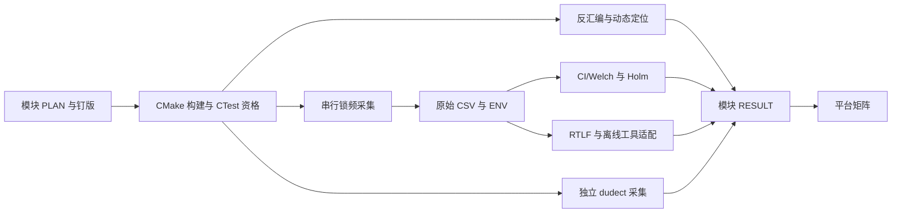

# 多泄漏模块平台架构

日期：2026-10-16。本文定义本轮共享接口与证据边界；各模块是否完成，以对应
`RESULT.md` 和平台矩阵为准。计划来源为
[平台工程计划](../多泄漏模块平台工程计划-20261016.md)，本文不构成采数计划或验收结论。

## 1. 模块与共享层

| 模块 | 对象 | 本轮角色 | 独立边界 |
|---|---|---|---|
| M1 | liboqs 0.10.0 编译器消息位分支 | 已有历史主阳性，只引用原证据 | 原 vendor、原结论只读 |
| M2 | KyberSlash 秘密相关除法 | 优先版本审计、产物定位，再决定采数 | 独立未修/已修 vendor 与构建树 |
| M3 | 秘密下标 LUT | 人工构造的检测器校准 | `fixtures/mem_lut_leak/` 开/关 |
| M4 | 提前退出比较 | 人工构造的检测器校准及有界验证 | `fixtures/early_reject_memcmp/` vulnerable/ct |
| M5 | mlkem-native | 恒时阴性对照候选 | 复用已钉版实现，记录实际后端 |

共享层只承担输入与计时协议、环境记录、统计适配和结果汇总，不建立网络服务、
密钥恢复链路或通用攻击框架。M3/M4 的独立小函数校准与完整 KEM 解封装分别报告，
不能把夹具运行写成完整解封装实验，也不修改密码语义或隐式拒绝来制造阳性。



## 2. 复用点与构建隔离

| 已有接口 | 位置 | 复用方式 |
|---|---|---|
| 长度检查与解封装封装 | `include/mlkem.h`、`src/mlkem.c` | 保持公共错误不暴露内部验证位 |
| 输入类别与公开测试种子 | `src/inputs.c` | 扩展类对前冻结含义；不按内部秘密输出打标签 |
| 单调用采集与身份记录 | `src/measure.c` | 复用逐次 CSV、100 次预热及输出消费边界 |
| 描述统计与 Welch | `src/timing_statistics.c` | 结果写明公式、差值方向、CI 方法和单位 |
| 既有 Holm 实现 | `src/protocol_decision.c` | 参数家族由模块 PLAN 定义，不直接继承旧实验家族 |
| M1 构建与反汇编检查 | `cmake/Liboqs010Historical.cmake`、`tests/check_liboqs010_poly_frommsg_disasm.sh` | 仅作接口参考，不改 M1 固定树 |
| M1 工具适配 | `tools/historical_dudect.c`、`tools/historical_poison.c` | 模块另建 harness；核对实际调用路径与秘密标记范围 |

CMake/CTest 是构建与测试配置来源。第三方构建用独立目录、固定编译器与选项；
核心计时、统计与运行校验使用 C。Shell 只编排和转换工具输入。
新增根 CMake 接线由主控串行合并；各路先提交独立子目录和接口片段。
普通采集产物与 ASan/UBSan、Valgrind、Pin 等动态检查产物分开，不混用计时。

M2 建议目录为 `vendor/liboqs-kyberslash-unfixed/` 与
`vendor/liboqs-kyberslash-fixed/`；若改用 pq-crystals 历史快照，记录实际目录与原因。
`PIN.md` 必须含完整提交号、来源、许可证、获取摘要、适用算法版本及补丁列表。
旧 Kyber、ML-KEM IPD 和最终 FIPS 203 ML-KEM 不互相冒称。

## 3. 原始 CSV 与统计适配协议

现有 `measure` 单调用表头保持原样：

```csv
run_id,implementation,input_category,sample_index,elapsed_nanoseconds,time_unit
```

`sample_index` 表示采集原序；`elapsed_nanoseconds` 是一次完整解封装窗口的非负整数，
`time_unit=ns`。类别可用 `message-zero`、`message-ones`、`valid`、`random`、
`bit-flipped`；模块新增类别须在 PLAN 解释生成方式和标签来源。
微基准另存目录，明确 `measurement_scope`、函数与计时边界，不伪装成完整解封装。

计时窗口只覆盖目标 C 调用和必要屏障；输入准备、分配、输出消费、日志与 I/O 在窗口外。
保存全部逐次原始值与普通长尾，记录平衡乱序算法和种子。短缓冲区、非法长度和空指针
由封装层拒绝，不能交给固定长度密码内核。

工具所需的两列时间文件是派生输入，表头为 PLAN 中的两类名称（如
`message-zero,message-ones`），各列按原 CSV 中该类的出现顺序抽取，不重新排序。
同一行的两列不自动构成配对实验；Welch 仍按两个独立样本计算。
适配器保留来源路径与摘要、类别/列映射、单位、行数和命令；不覆盖原始 CSV，
不静默丢弃长尾、截断较长列、转换时钟单位或混合不同二进制的样本。
最小合成 CSV 必须标注 `synthetic`，只能验证工具接口。

`scripts/run_stats_battery.sh` 是统一编排入口；其可执行用法以 `--help` 为准。
输出至少区分 CI/Welch、RTLF、dudect 三项；各项保存工具版本、命令、退出码、
原始输出和 `ok` / `blocked` / `failed` / `not_run` 状态。工具缺失时明确阻塞，
不能用自编近似方法冒称上游结果。

## 4. 统计与定位结论接口

| 层次 | 最小记录 | 声明边界 |
|---|---|---|
| 描述与 CI/Welch | 两类样本数、均值/标准差、分位数、差值方向、SE、CI 方法、t/自由度/p | 正态近似 CI 与 Student-t CI 分别标注；CI 本身不是 p 值 |
| Holm 家族 | `family_id`、事前比较清单、家族 α、原始 p、排序、阈值、逐步拒绝结果 | 只收入 PLAN 固定的有效参数检验 p；不能事后挑选显著项 |
| RTLF | 完整 commit、两列输入摘要、α=0.01、原输出、退出码及显著分位 | 作为单独交叉印证，不进本轮 Holm 参数家族 |
| dudect | 完整 commit、原生 harness、时钟、秘密/类别设置、批预算、阈值、原输出与 state | 原生在线实验与 CSV 离线 t 摘要必须分名；最大 t 不转伪 p 进 Holm |
| 反汇编 | 二进制摘要、ISA、编译器/优化、符号和带上下文片段 | 有 `div/idiv` 不单独证明操作数秘密相关或端到端可区分 |
| varlat / ctgrind | 工具/补丁摘要、完整命令、秘密标记范围、命中栈、退出码 | 定位检查与正式计时分开；公开种子造成的命中须解释 |
| Microwalk / Binsec | 工具版本、Pin/运行环境；或入口、秘密模型、边界、超时 | 缺 Pin、超时和未支持是阻塞；有界 secure 不等于完整算法恒时 |

模块 PLAN 在任何正式采集前冻结并本地提交；注明样本预算、停止规则、主类对、
复测、微基准是否预设、家族成员及阴性判据。不能把“期望阴性”直接作为“未误报”的证据。
M2 可分别得到“产物与动态定位阳性”“微基准可区分”“端到端未检出”；逐层报告，
不把任一层的成功升级为其他层的成功。

## 5. 环境、采集互斥与恢复

本机 `/Users/yin/code/cryProject` 为 macOS/ARM 开发环境。主实验环境必须重新核验
`nss-marker@10.144.144.5` 的真实 x86_64 Linux 状态，不沿用旧快照当作当前状态。
远端源码、构建、缓存、临时文件、输入和归档的物理路径全部位于
`/home/nss-marker/yhr/Cry`，不得经符号链接越界；运行前同时检查环境临时目录和硬编码路径。

主控持有采集互斥权；CPU2/CPU6 同时最多一个锁频采数任务。正式运行关闭 boost，
目标策略为 performance、约 4300000 kHz，使用 taskset；进入、采集中及退出保存读回，
退出必恢复并记录 `restore_match`。恢复失败或前置条件不满足时停止新增采集，
保留失败证据，不能把频率请求写成逐调用物理恒频证明。

ENV 至少记录主机/内核/ISA/虚拟化、CPU/拓扑、编译器、选项、源 commit/工作区摘要、
vendor 与补丁、CMake cache、实际链接后端、二进制摘要、时钟/单位、亲和性、频率快照、
恢复结果、工具版本、命令和执行时间。敏感口令与私钥不写证据或命令记录。

## 6. 证据目录与合并

```text
docs/evidence/<module>-YYYYMMDD/
  PLAN.md              # 正式采集前冻结
  REQUIREMENTS.md      # 本模块的验收项与适用范围
  VERSION_AUDIT.md     # 历史版本模块必须有
  ENV.md
  RESULT.md            # 使用 templates/MODULE_RESULT.md
  holm.csv             # 有正式家族时填写，否则说明未运行
  replication.csv      # 有复测时填写
  raw/                 # 逐次原始数据与元数据
  disasm/              # 产物及定位日志可分子目录
  partials/Sxx.md      # 并行路共享接口与回报
```

平台矩阵位于 `docs/evidence/platform-matrix-20261016/RESULT.md`，主控单点写入。
每路回报后记录“软件就绪、工具实际执行、定位、统计、验收”各状态，不能互相代替。
`vendor/liboqs-0.10.0/`、已有 `liboqs010-*`、`tooling-strengthen-*`、`r02-r04-*`
结论及 `sources/` 只读；M1 范围引用
[既有闭合判定](../evidence/r02-r04-close-20261016/RESULT.md)，本轮不重新签收或改写。
所有本地提交由主控审查并串行完成；不自动 push。
