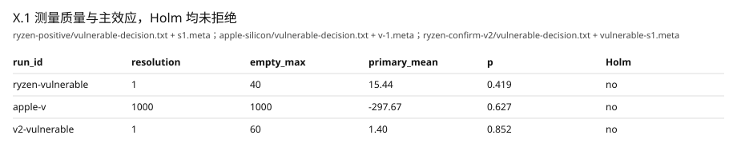
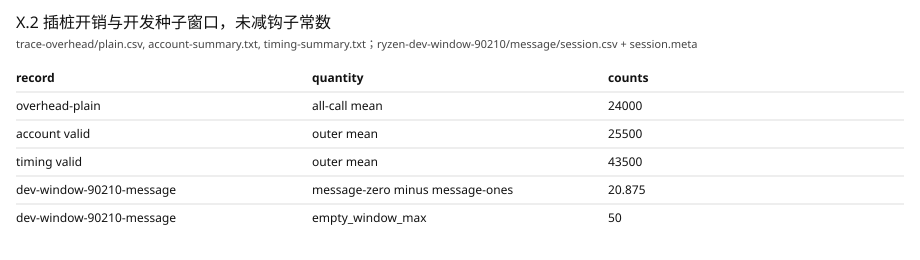
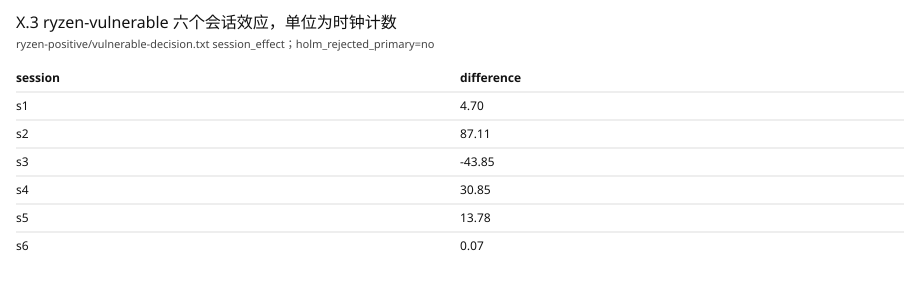
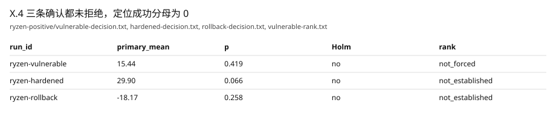
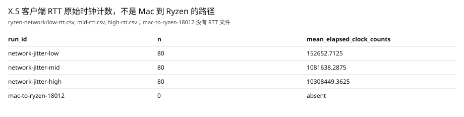
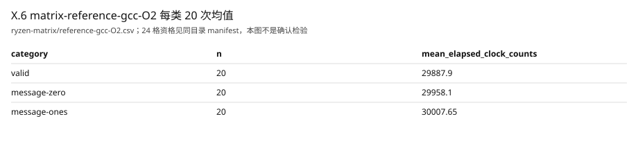
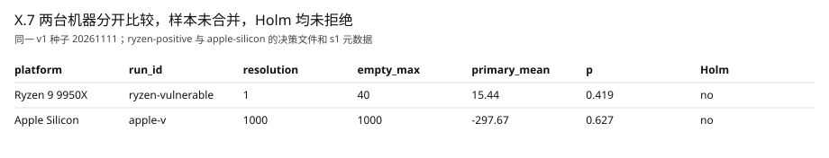

# 时间侧信道检测、定位与跨环境验证

本章各表的相对路径都在 `docs/evidence/seven-capabilities-20261011/` 下，数字取自这些已有 run 的原始文件。本章使用固定便携 C 的 ML-KEM-768。五类输入仍是有效、翻位、随机、全 0 硬币和全 1 硬币生成的 1088 字节密文。全 0 与全 1 在同一密钥下各只产生一条密文，`ryzen-vulnerable` 的 s1 元数据写明 `message-zero_unique_ciphertexts=1`。确认协议在看到确认样本之前冻结：族内 α 为 0.01，Holm 控制，分析单位是会话，预算是 6 个会话、每类 1000 次，停止规则是固定预算。开发种子与确认种子不同。确认种子是 `20261111`。两台机器的样本不合并。

## X.1 本地高精度计时与明显时间泄露检测

计时窗口只包住一次完整解封装。输入生成、预热、结果消费和 CSV 都在窗口外。读钟使用 `CLOCK_MONOTONIC`，记录的是该时钟的整数计数。元数据写明这不是 1 纳秒的物理精度。

Ryzen 9 9950X 上 `ryzen-vulnerable` 的 s1 记录 `resolution_counts=1`，256 次同路径空窗的最大计数是 40。Apple Silicon 上 `apple-v` 的对应记录是分辨率 1000、空窗最大 1000。空窗长尾被保留，没有拿空窗去减正式样本。

下表路径都在 `docs/evidence/seven-capabilities-20261011/`。`primary_mean_difference_counts`、`primary_p_value`、`holm_rejected_primary` 和 Wald 上下界取自决策文件。`resolution_counts` 与 `empty_window_max_counts` 取自同一 run 的 s1 元数据。

| run_id | raw file | resolution_counts | empty_window_max | sessions × per class | primary mean | p | Holm | Wald |
|---|---|---:|---:|---|---:|---:|---|---|
| `ryzen-vulnerable` | `ryzen-positive/vulnerable-decision.txt`，`ryzen-positive/vulnerable-s1.meta` | 1 | 40 | 6 × 1000 | 15.44 | 0.419 | no | −18.96, 49.85 |
| `apple-v` | `apple-silicon/vulnerable-decision.txt`，`apple-silicon/v-1.meta` | 1000 | 1000 | 6 × 1000 | −297.67 | 0.627 | no | −1424.51, 829.17 |
| `v2-vulnerable` | `ryzen-confirm-v2/vulnerable-decision.txt`，`ryzen-confirm-v2/vulnerable-s1.meta` | 1 | 60 | 20 × 5000 | 1.40 | 0.852 | no | −13.13, 15.93 |
| `v3-vulnerable` | `ryzen-confirm-v3/vulnerable-decision.txt`，`ryzen-confirm-v3/vulnerable-s01.meta` | 1 | 110 | 20 × 5000 | −5.47 | 0.00287 | yes | −8.60, −2.33 |

确认集上，人工消息分支的主比较是全 0 类均值减去全 1 类均值。`ryzen-vulnerable` 六个会话的主效应均值是 15.44 个时钟计数，t 为 0.880，双侧 p 为 0.419，Holm 没有拒绝。95% Wald 区间是 −18.96 到 49.85，跨过 0。把六个会话的调用摊开看，全 0 类 6000 次均值 29747.28、标准差 1281.62、P50 为 29635；全 1 类均值 29731.84、标准差 1041.21、P50 为 29636。类别差小于空窗里已经出现的 40 计数长尾。`apple-v` 的主效应均值是 −297.67，t 为 −0.518，p 为 0.627，Wald 区间 −1424.51 到 829.17，同样没有拒绝。在这条冻结规则下，两台机器都没有检出明显时间泄露。

## X.2 解封装过程的函数级插桩与时序分析

诊断构建是单独的目标。它不改正式 deployable，也不把 sanitizer 计时写进矩阵。编译器对七个阶段包装函数插入进入和退出钩子。比较、拒绝密钥派生和选择在上游是宏或 static inline，钩子到达的是包装函数，摘要里写了对应的内联映射。事件只有样本编号、模块相对函数编号、进入或退出、时间戳和完整性状态。

`ryzen-vulnerable` 的诊断排名列出七个阶段，`uncovered_count=0`。重加密、比较和解密位列前三，但端到端检测没有成立，所以输出是 `single_root_cause=not_forced`。诊断样本上重加密的排他差只有 24 个计数，不能把它写成根因。

| mode | raw file | quantity | counts |
|---|---|---|---:|
| 无插桩 | `trace-overhead/plain.csv`，run_id `overhead-plain` | 全部样本均值 | 24000 |
| 只记账 | `trace-overhead/account-summary.txt` | 有效类外层均值 | 25500 |
| 完整计时钩子 | `trace-overhead/timing-summary.txt` | 有效类外层均值 | 43500 |

三组都写 `hook_cost_not_subtracted=yes`。没有用一个常数去减钩子开销，再把剩下的数叫做无扰动函数时间。

开发种子 run_id `dev-window-90210-message` 的无插桩原件是 `ryzen-dev-window-90210/message/session.csv` 与 `ryzen-dev-window-90210/message/session.meta`。这组数字不进入确认协议，也不加大已冻结的 20×5000。

| run_id | raw file | quantity | counts |
|---|---|---|---:|
| `dev-window-90210-message` | `ryzen-dev-window-90210/message/session.meta` | `resolution_counts` | 1 |
| `dev-window-90210-message` | `ryzen-dev-window-90210/message/session.meta` | `empty_window_max_counts` | 50 |
| `dev-window-90210-message` | `ryzen-dev-window-90210/message/session.csv` | message-zero 均值 | 29833.835 |
| `dev-window-90210-message` | `ryzen-dev-window-90210/message/session.csv` | message-ones 均值 | 29812.960 |
| `dev-window-90210-message` | `ryzen-dev-window-90210/message/session.csv` | message-zero 减 message-ones | 20.875 |

## X.3 时间差异的统计显著性与检测能力分析

新入口只读冻结协议，不改历史 `analyze` 的检验定义。历史回放测试 `analysis_round1_replay` 仍然通过。主比较和三条次比较组成一个族，用 Holm 在 α=0.01 上一起控制。推断单位是会话均值差，不是把相关调用堆成一组后的 Welch 检验。

构造的无类别效应夹具给出主效应 15、t 统计量 3。自由度为 1 时，这就是柯西分布，双侧 p 等于 `1-2*atan(3)/π`。程序输出与这个独立计算一致，并且没有拒绝主比较。协议禁止把阈值写成看过确认数据之后才选定。两台机器的确认输出都是 `thresholds_chosen_after_data=no`。

`ryzen-vulnerable` 六个会话的主效应（全 0 减全 1，时钟计数）取自 `ryzen-positive/vulnerable-decision.txt` 的 `session_effect` 行：

| raw file | s1 | s2 | s3 | s4 | s5 | s6 |
|---|---:|---:|---:|---:|---:|---:|
| `ryzen-positive/vulnerable-decision.txt` | 4.70 | 87.11 | −43.85 | 30.85 | 13.78 | 0.07 |

会话均值 15.44，Wald 区间跨过 0。全 0 和全 1 的重复率不是 0，会话内自相关也没有被证明可以忽略，因此 `iid_upgrade=refused`。协议本身禁止恒时升级，输出是 `constant_time_upgrade=refused`。等长分块后再取均值，块均值的平均与总会话均值相同，所以三档块长给出同一个主效应；这是均值估计量的性质，不是另一次显著。确认预算用完即停。没有因为 p 值不够小而追加样本。

## X.4 潜在泄露源的自动化定位与防护验证

排名器只读候选表里的阶段、函数、源码位置、包含差和排他差。表头若出现 ground truth、目标名、补丁名或预置目标名，程序退出码为 2。两个固定夹具的最大排他差分别落在重加密和比较上，两次运行的 Top-1 不同。这只说明排序不是写死的三个位置，不是本次硬件上的检出。

| run_id | raw file | primary mean | p | Holm | 说明 |
|---|---|---:|---:|---|---|
| `ryzen-vulnerable` | `ryzen-positive/vulnerable-decision.txt`，`ryzen-positive/vulnerable-rank.txt` | 15.44 | 0.419 | no | 检测未成立，`single_root_cause=not_forced` |
| `ryzen-hardened` | `ryzen-positive/hardened-decision.txt` | 29.90 | 0.066 | no | 不能写成差异消失 |
| `ryzen-rollback` | `ryzen-positive/rollback-decision.txt` | −18.17 | 0.258 | no | 不能写成差异恢复 |
| `v3-vulnerable` | `ryzen-confirm-v3/vulnerable-decision.txt`，`trace20-31415926/summary.txt` | −5.47 | 0.00287 | yes | 20/20 的 Top-3 含重加密和 message 包装 |
| `v3-hardened` | `ryzen-confirm-v3/hardened-decision.txt` | −1.54 | 0.197 | no | 同一 Holm 门不再拒绝 |
| `v3-rollback` | `ryzen-confirm-v3/rollback-decision.txt` | −2.98 | 0.026 | no | 没有恢复 Holm 拒绝 |
| `v3-rollback-retry` | `rollback-retry-31415926/rollback-decision.txt` | −3.682 | 0.0436 | no | 新构建仍不拒绝 |

`v3-vulnerable` 在种子 `31415926`、20×5000 上被 Holm 拒绝。同一种子的 20 次诊断追踪见 `trace20-31415926/summary.txt`：重加密进入 Top-3 是 20/20，`baseline_stage_reencrypt_message` 进入 Top-3 是 20/20，分母是 20。每个会话的 `single_root_cause=not_asserted`，这是排名器的输出。早先那一次追踪仍留在 `ryzen-confirm-v3/trace-rank.txt`，不再当作书面分母。掩码后的 `v3-hardened` 不再拒绝。旧的 `v3-rollback` 主效应是 −2.976，p 为 0.026，Holm 不拒绝。新目录的 `v3-rollback-retry` 主效应是 −3.682，p 为 0.0436，Holm 仍不拒绝。两次回滚都没有恢复这次拒绝。这三份已有二进制所链的库通过了公开 KAT，含 5 条隐式拒绝，摘要见 `kat-v3-20261011/README.md`。

打印出的 v1 Top-3 是重加密、比较、解密，`uncovered_count=0`，但检出会话是 0/6，定位成功分母是 0。v2 用计划起点 20×5000 和新种子 `8675309`，在采集前冻结。`v2-vulnerable` 主效应 1.40，p=0.852，Holm 仍不拒绝。`v2-hardened` 是 4.28，p=0.261；`v2-rollback` 是 −5.00，p=0.034，也都没有拒绝。检出会话是 0/20。排名器对 v2 仍输出 `single_root_cause=not_forced`。重加密出现在打印的 Top-3 里，但检测没有成立，这 0/20 不算定位成功，也不能把掩码或回滚写成差异消失或恢复。`ryzen-vulnerable` 的端到端 Holm 没有拒绝，排名器因此不给唯一根因。同优化掩码 `ryzen-hardened` 的主效应均值是 29.90，p 为 0.066，Wald 区间 4.85 到 54.94，Holm 仍未拒绝。新目录重新构建的 `ryzen-rollback` 主效应均值是 −18.17，p 为 0.258，区间跨过 0。三条确认都没有达到检测条件，所以不能把掩码写成“差异消失”，也不能把回滚写成“差异恢复”。vulnerable 与 hardened 的公开 KAT 在这台机器上通过，包含隐式拒绝向量。Apple Silicon 的 `apple-v` 与 `apple-h` 同样没有拒绝主比较。检测没有成立时，定位成功的分母是 0。

## X.5 网络噪声环境下的时间侧信道检测

测试端点的请求是固定长度密文，应答是 32 字节固定确认。应答不包含共享秘密、接受或拒绝标志，也不包含服务端耗时。本机回环测试里，有效密文和翻位密文的应答正文相同，服务端完成次数等于请求次数。

| run_id | raw file | n | mean elapsed_clock_counts | server file | completed |
|---|---|---:|---:|---|---:|
| `network-jitter-low` | `ryzen-network/low-rtt.csv` | 80 | 152652.7125 | `ryzen-network/low-server.txt` | 80 |
| `network-jitter-mid` | `ryzen-network/mid-rtt.csv` | 80 | 1081638.2875 | `ryzen-network/mid-server.txt` | 80 |
| `network-jitter-high` | `ryzen-network/high-rtt.csv` | 80 | 10308449.3625 | `ryzen-network/high-server.txt` | 80 |
| `mac-to-ryzen-18012` | `ryzen-network/RUNS.txt` | 0 | — | `ryzen-network/mac-server.txt` | — |
| `mac-direct-20261011` | `mac-ryzen-direct-20261011/client-header-only.csv` | 0 | — | `mac-ryzen-direct-20261011/README.md` | — |

veth 三档不是 Mac 到 Ryzen 的路径。Ryzen 上的三档噪声没有使用管理网卡。进程网络命名空间里的 veth 两端是 10.88.11.1 和 10.88.11.2，netem 加在密码窗口之外。结束后 veth 已删除。`network-jitter-low`、`network-jitter-mid`、`network-jitter-high` 各有 80 条客户端 RTT，服务端 `completed_decapsulations=80`。上表均值是原始时钟计数。除以 1000 后约为 152.7、1081.6 和 10308.4 微秒，与 `ryzen-network/RUNS.txt` 里单向 100 微秒、1 毫秒和 10 毫秒的设置同量级。这些 RTT 比本地大约 30 微秒的解封装大得多。在这个预算下，网络观测没有被用来宣布检出或宣布不存在远程泄露。

Mac 到 `10.144.144.5:18012` 的直接连接没有形成。Ryzen 监听 `0.0.0.0:18012`，本机探测退出码为 1。run_id `mac-to-ryzen-18012` 没有 RTT 文件。没有用 SSH 隧道代替这条路径。

2026-10-11 再次从 Mac 直接连接 `10.144.144.5:18021`。服务端当时监听 `0.0.0.0:18021`，主机本机可以连上。Mac 客户端只写下表头，数据行数是 0，应答文件长度是 0，见 `mac-ryzen-direct-20261011/`。同一台 Mac 随后探测 2730 个端口，完成握手的只有 22、9010、9100 和 9400，连接被拒绝的个数是 0，其余超时。这些端口已有 SSH、他人的 uvicorn 或其他监听。没有占用它们，也没有改防火墙或改用隧道。因此仍然没有 Mac 到 Ryzen 的 RTT 样本。三档 veth 记录不能代替这条路径。

## X.6 编译器优化对时序行为及防护效果的影响

| variant | compiler | opt | status | compile | link | run_id |
|---|---|---|---|---|---|---|
| reference | gcc | O0 | qualified | -O0 | -O0 | `matrix-reference-gcc-O0` |
| reference | gcc | O1 | qualified | -O1 | -O1 | `matrix-reference-gcc-O1` |
| reference | gcc | O2 | qualified | -O2 | -O2 | `matrix-reference-gcc-O2` |
| reference | gcc | O3 | qualified | -O3 | -O3 | `matrix-reference-gcc-O3` |
| reference | gcc | O2LTO | qualified | -O2 -flto | -flto | `matrix-reference-gcc-O2LTO` |
| reference | clang | O0 | qualified | -O0 | -O0 | `matrix-reference-clang-O0` |
| reference | clang | O1 | qualified | -O1 | -O1 | `matrix-reference-clang-O1` |
| reference | clang | O2 | qualified | -O2 | -O2 | `matrix-reference-clang-O2` |
| reference | clang | O3 | qualified | -O3 | -O3 | `matrix-reference-clang-O3` |
| reference | clang | O2LTO | qualified | -O2 -flto | -flto | `matrix-reference-clang-O2LTO` |
| deployable | gcc | O0 | qualified | -O0 | -O0 | `matrix-deployable-gcc-O0` |
| deployable | gcc | O1 | qualified | -O1 | -O1 | `matrix-deployable-gcc-O1` |
| deployable | gcc | O2 | qualified | -O2 | -O2 | `matrix-deployable-gcc-O2` |
| deployable | gcc | O3 | qualified | -O3 | -O3 | `matrix-deployable-gcc-O3` |
| deployable | gcc | O2LTO | qualified | -O2 -flto | -flto | `matrix-deployable-gcc-O2LTO` |
| deployable | clang | O0 | qualified | -O0 | -O0 | `matrix-deployable-clang-O0` |
| deployable | clang | O1 | qualified | -O1 | -O1 | `matrix-deployable-clang-O1` |
| deployable | clang | O2 | qualified | -O2 | -O2 | `matrix-deployable-clang-O2` |
| deployable | clang | O3 | qualified | -O3 | -O3 | `matrix-deployable-clang-O3` |
| deployable | clang | O2LTO | qualified | -O2 -flto | -flto | `matrix-deployable-clang-O2LTO` |
| vulnerable | gcc | O2 | qualified | -O2 | -O2 | `matrix-vulnerable-gcc-O2` |
| vulnerable | clang | O2 | qualified | -O2 | -O2 | `matrix-vulnerable-clang-O2` |
| hardened | gcc | O2 | qualified | -O2 | -O2 | `matrix-hardened-gcc-O2` |
| hardened | clang | O2 | qualified | -O2 | -O2 | `matrix-hardened-clang-O2` |

上表每一格的 `status`、编译行和链接行取自 `ryzen-matrix/<变体>-<编译器>-<优化>.manifest`。24 格全部 `status=qualified`。O0 编译行没有另一个 `-O2`。O2+LTO 的链接行含 `-flto`。reference 和 deployable 各有 GCC 与 Clang 的 O0、O1、O2、O3 和 O2+LTO。vulnerable 和 hardened 只有外层 O2，函数级的 O0 或 optnone 约束仍在补丁里，不能写成对目标函数做了 O3 测试。每个格子都有公开 KAT、实际编译行、链接行，以及每类 20 次的基础计时。sanitizer 没有进入这些计时。

`matrix-reference-gcc-O0` 的编译行在配置标志之后是 `-O0`，其中没有另一个 `-O2`。`matrix-reference-gcc-O2LTO` 的链接行包含 `-flto`。`matrix-reference-gcc-O2` 的基础计时原件是 `ryzen-matrix/reference-gcc-O2.csv`。有效类 20 次均值是 29887.9 个计数，全 0 类是 29958.1，全 1 类是 30007.65。这是每类 20 次的范围观察，不是确认协议的 1000 次会话检验。优化改变了编译和链接行；在未做逐格确认检验之前，不能把某一格的均值差写成防护失效或防护成立。

同一批已合格二进制后来按开发种子 `31337` 补了无插桩会话计时，run_id 是 `matrix-session-<格子>`，原件在 `matrix-sessions-20261011/`。八个外层 O2 格是 20 个会话、每类 5000 次，其余 16 格是 5 个会话、每类 5000 次。五类仍是 valid、bit-flipped、random、message-zero、message-ones。下表主效应是全 0 类会话均值减去全 1 类会话均值，单位是采集器记录的 `CLOCK_MONOTONIC` 计数。表内数字取到所示位数，完整值在各格 `decision.txt`。`frozen_per_cell_test` 全部是 no。

| run_id | sessions × per class | primary mean | p | analyzer Holm | frozen_per_cell_test |
|---|---|---:|---:|---|---|
| `matrix-session-reference-gcc-O0` | 5 × 5000 | 1.155 | 0.8814 | no | no |
| `matrix-session-reference-gcc-O1` | 5 × 5000 | −2.571 | 0.2924 | no | no |
| `matrix-session-reference-gcc-O2` | 20 × 5000 | −0.033 | 0.9833 | no | no |
| `matrix-session-reference-gcc-O3` | 5 × 5000 | 3.877 | 0.2408 | no | no |
| `matrix-session-reference-gcc-O2LTO` | 5 × 5000 | 3.499 | 0.1747 | no | no |
| `matrix-session-reference-clang-O0` | 5 × 5000 | −2.641 | 0.9024 | no | no |
| `matrix-session-reference-clang-O1` | 5 × 5000 | −2.193 | 0.5895 | no | no |
| `matrix-session-reference-clang-O2` | 20 × 5000 | −1.786 | 0.2425 | no | no |
| `matrix-session-reference-clang-O3` | 5 × 5000 | 2.239 | 0.4386 | no | no |
| `matrix-session-reference-clang-O2LTO` | 5 × 5000 | −2.663 | 0.4283 | no | no |
| `matrix-session-deployable-gcc-O0` | 5 × 5000 | −5.514 | 0.1300 | no | no |
| `matrix-session-deployable-gcc-O1` | 5 × 5000 | −0.222 | 0.9340 | no | no |
| `matrix-session-deployable-gcc-O2` | 20 × 5000 | 1.135 | 0.4947 | no | no |
| `matrix-session-deployable-gcc-O3` | 5 × 5000 | 1.690 | 0.3061 | no | no |
| `matrix-session-deployable-gcc-O2LTO` | 5 × 5000 | 4.324 | 0.3420 | no | no |
| `matrix-session-deployable-clang-O0` | 5 × 5000 | 3.492 | 0.6130 | no | no |
| `matrix-session-deployable-clang-O1` | 5 × 5000 | −1.657 | 0.5597 | no | no |
| `matrix-session-deployable-clang-O2` | 20 × 5000 | −0.702 | 0.6836 | no | no |
| `matrix-session-deployable-clang-O3` | 5 × 5000 | −1.292 | 0.7628 | no | no |
| `matrix-session-deployable-clang-O2LTO` | 5 × 5000 | 0.394 | 0.8144 | no | no |
| `matrix-session-vulnerable-gcc-O2` | 20 × 5000 | −8.153 | 4.059e-05 | yes | no |
| `matrix-session-vulnerable-clang-O2` | 20 × 5000 | 5.090 | 0.0013 | yes | no |
| `matrix-session-hardened-gcc-O2` | 20 × 5000 | −2.184 | 0.0696 | no | no |
| `matrix-session-hardened-clang-O2` | 20 × 5000 | 1.544 | 0.2738 | no | no |

分析器对 `matrix-session-vulnerable-gcc-O2` 打印 `holm_rejected_primary=yes`，p 为 `4.0590131124768774e-05`。对 `matrix-session-vulnerable-clang-O2` 也打印 yes，p 为 `0.001259532563931612`。这两格和其余 22 格一样，`frozen_per_cell_test=no`。采集前没有按格冻结检验。不能由这次描述性效应宣布某一优化级防护成立或失效。vulnerable 与 hardened 仍只是外层 O2 加既有函数级约束，不能写成对目标函数做了 O3 测试。旧的每类 20 次基础文件仍在 `ryzen-matrix/`。

## X.7 不同处理器平台上的检测与防护稳定性

| platform | run_id | raw file | resolution | empty max | primary mean | p | Holm |
|---|---|---|---:|---:|---:|---:|---|
| Ryzen 9 9950X | `ryzen-vulnerable` | `ryzen-positive/vulnerable-decision.txt`，`ryzen-positive/vulnerable-s1.meta` | 1 | 40 | 15.44 | 0.419 | no |
| Apple Silicon | `apple-v` | `apple-silicon/vulnerable-decision.txt`，`apple-silicon/v-1.meta` | 1000 | 1000 | −297.67 | 0.627 | no |

两行来自同一确认种子 `20261111` 和 v1 的 6×1000，样本没有合并。两边的主比较都没有被 Holm 拒绝。Ryzen 上 `ryzen-vulnerable` 的主效应是 15.44 个计数，空窗最大是 40。Apple 上 `apple-v` 的主效应是 −297.67，时钟分辨率和空窗最大都是 1000。两边的绝对纳秒差不能相减后叫做防护效果变化。

两台机器同时改变了处理器、操作系统和工具链。这个记录支持的是同协议跨环境复测，不是“只换了 CPU”。直接的 Mac 到 Ryzen 网络路径没有连通，因此平台比较不包括那条远程 RTT。没有第三台机器。没有把历史 KVM 的旧样本并进来凑检出。

## 边界

软件能够采集、插桩、按冻结协议做会话检验、对候选排序，并完成回环、三档 veth 噪声和 24 格构建。`v3-vulnerable` 的冻结确认拒绝了主比较。掩码后的同门不再拒绝，两次新构建回滚都没有恢复拒绝。20 次诊断追踪里重加密和 message 包装都在 Top-3，排名器给出的 `single_root_cause` 仍是 `not_asserted`。这不证明实现恒时，也不证明网络上不可区分。约 5 个时钟计数不是逐次调用的物理纳秒精度，Apple 也没有重跑 v3。R02 与 R04 仍按原验收表保持部分签收。
