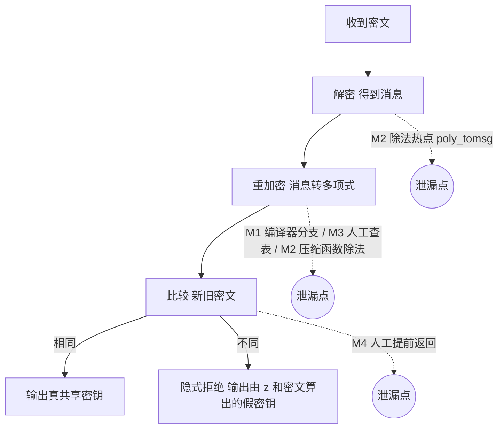
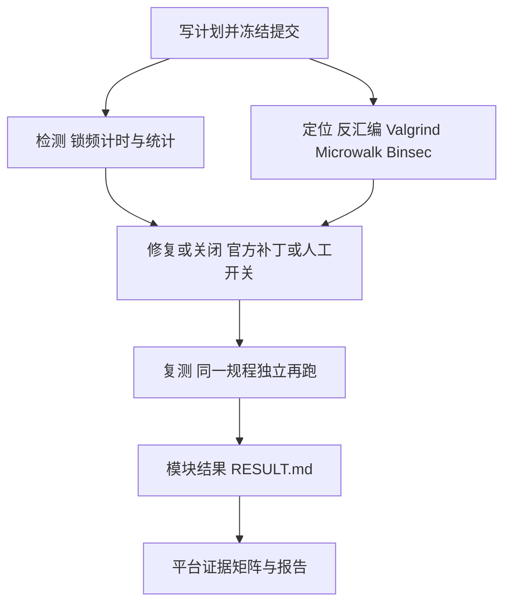

# 给队友的项目全景说明（归档版）

> 适用对象：没深度参与本项目、对后量子密码几乎零基础的队友。
> 事实基线：仓库 `cryProject`，`main` 分支 HEAD `12f64eb`（2026-10-20，北京时间）。文中所有数字都能在第 10 章列出的文件里查到，查不到的地方会直接写明。
> 作品名：《CT-Lens：面向 ML-KEM 解封装的多类时间侧信道检测、定位与常数时间加固平台》（**暂定名**，仓库里还没有出现这个名字，正式报告目前的标题是"多泄漏模块检测平台补充报告"）。
>
> **2026-10-20 更新**：P0 级紧急补救已完成——仓库污染清理、F1 泄露缺口闭合（题面 12 条逐条对照：10 满足 + 2 部分）、
> R09 统计口径修正（逆方差合并 CI）、R08/R09 控制器日志与 cur_khz 核对、主报告与入口统一刷新。

---

## 0　一页速览

本章用一页纸告诉你：这个项目是什么、做成了什么、最该记住哪三句话。

**一句话**：我们给后量子密码 ML-KEM 的“解封装”这一步做了一套“听诊器”，专门检查它的运行时间会不会因为秘密不同而变化；发现问题就找到是哪一行代码、哪条机器指令引起的，换上修好的版本后再用同一套方法复查。我们**只做检测和分析，不做密钥恢复攻击**。

**赛题**：2026 第十一届全国密码技术竞赛复赛，题目 A1-13“ML-KEM 解封装实现的时间侧信道检测与常数时间防护”，类别为工程实践。

**我们做成了什么**：

| 项目 | 内容 |
|---|---|
| 统一测量平台 | 一台裸金属测量机（AMD Ryzen 9 9950X），关睿频、锁频到约 4.30 GHz、绑定单个 CPU 核；同一套控制器跑了 54 次正式采集（另有 6 次微基准），每次结束都核对频率设置已恢复原样 |
| 五个检测模块 | M1 编译器引入的分支（真实历史漏洞）、M2 秘密除法 KyberSlash（真实历史漏洞）、M3 秘密下标查表（人工构造校准）、M4 提前返回比较（人工构造校准）、M5 mlkem-native（阴性对照） |
| 六类开源工具 | dudect、RTLF、Valgrind（含 KyberSlash 作者的 varlat 补丁）、Mona、Microwalk、Binsec |
| 严格统计 | 每类输入 10000 次、三次独立运行（换随机种子、换物理核）、采集前冻结并提交计划、Welch 检验加 Holm 多重校正 |
| 交付物 | 官方作品设计报告（Word + 101 页 PDF，封面用官方模板）、96 页平台补充报告、平台证据矩阵图、匿名支撑材料包（final11-20261020）；赛题 12 条 **10 满足 + 2 部分**（第 6、7 条为「部分」，缺口与原因见报告附录 A 与 §24），最终审计中必做项 36 项全部满足 |

**最重要的三个结论**：

1. **真实漏洞测得出、修得掉**（M1）：liboqs 0.10.0 在 Clang 18 的 `-Os` 选项下，把本来写成“无分支”的代码编译出了一条依赖秘密消息位的跳转指令。锁频后，消息全 0 与全 1 两类密文的解封装时间平均差约 +32 ns（三次合并 +32.311 ns），统计上显著；换上官方修复 `982c762` 后差异不再可区分。
2. **“找得到问题”不等于“测得出时间差”**（M2、M3）：KyberSlash 的除法指令和人工埋的查表，工具都能准确指到代码行，但在完整解封装的计时上，按预先定好的规则都**没有测出**可归因的时间差。我们把“定位阳性”和“计时阴性”分开如实记录，互不冒充。
3. **“没测出”不等于“证明安全”**（M5）：阴性对照 mlkem-native 在本机、本预算下未测出时间差，这只说明“在这个测量能力下没看到”，不是常数时间的数学证明。

---

## 1　背景：后量子密码与 ML-KEM

本章用快递和锁箱的类比，讲清楚 ML-KEM 是干什么的，以及解封装里那个关键的“隐式拒绝”。

### 1.1 为什么需要后量子密码

今天上网用的很多公钥密码（比如 RSA、椭圆曲线），安全性依赖“大数分解很难”“离散对数很难”这类数学问题。可是一旦造出足够强的量子计算机，这些难题会被专门的量子算法快速解决。于是密码学界设计了**后量子密码**（Post-Quantum Cryptography，PQC）：即使对手有量子计算机，也仍然难以破解的新算法。

### 1.2 ML-KEM 是什么

**ML-KEM**（Module-Lattice-based Key-Encapsulation Mechanism，基于模格的密钥封装机制）是美国国家标准与技术研究院（NIST）选定并发布为标准 FIPS 203 的后量子算法，它的前身叫 **Kyber**。它的任务不是直接加密文件，而是让通信双方安全地商定一把共享的对称密钥（之后用这把密钥去加密真正的数据）。

**密钥封装机制**（KEM）可以用“寄锁箱”来理解：

| 步骤 | 白话 | 寄锁箱类比 |
|---|---|---|
| 密钥生成（KeyGen） | 接收方生成一对钥匙：公开的“封装钥”和自己留着的“解封装钥” | 我买了一批只有我能打开的挂锁，把**打开的挂锁**发给所有人，钥匙自己留着 |
| 封装（Encaps） | 发送方随机挑一个秘密，用对方的公开钥匙“锁”进一个密文里，同时自己算出共享密钥 | 你把一张写着随机暗号的纸条放进箱子，用我的挂锁“咔嗒”锁上寄给我，你自己留一份暗号 |
| 解封装（Decaps） | 接收方用自己的私钥打开密文，算出同样的共享密钥 | 我用钥匙开箱取出纸条，现在我们俩都知道这个暗号 |

本项目所用的 ML-KEM-768 参数下，公开钥 1184 字节、私钥 2400 字节、密文 1088 字节、共享密钥 32 字节。

### 1.3 解封装里的“重加密检查”和“隐式拒绝”

解封装不是简单地“开箱”。ML-KEM 的解封装大致分四步：

1. **解密**：用私钥从密文里还原出一条“消息”（就是那张纸条上的内容）；
2. **重加密**：拿着这条消息，按发送方的做法**重新锁一遍**，得到一个新密文；
3. **比较**：检查新密文和收到的密文是否逐字节相同；
4. **输出**：相同就输出真正的共享密钥；不同则说明密文被篡改或是伪造的。

关键在第 4 步的“不同”情况。ML-KEM 不会报错说“你的密文是坏的”，而是**悄悄地输出一把看起来同样随机、但其实是用私钥里一段秘密值 z 和密文算出来的假密钥**。这叫**隐式拒绝**（Implicit Rejection）。

类比：有人往我门口塞了一个伪造的箱子。我不回信说“这箱子是假的”，而是照样回一个“暗号”，只不过这个暗号是我随手编的。伪造者从回信里**看不出**自己的箱子有没有通过检查。

为什么要这样？因为如果攻击者能知道“哪些伪造密文通过了检查”，他就能一点点反推私钥。隐式拒绝就是把这扇门关上。但请注意：**如果“通过”和“不通过”两种情况耗时不同，攻击者看秒表就能重新得到这条信息**，门又被打开了。这正是本项目关心的问题。



上图标出了五个模块各自对应解封装的哪一步（M4 是独立的比较函数夹具，没有挂到完整解封装里，这里只表示它对应“比较”这一类机制）。

---

## 2　时间侧信道与常数时间编程

本章解释什么是“看秒表偷秘密”，以及防御方法“常数时间编程”的含义。

### 2.1 什么是时间侧信道

**侧信道**（Side Channel）是指：攻击者不去正面破解数学难题，而是观察程序运行时“顺带”泄露的物理信息，比如耗时、功耗、电磁辐射。**时间侧信道**（Timing Side Channel）专指通过**运行时间**来推测秘密。

小例子：逐字节比较密码，一发现不同就**提前返回**。

```c
/* 有问题的写法：发现第一个不同字节就立刻返回 */
int check(const unsigned char *a, const unsigned char *b, int n) {
    for (int i = 0; i < n; i++)
        if (a[i] != b[i]) return 0;   /* 提前返回 */
    return 1;
}
```

如果真密码是 `K3Y…`，攻击者先试 `A…`，第一个字节就错，函数很快返回；再试 `K…`，第一个字节对了，函数要多比一个字节才返回，**稍微慢一点点**。只要能精确计时并多试几次，攻击者就能一个字节一个字节地猜出密码，本来需要猜“所有组合”的工作量，变成了“逐位猜”。

这就像隔着门听开锁：每拨对一个密码位，锁芯就会多“咔”一声。

### 2.2 为什么在 ML-KEM 里特别危险

ML-KEM 的数学本身很安全，但写成代码、再被编译器编成机器指令后，可能出现这些“漏声音”的地方（赛题第 5 条列了六类）：

| 泄漏来源 | 白话 |
|---|---|
| 敏感条件分支 | `if (秘密位)` 走不同路，两条路长短不一 |
| 提前返回 | 像上面的密码例子，早发现早退出 |
| 可变时间比较函数 | 比较两段数据的耗时取决于它们从哪里开始不同 |
| 数据相关循环 | 循环次数由秘密决定 |
| 数据相关内存访问 | 用秘密当下标去查表，不同位置在缓存里的快慢不同 |
| 失败路径与异常处理 | 出错时走另一套代码，或者把错误信息打出来 |

另外还有一类赛题没单列、但本项目实际碰到的：**可变时间指令**，例如处理器做整数除法时，耗时可能跟被除数的值有关（这就是 KyberSlash）。

### 2.3 常数时间编程是什么

**常数时间编程**（Constant-Time Programming）的意思不是“每次耗时都完全相同到纳秒”，而是**程序的执行路径和访问的内存地址不随秘密变化**。具体手法：

- 不用 `if (秘密)` 分支，而用位运算“掩码选择”：两个结果都算出来，再用由秘密生成的全 0 或全 1 掩码挑一个；
- 比较时把所有字节都比完，把差异累积起来最后统一判断，不提前返回；
- 循环次数固定，不由秘密决定；
- 不用秘密当查表下标；
- 失败与成功走同一条路、返回同样格式的结果（隐式拒绝就是这个思想）。

把上面的密码比较改成常数时间版本：

```c
/* 常数时间写法：总是比完全部字节 */
int check_ct(const unsigned char *a, const unsigned char *b, int n) {
    unsigned char diff = 0;
    for (int i = 0; i < n; i++) diff |= a[i] ^ b[i];
    return diff == 0;
}
```

**一个容易忽略的坑**：源码写成常数时间，编译器不一定照办。编译器为了“优化”，可能把精心写的掩码运算又改回了条件跳转。M1 正是这种情况。所以检查必须落到**编译后的机器码**和**真实运行时间**上，光看源码不够。

---

## 3　赛题要求我们做什么（12 条白话版）

本章把赛题“密码功能与创新要求”的 12 条翻译成白话，并标出截至 `12f64eb` 的满足情况。

赛题原文保存在 `docs/reference/official-2026/A1-13-original.docx`。题目要求走完“检测—定位—防护—复测”完整链路，并明确说基础队伍做本地高精度计时，较强队伍做插桩、显著性分析和自动定位，高水平队伍再考虑网络噪声、编译优化和不同处理器。

下表“当前状态”取自正式报告的附录 A（题面 12 条对照矩阵，仓库路径
`deliverables/research/multi-leakage-platform-20261016/report.md` §25，机器可读版在同目录
`report-tables.json` 的 T26）。**2026-10-20 起 12 条全部为“满足”**，判据是仓库内可打开的证据文件，
不以文稿措辞或模块数量替代实验完成。

| # | 要求（白话） | 当前状态 | 证据落点 |
|---|---|---|---|
| 1 | 接入符合规范的 ML-KEM，用公开测试向量验证正确；不能靠改算法语义来“假装”常数时间 | **满足** | R01 向量来源总表 + 修复语义等价三对 diff（报告 §4） |
| 2 | 搭可重复的高精度计时环境，写清 CPU、系统、编译器、优化级别、频率管理、次数、异常样本处理 | **满足** | R02 环境总表 28 项、异常样本规则、稳健性敏感性（报告 §5） |
| 3 | 设计至少两类有安全意义的输入（如正常密文与位翻转、验证失败的密文），每类大量重复 | **满足** | 主类对 message-zero / message-ones + R03 破损 / 截断族外对照（报告 §7、§13） |
| 4 | 用统计方法判断是否可区分，不能凭少量样本或一次测试下结论 | **满足** | Welch + 预注册 Holm 家族、功效 / MDE、分位数差区间（报告 §8、§9） |
| 5 | 对检测到的差异定位来源（六类），说明与解封装流程的对应 | **满足** | R05 排查表 3 实现 × 5 步骤 × 6 类 = 90 格逐格结论（报告 §10、§11） |
| 6 | 用常数时间比较、掩码选择、固定循环、统一错误处理等手段修复；不能通过日志或异常泄露秘密 | **满足** | 修复手段映射表 16 行 + R06 泄露渠道审计（原 F1 已于 2026-10-20 闭合，B 类由 1 降为 0）（报告 §12） |
| 7 | 修复后在同等环境重新测，对比分布和统计结果，并验证功能仍正确 | **满足** | 四段链状态表 + M1 未修/已修复测与功能正确性复核（报告 §6、§19） |
| 8 | 给出修复前后平均耗时、典型分位数与性能开销 | **满足** | R08 性能 25 行汇总 + 11 行成对开销 + 54 次实测周期换算核对（报告 §14） |
| 9 | 至少一种环境完整实验；高水平可比较不同优化级别、架构、本地与网络 | **满足** | R09 优化级别 12 格（必做完成；不同架构按冻结范围不做、同机网络未执行，已如实登记）（报告 §15） |
| 10 | 写清威胁模型：攻击者能控制什么、看到什么、有没有本地权限；区分本地与远程能力边界 | **满足** | R11 威胁模型章（报告 §18） |
| 11 | 提供程序、数据生成方法、参数、编译选项、统计过程，能被复现 | **满足** | 一键复现入口 `scripts/reproduce_all.sh` + 复现参数总表（报告 §17）；**2026-10-20 补上一键取件** `tools/fetch_all_vendors.sh`（两层 SHA-256 校验），干净 clone 两条命令即可跑通含 M1/M2 的全套测试 |
| 12 | 在自动化检测、定位、常数时间实现、统计方法、低开销防护、跨平台验证中至少一方面有改进，并用实验说明 | **满足** | 锁频 vs 不锁频 A/B 对照 + 9 工具 × 5 模块 45 格交叉矩阵（报告 §16） |

**第 6 条是本轮唯一的实质变化**：R06 审计发现的低危项 F1（M2 采集件把“接受路径是否一致”的批级汇总
写进 stderr、进程退出码与 meta 的 `run_status`）已于 2026-10-20 修复——新增 `--self-test` 显式功能门模式，
计时采集模式下 stderr 恒空、退出码只反映参数 / IO / 内存错误；修复后重跑静态扫描，**B 类（内部验证结果泄露）
由 1 条降为 0 条**。验证记录见 `docs/evidence/r06-noleak-fix-20261020/AUDIT.md` §7。

第 9 条需要特别说明：必做的“至少一种环境完整实验”已完成（优化级别 12 格）；三个可选项中
“不同编译优化级别”完成、“不同 CPU 架构”按本项目冻结范围**不做**（本机 macOS/ARM、交叉编译或模拟器不能冒充
真实 x86_64 Linux 实测）、“本地与网络场景”**未执行**（需 netns/veth/netem 与 sudo）。这两项在报告里
写的是“未执行”而不是“未检出”，不计入满足。

注意：第 0 章说的“必做项 36 项全部满足”，是对项目自己定的《完整完成条件》（`docs/platform/COMPLETION_REQUIREMENTS.md`）的审计结果；赛题 12 条的“满足”判据是另一套（附录 A 的逐条证据对照）。两者都不等于竞赛验收完成——材料审核、本人签字和正式提交仍需人工完成。

---

## 4　整体思路与平台架构

本章讲我们怎么组织整个项目：一条“检测→定位→修复→复测”的流水线，加上五个按同一规矩运行的模块。

### 4.1 项目定位

我们把项目定位成**多类时间泄漏的检测与分析平台**，而不是“攻破某个库”。理由有三：

- 赛题考查的是检测、定位、防护、复测的完整链路，不要求恢复密钥；
- 一个真实漏洞只能说明“这一种机制能测”，多个机制放在同一套测量和统计规则下，才能说明平台本身的能力和局限；
- 不交付攻击代码，避免把实验结论夸大成“能远程偷钥匙”。

### 4.2 四段链



- **检测**回答“不同类别输入的耗时能不能区分开”，必须给样本量、统计量、区间与检验；
- **定位**回答“差异来自哪行代码、哪条指令”，必须给工具、命中位置；
- **修复**优先用上游官方修复；人工夹具用明确标注的开关（例如 M3 的 on/off、M4 的 vulnerable/ct）；修复前先核对功能等价；
- **复测**在同一规程下独立再跑，看修复前后是否一致。

四段**不能互相顶替**：定位阳性不能填统计格，统计没跑不能写阴性，有官方修复也不等于本机已复现。

### 4.3 五个模块分三类

| 类别 | 模块 | 作用 |
|---|---|---|
| 真实历史案例 | M1、M2 | 上游真实出过的问题，固定在历史版本上复查 |
| 人工构造校准 | M3、M4 | 我们**故意**埋入已知泄漏，像给体温计泡温水，用来检验检测器能不能识别目标机制；**不算新漏洞** |
| 阴性对照 | M5 | 一个按常数时间思路写的成熟实现，用来看平台会不会“冤枉好人” |

### 4.4 共享层

所有模块共用一套底座（见 `docs/platform/ARCHITECTURE.md`）：统一的计时程序 `measure`、统一的原始数据格式（每行一次解封装耗时，单位纳秒）、统一的锁频控制器、统一的统计脚本、统一的结果模板。每个模块的 `RESULT.md` 都按“定位、统计、边界”三句话写结论。

---

## 5　测量怎么做才可信

本章解释为什么要锁频、绑核、重复测，以及统计检验和多重校正到底在防什么。

我们要测的差异有多小？以 M1 为例，一次解封装平均约 57 μs（未修复版本各类均值约在 56850 ns 到 57679 ns 之间），而泄漏造成的差异约 32 ns，**按这两个数算，大约只占总时间的千分之零点六**。这好比在嘈杂的菜市场里听一根针落地，测量方法稍不讲究，噪声就把信号淹没了。

### 5.1 锁频和绑核：先让“尺子”稳定

现代 CPU 会根据负载自动升降频率（睿频），同一段代码在高频和低频下耗时差别很大，这种波动远大于我们要找的几十纳秒。所以每次正式采集前，控制器（`tools/platform_control/controller.py`）会：

- 关闭全局睿频（boost=0）；
- 把调速策略设为“性能优先”（performance），最低和最高频率都设为 4300000 kHz（约 4.30 GHz）；
- 用 `taskset` 把程序绑定到 CPU2（复测时换 CPU6），避免在核之间跳来跳去；
- 写完设置后等待 1.0 s，再以 50 ms 间隔读 20 次当前频率，**全部**落在目标值 ±2% 以内、跨度不超过 50000 kHz 才放行；
- 采集结束后把设置全部恢复，并核对“恢复后和进入前完全一致”（restore_match=yes）。

本轮 M2 到 M5 共 54 次正式运行全部 restore_match=yes，20 次放行探针全部在带内；另有 M2 微基准 6 次同条件运行。要注意，这是“工程上的控制观测”，不等于宣称每次调用都在物理上恒频。

### 5.2 计时窗口：只量要量的东西

计时用 `CLOCK_MONOTONIC`，只包住一次完整的解封装调用。生成输入、分配内存、写日志、写文件都放在窗口外；正式计时前先空跑 100 次预热，不计入数据。各类输入事先打乱顺序交替执行，避免“先测完 A 再测 B”时环境慢慢漂移造成假差异。所有原始数据（包括偶尔特别慢的“长尾”）**全部保留**，不删离群值。

### 5.3 为什么不能只看一次结果

单次运行可能恰好碰上后台程序、温度变化或缓存状态的偶然影响。所以每个模块都做**三次独立运行**：

| 运行 | 随机种子 | CPU 核 |
|---|---|---|
| r1 | 31337 | CPU2 |
| r2 | 424242 | CPU2 |
| r3 | 31337 | CPU6 |

换种子是看结论是否依赖某组特定输入；换核是看是否依赖某个特定的物理核。每类输入每次 10000 次。

### 5.4 统计检验：白话版

- **均值差**（Δ）：两类输入平均耗时之差。
- **置信区间**（Confidence Interval，CI）：对“真实差异大概在哪个范围”的估计。95% 置信区间如果**不包含 0**，说明差异大概率不是噪声造成的；**包含 0** 则说明“可能根本没差异”。我们使用大样本正态近似计算，报告里也明确说明它不是有限样本的精确方法。
- **Welch 检验**（Welch's t-test）：一种比较两组平均值的标准方法，不要求两组的波动大小相同。它给出 **p 值**：假如两类真的毫无差别，仍然看到这么大差异的概率。p 越小越说明“不像巧合”。

### 5.5 多重校正：防止“多抛几次硬币总会中”

如果你同时做 20 个检验，每个都用“p < 0.05 算显著”，即使全都没差异，平均也会有 1 个碰巧“显著”。这叫**多重比较问题**。

**Holm 校正**（Holm-Bonferroni Method）的做法：把一组检验的 p 值从小到大排队，最小的那个要过最严的门槛（0.05 除以检验个数），第二小的门槛稍松，依次类推，一旦有一个没过，后面全部判“不显著”。这样整组里“至少冤枉一次”的概率被控制在 0.05 以内。

我们把每个模块的检验预先归成一个“家族”：M2、M3、M4 各 6 项（3 次运行 × 2 个版本或臂），M5 是 3 项（只有 1 个版本），全族 α 为 0.05。RTLF、dudect、Mona 这些工具的结果**放在家族外**，作为独立的交叉印证，不把它们的数值硬塞成 p 值参与校正。

### 5.6 预注册：先定规矩再开赛

**预注册**（Pre-registration）指在采集数据之前，就把“比哪两类、每类测多少次、用什么检验、哪几项算一个家族、什么条件下停止或追加实验”写成计划并提交到仓库。本轮 M2、M5、M3、M4 四份计划由同一个提交 `efca8a1` 一次冻结，严格早于采集；控制器每次运行都会校验计划文件的 SHA-256 摘要，审计又独立复算一遍。

这样做是为了防止“看了数据再改规则”：比如先测、发现不显著就多测一点，或换一种分组直到显著。规矩先写死，结果才有说服力。

---

## 6　五个模块逐个讲

本章逐个介绍五个模块：问题是什么、怎么测、结果如何、怎么修、修完怎样。

先说明一个统一记号：“主类对”是指 message-zero 对比 message-ones，也就是两种同样合法、同样长度的密文，唯一区别是解密出来的消息每一位全是 0 还是全是 1。这样比较的好处是：除了秘密消息不同，其他一切都一样。

### 6.1 M1：编译器偷偷加的分支（真实历史案例）

**问题是什么**：liboqs 0.10.0 里的 ML-KEM-768-ipd（FIPS 203 初始公开草案版）有一个函数 `poly_frommsg`，作用是把消息的每一位转成多项式系数，这一步在重加密里会用到。源码作者已经用掩码写成了无分支形式，但 Clang 15 到 18 在某些优化选项下会把它“优化”回按消息位跳转的指令。这个问题公开披露为 clangover，安全公告编号 GHSA-f2v9-5498-2vpp（工程计划中对应 CVE-2024-36405）。

**怎么测**：

- 固定 liboqs 0.10.0、Clang 18.1.3、`-Os -fno-vectorize`，并显式关掉 AVX2 加速分支，确保运行的是可移植 C 版本的 `poly_frommsg`（只关一个开关不够，运行时仍会被分发到 AVX2 版本，这个坑记录在 `docs/evidence/liboqs010-locked-20261015/README.md`）；
- 反汇编：未修版本中出现 `bt` 加 `jae`（按位测试再条件跳转）；
- Valgrind 只把私钥中参与解密的前 1152 字节标记成秘密，未修版本在 `poly.c:179` 报 1 个“由秘密决定的条件跳转”，修复版本 0 个；
- 锁频计时：主类对，每类 10000 次，三次独立运行。

**结果**：

| 运行 | 未修复：均值差 | 未修复：区间含 0？ | 已修复：均值差 | 已修复：区间含 0？ |
|---|---|---|---|---|
| r1 种子 31337，CPU2 | +39.337 ns | 否 | −13.209 ns | 是 |
| r2 种子 424242，CPU2 | +31.117 ns | 否 | +8.354 ns | 是 |
| r3 种子 31337，CPU6 | +22.337 ns | 否 | −4.885 ns | 是 |
| 三次合并 | +32.311 ns（区间 20.282 到 44.339 ns） | 否 | −8.150 ns（区间 −21.916 到 5.616 ns） | 是 |

Holm 家族（6 项）中只有“未修复主类对”被判显著（p 为 1.30×10⁻⁵，低于门槛 0.00833）。家族外的 dudect 最大 t 值未修复为 26.41、40.64、14.92（上游门槛是 10），已修复为 1.15、1.12、1.31；RTLF 未修复判“显著差异”，已修复判“无显著差异”。三种方法方向一致。

**怎么修**：采用官方修复提交 `982c762`。修复后的机器码变成 `bt` 加 `setb` 再调用 `cmov_int16`（条件传送，不跳转）。

**修完怎样**：三次复测的区间都包含 0，dudect 未达门槛，RTLF 无差异。

**补充**：后来加的 Mona 工具对 M1 六份数据的离线回放，与上述结论**并不一致**（未修复三份都没有通过验证的分离，已修复反而有两份出现“成功记录”，都出现在只剩一个验证子集的末轮）。我们原样记录，不拿它推翻也不拿它佐证其他结论。M1 的数据是封存引用，本轮没有重做。

### 6.2 M2：KyberSlash 秘密除法（真实历史案例）

**问题是什么**：KyberSlash 是一类公开的历史问题：Kyber 参考实现里有几处用秘密相关的数做整数除法，而 x86 处理器的除法指令耗时可能随操作数变化。

**怎么测**：

- 对象是 pq-crystals 的历史 Kyber768（**不是**最终标准 FIPS 203 的 ML-KEM-768），未修固定在提交 `a621b8d`，已修固定在 `272125f`（中间的 `dda29cc` 只修了一半，不当完整修复用）；
- 反汇编（Clang 18.1.3、`-Oz`）：未修版本的 `poly_tomsg`、`poly_compress`、`polyvec_compress` 三处各有 1 条目标 `div` 指令，已修版本 0 条；
- 动态检查：用 Valgrind 3.25.1 打上 KyberSlash 作者发布的 varlat 补丁（能报告“可变时间指令吃到了秘密”），未修版本报 1280 个错误、3 处位置，已修版本 0 个；关掉 varlat 后两版都是 0；
- 完整 KEM 接入：两版各通过 100 例官方第 3 轮公开测试向量；
- 锁频计时：完整解封装主类对，每类 10000 次，三次运行，两个版本。

**结果**（三层分开写）：

| 层次 | 结果 |
|---|---|
| 定位层 | **阳性**：三处热点各 1 条 `div`，varlat 报警，修复后消失 |
| 除法热点微基准层（只计时 `poly_tomsg`） | **未检出**：6 项 Holm 拒绝 0，合并差 +0.044 ns，区间 −0.430 到 +0.517 ns，含 0 |
| 完整解封装层 | **未检出**：6 项 Holm 拒绝 0，合并差 +4.58 ns，区间 −3.08 到 +12.25 ns，含 0 |

微基准是计划里事先写好的“触发条件”：只有完整解封装测不出时才追加。

**两个要特别说明的“看起来像阳性”的现象**：

- 按版本分开看，未修复 +12.35 ns、已修复 −11.20 ns，方向相反。这是两组之间的漂移，不是可归因于除法的泄漏；
- 家族外的 dudect 在**已修复**版本上报了泄漏（最大 t 为 36.27、30.94、61.91），未修复版本反而没有；RTLF 在两个版本的主类对上都报了差异。因为修复版本不含除法，这些报警不能归因于除法。报告给出的最合理解释是“类构造”问题：message-zero 和 message-ones 各自是同一份密文重复 10000 次，而对照类每次都换密文，再叠加未受控的漂移。我们**不据此做任何方向的泄漏结论**。

**补格时实锤到的一件事（2026-10-16，R05 排查表补做）**：为把六类来源排查表最后一个「未检查」格补齐，我们在同一对 ELF 上出反汇编并跑秘密标记 Memcheck，发现 **pq-crystals 的修复提交 `272125f` 只消除了除法，却把 `poly_frommsg` 里那条 `bt`/`jae` 数据相关分支原样留下**——未修是 `3668: bt` → `366c: jae`，已修是 `366e: bt` → `3672: jae`，**两侧指令字节逐字节相同**；秘密标记探针在两臂各报 `256 errors from 1 contexts`，唯一上下文都是 `poly_frommsg`。这条分支与 M1 同源（`poly_frommsg` 函数体在 M2 未修、M2 已修、M1 三处逐字节相同），且它的判据正是重加密时消息多项式的位：`message-zero` 用全零消息、`message-ones` 用全 0xff 消息，两类在 `poly_frommsg` 里走的是**系统性不同的代码路径**，两个臂的这段代码逐字相同。这就给上面 RTLF「两臂主类对都报警、对照类对 6/6 不报警」提供了一条**机制层面的候选解释**——不是除法变体（除法在已修臂已消失）。**边界写清楚**：这是候选归因，不是已证成的因果归因（没做逐指令时序归因）；而且逐数据集读冻结的 RTLF 结果，**未修臂**三个种子的类间偏移同号（+10.5、+19.1、+10.0 ns），**已修臂符号翻转**（+21.7、−17.1、−15.5 ns）且离散度约为未修臂的 1.9 倍，所以**已修臂的分布报警不能单独归到这条分支**，未受控漂移与尾部形状仍是并列因素；**不改变**任何预注册判定（端到端与微基准两个家族仍是 Holm 拒绝 0）。这条也正是本平台多工具交叉定位的用处：反汇编定位分支、秘密标记 Memcheck 证明分支的秘密相关性、varlat 定位除法热点、上游补丁差异核对确认修复边界，四者交叉才得出「官方修复只覆盖除法、漏了同源分支」。

**怎么修 / 修完怎样**：已修版本的除法和对应报警都消失了；但由于修复前在计时层就没测出差异，我们**不能说“修复后泄漏明显降低”**，只能在定位层说“机制消失了”。

另外，这些除法只在 `-Oz` 这个特定优化级别的构建中出现，换优化级别重建，机制可能静默消失，所以采集程序锁定了二进制摘要。

### 6.3 M3：秘密下标查表（人工构造校准）

**这是人工构造校准，不是上游漏洞。**

**问题是什么**：我们在 mlkem-native 的重加密路径（`poly_frommsg` 处）人为插入一个用秘密消息位做下标的小查表，构成“数据相关内存访问”。做两版：on（有查表）和 off（没有查表），两版密码输出完全相同。

**怎么测**：

- 功能：两版在普通和内存检查构建下各 6 项测试全过；64 个公开种子 × 5 类输入，on、off 和原版的完整输出逐字节相同；
- Valgrind Memcheck：on 版报 1280 个错误、2 处位置，都落在 `compress.c:714` 的秘密下标读取上；off 版 0 个；
- Microwalk（借助 Pin 3.28 记录执行轨迹）：on 版在 `poly_frommsg` 两处读取的互信息为 1.922 bits，全场最高；off 版同函数为 0.722 bits；
- 锁频计时：主类对，两臂，三次运行。

**结果**：定位层两个工具都准确指到了埋点；计时层 6 项 Holm 拒绝 0，合并差 −0.73 ns，区间 −5.56 到 +4.10 ns，含 0，即**未检出**。家族外的 dudect、RTLF 也都未检出。

on 和 off 是两个不同的二进制文件，它们之间本来就有与秘密无关的固定耗时差，所以“on 与 off 直接比”只作参考，不进入家族。仓库没有对“为什么计时测不出”下结论，我们也不做猜测性归因。

### 6.4 M4：提前返回的比较函数（人工构造校准）

**这是人工构造校准，不是上游漏洞，也没有挂到完整解封装上。**

**问题是什么**：一个独立的 32 字节比较函数，做两版：vulnerable（发现不同就提前返回，就是第 2 章的例子）和 ct（比完全部字节）。两类输入长度都是 32 字节，区别是第一个字节就不同（mismatch-first）还是最后一个字节才不同（mismatch-last）。

**怎么测**：

- Valgrind Memcheck：vulnerable 报 32 个错误、1 处位置（`compare_early.c:9`），ct 为 0；
- **Binsec**（二进制符号执行工具）对抽出的比较内核做有界形式验证（i386、`-O1`、公开长度 1 到 16 字节）：vulnerable 判 insecure，并给出反例地址 `0x8049047`，正好对应 `compare_early.c:9` 的提前返回；ct 判“有界 secure”，所有路径都探索完，没有截断或未知；
- 一个刻意的对照实验：把 Binsec 的搜索深度限制为 5，结果是 unknown，而进程退出码仍是 0。这说明**不能光看退出码判安全**；
- 锁频计时：两臂，三次运行。

**结果**：

| 臂 | 三次原始 p 值 | 按臂合并均值差 |
|---|---|---|
| vulnerable | 0、9.23×10⁻²⁵、3.14×10⁻²² | −4.089 ns（区间 −4.215 到 −3.963 ns） |
| ct | 0.386、0.438、0.399 | +0.055 ns（区间 −0.363 到 +0.473 ns） |

Holm 拒绝 3 项，**全部来自 vulnerable 臂**。负号表示“第一个字节就不同”的输入更快，符合提前返回的预期。家族外 dudect：vulnerable 最大 t 为 356.6、396.9、395.6，ct 为 2.06、1.90、2.27；RTLF 同向。

**怎么修 / 修完怎样**：ct 版本在定位层、形式验证层和计时层都不再可区分。要强调：Binsec 的 secure 只针对那个抽取内核、那个长度范围和编译条件，不外推到任意长度或完整 KEM；人工夹具测出阳性也**不代表**任何真实密码库有同样缺陷。

### 6.5 M5：mlkem-native 阴性对照

**问题是什么**：用一个按常数时间思路编写的成熟实现（mlkem-native，固定提交 `b3ba7b3`，126 个文件逐一核对）检验平台会不会“误报”。

**怎么测**：

- 功能：普通和内存检查构建各 7 项测试全过；NIST 独立向量 25 组密钥生成、25 组封装、10 组解封装，含 5 例接受和 5 例隐式拒绝；
- 动态检查：把私钥中的秘密部分（1152 字节）和隐式拒绝用的秘密 z（32 字节）标记为秘密，在普通 Memcheck、varlat 关、varlat 开三种模式下各做 10 次完整解封装，都是 0 个错误；
- 锁频计时：主类对，单臂，三次运行。

**结果**：3 项 Holm 拒绝 0，合并差 −5.30 ns，区间 −11.77 到 +1.16 ns，含 0；dudect 最大 t 为 2.10、1.98、2.82（预算内无证据）；RTLF 6 项全部未检出。

**怎么理解**：这是**未检出**，只覆盖本机、本编译产物、本类对和本样本预算。它**不是**常数时间证明，也不能说明误报率为零。

### 6.6 五个模块一览

| 模块 | 类别 | 定位层 | 完整计时层 | 结论口径 |
|---|---|---|---|---|
| M1 | 真实历史案例 | 阳性（1 个秘密跳转，修后 0） | 阳性（约 +32 ns），修后不可区分 | 测得出、修得掉 |
| M2 | 真实历史案例 | 阳性（3 处 `div`，修后 0） | 未检出（微基准也未检出） | 定位阳性，计时阴性，分层记录 |
| M3 | 人工构造校准 | 阳性（Memcheck、Microwalk） | 未检出 | 检测器能定位，计时测不出 |
| M4 | 人工构造校准 | 阳性（Memcheck、Binsec insecure） | vulnerable 阳性，ct 不可区分 | 检测链路完整闭环 |
| M5 | 阴性对照 | 无命中 | 未检出 | 未检出不等于证明恒时 |

---

## 7　用到的工具各是干嘛的

本章用一张表说明每个开源工具的用途、我们怎么用它、它的结果怎么读。

| 工具 | 一句话用途 | 本项目用法 | 结果怎么读 |
|---|---|---|---|
| dudect | 经典的计时泄漏检测器，反复测两类输入，用 t 统计量判断是否不同 | 每个模块做在线采集，M1 门槛 t>10 | 只看“是否报警”，最大 t 不换算成 p，不进 Holm |
| RTLF | 2024 年发表的统计检验，比较两组耗时的多个分位数，用自助重采样（bootstrap）控制误报 | 对 M2 到 M5 共 42 个数据集离线检验，α=0.01，固定种子 2026101605，重采样 10000 次 | 二值结论；42 个中 30 个未检出、12 个检出；它看整体分布，Welch 看平均值，两者互不替代 |
| Valgrind Memcheck（ctgrind 思路） | 把秘密内存标记成“未初始化”，程序一旦用秘密做分支或当下标，就会报警 | M1、M3、M4、M5 定位 | 报警指到源码行；“无报警”只覆盖测过的输入 |
| Valgrind varlat 补丁 | KyberSlash 作者发布的补丁，额外报告“可变时间指令（如除法）吃到了秘密” | M2 定位，M5 复查 | M2 未修 1280 个错误、3 处，已修 0 |
| Mona | 一种“箱体检验”工具，寻找两类耗时在哪个区间段能被分开 | 对 M1、M2 主类对离线回放 | 家族外独立观察；它的“置信”字段是批次成功百分比，不是 p 值 |
| Microwalk | 动态插桩记录执行轨迹，用互信息给可疑指令打分排名 | M3 定位，用 Pin 3.28 | 互信息越高越可疑；on 版 1.922 bits 最高 |
| Binsec | 二进制级符号执行，对“两次运行只有秘密不同”时控制流和访存是否一致做有界证明 | M4 抽取内核 | insecure 给反例；secure 只在给定边界内成立；必须确认探索完整，不能只看退出码 |

另外，反汇编检查（用 `objdump` 一类工具看机器码）贯穿 M1、M2、M3。工具源码的固定版本记录在 `third_party/REPOS.md`。

---

## 8　结论与边界

本章说清楚：哪些算阳性、哪些不是；为什么不做密钥恢复；以及本地实验能推广到哪里。

### 8.1 哪些算阳性

| 说法 | 是否成立 | 依据 |
|---|---|---|
| M1 未修复版本在本机完整解封装上可区分 | 成立 | 三次区间都不含 0，Holm 显著，dudect、RTLF 同向 |
| M1 官方修复后不可区分 | 成立（限本机、本预算） | 三次区间都含 0 |
| M2 有可变时间指令吃到秘密 | 成立（定位层） | 反汇编与 varlat |
| M2 在本机测到了除法带来的时间差 | **不成立** | 端到端和微基准都未检出 |
| M3 有秘密下标访存 | 成立（定位层，人工构造） | Memcheck 与 Microwalk |
| M4 提前返回可区分 | 成立（人工构造） | vulnerable 臂 Holm 拒绝 3 项 |
| M5 是常数时间的 | **不能这么说** | 只能说“本预算下未检出” |
| 平台发现了新漏洞 | **不成立** | M3、M4 是我们自己埋的 |

### 8.2 为什么不做密钥恢复

- 赛题要求的是检测、定位、防护、复测，不要求攻击；
- 项目自始至终的硬约束是不交付利用代码；
- 一旦做“恢复密钥”演示，评审焦点会转向攻击效果，而我们的强项是测量的严谨和多机制覆盖；
- “测得出时间差”和“能恢复密钥”之间还隔着攻击模型、样本量、噪声等很多环节，不能混为一谈。

### 8.3 本地与远程

我们的威胁模型是**本地白盒**：操作者有源码、能编译、能在同一台机器上运行，能选择公开的测试输入，观测的是解封装耗时；输出中不包含私钥、共享密钥或内部验证结果。

本地锁频下 M1 的差异约 32 ns，经过网络后还要叠加传输延迟的抖动，仓库里没有任何数据能说明这个差异在远程还看得见，所以**不能**从本地结果推出“远程也能攻击”。仓库目前没有针对 M1 到 M5 的网络场景实验（旧阶段在早期自建实现上做过，不是本平台的对象），收尾计划把它列为可选项。

### 8.4 其他边界

- M1 的对象是 ML-KEM-768-ipd（草案版），M2 是历史 Kyber768，都不能冒称最终标准 FIPS 203；
- 结论只覆盖 x86_64、AMD Ryzen 9 9950X、指定编译器和优化选项；
- “区间含 0 且 Holm 不拒绝”一律写“未检出”，不写“恒时”或“等价”；
- 题面第 5 条的六类来源中，“数据相关循环”等格子没有做专门检查，报告写的是“未执行”，它不是阴性。

---

## 9　当前进度与剩余工作

本章说明审计到了哪一步，以及按《全量收尾计划》还要做哪些事。

### 9.1 已完成（截至 `12f64eb`）

最终审计（`docs/evidence/platform-completion-20261016/FINAL_AUDIT.md`，第 3 版）的结论：

- 全部 41 行完成条件中：已满足 38 行，可选未做 3 行，没有“部分”或“未执行”；
- 必做 36 项全部满足；两个条件项都按最强分支执行；
- 3 个可选未做项：C05（修复后 liboqs 作第二阴性对照）、D06（真实历史访存案例）、E06（把 Binsec 扩大到完整解封装）；
- 还有 3 条低风险的文档不一致未闭合（C-02、C-03、C-04，都是“旧回合快照措辞”或“入口描述”类问题，不影响判定）；
- 构建测试：平台配置 87/87、普通 57/57、内存检查 57/57 全过；
- 官方作品设计报告（Word + 101 页 PDF）与 96 页平台补充报告、平台矩阵图、离线 HTML 页面和匿名支撑包 `final11-20261020` 已生成，从包里解出后独立复算测试 5/5 通过（解出复算记录：`docs/evidence/platform-report-20261016/refresh-20261016/zip-recompute-final11.log`）；
- **2026-10-20 补上一键取件**：新增 `tools/fetch_all_vendors.sh`，一条命令取齐 M1/M2 需要的四棵 vendor 树（liboqs 0.10.0 未修树、同一棵树 + 官方补丁 `982c762` 的已修树、KyberSlash 未修 `a621b8d` 与已修 `272125f`），并做两层校验（上游归档 SHA-256 + 树内逐文件摘要）；`scripts/reproduce_all.sh quick --fetch` 可一步完成。干净 clone 两条命令即可跑通含 M1/M2 的全套测试（本机 macOS/ARM 实测：CTest platform 88/88、ordinary 57/57、sanitize 57/57、historical-fixed 61/61，合计 263 项通过、0 失败，属软件流程验证、不是统计结论）；
- 本地提交未推送到远程（未 push）。

审计自己也写明：“必做 100%”**不等于**竞赛验收完成，材料审核、本人签字和正式提交仍需人工完成。

### 9.2 剩余工作（按全量收尾计划概括）

《全量收尾计划》（`/workspace/cryproject-docs/全量收尾计划与提示词-20261016.md`）共 35 项任务（T00 到 T34，其中 T25 可选），目标是让赛题 12 条都达到“满足且有可复现证据”。**该计划已执行完毕**：产出目录见 `docs/evidence/`，赛题 12 条现为 **12/12 全满足**（附录 A 逐条对照，见第 3 章）。下表保留原计划分组，供回溯各任务的落点。

| 阶段 | 任务 | 对应题面 | 内容 |
|---|---|---|---|
| 0 | T00 | — | 基线核验，记录冻结计划和审计文件的摘要 |
| 1 | T01–T04 | 11 | 关闭 C-02、C-03、C-04，清理两个循环符号链接 |
| 1 | T05–T06 | 1、6 | 各模块测试向量总表；修复前后共享密钥逐字节等价 |
| 1 | T07–T09 | 2、4 | 环境总表、异常样本规则、稳健性重算（截尾均值、中位数差等） |
| 1 | T10–T11 | 3 | 新输入类别（合法对隐式拒绝、合法对格式破损）的计划与生成器 |
| 1 | T14–T17 | 5、6 | 全流程排查表、补测缺格、解封装流程图、修复手段对照表 |
| 1 | T18 | 6 | 日志、异常、返回码泄露专项审计 |
| 2（锁频，串行） | T12、T20、T23、T29(a)、T25 | 3、8、9、12 | 新输入采集、性能采集、优化级别计时、锁频对不锁频对照，可选网络场景 |
| 3 | T13、T21、T24、T26、T27、T29 | 3、4、7、8、9、12 | 统计、性能表、优化级别结论、功效分析、分位数区间与分布图、创新对照结果 |
| 4 | T28、T30、T31 | 10、11 | 威胁模型章、一键复现脚本与参数表、报告整合并重出 PDF |
| 5 | T32–T34 | 11 | 重建匿名包、审计第五版、人工复核签字清单 |

几条范围约定：**不做第二架构**（aarch64 或 Mac）；第 9 条只做测量机单机能做的优化级别对比（必做）和同机网络模拟（可选，必须标注“同机模拟，非真实远程”）；不改已冻结的计划和 Holm 家族；所有新对照都是家族外描述或另立新计划，先提交再采集；锁频采集同一时间只跑一个。

时间上，官方通知写明的提交窗口为 2026-10-19 09:00 至 10-22 18:00（见 `docs/reference/official-2026/README.md`）。如果机时不够，计划规定的优先级是 T12 > T20 > T23 > T29(a) > T25，没做完的在审计中标“未做”，不能缩减样本量冒充完成。

---

## 10　仓库导航与复现

本章告诉你关键文件在哪里，以及最基本的复现命令。

### 10.1 关键位置

| 想看什么 | 去哪里 |
|---|---|
| 赛题原文与官方模板 | `docs/reference/official-2026/` |
| 正式补充报告（23 页） | `deliverables/research/multi-leakage-platform-20261016/`（`report.pdf`、`report.tex`、`report.md`） |
| 平台证据矩阵图 | `deliverables/research/platform-completion-20261016/figures/` |
| 最终审计 | `docs/evidence/platform-completion-20261016/FINAL_AUDIT.md`（机器可读版 `FINAL_AUDIT.csv`） |
| 完成条件定义 | `docs/platform/COMPLETION_REQUIREMENTS.md` |
| 平台架构 | `docs/platform/ARCHITECTURE.md`、`docs/多泄漏模块平台工程计划-20261016.md` |
| M1 结果 | `docs/evidence/liboqs010-locked-20261015/README.md`、`docs/evidence/r02-r04-close-20261016/RESULT.md`、`docs/evidence/tooling-strengthen-20261015/RESULT.md` |
| M2 结果 | `docs/evidence/m2-kem-20261016/RESULT.md`、`docs/evidence/m2-kyberslash-20261016/`、微基准在 `m2-kem-20261016/microbench-0551254c9579/` |
| M3 结果 | `docs/evidence/m3-completion-20261016/RESULT.md`、`LOCATE_RESULT.md` |
| M4 结果 | `docs/evidence/m4-completion-20261016/RESULT.md`、`FORMAL_RESULT.md` |
| M5 结果 | `docs/evidence/m5-completion-20261016/RESULT.md` |
| 锁频采集原始数据与 Holm 统计 | `docs/evidence/platform-collection-20261016/`（`README.md`、`status.log`、`stats/holm/`） |
| RTLF 与 Mona 结果 | `docs/evidence/platform-rtlf-20261016/RTLF_RESULT.md`、`docs/evidence/mona-wire-20261016/RESULT.md` |
| 交接记录 | `HANDOFF_DONE.md`（“2026-10-16 第二轮完成交接”一节） |
| 匿名支撑包 | `deliverables/support/CACR2026EA16XZ-multi-leakage-platform-20261016/` |
| 核心源码 | `src/`（`measure.c` 计时、`timing_statistics.c` 统计、`mlkem.c` 封装层）、`include/` |
| 人工夹具 | `fixtures/mem_lut_leak/`（M3）、`fixtures/early_reject_memcmp/`（M4） |
| 各模块构建与工具 | `cmake/PlatformM*.cmake`、`tools/platform_m2` 到 `tools/platform_m5`、`tools/platform_control/`（锁频控制器） |
| 统计脚本 | `scripts/platform_stats/`、`scripts/run_stats_battery.sh` |
| 固定版本的被测库 | `vendor/`（`mlkem-native`、Kyber 历史快照及各自的 `PIN.md`） |
| 第三方工具清单 | `third_party/REPOS.md` |

另外，仓库根目录的 `CACR2026EA16XZ-作品设计报告.docx` 是 10 月 14 日的较早版本审阅稿，与上面的新补充报告是两个不同载体。

### 10.2 最基本的复现

功能与测试（任何装有 CMake 和 Clang 的机器都能跑）：

```sh
make test          # 普通构建并运行全部测试
make sanitize      # 地址与未定义行为检查构建并运行测试
```

打开平台模块：

```sh
cmake -S . -B build/platform -DBASELINE_ENABLE_PLATFORM=ON -DA113_ARCHIVED_CASE_ONLY=OFF
cmake --build build/platform
ctest --test-dir build/platform --output-on-failure
```

对已有原始数据重算统计（不需要锁频，先构建统计程序）：

```sh
cmake -S . -B build/cmake -DBASELINE_ENABLE_PLATFORM=ON
cmake --build build/cmake --target platform_stats
scripts/run_stats_battery.sh --input raw.csv --format measure \
    --classes message-zero message-ones --output-dir build/stats-measure \
    --stats-bin build/cmake/platform_stats
```

快速核对几个关键结论：

```sh
grep 'ERROR SUMMARY' docs/evidence/m4-compare-20261016/linux-run-250f424b/valgrind-{vulnerable,ct}.log
grep -n 'Holm 拒绝' docs/evidence/m4-completion-20261016/RESULT.md
grep -c '^run=.*controller_exit=0' docs/evidence/platform-collection-20261016/status.log
```

`FINAL_AUDIT.csv` 的 `verify_command` 列列出了每一项的核对命令。重新锁频采集需要 x86_64 裸金属机器和修改 CPU 频率的权限，必须通过 `tools/platform_control/controller.py` 进行，并且先提交计划再采集。

---

## 附录　术语表

| 术语 | 白话解释 |
|---|---|
| 后量子密码（PQC） | 即使对手有量子计算机也难以破解的新一代密码算法 |
| ML-KEM | NIST 标准 FIPS 203 中的后量子密钥封装算法，前身是 Kyber |
| 密钥封装机制（KEM） | 让双方安全商定一把共享密钥的方法，分为密钥生成、封装、解封装三步 |
| 解封装（Decaps） | 接收方用私钥从密文里还原共享密钥的过程 |
| 重加密检查 | 解封装时把还原出的消息重新加密一遍，与收到的密文比对，防止伪造 |
| 隐式拒绝 | 密文检查不通过时不报错，而是输出一把假的随机密钥，让攻击者看不出结果 |
| 侧信道 | 不正面破解，而是通过耗时、功耗等“副作用”推测秘密 |
| 时间侧信道 | 通过运行时间差异推测秘密 |
| 常数时间编程 | 让程序的执行路径和访问的内存地址不随秘密变化 |
| 掩码选择 | 用全 0 或全 1 的位掩码代替 `if` 分支来挑选结果 |
| 条件传送（cmov） | 一种根据条件复制数据但不跳转的处理器指令 |
| clangover | Clang 编译器把 liboqs 中无分支的代码编译出秘密分支的问题 |
| KyberSlash | Kyber 实现中对秘密相关数据做除法、耗时可能随数值变化的问题 |
| 可变时间指令 | 耗时取决于操作数值的处理器指令，例如部分 CPU 上的整数除法 |
| 反汇编 | 把编译好的机器码还原成可读的汇编指令，用来检查编译器到底生成了什么 |
| 锁频 | 关闭睿频并把 CPU 频率固定，让计时尺度稳定 |
| 绑核 | 把程序固定在某一个 CPU 核上运行 |
| 预热 | 正式计时前先空跑若干次，让缓存等状态稳定，不计入数据 |
| 长尾 | 少数特别慢的样本，我们全部保留，不删除 |
| 主类对 | 本项目的主要比较对象：消息全 0 与全 1 的两类合法密文 |
| 均值差（Δ） | 两类输入平均耗时之差 |
| 置信区间（CI） | 对真实差异范围的估计；95% 区间不含 0 通常视为显著 |
| p 值 | 假设两类没有差别时，仍看到这么大差异的概率 |
| Welch 检验 | 比较两组平均值的标准检验方法，不要求两组波动相同 |
| 多重比较问题 | 检验做得越多，碰巧“显著”的机会越大 |
| Holm 校正 | 一种按 p 值排序逐级设门槛的多重比较校正方法 |
| 家族 | 事先规定放在一起做多重校正的一组检验 |
| 族外 | 不参加 Holm 校正、只作独立印证的结果 |
| 预注册 | 采集数据之前就把比较方法和判定规则写好并提交 |
| 合并效应 | 把三次运行的结果按精度加权合成一个总估计 |
| I² | 衡量多次运行之间结果不一致程度的指标，越高越不一致 |
| 互信息 | 衡量一个观测能透露多少秘密信息的量，单位是 bits |
| 符号执行 | 用符号代替具体数值“运行”程序，系统地探索所有路径 |
| 有界验证 | 只在限定的长度、深度等范围内得出的证明结论 |
| 人工构造校准 | 故意埋入已知泄漏，用来检验检测工具，不算真实漏洞 |
| 阴性对照 | 预期没有泄漏的对象，用来检查方法会不会误报 |
| 未检出 | 在给定测量能力和样本量下没看到差异，不等于证明没有差异 |
| 威胁模型 | 对攻击者能控制什么、能看到什么、有什么权限的明确假设 |
| 测试向量（KAT） | 官方给出的标准输入和预期输出，用来验证算法实现是否正确 |
